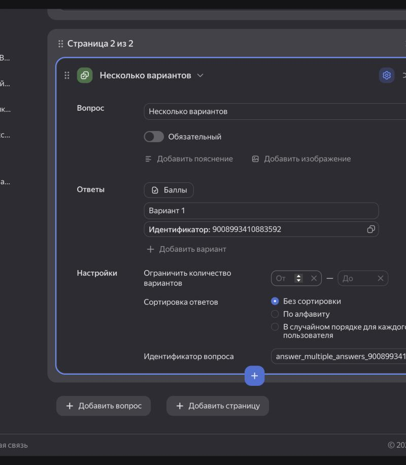
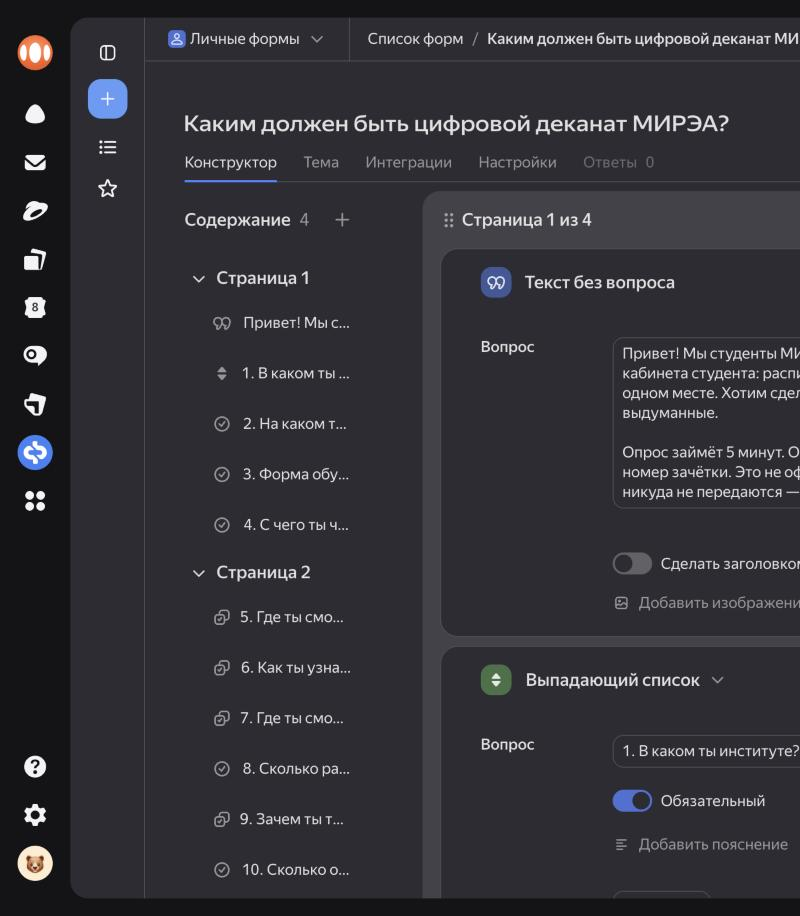
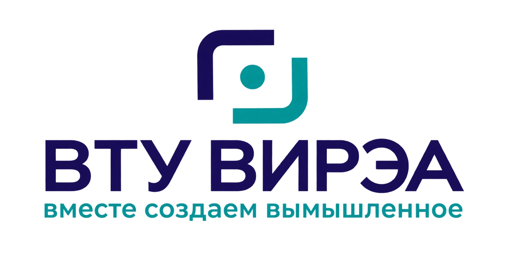
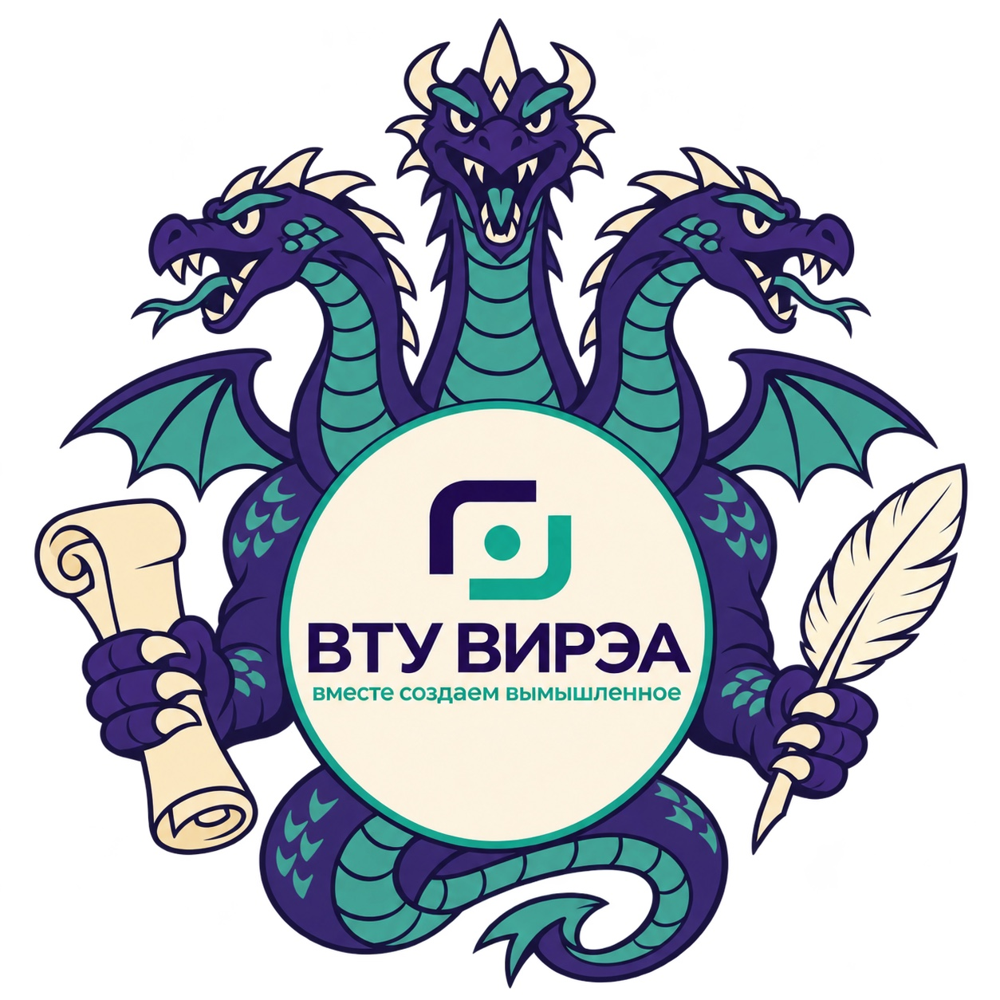
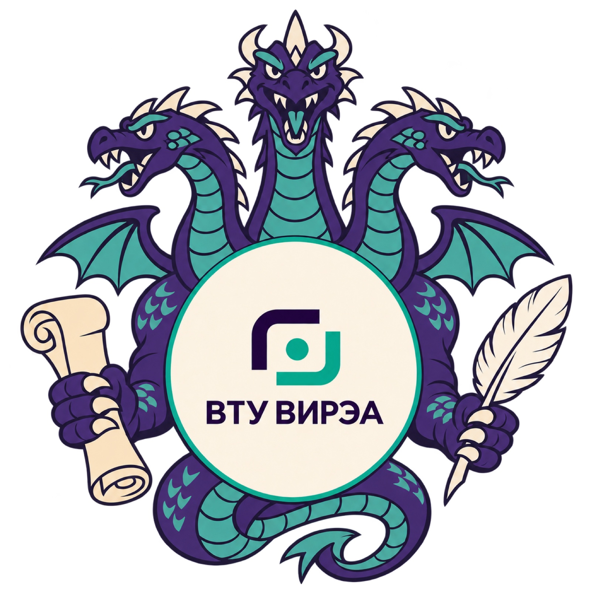

# Журнал работы с ИИ — цифровой деканат ВТУ ВИРЭА

Файл собран скриптом `scripts/build_ai_log.py`, руками не редактировать. Записи — в `entries/`.

## Сводка

| № | Дата | Инструмент | Что сделано |
| --- | --- | --- | --- |
| 1 | 2026-11-08 | Claude Code | Записи 1–11 за 8 ноября, перенесённые из журнала в Claude Docs |
| 2 | 2026-11-08 | Claude Code | Создан репозиторий и правила для агентов |
| 3 | 2026-11-08 | Codex (Алёна) | Проверка онбординга Codex Алёны |
| 4 | 2026-11-08 | Claude Code | Репозиторий подготовлен для агентов без контекста |
| 5 | 2026-11-08 | Claude Code | Закрыты пробелы, которые Codex Алёны нашёл при проверке онбординга |
| 6 | 2026-11-08 | ChatGPT | Обновили логотип ВТУ ВИРЭА |
| 7 | 2026-11-08 | ChatGPT | Нарисовали вариант логотипа ВТУ ВИРЭА со Змеем Горынычем |
| 8 | 2026-11-08 | ChatGPT | Убрали слоган и выровняли оба логотипа ВТУ ВИРЭА |
| 9 | 2026-11-09 | Claude Code | Промпт для Codex: как достать открытое расписание МИРЭА |
| 10 | 2026-11-09 | Claude Code | Сверка с GitHub и ревью логотипов |
| 11 | 2026-11-09 | Claude Code | Журналы в Claude Docs и в репозитории сведены |

## Ошибки ИИ

| Запись | Инструмент | Ошибка → как заметили → как исправили → правило |
| --- | --- | --- |
| 1 | Claude Code | Claude решил, что вуз — МГИМО, по названию проекта → Алёна поправила → план переписан → правило: вуз — РТУ МИРЭА, не додумывать факты о команде |
| 1 | Claude Code | При вводе текста в поле с плейсхолдером получилось «Введите текВ каком…» → заметил Claude на скриншоте → исправил через API → правило: проверять поле после ввода |
| 1 | Claude Code | Тип «несколько ответов» передан как checkbox, редактор его не принял → ошибка API → подсмотрел правильное значение checks в редакторе → правило: брать значения из реального запроса редактора |
| 1 | Claude Code | Все вопросы попали на одну страницу: пустые страницы форма удаляет → заметил Claude при проверке → создавал страницу и сразу заполнял → правило: проверять структуру после каждой страницы |
| 1 | Claude Code | Вопрос 14 не добавился из-за повторяющегося ключа (ошибка 400) → ответ API → добавлен с уникальным ключом → правило: ключи вопросов уникальные |
| 1 | Claude Code | Вступительный текст создан как поле ввода → заметил Claude в превью → пересоздан как staticText → правило: проверять тип блока в превью |
| 1 | Claude Code | Уведомления спроектированы через Telegram без проверки доступности → Алёна: без VPN не работает → заменено на push + MAX + e-mail → правило: каждый внешний сервис проверять на доступ из РФ без VPN |
| 2 | Claude Code | Экспорт документов Claude Docs отдаётся только внутрь чата, в файл напрямую не сохраняется → заметил Claude при сборке → PRD и итоги опроса переписаны в репозиторий сжато, без потери требований → правило: основная версия документов теперь в репозитории |
| 4 | Claude Code | В первой версии документов репозиторий назван `virea-dekanat`, а на GitHub создан `VIREA_Decanat` → заметил Claude при публикации → имя исправлено во всех инструкциях → правило: имена внешних ресурсов брать по факту после создания, а не из плана |
| 5 | Claude Code | В PRD Claude описал порядок блоков «Сегодня» по-разному в S1 и T1 → нашёл Codex Алёны при проверке онбординга → оба места приведены к «изменения над парой» → правило: после правки PRD сверять сценарии с таблицей требований |
| 5 | Claude Code | Противоречие S1/T1 Claude разрешил сам, поставив изменения над парой ради «главной идеи», не подумав о дне с множеством замен → Алёна при ревью → изменения перенесены под пару → правило: продуктовые решения с компромиссом для интерфейса не принимать самому, а предлагать варианты человеку |
| 5 | Claude Code | Критерии обязательных сценариев S1, S3, S4 требовали функций с приоритетом Should и Could → нашёл Codex Алёны → части критериев помечены приоритетами → правило: у каждого пункта критерия приоритет не выше, чем у его требования |
| 8 | ChatGPT | После первого прохода центр композиции с Горынычем был выше центра круга. При выравнивании надпись приблизилась к ободку. На финальном проходе уменьшил надпись и проверил поля по бокам. |

## Записи

## 1. Записи 1–11 за 8 ноября, перенесённые из журнала в Claude Docs

- **Дата и время:** 2026-11-08, весь день (перенесено 21:55 МСК)
- **Инструмент:** Claude Code (Claude Opus 5.5)
- **Кто ставил задачу:** Алёна
- **Этап плана:** 1 Исследование
- **Требования PRD:** —

### Задача
До создания репозитория журнал вёлся в документе Claude Docs «Журнал работы с ИИ». С этого момента единый журнал — в репозитории, чтобы его видели и дополняли оба Codex и ChatGPT. Здесь — краткое содержание первых 11 записей.

### Что сделал ИИ
| № | Что сделано | Результат |
| --- | --- | --- |
| 1 | План работы до 22 ноября | Документ «План работы» с этапами, ролями, рисками и чек-листом |
| 2 | Адаптация под РТУ МИРЭА | План и концепция переписаны под МИРЭА вместо МГИМО |
| 3 | Учёт команды из двух человек | Роли: Алёна — Claude Code, напарник — Codex; правила кросс-ревью |
| 4 | Анкета опроса | 20 вопросов в 4 блоках: расписание, новости и дедлайны, заявки, функции и каналы |
| 5 | Форма в Яндекс Формах | Claude собрал форму через браузер и внутренний API редактора; ограничение «один ответ с устройства» снято |
| 6 | Публикация формы | Форма опубликована, проверена на телефоне |
| 7 | Анализ 20 ответов | Скрипт `docs/research/analyze_survey.py`, отчёт, выводы о болях |
| 8 | Корректировка плана по опросу | Главная фишка — мгновенные уведомления об изменениях; экспорт в календарь убран |
| 9 | PRD | Персоны, сценарии S1–S9, требования с номерами, роли, NF1–NF8, тестовые аккаунты |
| 10 | Каналы уведомлений без Telegram | Web push (Must) + бот MAX + e-mail; правило проверять доступность сервисов из РФ |
| 11 | Вымышленное название вуза | 10 вариантов, выбрано ВТУ ВИРЭА; PRD и план обновлены, интервью убраны из плана |

### Что проверил и поправил человек
Алёна поправила вуз (МИРЭА, а не МГИМО), указала, что Telegram не работает без VPN, убрала интервью (их закрывает опрос) и выбрала название ВТУ ВИРЭА. Форму опроса Алёна проверила вживую перед публикацией.

### Ошибки ИИ
- Claude решил, что вуз — МГИМО, по названию проекта → Алёна поправила → план переписан → правило: вуз — РТУ МИРЭА, не додумывать факты о команде
- При вводе текста в поле с плейсхолдером получилось «Введите текВ каком…» → заметил Claude на скриншоте → исправил через API → правило: проверять поле после ввода
- Тип «несколько ответов» передан как checkbox, редактор его не принял → ошибка API → подсмотрел правильное значение checks в редакторе → правило: брать значения из реального запроса редактора
- Все вопросы попали на одну страницу: пустые страницы форма удаляет → заметил Claude при проверке → создавал страницу и сразу заполнял → правило: проверять структуру после каждой страницы
- Вопрос 14 не добавился из-за повторяющегося ключа (ошибка 400) → ответ API → добавлен с уникальным ключом → правило: ключи вопросов уникальные
- Вступительный текст создан как поле ввода → заметил Claude в превью → пересоздан как staticText → правило: проверять тип блока в превью
- Уведомления спроектированы через Telegram без проверки доступности → Алёна: без VPN не работает → заменено на push + MAX + e-mail → правило: каждый внешний сервис проверять на доступ из РФ без VPN

### Скриншоты

---

## 2. Создан репозиторий и правила для агентов

- **Дата и время:** 2026-11-08 21:55 МСК
- **Инструмент:** Claude Code (Claude Opus 5.5)
- **Кто ставил задачу:** Алёна
- **Этап плана:** 1 Исследование → подготовка к 3 Каркас
- **Требования PRD:** —

### Задача
> Создай репозиторий сейчас и дай инструкции по подключению. Подключать будем 2 кодекса — один мой, другой напарника; логотип и картинки — ChatGPT.

### Что сделал ИИ
- Собрал репозиторий `VIREA_Decanat`: README, `AGENTS.md` (единые правила для Codex ×2, Claude Code и ChatGPT), `CLAUDE.md` со ссылкой на `AGENTS.md`.
- Перенёс в репозиторий PRD, план, итоги опроса и скрипт анализа. PRD в репозитории теперь основная версия.
- Журнал ИИ перевёл на формат «одна запись — один файл» в `docs/ai-log/entries/`, чтобы два Codex не конфликтовали; добавил шаблон и скрипт сборки `scripts/build_ai_log.py`.
- Добавил `.env.example` без значений, `.gitignore` (секреты и сырые ответы опроса не попадают в git), шаблон PR, ревьюеров `.claude/agents/`.
- Написал инструкцию `docs/setup/connect-agents.md`: Codex у каждого из своего аккаунта, ChatGPT для картинок.

### Что проверил и поправил человек
Ожидает проверки Алёной.

### Ошибки ИИ
- Экспорт документов Claude Docs отдаётся только внутрь чата, в файл напрямую не сохраняется → заметил Claude при сборке → PRD и итоги опроса переписаны в репозиторий сжато, без потери требований → правило: основная версия документов теперь в репозитории

### Скриншоты
Не нужны: результат — файлы репозитория.

---

## 3. Проверка онбординга Codex Алёны

- **Дата и время:** 2026-11-08 22:50 МСК
- **Инструмент:** Codex (Алёна)
- **Кто ставил задачу:** Алёна
- **Этап плана:** 1 Исследование
- **Требования PRD:** —

### Задача

Проверить, можно ли подключиться к проекту без истории чата. Прочитать пять документов по порядку, пересказать идею и правила, выбрать первую задачу и зафиксировать пробелы.

> Ничего не меняй в документах и коде. Единственное исключение — добавь запись в журнал ИИ о своём подключении.

### Что сделал ИИ

- Прочитал в указанном порядке `AGENTS.md`, `docs/context.md`, `docs/status.md`, `docs/PRD.md` и `docs/hackathon-task.md` в `docs/agent-onboarding`. Три документа по онбордингу пока доступны только в этой ветке. В `main` отсутствуют `docs/context.md`, `docs/status.md` и `docs/hackathon-task.md`. [AGENTS.md:13-22](https://github.com/ghsteee/VIREA_Decanat/blob/9505ff8253e35384ee496a90477035d53ce27a55/AGENTS.md#L13-L22)
- Сформулировал идею прототипа: кабинет студента вымышленного ВТУ ВИРЭА первым сообщает о переносах пар и новых дедлайнах через web push и MAX с целевым временем доставки до минуты. Сверил ограничения по вымышленным данным, символике, серверной авторизации, паролям, секретам и доступности из РФ. [docs/PRD.md:3](https://github.com/ghsteee/VIREA_Decanat/blob/9505ff8253e35384ee496a90477035d53ce27a55/docs/PRD.md#L3) · [AGENTS.md:33-44](https://github.com/ghsteee/VIREA_Decanat/blob/9505ff8253e35384ee496a90477035d53ce27a55/AGENTS.md#L33-L44)
- Выбрал проверку подключения Codex Алёны. Алёна поручила её в текущем чате, а результат можно проверить по PR с этой записью. Следующие задачи исследования и дизайна уже распределены. [docs/status.md:27-43](https://github.com/ghsteee/VIREA_Decanat/blob/9505ff8253e35384ee496a90477035d53ce27a55/docs/status.md#L27-L43) · [docs/setup/connect-agents.md:23-27](https://github.com/ghsteee/VIREA_Decanat/blob/9505ff8253e35384ee496a90477035d53ce27a55/docs/setup/connect-agents.md#L23-L27)
- Нашёл расхождения в процессе. Правила называют `main` защищённой, статус говорит обратное. GitHub подтвердил `protected: false`. Инструкция называет напарника collaborator, а статус оставляет выдачу доступа открытой. [AGENTS.md:49](https://github.com/ghsteee/VIREA_Decanat/blob/9505ff8253e35384ee496a90477035d53ce27a55/AGENTS.md#L49) · [docs/status.md:11](https://github.com/ghsteee/VIREA_Decanat/blob/9505ff8253e35384ee496a90477035d53ce27a55/docs/status.md#L11) · [docs/status.md:29-30](https://github.com/ghsteee/VIREA_Decanat/blob/9505ff8253e35384ee496a90477035d53ce27a55/docs/status.md#L29-L30) · [docs/setup/connect-agents.md:3](https://github.com/ghsteee/VIREA_Decanat/blob/9505ff8253e35384ee496a90477035d53ce27a55/docs/setup/connect-agents.md#L3)
- Для проверочного PR требования PRD нет. Запрошенные точный заголовок и один файл журнала расходятся с общим требованием указать номер PRD и обновить статус. В инструкции подключения также остались прежние заголовок и имя записи. Выполнил явное поручение для этого PR. [AGENTS.md:24](https://github.com/ghsteee/VIREA_Decanat/blob/9505ff8253e35384ee496a90477035d53ce27a55/AGENTS.md#L24) · [AGENTS.md:49-50](https://github.com/ghsteee/VIREA_Decanat/blob/9505ff8253e35384ee496a90477035d53ce27a55/AGENTS.md#L49-L50) · [docs/status.md:5](https://github.com/ghsteee/VIREA_Decanat/blob/9505ff8253e35384ee496a90477035d53ce27a55/docs/status.md#L5) · [docs/setup/connect-agents.md:23-27](https://github.com/ghsteee/VIREA_Decanat/blob/9505ff8253e35384ee496a90477035d53ce27a55/docs/setup/connect-agents.md#L23-L27)
- Нужно уточнить критерии к 16 ноября. S1 требует видеть изменения над ближайшей парой, а T1 ставит пару первой. Этаж нужен в S1, но R4 с этажом имеет приоритет Should. Демо-кнопка нужна в S3, но E4 имеет приоритет Should. В S4 нужны PDF или слот выдачи, а способ получения A3 — Should, PDF с QR A5 — Could. [docs/PRD.md:24-31](https://github.com/ghsteee/VIREA_Decanat/blob/9505ff8253e35384ee496a90477035d53ce27a55/docs/PRD.md#L24-L31) · [docs/PRD.md:44-49](https://github.com/ghsteee/VIREA_Decanat/blob/9505ff8253e35384ee496a90477035d53ce27a55/docs/PRD.md#L44-L49) · [docs/PRD.md:62-66](https://github.com/ghsteee/VIREA_Decanat/blob/9505ff8253e35384ee496a90477035d53ce27a55/docs/PRD.md#L62-L66) · [docs/PRD.md:73](https://github.com/ghsteee/VIREA_Decanat/blob/9505ff8253e35384ee496a90477035d53ce27a55/docs/PRD.md#L73)
- Условие ссылается на «эту страницу» и Регламент без URL. Для сверки сдачи нужен адрес источника. Путь `public/brand/` пока отсутствует и понадобится при добавлении ассетов. [docs/hackathon-task.md:62-68](https://github.com/ghsteee/VIREA_Decanat/blob/9505ff8253e35384ee496a90477035d53ce27a55/docs/hackathon-task.md#L62-L68) · [docs/hackathon-task.md:85-87](https://github.com/ghsteee/VIREA_Decanat/blob/9505ff8253e35384ee496a90477035d53ce27a55/docs/hackathon-task.md#L85-L87) · [docs/brand/README.md:3](https://github.com/ghsteee/VIREA_Decanat/blob/9505ff8253e35384ee496a90477035d53ce27a55/docs/brand/README.md#L3)
- Для старта каркаса ещё нужны модель данных и дизайн-система. Оба файла пока описывают, что предстоит заполнить. Выбор шкалы оценок, источника документов для помощника, ИИ-провайдера и проверка MAX уже обозначены как открытые вопросы. [docs/status.md:9-10](https://github.com/ghsteee/VIREA_Decanat/blob/9505ff8253e35384ee496a90477035d53ce27a55/docs/status.md#L9-L10) · [docs/data-model.md:3-7](https://github.com/ghsteee/VIREA_Decanat/blob/9505ff8253e35384ee496a90477035d53ce27a55/docs/data-model.md#L3-L7) · [docs/design-system.md:3-5](https://github.com/ghsteee/VIREA_Decanat/blob/9505ff8253e35384ee496a90477035d53ce27a55/docs/design-system.md#L3-L5) · [docs/PRD.md:139-145](https://github.com/ghsteee/VIREA_Decanat/blob/9505ff8253e35384ee496a90477035d53ce27a55/docs/PRD.md#L139-L145)

### Что проверил и поправил человек

Запись ожидает ревью напарника.

### Ошибки ИИ

Не было.

### Скриншоты

Проверка касалась документации. Экраны приложения не проверялись.

---

## 4. Репозиторий подготовлен для агентов без контекста

- **Дата и время:** 2026-11-08 22:55 МСК
- **Инструмент:** Claude Code (Claude Opus 5.5)
- **Кто ставил задачу:** Алёна
- **Этап плана:** 1 Исследование → подготовка к 2 и 3
- **Требования PRD:** —

### Задача
> Добавь в репозиторий все необходимые файлы и инструкции, чтобы с проектом мог работать любой агент, изначально не имеющий никакого контекста, кроме этого репозитория.

Повод: Алёна подключила свой Codex. До этого часть знаний жила только в чате с Claude и в документах Claude Docs, которые Codex не видит.

### Что сделал ИИ
- `AGENTS.md`: раздел «Начни здесь» — порядок чтения, запрет додумывать факты, порядок важности документов при противоречиях, обязанность обновлять статус. Новые правила: лицензии (9), пароли тестовых аккаунтов не в репозиторий (10), язык и время.
- `docs/hackathon-task.md` — условие хакатона и критерии оценки целиком плюс таблица «требование → где у нас».
- `docs/context.md` — журнал решений с причинами (МИРЭА вместо МГИМО, ВТУ ВИРЭА, MAX вместо Telegram, стек, хостинг и др.).
- `docs/status.md` — текущий этап, сроки и свободные задачи с исполнителями и номерами требований.
- `docs/glossary.md`, `docs/prompts.md` (шаблоны задач для Codex, Claude Code, ChatGPT и «старт с нуля»), `docs/submission.md` (что сдаём, структура PDF по требованиям условия), `docs/licenses.md`.
- Исправлено имя репозитория в инструкциях (`VIREA_Decanat`), отмечено подключение Codex Алёны.
- Проверил скриптом, что все пути, упомянутые в документах, существуют.
- Изменения — через ветку `docs/agent-onboarding` и PR, без прямого push в `main`.

### Что проверил и поправил человек
Ожидает ревью PR Алёной. Проверка «агент с нуля»: дать своему Codex задачу из раздела «Если агент начинает с нуля» в `docs/prompts.md` и сравнить пересказ с реальностью.

### Ошибки ИИ
- В первой версии документов репозиторий назван `virea-dekanat`, а на GitHub создан `VIREA_Decanat` → заметил Claude при публикации → имя исправлено во всех инструкциях → правило: имена внешних ресурсов брать по факту после создания, а не из плана

### Скриншоты
Не нужны: результат — файлы репозитория.

---

## 5. Закрыты пробелы, которые Codex Алёны нашёл при проверке онбординга

- **Дата и время:** 2026-11-08 23:10 МСК
- **Инструмент:** Claude Code (Claude Opus 5.5)
- **Кто ставил задачу:** Алёна
- **Этап плана:** 1 Исследование → подготовка к 2 и 3
- **Требования PRD:** T1, S1, S3, S4

### Задача
Алёна дала своему Codex промпт «агент с нуля» (составил Claude) на ветке `docs/agent-onboarding`. Codex прочитал документы, пересказал проект и перечислил пробелы с файлами и строками (PR #2). Алёна передала ответ Claude — закрыть пробелы.

Так проверяется, что репозиторий понятен агенту без истории: один ИИ готовит документы, второй, без контекста, ищет в них дыры.

### Что сделал ИИ
- PRD: порядок блоков «Сегодня» приведён к одному виду в S1 и T1 (было противоречие). Сначала Claude поставил изменения над парой, после правки Алёны — под парой. В критериях S1, S3, S4 части, зависящие от требований Should и Could (этаж R4, демо-кнопка E4, слот выдачи A3, PDF с QR A5), помечены приоритетом — чтобы Must к 16 ноября не требовал Should-функций.
- `AGENTS.md`: прямой push в `main` запрещён, даже пока защита на GitHub не включена; для PR без требования — префикс `docs:`/`chore:`; проверочные PR не меняют статус.
- Инструкция подключения и `docs/prompts.md`: одна и та же проверочная задача, одно имя записи журнала и PR. Напарник помечен как ещё не добавленный.
- `docs/hackathon-task.md`: пояснено, что «эта страница» и «Регламент» — у капитана, агентам не нужны. `docs/brand/README.md`: `public/brand/` появится с каркасом.
- `docs/status.md`: проверка Codex Алёны отмечена. `docs/context.md`: решение о порядке блоков на «Сегодня».

### Что проверил и поправил человек
Алёна отклонила решение Claude про порядок блоков: изменения должны идти **под** расписанием — при многочисленных заменах студент не захочет листать полотно изменений, чтобы увидеть свою пару. Исправлено в PRD и `docs/context.md`; изменение самой ближайшей пары остаётся видно сразу через метку «было → стало» на её карточке.

### Ошибки ИИ
- В PRD Claude описал порядок блоков «Сегодня» по-разному в S1 и T1 → нашёл Codex Алёны при проверке онбординга → оба места приведены к «изменения над парой» → правило: после правки PRD сверять сценарии с таблицей требований
- Противоречие S1/T1 Claude разрешил сам, поставив изменения над парой ради «главной идеи», не подумав о дне с множеством замен → Алёна при ревью → изменения перенесены под пару → правило: продуктовые решения с компромиссом для интерфейса не принимать самому, а предлагать варианты человеку
- Критерии обязательных сценариев S1, S3, S4 требовали функций с приоритетом Should и Could → нашёл Codex Алёны → части критериев помечены приоритетами → правило: у каждого пункта критерия приоритет не выше, чем у его требования

### Скриншоты
Не нужны: результат — файлы репозитория.

---

## 6. Обновили логотип ВТУ ВИРЭА

- **Дата и время:** 2026-11-08 23:16 МСК
- **Инструмент:** ChatGPT (генерация изображения в Codex), Codex (Алёна) для добавления файлов в GitHub
- **Кто ставил задачу:** Алёна
- **Этап плана:** 2 Дизайн
- **Требования PRD:** X1

### Задача

Обновить название и подпись на логотипе. Добавить результат и запись с изображением в отдельную ветку.

> переделай логотип - исправь буквы на ВТУ ВИРЭА, а текст на "вместе создаем вымышленное"

### Что сделал ИИ

- Перерисовал знак из двух углов и точки и поставил надписи «ВТУ ВИРЭА» и «вместе создаем вымышленное».
- Сохранил [логотип с прозрачным фоном](../../brand/vtu-virea-logo.png) в PNG (1774 × 887). Для журнала подготовил JPEG шириной 1600 px и проверил обе надписи по изображению.
- Добавил промпт и описание варианта в [документацию бренда](../../brand/README.md).

### Что проверил и поправил человек

Алёна попросила добавить в репозиторий вариант из чата. Ревью файлов ещё впереди.

### Ошибки ИИ

Не было.

### Скриншоты

---

## 7. Нарисовали вариант логотипа ВТУ ВИРЭА со Змеем Горынычем

- **Дата и время:** 2026-11-08 23:24 МСК
- **Инструмент:** ChatGPT (генерация изображения в Codex), Codex (Алёна) для добавления файлов в GitHub
- **Кто ставил задачу:** Алёна
- **Этап плана:** 2 Дизайн
- **Требования PRD:** X1

### Задача

Сделать вариант логотипа с персонажем из фольклора и добавить его в ветку с предыдущим логотипом.

> вместо двуглавого орла отрисуй трехглавого змея-горыныча, по центру вместо овала круг и в нем новый логотип ВТУ ВИРЭА, в лапах остается свиток и перо

### Что сделал ИИ

- Нарисовал трёхглавого Змея Горыныча со свитком и пером. В круг на груди поместил знак ВТУ ВИРЭА с подписью «вместе создаем вымышленное».
- Сохранил [новый вариант](../../brand/vtu-virea-gorynych-logo.png) как PNG с прозрачным фоном, 1254 × 1254 px. Для журнала подготовил JPEG шириной 1254 px.
- Записал промпт и описание варианта в [документацию бренда](../../brand/README.md).

### Что проверил и поправил человек

Алёна попросила добавить показанный в чате вариант в ту же ветку. Ревью коммита ещё впереди.

### Ошибки ИИ

Не было.

### Скриншоты

---

## 8. Убрали слоган и выровняли оба логотипа ВТУ ВИРЭА

- **Дата и время:** 2026-11-08 23:45 МСК
- **Инструмент:** ChatGPT (генерация изображения в Codex), Codex (Алёна) для добавления файлов в GitHub
- **Кто ставил задачу:** Алёна
- **Этап плана:** 2 Дизайн
- **Требования PRD:** X1

### Задача

> переделай оба логотипа - убери слоган, выровняй логотип

### Что сделал ИИ

- Убрал слоган из обоих вариантов. В [основном логотипе](../../brand/vtu-virea-logo.png) выровнял знак и название «ВТУ ВИРЭА» по общей вертикальной оси.
- В [варианте со Змеем Горынычем](../../brand/vtu-virea-gorynych-logo.png) отцентрировал композицию в круге и уменьшил надпись, чтобы она не касалась ободка. В лапах остались свиток и перо.
- Проверил надписи и прозрачный фон обоих PNG. Добавил JPEG-превью шириной 1600 и 1254 px и обновил [описание вариантов](../../brand/README.md).

### Что проверил и поправил человек

Алёна задала правки к двум предыдущим версиям. Новые версии ожидают ревью.

### Ошибки ИИ

- После первого прохода центр композиции с Горынычем был выше центра круга. При выравнивании надпись приблизилась к ободку. На финальном проходе уменьшил надпись и проверил поля по бокам.

### Скриншоты

---

## 9. Промпт для Codex: как достать открытое расписание МИРЭА

- **Дата и время:** 2026-11-09 00:03 МСК
- **Инструмент:** Claude Code (Claude Opus 5.5) → задача для Codex (Алёна)
- **Кто ставил задачу:** Алёна
- **Этап плана:** 2a Модель данных и проверки
- **Требования PRD:** R5, NF6

### Задача
> Напиши промт для кодекса, чтобы он выполнил эту задачу - Проверить, как достать открытое расписание МИРЭА

### Что сделал ИИ
- Написал задачу для Codex Алёны в формате `docs/prompts.md`: найти официальные открытые источники расписания, проверить доступ без авторизации и без VPN, разобрать формат и сопоставить поля с карточкой пары (R2), понять чётные недели и переносы (R3), проверить на трёх группах разных институтов.
- Результат задачи: отчёт `docs/research/schedule-source.md` и скрипт-проба `scripts/schedule/probe.mjs` (Node 20 без зависимостей).
- Встроил ограничения из `AGENTS.md`: скрипт сразу заменяет ФИО преподавателей на вымышленные детерминированно, сырые ответы источника не коммитятся, никаких логинов, обхода защиты и массовых запросов.
- Варианты источников помечены как предположения для проверки — не факты. Выбор источника Codex не принимает сам, а выносит вопрос человеку.
- Предупредил Алёну: в `docs/status.md` задача записана на напарника (парсер в его зоне), промпт передаёт её Codex Алёны.

### Что проверил и поправил человек
Алёна передала промпт своему Codex. Результат (PR) ещё не получен.

### Ошибки ИИ
Не было

### Скриншоты
Не нужны: результат — текст задачи.

---

## 10. Сверка с GitHub и ревью логотипов

- **Дата и время:** 2026-11-09 00:04 МСК
- **Инструмент:** Claude Code (Claude Opus 5.5)
- **Кто ставил задачу:** Алёна
- **Этап плана:** 2 Дизайн
- **Требования PRD:** X1

### Задача
> Проверь изменения на гитхабе и обнови локальные файлы в соответствии с ним

### Что сделал ИИ
- Обновил локальную копию до `main`: после PR #1 слит PR #3 Codex Алёны — два логотипа в `docs/brand/`, три записи журнала от ChatGPT, 4 скриншота.
- Посмотрел оба логотипа: надпись везде «ВТУ ВИРЭА», прозрачный фон, реальных людей нет.
- Замечания Алёне:
  - вариант со Змеем Горынычем — переделка герба (орла заменили драконом). Условие допускает перекличку с оригиналом, но не копию; выбор главного варианта — за Алёной, записать в `docs/context.md`;
  - `vtu-virea-gorynych-logo.png` весит 1,5 МБ — для сайта сжать и сделать маленькие версии вместе с каркасом;
  - в `docs/status.md` задача «Логотип ВТУ ВИРЭА и иконки PWA» не отмечена: логотип готов, иконок нет;
  - `LOG.md` не пересобран — это нормально, собираем перед сдачей.

### Что проверил и поправил человек
Выбор главного логотипа ещё не сделан.

### Ошибки ИИ
Не было

### Скриншоты
Логотипы — в записях ChatGPT от 8 ноября (`2026-11-08_10_…`, `2026-11-08_11_…`).

---

## 11. Журналы в Claude Docs и в репозитории сведены

- **Дата и время:** 2026-11-09 01:11 МСК
- **Инструмент:** Claude Code (Claude Opus 5.5)
- **Кто ставил задачу:** Алёна
- **Этап плана:** 7 Сдача (подготовка отчёта)
- **Требования PRD:** —

### Задача
> обнови локальные данные в журнале работы с ии данными с гитхаба и из чата

Затем: «добавь» — перенести в репозиторий записи, которых там не было.

### Что сделал ИИ
- В документ «Журнал работы с ИИ» в Claude Docs перенёс записи 12–21 из репозитория и чата: репозиторий, онбординг агентов, проверка Codex, исправления и решение Алёны по «Сегодня», три логотипа ChatGPT, задача про расписание, сверка с GitHub.
- Дополнил таблицы «Ошибки ИИ» (8–13) и «Ручные шаги» (создание репозитория, подключение GitHub и Codex, решение по порядку блоков, выбор логотипов и слияние PR), вставил скриншоты итоговых логотипов.
- В разделе «Как ведём журнал» указал, что основной журнал — в репозитории, документ — сводная копия для чтения.
- Добавил в репозиторий три записи, которых там не было (эта и две предыдущие от 9 ноября), через PR.

### Что проверил и поправил человек
Ожидает ревью Алёной.

### Ошибки ИИ
Не было

### Скриншоты
Не нужны.
