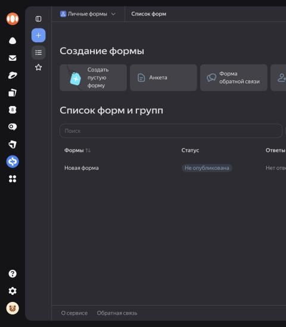
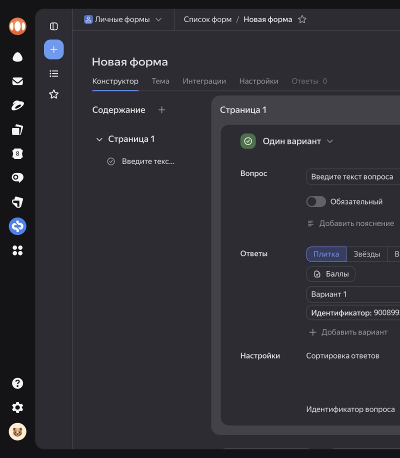
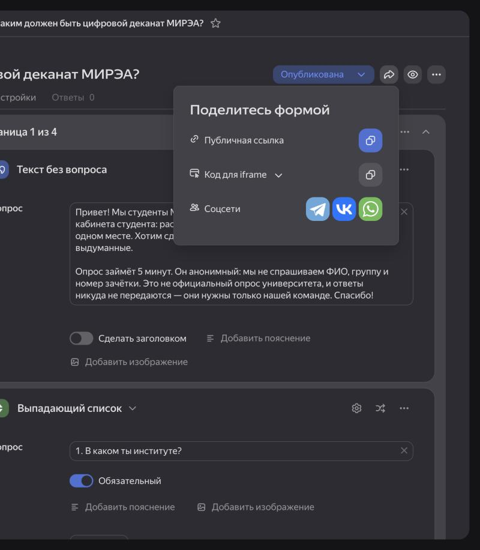

# Журнал работы с ИИ — цифровой деканат ВТУ ВИРЭА

Файл собран скриптом `scripts/build_ai_log.py`, руками не редактировать. Записи — в `entries/`.

## Сводка

| № | Дата | Инструмент | Что сделано |
| --- | --- | --- | --- |
| 1 | 2026-11-08 | Claude Code | Записи 1–11 за 8 ноября, перенесённые из журнала в Claude Docs |
| 2 | 2026-11-08 | Claude Code | Создан репозиторий и правила для агентов |
| 3 | 2026-11-08 | Claude Code | Репозиторий подготовлен для агентов без контекста |
| 4 | 2026-11-08 | Claude Code | Закрыты пробелы, которые Codex Алёны нашёл при проверке онбординга |

## Ошибки ИИ

| Запись | Инструмент | Ошибка → как заметили → как исправили → правило |
| --- | --- | --- |
| 1 | Claude Code | Claude решил, что вуз — МГИМО, по названию проекта → Алёна поправила → план переписан → правило: вуз — РТУ МИРЭА, не додумывать факты о команде |
| 1 | Claude Code | При вводе текста в поле с плейсхолдером получилось «Введите текВ каком…» → заметил Claude на скриншоте → исправил через API → правило: проверять поле после ввода |
| 1 | Claude Code | Тип «несколько ответов» передан как checkbox, редактор его не принял → ошибка API → подсмотрел правильное значение checks в редакторе → правило: брать значения из реального запроса редактора |
| 1 | Claude Code | Все вопросы попали на одну страницу: пустые страницы форма удаляет → заметил Claude при проверке → создавал страницу и сразу заполнял → правило: проверять структуру после каждой страницы |
| 1 | Claude Code | Вопрос 14 не добавился из-за повторяющегося ключа (ошибка 400) → ответ API → добавлен с уникальным ключом → правило: ключи вопросов уникальные |
| 1 | Claude Code | Вступительный текст создан как поле ввода → заметил Claude в превью → пересоздан как staticText → правило: проверять тип блока в превью |
| 1 | Claude Code | Уведомления спроектированы через Telegram без проверки доступности → Алёна: без VPN не работает → заменено на push + MAX + e-mail → правило: каждый внешний сервис проверять на доступ из РФ без VPN |
| 2 | Claude Code | Экспорт документов Claude Docs отдаётся только внутрь чата, в файл напрямую не сохраняется → заметил Claude при сборке → PRD и итоги опроса переписаны в репозиторий сжато, без потери требований → правило: основная версия документов теперь в репозитории |
| 3 | Claude Code | В первой версии документов репозиторий назван `virea-dekanat`, а на GitHub создан `VIREA_Decanat` → заметил Claude при публикации → имя исправлено во всех инструкциях → правило: имена внешних ресурсов брать по факту после создания, а не из плана |
| 4 | Claude Code | В PRD Claude описал порядок блоков «Сегодня» по-разному в S1 и T1 → нашёл Codex Алёны при проверке онбординга → оба места приведены к «изменения над парой» → правило: после правки PRD сверять сценарии с таблицей требований |
| 4 | Claude Code | Противоречие S1/T1 Claude разрешил сам, поставив изменения над парой ради «главной идеи», не подумав о дне с множеством замен → Алёна при ревью → изменения перенесены под пару → правило: продуктовые решения с компромиссом для интерфейса не принимать самому, а предлагать варианты человеку |
| 4 | Claude Code | Критерии обязательных сценариев S1, S3, S4 требовали функций с приоритетом Should и Could → нашёл Codex Алёны → части критериев помечены приоритетами → правило: у каждого пункта критерия приоритет не выше, чем у его требования |

## Записи

## 1. Записи 1–11 за 8 ноября, перенесённые из журнала в Claude Docs

- **Дата и время:** 2026-11-08, весь день (перенесено 21:55 МСК)
- **Инструмент:** Claude Code (Claude Opus 5.5)
- **Кто ставил задачу:** Алёна
- **Этап плана:** 1 Исследование
- **Требования PRD:** —

### Задача
До создания репозитория журнал вёлся в документе Claude Docs «Журнал работы с ИИ». С этого момента единый журнал — в репозитории, чтобы его видели и дополняли оба Codex и ChatGPT. Здесь — краткое содержание первых 11 записей.

### Что сделал ИИ
| № | Что сделано | Результат |
| --- | --- | --- |
| 1 | План работы до 22 ноября | Документ «План работы» с этапами, ролями, рисками и чек-листом |
| 2 | Адаптация под РТУ МИРЭА | План и концепция переписаны под МИРЭА вместо МГИМО |
| 3 | Учёт команды из двух человек | Роли: Алёна — Claude Code, напарник — Codex; правила кросс-ревью |
| 4 | Анкета опроса | 20 вопросов в 4 блоках: расписание, новости и дедлайны, заявки, функции и каналы |
| 5 | Форма в Яндекс Формах | Claude собрал форму через браузер и внутренний API редактора; ограничение «один ответ с устройства» снято |
| 6 | Публикация формы | Форма опубликована, проверена на телефоне |
| 7 | Анализ 20 ответов | Скрипт `docs/research/analyze_survey.py`, отчёт, выводы о болях |
| 8 | Корректировка плана по опросу | Главная фишка — мгновенные уведомления об изменениях; экспорт в календарь убран |
| 9 | PRD | Персоны, сценарии S1–S9, требования с номерами, роли, NF1–NF8, тестовые аккаунты |
| 10 | Каналы уведомлений без Telegram | Web push (Must) + бот MAX + e-mail; правило проверять доступность сервисов из РФ |
| 11 | Вымышленное название вуза | 10 вариантов, выбрано ВТУ ВИРЭА; PRD и план обновлены, интервью убраны из плана |

### Что проверил и поправил человек
Алёна поправила вуз (МИРЭА, а не МГИМО), указала, что Telegram не работает без VPN, убрала интервью (их закрывает опрос) и выбрала название ВТУ ВИРЭА. Форму опроса Алёна проверила вживую перед публикацией.

### Ошибки ИИ
- Claude решил, что вуз — МГИМО, по названию проекта → Алёна поправила → план переписан → правило: вуз — РТУ МИРЭА, не додумывать факты о команде
- При вводе текста в поле с плейсхолдером получилось «Введите текВ каком…» → заметил Claude на скриншоте → исправил через API → правило: проверять поле после ввода
- Тип «несколько ответов» передан как checkbox, редактор его не принял → ошибка API → подсмотрел правильное значение checks в редакторе → правило: брать значения из реального запроса редактора
- Все вопросы попали на одну страницу: пустые страницы форма удаляет → заметил Claude при проверке → создавал страницу и сразу заполнял → правило: проверять структуру после каждой страницы
- Вопрос 14 не добавился из-за повторяющегося ключа (ошибка 400) → ответ API → добавлен с уникальным ключом → правило: ключи вопросов уникальные
- Вступительный текст создан как поле ввода → заметил Claude в превью → пересоздан как staticText → правило: проверять тип блока в превью
- Уведомления спроектированы через Telegram без проверки доступности → Алёна: без VPN не работает → заменено на push + MAX + e-mail → правило: каждый внешний сервис проверять на доступ из РФ без VPN

### Скриншоты

---

## 2. Создан репозиторий и правила для агентов

- **Дата и время:** 2026-11-08 21:55 МСК
- **Инструмент:** Claude Code (Claude Opus 5.5)
- **Кто ставил задачу:** Алёна
- **Этап плана:** 1 Исследование → подготовка к 3 Каркас
- **Требования PRD:** —

### Задача
> Создай репозиторий сейчас и дай инструкции по подключению. Подключать будем 2 кодекса — один мой, другой напарника; логотип и картинки — ChatGPT.

### Что сделал ИИ
- Собрал репозиторий `VIREA_Decanat`: README, `AGENTS.md` (единые правила для Codex ×2, Claude Code и ChatGPT), `CLAUDE.md` со ссылкой на `AGENTS.md`.
- Перенёс в репозиторий PRD, план, итоги опроса и скрипт анализа. PRD в репозитории теперь основная версия.
- Журнал ИИ перевёл на формат «одна запись — один файл» в `docs/ai-log/entries/`, чтобы два Codex не конфликтовали; добавил шаблон и скрипт сборки `scripts/build_ai_log.py`.
- Добавил `.env.example` без значений, `.gitignore` (секреты и сырые ответы опроса не попадают в git), шаблон PR, ревьюеров `.claude/agents/`.
- Написал инструкцию `docs/setup/connect-agents.md`: Codex у каждого из своего аккаунта, ChatGPT для картинок.

### Что проверил и поправил человек
Ожидает проверки Алёной.

### Ошибки ИИ
- Экспорт документов Claude Docs отдаётся только внутрь чата, в файл напрямую не сохраняется → заметил Claude при сборке → PRD и итоги опроса переписаны в репозиторий сжато, без потери требований → правило: основная версия документов теперь в репозитории

### Скриншоты
Не нужны: результат — файлы репозитория.

---

## 3. Репозиторий подготовлен для агентов без контекста

- **Дата и время:** 2026-11-08 22:55 МСК
- **Инструмент:** Claude Code (Claude Opus 5.5)
- **Кто ставил задачу:** Алёна
- **Этап плана:** 1 Исследование → подготовка к 2 и 3
- **Требования PRD:** —

### Задача
> Добавь в репозиторий все необходимые файлы и инструкции, чтобы с проектом мог работать любой агент, изначально не имеющий никакого контекста, кроме этого репозитория.

Повод: Алёна подключила свой Codex. До этого часть знаний жила только в чате с Claude и в документах Claude Docs, которые Codex не видит.

### Что сделал ИИ
- `AGENTS.md`: раздел «Начни здесь» — порядок чтения, запрет додумывать факты, порядок важности документов при противоречиях, обязанность обновлять статус. Новые правила: лицензии (9), пароли тестовых аккаунтов не в репозиторий (10), язык и время.
- `docs/hackathon-task.md` — условие хакатона и критерии оценки целиком плюс таблица «требование → где у нас».
- `docs/context.md` — журнал решений с причинами (МИРЭА вместо МГИМО, ВТУ ВИРЭА, MAX вместо Telegram, стек, хостинг и др.).
- `docs/status.md` — текущий этап, сроки и свободные задачи с исполнителями и номерами требований.
- `docs/glossary.md`, `docs/prompts.md` (шаблоны задач для Codex, Claude Code, ChatGPT и «старт с нуля»), `docs/submission.md` (что сдаём, структура PDF по требованиям условия), `docs/licenses.md`.
- Исправлено имя репозитория в инструкциях (`VIREA_Decanat`), отмечено подключение Codex Алёны.
- Проверил скриптом, что все пути, упомянутые в документах, существуют.
- Изменения — через ветку `docs/agent-onboarding` и PR, без прямого push в `main`.

### Что проверил и поправил человек
Ожидает ревью PR Алёной. Проверка «агент с нуля»: дать своему Codex задачу из раздела «Если агент начинает с нуля» в `docs/prompts.md` и сравнить пересказ с реальностью.

### Ошибки ИИ
- В первой версии документов репозиторий назван `virea-dekanat`, а на GitHub создан `VIREA_Decanat` → заметил Claude при публикации → имя исправлено во всех инструкциях → правило: имена внешних ресурсов брать по факту после создания, а не из плана

### Скриншоты
Не нужны: результат — файлы репозитория.

---

## 4. Закрыты пробелы, которые Codex Алёны нашёл при проверке онбординга

- **Дата и время:** 2026-11-08 23:10 МСК
- **Инструмент:** Claude Code (Claude Opus 5.5)
- **Кто ставил задачу:** Алёна
- **Этап плана:** 1 Исследование → подготовка к 2 и 3
- **Требования PRD:** T1, S1, S3, S4

### Задача
Алёна дала своему Codex промпт «агент с нуля» (составил Claude) на ветке `docs/agent-onboarding`. Codex прочитал документы, пересказал проект и перечислил пробелы с файлами и строками (PR #2). Алёна передала ответ Claude — закрыть пробелы.

Так проверяется, что репозиторий понятен агенту без истории: один ИИ готовит документы, второй, без контекста, ищет в них дыры.

### Что сделал ИИ
- PRD: порядок блоков «Сегодня» приведён к одному виду в S1 и T1 (было противоречие). Сначала Claude поставил изменения над парой, после правки Алёны — под парой. В критериях S1, S3, S4 части, зависящие от требований Should и Could (этаж R4, демо-кнопка E4, слот выдачи A3, PDF с QR A5), помечены приоритетом — чтобы Must к 16 ноября не требовал Should-функций.
- `AGENTS.md`: прямой push в `main` запрещён, даже пока защита на GitHub не включена; для PR без требования — префикс `docs:`/`chore:`; проверочные PR не меняют статус.
- Инструкция подключения и `docs/prompts.md`: одна и та же проверочная задача, одно имя записи журнала и PR. Напарник помечен как ещё не добавленный.
- `docs/hackathon-task.md`: пояснено, что «эта страница» и «Регламент» — у капитана, агентам не нужны. `docs/brand/README.md`: `public/brand/` появится с каркасом.
- `docs/status.md`: проверка Codex Алёны отмечена. `docs/context.md`: решение о порядке блоков на «Сегодня».

### Что проверил и поправил человек
Алёна отклонила решение Claude про порядок блоков: изменения должны идти **под** расписанием — при многочисленных заменах студент не захочет листать полотно изменений, чтобы увидеть свою пару. Исправлено в PRD и `docs/context.md`; изменение самой ближайшей пары остаётся видно сразу через метку «было → стало» на её карточке.

### Ошибки ИИ
- В PRD Claude описал порядок блоков «Сегодня» по-разному в S1 и T1 → нашёл Codex Алёны при проверке онбординга → оба места приведены к «изменения над парой» → правило: после правки PRD сверять сценарии с таблицей требований
- Противоречие S1/T1 Claude разрешил сам, поставив изменения над парой ради «главной идеи», не подумав о дне с множеством замен → Алёна при ревью → изменения перенесены под пару → правило: продуктовые решения с компромиссом для интерфейса не принимать самому, а предлагать варианты человеку
- Критерии обязательных сценариев S1, S3, S4 требовали функций с приоритетом Should и Could → нашёл Codex Алёны → части критериев помечены приоритетами → правило: у каждого пункта критерия приоритет не выше, чем у его требования

### Скриншоты
Не нужны: результат — файлы репозитория.
