# Журнал работы с ИИ — цифровой деканат ВТУ ВИРЭА

Файл собран скриптом `scripts/build_ai_log.py`, руками не редактировать. Записи — в `entries/`.

## Сводка

| № | Дата | Инструмент | Что сделано |
| --- | --- | --- | --- |
| 1 | 2026-11-08 | Claude Code | Записи 1–11 за 8 ноября, перенесённые из журнала в Claude Docs |
| 2 | 2026-11-08 | Claude Code | Создан репозиторий и правила для агентов |
| 3 | 2026-11-08 | Codex (Алёна) | Проверка онбординга Codex Алёны |
| 4 | 2026-11-08 | Claude Code | Репозиторий подготовлен для агентов без контекста |
| 5 | 2026-11-08 | Claude Code | Закрыты пробелы, которые Codex Алёны нашёл при проверке онбординга |
| 6 | 2026-11-08 | ChatGPT | Обновили логотип ВТУ ВИРЭА |
| 7 | 2026-11-08 | ChatGPT | Нарисовали вариант логотипа ВТУ ВИРЭА со Змеем Горынычем |
| 8 | 2026-11-08 | ChatGPT | Убрали слоган и выровняли оба логотипа ВТУ ВИРЭА |
| 9 | 2026-11-09 | Claude Code | Промпт для Codex: как достать открытое расписание МИРЭА |
| 10 | 2026-11-09 | Claude Code | Сверка с GitHub и ревью логотипов |
| 11 | 2026-11-09 | Codex (Алёна) | Проверили источник открытого расписания РТУ МИРЭА |
| 12 | 2026-11-09 | Claude Code | Журналы в Claude Docs и в репозитории сведены |
| 13 | 2026-11-09 | Codex (напарник) | Проверка подключения Codex напарника |
| 14 | 2026-11-09 | Codex (напарник) | Логическая модель данных деканата |
| 15 | 2026-11-09 | Codex (напарник) | Проверка доступности ботов MAX и ВКонтакте |
| 16 | 2026-11-09 | Codex (напарник) | Переход на web push и e-mail |
| 17 | 2026-11-10 | Claude Code | Ревью PR #6, #7 и #8 напарника по чек-листу AGENTS.md |
| 18 | 2026-11-10 | Claude Code | Опрос отмечен итоговым, статус защиты main зафиксирован |
| 19 | 2026-11-10 | Claude Code | Слияние PR #6, #8, #7 и обновление PR #9 |
| 20 | 2026-11-11 | Claude Code | Устранены замечания из ревью PR #7 и #8, закрыты организационные хвосты |
| 21 | 2026-11-11 | Claude Code | Дизайн-система v1: палитра, шрифт, компоненты и превью «Сегодня» |
| 22 | 2026-11-11 | Claude Code | Подбор шрифтов: Days One для заголовков и Onest для текста |
| 23 | 2026-11-11 | Claude Code | Палитра «Табло» из словаря Санзо Вады: молочная основа и пастельные плашки |
| 24 | 2026-11-11 | Claude Code | Название «Деканыч» и логотип «Одна пара»: от 40 концепций до файлов |
| 25 | 2026-11-11 | Claude Code | Макеты ключевых экранов «Деканыча» на 360 px и десктопе |
| 26 | 2026-11-11 | Claude Code | Дизайн-система 2.0: стиль вокзального табло, шрифт заголовков, маршрут заявки |
| 27 | 2026-11-11 | Claude Code | Дорисованы недостающие экраны в стиле табло |
| 28 | 2026-11-11 | Claude Code | Последние экраны и песочный вариант табло для светлой темы |
| 29 | 2026-11-11 | Claude Code | Песочное табло принято, главные кнопки в светлой теме — розовые |
| 30 | 2026-11-11 | Claude Code | Розовый вариант логотипа для светлой темы |
| 31 | 2026-11-11 | Claude Code | Розовый знак для светлой темы: рамка, иконки, шапки |
| 32 | 2026-11-11 | Claude Code | Сравнение GigaChat и YandexGPT по лимитам и цене, предложение по документам помощника |
| 33 | 2026-11-11 | Claude Code | Демо-положение ВТУ ВИРЭА и решения по ИИ-провайдеру |
| 34 | 2026-11-11 | Claude Code | Подключение GigaChat: ключ сохранён, проверка из облака упёрлась в сертификат |
| 35 | 2026-11-11 | Claude Code | Промпты ChatGPT для иллюстраций пустых состояний |
| 36 | 2026-11-11 | Claude Code | Промпты пустых состояний: светлая и тёмная версии |
| 37 | 2026-11-11 | Claude Code | Разбивка этапов 3 и 4 на задачи, промпт для аватаров |
| 38 | 2026-11-11 | Claude Code | Каркас приложения на Next.js (задача 3.1) |
| 39 | 2026-11-11 | Claude Code | Схема БД в Prisma и первая миграция (задача 3.3) |
| 40 | 2026-11-11 | Claude Code | Вход по логину и паролю, сессии и роли (задача 3.4) |
| 41 | 2026-11-11 | Claude Code | Демо-данные: 4 тестовых аккаунта, расписание, изменения, оценки, заявки (задача 3.5) |
| 42 | 2026-11-11 | Claude Code | Docker, Compose и Caddy для деплоя (задача 3.2, без VPS) |
| 43 | 2026-11-11 | Claude Code | Скрипт первой настройки VPS |
| 44 | 2026-11-12 | Claude Code | Первый деплой на Yandex Cloud |
| 45 | 2026-11-12 | Claude Code | Сертификат Минцифры — только для клиента GigaChat |
| 46 | 2026-11-12 | Claude Code | Токены, компоненты табло, навигация; экраны «Сегодня» и «Расписание» |
| 47 | 2026-11-12 | Claude Code | Перенос пары сотрудником, дедлайны и объявления, лента уведомлений (S2, S3) |
| 48 | 2026-11-12 | Claude Code | Заявки студента и очередь дирекции (S4, S9) |
| 49 | 2026-11-12 | Claude Code | «Учёба» по демо-положению и профиль с темой (S5) |
| 50 | 2026-11-12 | Claude Code | Web push: подписка, доставка с повторами, установка на экран «Домой» (N3) |
| 51 | 2026-11-12 | Claude Code | Сайт открылся на https://dekanych.ru |
| 52 | 2026-11-12 | Claude Code | Сайт на телефоне; исправлен вход в тёмной теме |
| 53 | 2026-11-12 | Claude Code | Напоминания о дедлайнах за 3 дня и за 1 день (D2) |
| 54 | 2026-11-12 | Claude Code | Кнопки входа для жюри без пароля |
| 55 | 2026-11-12 | Claude Code | Цвета знака и кнопок поменяли местами: светлая — синие, тёмная — розовые |
| 56 | 2026-11-14 | Codex (напарник) | Подтверждение почты и отправка срочных писем |
| 57 | 2026-11-14 | Codex (напарник) | Проверки сценариев жюри и исправления демо |
| 58 | 2026-11-14 | ChatGPT | Иллюстрация для дня без занятий |
| 59 | 2026-11-14 | Codex (напарник) | Черновик отчёта о создании «Деканыча» |
| 60 | 2026-11-19 | Codex (Алёна) | Ревью и слияние почты и проверок для жюри |
| 61 | 2026-11-20 | Codex (Алёна) | Защита отправки push и отображение переноса |
| 62 | 2026-11-20 | ChatGPT | Четыре иллюстрации пустых состояний подключены к кабинету |
| 63 | 2026-11-20 | Codex (Алёна) | Подготовка сдачи и безопасного обновления стенда |
| 64 | 2026-11-20 | Codex (Алёна) | Кабинет старосты для своей группы |
| 65 | 2026-11-20 | Codex (Алёна) | Предметные аватары для четырёх демо-аккаунтов |
| 66 | 2026-11-20 | Codex (Алёна) | Ближайший срок и условия допуска в разделе «Учёба» |
| 67 | 2026-11-20 | Codex (Алёна) | Мгновенное напоминание для демонстрации дедлайна |
| 68 | 2026-11-20 | Codex (Алёна) | Свободное время выдачи справки без пересечения с парами |
| 69 | 2026-11-20 | Codex (Алёна) | Обновлены отчёт и порядок финальной проверки |
| 70 | 2026-11-20 | Codex (Алёна) | Записано мобильное демо для сдачи |
| 71 | 2026-11-20 | Codex (Алёна) | Подготовлено скачивание пары в календарь |
| 72 | 2026-11-20 | Codex (Алёна) | Проверен мобильный кабинет и добавлен свайп в расписании |
| 73 | 2026-11-20 | Codex (Алёна) | Проверена локальная почта и доработан переход из push |
| 74 | 2026-11-20 | Codex (Алёна) | Уточнена подробная карточка пары на телефоне |
| 75 | 2026-11-20 | Codex (Алёна) | Проверены предупреждения зависимостей сборки |
| 76 | 2026-11-20 | Codex (Алёна) | Проверена остановка пробы при изменении календаря |
| 77 | 2026-11-20 | Codex (Алёна) | Выполнена локальная репетиция деплоя и возврата версии |
| 78 | 2026-11-20 | Codex (Алёна) | Кабинет адаптирован для телефона, планшета и ноутбука |
| 79 | 2026-11-20 | Codex (Алёна) | Расписание и кабинет после повторного аудита интерфейса |
| 80 | 2026-11-20 | Codex (Алёна) | Панели входа выровнены по высоте |
| 81 | 2026-11-20 | Codex (Алёна) | Выбор дня расположен над расписанием |
| 82 | 2026-11-21 | Codex (Алёна) | Пиксельные глаза Деканыча на фоне входа |
| 83 | 2026-11-21 | Codex (Алёна) | Возврат статичного фона входа |

## Ошибки ИИ

| Запись | Инструмент | Ошибка → как заметили → как исправили → правило |
| --- | --- | --- |
| 1 | Claude Code | Claude решил, что вуз — МГИМО, по названию проекта → Алёна поправила → план переписан → правило: вуз — РТУ МИРЭА, не додумывать факты о команде |
| 1 | Claude Code | При вводе текста в поле с плейсхолдером получилось «Введите текВ каком…» → заметил Claude на скриншоте → исправил через API → правило: проверять поле после ввода |
| 1 | Claude Code | Тип «несколько ответов» передан как checkbox, редактор его не принял → ошибка API → подсмотрел правильное значение checks в редакторе → правило: брать значения из реального запроса редактора |
| 1 | Claude Code | Все вопросы попали на одну страницу: пустые страницы форма удаляет → заметил Claude при проверке → создавал страницу и сразу заполнял → правило: проверять структуру после каждой страницы |
| 1 | Claude Code | Вопрос 14 не добавился из-за повторяющегося ключа (ошибка 400) → ответ API → добавлен с уникальным ключом → правило: ключи вопросов уникальные |
| 1 | Claude Code | Вступительный текст создан как поле ввода → заметил Claude в превью → пересоздан как staticText → правило: проверять тип блока в превью |
| 1 | Claude Code | Уведомления спроектированы через Telegram без проверки доступности → Алёна: без VPN не работает → заменено на push + MAX + e-mail → правило: каждый внешний сервис проверять на доступ из РФ без VPN |
| 2 | Claude Code | Экспорт документов Claude Docs отдаётся только внутрь чата, в файл напрямую не сохраняется → заметил Claude при сборке → PRD и итоги опроса переписаны в репозиторий сжато, без потери требований → правило: основная версия документов теперь в репозитории |
| 4 | Claude Code | В первой версии документов репозиторий назван `virea-dekanat`, а на GitHub создан `VIREA_Decanat` → заметил Claude при публикации → имя исправлено во всех инструкциях → правило: имена внешних ресурсов брать по факту после создания, а не из плана |
| 5 | Claude Code | В PRD Claude описал порядок блоков «Сегодня» по-разному в S1 и T1 → нашёл Codex Алёны при проверке онбординга → оба места приведены к «изменения над парой» → правило: после правки PRD сверять сценарии с таблицей требований |
| 5 | Claude Code | Противоречие S1/T1 Claude разрешил сам, поставив изменения над парой ради «главной идеи», не подумав о дне с множеством замен → Алёна при ревью → изменения перенесены под пару → правило: продуктовые решения с компромиссом для интерфейса не принимать самому, а предлагать варианты человеку |
| 5 | Claude Code | Критерии обязательных сценариев S1, S3, S4 требовали функций с приоритетом Should и Could → нашёл Codex Алёны → части критериев помечены приоритетами → правило: у каждого пункта критерия приоритет не выше, чем у его требования |
| 8 | ChatGPT | После первого прохода центр композиции с Горынычем был выше центра круга. При выравнивании надпись приблизилась к ободку. На финальном проходе уменьшил надпись и проверил поля по бокам. |
| 19 | Claude Code | Первая попытка слить #8 упала: PR был черновиком. ИИ это не проверил при ревью → заметил по ответу GitHub 405 → спросил Алёну и снял draft с её согласия → перед слиянием проверять статус draft. |
| 21 | Claude Code | Скриншот превью сначала вышел без иконок → Playwright показал 0 иконок на странице → CDN unpkg закрыт в песочнице, для скриншота подключил копию lucide из npm → проверять загрузку внешних скриптов до снимка. |
| 22 | Claude Code | На первой странице сравнения все карточки показывали Golos → заметила Алёна → имена шрифтов в двойных кавычках обрывали атрибут `style="…"`, заменил на одинарные и проверил вычисленный `font-family` в Playwright → при подстановке строк в HTML-атрибуты проверять кавычки и смотреть результат до публикации. |
| 22 | Claude Code | При исправлении скрипт вставил в код лишние обратные слэши → Playwright не нашёл ни одной карточки → убрал слэши, проверил снова. |
| 22 | Claude Code | Sofia Sans по умолчанию рисует болгарские формы «т» и «д» → заметил на скриншоте → с `lang="ru"` формы русские; правило `lang="ru"` добавлено в дизайн-систему. |
| 23 | Claude Code | В первых палитрах кнопка «Как добраться» и метка «Перенесена» были одного цвета → заметил на скриншоте до публикации → развёл действие и предупреждение по разным цветам → в палитре цвет действия и цвет изменений всегда разные. |
| 23 | Claude Code | Просьбу «как в предыдущей версии, но не такие броские» понял как «на нейтральной основе» → Алёна поправила: фон может быть цветным → переделал блок с окрашенным фоном → уточнять, к какой версии относится «как в предыдущей». |
| 23 | Claude Code | В превью у плашки «От старосты» пропал фон → по скриншоту → имя токена `--head` совпало с переменной шрифта заголовков, переименовал в `--plate-head` → давать цветовым токенам префикс по роли. |
| 24 | Claude Code | Головы с рогами наверху читались как коты и чертята, профили — как лошади → видно на скриншотах → рога перенесены на бока, добавлены гребень, клыки, пасть → драконьи признаки задавать формой морды и гребнем, а не «ушами». |
| 24 | Claude Code | Глаза с толстым зрачком распадались на два треугольника «◄►» → на скриншоте → глаз шире, зрачок тоньше. |
| 24 | Claude Code | В тёмной теме глаза почти не видны: 1,5 : 1 → заметила Алёна → табличка тёмно-синяя в обеих темах, 5,8 : 1 → считать контраст знака в обеих темах до показа. |
| 24 | Claude Code | Лист с надписями отрисовался запасным шрифтом, и головы встали не над теми буквами → проверил `document.fonts.check` → загрузил Days One из файла и измерил позиции букв. |
| 24 | Claude Code | Две вспомогательные функции с одинаковым именем ломали страницу; плашки шапки вылезали за карточку; на 360 px была прокрутка → поймал проверкой в Playwright до публикации. |
| 26 | Claude Code | Первая версия: меню не влезало по высоте, линия на плитках читалась как зачёркивание, колонки на десктопе наезжали → заметила Алёна → проверил локальной сборкой, переделал → проверять каждую раскладку до публикации. |
| 26 | Claude Code | Время в строках на 360 px переносилось на две строки; проверка «выход за край» этого не ловила → увидел на скриншоте → расширил колонку, добавил в проверку поиск переноса плиток. |
| 26 | Claude Code | Цифры прошедших пар на плитке — 2,8 : 1, ниже AA → нашёл при расчёте контраста для дизайн-системы → заменил на `#A9C7D7` (4,5–5,6). |
| 26 | Claude Code | В билете обрезался код группы, три названия в расписании не помещались → по проверке → полная ширина поля, сокращения. |
| 27 | Claude Code | В «Уведомлениях» навигация уехала за низ экрана → заметил по проверке рендера → увеличил высоту макета → проверять, что капсула навигации видна на каждом скриншоте. |
| 27 | Claude Code | В кнопке «В работе» текст переносился на две строки → увидел на скриншоте → запретил перенос в кнопках → кнопки статусов делать с `white-space: nowrap`. |
| 27 | Claude Code | В сноске «Учёбы» было упоминание МИРЭА и PRD — служебный текст в интерфейсе → заметил при просмотре → заменил на пояснение шкалы → в макетах не писать служебные пометки. |
| 27 | Claude Code | Подсветка строки с риском и чек-лист выглядели как два несвязанных куска → заметила Алёна → объединил в один скруглённый блок → раскрывающиеся детали строки оформлять одним блоком с самой строкой. |
| 28 | Claude Code | При автозамене цветов в песочный текст на плитках, днях недели, переключателе темы и выбранной паре недели стал тёмным на тёмном → увидел на листе со всеми экранами → добавил исключения в скрипт и перепроверил все экраны → после автоматической перекраски смотреть каждый экран глазами, а не только проверку переполнения. |
| 28 | Claude Code | Тусклый текст «прошла» на песке сначала был 4,2:1 → посчитал контраст до вёрстки → затемнил до #625842 → считать контраст для каждой пары «текст — фон» новой палитры. |
| 28 | Claude Code | В прошлой задаче строка о макетах учёбы и сотрудника не добавилась в `docs/status.md`: замена не нашла текст и молча ничего не сделала → заметил сейчас → добавил строку → в скриптах правки документов проверять, что замена сработала. |
| 29 | Claude Code | В `design-system.md` при правке скриптом в текст попали буквальные `\n` вместо переноса строки → заметил, когда проверял раздел → исправил → после правок скриптом просматривать изменённый раздел. |
| 32 | Claude Code | Сначала искал через поиск и получил противоречивые цифры из сторонних обзоров (1 млн токенов против 365 млн) → проверил по changelog и странице тарифов Сбера → в документ взял только цифры первоисточника, сторонние пометил → цены и лимиты брать только с официальных страниц. |
| 32 | Claude Code | Не смог прочитать mirea.ru (DDoS-Guard блокирует зарубежные адреса) и цены AI Studio (капча) → записал это в документ, цифры не додумывал. |
| 33 | Claude Code | В макетах старосты и настроек уведомлений было «напомним за 2 дня», а в PRD (D2) — за 3 дня и за 1 день → заметил при сверке с положением → исправил макеты на холсте → тексты в макетах сверять с требованиями PRD. |
| 33 | Claude Code | В первой версии положения статус «риск» включался только за 14 дней до сессии — тогда «Базы данных» на макете «Учёба» (12.11, сессия с 22.12) не были бы в риске → поправил правило: «риск», пока сессия не началась и условие не выполнено. |
| 34 | Claude Code | Не проверил заранее, что Сбер работает на сертификате Минцифры, и открыл форму до проверки сети → узнал по ошибке TLS → записал требование в исследование → перед запросом ключа проверять, что хост вообще доступен из этой среды. |
| 36 | Claude Code | В первой версии промптов не учёл тёмную тему — заметила Алёна → добавил вторую раскраску → иллюстрации и иконки сразу описывать для обеих тем. |
| 40 | Claude Code | Первый прогон теста упал: сервер из прошлой проверки не остановился и занимал порт, а селектор `[role=alert]` находил служебный элемент Next.js → остановил процесс по порту, уточнил селектор → в тестах искать сообщения по своему элементу, а не по роли. |
| 41 | Claude Code | Первый запуск упал: ключи корпусов в коде были латиницей, а в кодах аудиторий — кириллица → добавил явное соответствие букв и понятную ошибку → коды из интерфейса не смешивать с ключами в коде. |
| 41 | Claude Code | Заметил, что в макете «Расписание» адрес корпуса — реальный адрес РТУ МИРЭА → в сидах адреса вымышленные; макет нужно поправить. |
| 42 | Claude Code | Сборку образа в облачной среде проверить не удалось: `apt` и `npm ci` внутри Docker не достают до сети песочницы → проверил standalone-сборку без Docker, в инструкции записал, что образ проверяем на VPS → не считать Docker-образ проверенным до первого запуска на сервере. |
| 44 | Claude Code | В инструкциях писал `<домен>` и `<IP-адрес>` без пояснения, что скобки набирать не нужно → Алёна получила `syntax error` → объяснил; в документацию добавил предупреждение → в командах для человека давать готовые примеры без угловых скобок. |
| 44 | Claude Code | Не предупредил заранее, что при покупке домена вместе с хостингом REG.RU ставит DNS-серверы хостинга → нашли по WHOIS → описал в «Граблях» → при настройке домена сразу проверять `nserver` в WHOIS. |
| 45 | Claude Code | В первой версии деплоя подключил сертификат ко всему приложению → заметил при разборе → ограничил клиентом GigaChat → доверие к дополнительным центрам сертификации давать только тому коду, которому оно нужно. |
| 46 | Claude Code | Плитки времени получились шире колонки и наезжали на название → увидел на скриншоте → уменьшил плитку до 0,85 em × 1,25 em, как в макете → сверять размеры компонентов с макетом в пикселях. |
| 46 | Claude Code | В тёмной теме текст кнопки «Как дойти» был невидим: базовое правило `a { color }` вне слоя перебивало классы Tailwind → увидел на скриншоте → перенёс базовые стили в `@layer base` → базовые стили в Tailwind 4 всегда класть в слой. |
| 47 | Claude Code | Файл форм сотрудника не записался — папку создавал той же командой после записи → заметил по ошибке проверки типов → создал заново → сначала создавать папки, потом писать файлы. |
| 47 | Claude Code | Ограничение Prisma на тип смещения напоминания (`"d3"` как строка) → поймала проверка типов → `as const` → для перечислений Prisma использовать литеральные типы. |
| 49 | Claude Code | В демо-данных лабы были записаны группами («Лабы 4–5», «Лабы 1–4») → на экране «осталось 1 лаба» и «1 из 1 лаб», а в S5 должно быть «3 из 5» → увидел на скриншоте → разбил на отдельные лабы → в сидах каждую работу заводить отдельно, раз экран их считает. |
| 50 | Claude Code | Импортировал `web-push` как модуль по умолчанию → сборка предупредила, отправка бы упала → `import * as webpush` → проверять формат экспорта CommonJS-пакетов в ESM. |
| 50 | Claude Code | Первый тест слал push на HTTP-адрес, а `web-push` всегда ходит по HTTPS → поднял поддельный сервис на HTTPS с самоподписанным сертификатом, доверие — только тестовому процессу. |
| 50 | Claude Code | Включение push в браузере автоматически проверить не удалось: безголовый Chromium запрещает уведомления → оставил ручную проверку на телефоне. |
| 51 | Claude Code | Раньше советовал переключить DNS-серверы на `ns1.reg.ru`, хотя A-записи можно было править в зоне хостинга, которая и отвечала → Алёна правила зону хостинга, и это сработало → сначала смотреть, какие DNS-серверы реально назначены, и править их зону. |
| 52 | Claude Code | Страница входа делалась до токенов (задача 3.4) с цветами напрямую, и при переходе на токены я её не пересмотрел → заметили на телефоне → перевёл на токены → после ввода токенов искать по коду оставшиеся `#…` цвета. |
| 54 | Claude Code | Положил константу и обычную функцию в файл с `"use server"` — сборка упала («Server Actions must be async functions») → перенёс в `src/server/demo.ts` → в файлах серверных действий экспортировать только асинхронные функции. |
| 56 | Codex (напарник) | Первый локальный тест блокировал цикл событий синхронным запуском сида. Перевёл запуск в асинхронный режим и повторил проверку. |
| 57 | Codex (напарник) | Первый прогон использовал режим разработки и столкнулся с упаковкой `web-push`. Переключил тесты на собранное приложение и уточнил селекторы формы и активного шага заявки. |
| 59 | Codex (напарник) | Сборка журнала записывала Markdown, но завершалась с ошибкой вывода стрелки в консоли Windows. Заменил стрелку в сообщении и повторил сборку. |
| 62 | ChatGPT | ИИ один раз выбрал не тот вариант заявки. Алёна уточнила номер из финальной тройки. В репозиторий вошла пара с маршрутом под папкой. |
| 64 | Codex (Алёна) | Тест пытался нажать скрытый radio input. GitHub Actions выявил, что видимая подпись перехватывала клик. Тест нажимает подпись, затем проверяет выбор по доступной роли. |
| 66 | Codex (Алёна) | Предыдущая сводка выбирала самый дальний срок. Сверили список с демо-данными, поменяли сортировку и добавили проверку ближайшей даты. |
| 70 | Codex (Алёна) | В поле «Срок» браузер показал американский порядок даты. Повтор с русской локалью видео не изменил это поле. Заголовки приложения и даты расписания показываются по-русски. |
| 72 | Codex (Алёна) | Первая правка заменила видимый текст кнопок дат описанием для скринридера, что выявил повторный прогон axe. Вернул видимую подпись в доступное имя и добавил полную дату скрытым текстом. |
| 73 | Codex (Алёна) | Локальный SMTP через имя localhost не ответил в срок. Повторил на IPv4 loopback с отключённым обратным DNS на тестовом приёмнике. Проверка доверия к TLS-сертификату прошла. |
| 73 | Codex (Алёна) | Полный Chromium локально показал тестовый push, но повтор CI не увидел его через getNotifications. Автоматический браузерный тест теперь проверяет активацию воркера, а модульные проверки покрывают показ уведомления и переход. Доставку до устройства отдельно проверяем на VPS. |
| 73 | Codex (Алёна) | Первый прогон CI на этой ветке прошёл push, но на Ubuntu не сработал сразу эмулированный тап после серии свайпов. Разделил касания и обычную проверку кнопок перезагрузкой страницы. Временные значения тестового запуска теперь маскируются в журнале CI. |
| 74 | Codex (Алёна) | После первой правки один инициал отрывался от остального имени. Добавил неразрывные пробелы перед инициалами и повторно проверил карточку. |
| 76 | Codex (Алёна) | Предыдущий разбор пропускал исключение с RECURRENCE-ID в отменённом событии. Добавил проверку до ветки, которая пропускает отменённые и служебные события. |
| 77 | Codex (Алёна) | Тест кабинета сотрудника искал короткое название пункта меню. В заголовке страницы используется «Очередь заявок», на него и перевёл проверку. |
| 78 | Codex (Алёна) | Новый тест находил одновременно заголовок «Сегодня» и заголовок про изменения. Уточнил поиск до полного текста заголовка и повторил весь прогон. |
| 79 | Codex (Алёна) | Предыдущий тест проверял ширину страницы, но пропускал неудачное расположение календаря относительно пар. Добавлены проверки геометрии двух режимов и снимки той же группы. |
| 79 | Codex (Алёна) | Серия повторных входов демо-аккаунтов остановила первый локальный обход. Для повторных просмотров тест переиспользовал свои сеансы и завершил все проверки. |

## Записи

## 1. Записи 1–11 за 8 ноября, перенесённые из журнала в Claude Docs

- **Дата и время:** 2026-11-08, весь день (перенесено 21:55 МСК)
- **Инструмент:** Claude Code (Claude Opus 5.5)
- **Кто ставил задачу:** Алёна
- **Этап плана:** 1 Исследование
- **Требования PRD:** —

### Задача
До создания репозитория журнал вёлся в документе Claude Docs «Журнал работы с ИИ». С этого момента единый журнал — в репозитории, чтобы его видели и дополняли оба Codex и ChatGPT. Здесь — краткое содержание первых 11 записей.

### Что сделал ИИ
| № | Что сделано | Результат |
| --- | --- | --- |
| 1 | План работы до 22 ноября | Документ «План работы» с этапами, ролями, рисками и чек-листом |
| 2 | Адаптация под РТУ МИРЭА | План и концепция переписаны под МИРЭА вместо МГИМО |
| 3 | Учёт команды из двух человек | Роли: Алёна — Claude Code, напарник — Codex; правила кросс-ревью |
| 4 | Анкета опроса | 20 вопросов в 4 блоках: расписание, новости и дедлайны, заявки, функции и каналы |
| 5 | Форма в Яндекс Формах | Claude собрал форму через браузер и внутренний API редактора; ограничение «один ответ с устройства» снято |
| 6 | Публикация формы | Форма опубликована, проверена на телефоне |
| 7 | Анализ 20 ответов | Скрипт `docs/research/analyze_survey.py`, отчёт, выводы о болях |
| 8 | Корректировка плана по опросу | Главная фишка — мгновенные уведомления об изменениях; экспорт в календарь убран |
| 9 | PRD | Персоны, сценарии S1–S9, требования с номерами, роли, NF1–NF8, тестовые аккаунты |
| 10 | Каналы уведомлений без Telegram | Web push (Must) + бот MAX + e-mail; правило проверять доступность сервисов из РФ |
| 11 | Вымышленное название вуза | 10 вариантов, выбрано ВТУ ВИРЭА; PRD и план обновлены, интервью убраны из плана |

### Что проверил и поправил человек
Алёна поправила вуз (МИРЭА, а не МГИМО), указала, что Telegram не работает без VPN, убрала интервью (их закрывает опрос) и выбрала название ВТУ ВИРЭА. Форму опроса Алёна проверила вживую перед публикацией.

### Ошибки ИИ
- Claude решил, что вуз — МГИМО, по названию проекта → Алёна поправила → план переписан → правило: вуз — РТУ МИРЭА, не додумывать факты о команде
- При вводе текста в поле с плейсхолдером получилось «Введите текВ каком…» → заметил Claude на скриншоте → исправил через API → правило: проверять поле после ввода
- Тип «несколько ответов» передан как checkbox, редактор его не принял → ошибка API → подсмотрел правильное значение checks в редакторе → правило: брать значения из реального запроса редактора
- Все вопросы попали на одну страницу: пустые страницы форма удаляет → заметил Claude при проверке → создавал страницу и сразу заполнял → правило: проверять структуру после каждой страницы
- Вопрос 14 не добавился из-за повторяющегося ключа (ошибка 400) → ответ API → добавлен с уникальным ключом → правило: ключи вопросов уникальные
- Вступительный текст создан как поле ввода → заметил Claude в превью → пересоздан как staticText → правило: проверять тип блока в превью
- Уведомления спроектированы через Telegram без проверки доступности → Алёна: без VPN не работает → заменено на push + MAX + e-mail → правило: каждый внешний сервис проверять на доступ из РФ без VPN

### Скриншоты

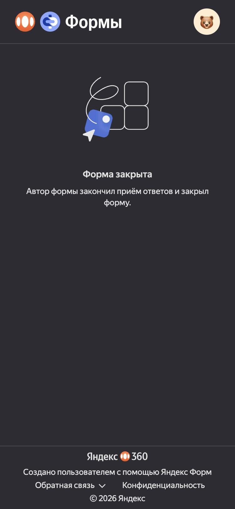

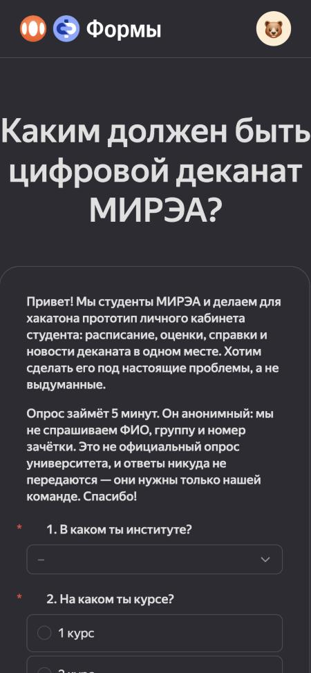

---

## 2. Создан репозиторий и правила для агентов

- **Дата и время:** 2026-11-08 21:55 МСК
- **Инструмент:** Claude Code (Claude Opus 5.5)
- **Кто ставил задачу:** Алёна
- **Этап плана:** 1 Исследование → подготовка к 3 Каркас
- **Требования PRD:** —

### Задача
> Создай репозиторий сейчас и дай инструкции по подключению. Подключать будем 2 кодекса — один мой, другой напарника; логотип и картинки — ChatGPT.

### Что сделал ИИ
- Собрал репозиторий `VIREA_Decanat`: README, `AGENTS.md` (единые правила для Codex ×2, Claude Code и ChatGPT), `CLAUDE.md` со ссылкой на `AGENTS.md`.
- Перенёс в репозиторий PRD, план, итоги опроса и скрипт анализа. PRD в репозитории теперь основная версия.
- Журнал ИИ перевёл на формат «одна запись — один файл» в `docs/ai-log/entries/`, чтобы два Codex не конфликтовали; добавил шаблон и скрипт сборки `scripts/build_ai_log.py`.
- Добавил `.env.example` без значений, `.gitignore` (секреты и сырые ответы опроса не попадают в git), шаблон PR, ревьюеров `.claude/agents/`.
- Написал инструкцию `docs/setup/connect-agents.md`: Codex у каждого из своего аккаунта, ChatGPT для картинок.

### Что проверил и поправил человек
Ожидает проверки Алёной.

### Ошибки ИИ
- Экспорт документов Claude Docs отдаётся только внутрь чата, в файл напрямую не сохраняется → заметил Claude при сборке → PRD и итоги опроса переписаны в репозиторий сжато, без потери требований → правило: основная версия документов теперь в репозитории

### Скриншоты
Не нужны: результат — файлы репозитория.

---

## 3. Проверка онбординга Codex Алёны

- **Дата и время:** 2026-11-08 22:50 МСК
- **Инструмент:** Codex (Алёна)
- **Кто ставил задачу:** Алёна
- **Этап плана:** 1 Исследование
- **Требования PRD:** —

### Задача

Проверить, можно ли подключиться к проекту без истории чата. Прочитать пять документов по порядку, пересказать идею и правила, выбрать первую задачу и зафиксировать пробелы.

> Ничего не меняй в документах и коде. Единственное исключение — добавь запись в журнал ИИ о своём подключении.

### Что сделал ИИ

- Прочитал в указанном порядке `AGENTS.md`, `docs/context.md`, `docs/status.md`, `docs/PRD.md` и `docs/hackathon-task.md` в `docs/agent-onboarding`. Три документа по онбордингу пока доступны только в этой ветке. В `main` отсутствуют `docs/context.md`, `docs/status.md` и `docs/hackathon-task.md`. [AGENTS.md:13-22](https://github.com/ghsteee/VIREA_Decanat/blob/9505ff8253e35384ee496a90477035d53ce27a55/AGENTS.md#L13-L22)
- Сформулировал идею прототипа: кабинет студента вымышленного ВТУ ВИРЭА первым сообщает о переносах пар и новых дедлайнах через web push и MAX с целевым временем доставки до минуты. Сверил ограничения по вымышленным данным, символике, серверной авторизации, паролям, секретам и доступности из РФ. [docs/PRD.md:3](https://github.com/ghsteee/VIREA_Decanat/blob/9505ff8253e35384ee496a90477035d53ce27a55/docs/PRD.md#L3) · [AGENTS.md:33-44](https://github.com/ghsteee/VIREA_Decanat/blob/9505ff8253e35384ee496a90477035d53ce27a55/AGENTS.md#L33-L44)
- Выбрал проверку подключения Codex Алёны. Алёна поручила её в текущем чате, а результат можно проверить по PR с этой записью. Следующие задачи исследования и дизайна уже распределены. [docs/status.md:27-43](https://github.com/ghsteee/VIREA_Decanat/blob/9505ff8253e35384ee496a90477035d53ce27a55/docs/status.md#L27-L43) · [docs/setup/connect-agents.md:23-27](https://github.com/ghsteee/VIREA_Decanat/blob/9505ff8253e35384ee496a90477035d53ce27a55/docs/setup/connect-agents.md#L23-L27)
- Нашёл расхождения в процессе. Правила называют `main` защищённой, статус говорит обратное. GitHub подтвердил `protected: false`. Инструкция называет напарника collaborator, а статус оставляет выдачу доступа открытой. [AGENTS.md:49](https://github.com/ghsteee/VIREA_Decanat/blob/9505ff8253e35384ee496a90477035d53ce27a55/AGENTS.md#L49) · [docs/status.md:11](https://github.com/ghsteee/VIREA_Decanat/blob/9505ff8253e35384ee496a90477035d53ce27a55/docs/status.md#L11) · [docs/status.md:29-30](https://github.com/ghsteee/VIREA_Decanat/blob/9505ff8253e35384ee496a90477035d53ce27a55/docs/status.md#L29-L30) · [docs/setup/connect-agents.md:3](https://github.com/ghsteee/VIREA_Decanat/blob/9505ff8253e35384ee496a90477035d53ce27a55/docs/setup/connect-agents.md#L3)
- Для проверочного PR требования PRD нет. Запрошенные точный заголовок и один файл журнала расходятся с общим требованием указать номер PRD и обновить статус. В инструкции подключения также остались прежние заголовок и имя записи. Выполнил явное поручение для этого PR. [AGENTS.md:24](https://github.com/ghsteee/VIREA_Decanat/blob/9505ff8253e35384ee496a90477035d53ce27a55/AGENTS.md#L24) · [AGENTS.md:49-50](https://github.com/ghsteee/VIREA_Decanat/blob/9505ff8253e35384ee496a90477035d53ce27a55/AGENTS.md#L49-L50) · [docs/status.md:5](https://github.com/ghsteee/VIREA_Decanat/blob/9505ff8253e35384ee496a90477035d53ce27a55/docs/status.md#L5) · [docs/setup/connect-agents.md:23-27](https://github.com/ghsteee/VIREA_Decanat/blob/9505ff8253e35384ee496a90477035d53ce27a55/docs/setup/connect-agents.md#L23-L27)
- Нужно уточнить критерии к 16 ноября. S1 требует видеть изменения над ближайшей парой, а T1 ставит пару первой. Этаж нужен в S1, но R4 с этажом имеет приоритет Should. Демо-кнопка нужна в S3, но E4 имеет приоритет Should. В S4 нужны PDF или слот выдачи, а способ получения A3 — Should, PDF с QR A5 — Could. [docs/PRD.md:24-31](https://github.com/ghsteee/VIREA_Decanat/blob/9505ff8253e35384ee496a90477035d53ce27a55/docs/PRD.md#L24-L31) · [docs/PRD.md:44-49](https://github.com/ghsteee/VIREA_Decanat/blob/9505ff8253e35384ee496a90477035d53ce27a55/docs/PRD.md#L44-L49) · [docs/PRD.md:62-66](https://github.com/ghsteee/VIREA_Decanat/blob/9505ff8253e35384ee496a90477035d53ce27a55/docs/PRD.md#L62-L66) · [docs/PRD.md:73](https://github.com/ghsteee/VIREA_Decanat/blob/9505ff8253e35384ee496a90477035d53ce27a55/docs/PRD.md#L73)
- Условие ссылается на «эту страницу» и Регламент без URL. Для сверки сдачи нужен адрес источника. Путь `public/brand/` пока отсутствует и понадобится при добавлении ассетов. [docs/hackathon-task.md:62-68](https://github.com/ghsteee/VIREA_Decanat/blob/9505ff8253e35384ee496a90477035d53ce27a55/docs/hackathon-task.md#L62-L68) · [docs/hackathon-task.md:85-87](https://github.com/ghsteee/VIREA_Decanat/blob/9505ff8253e35384ee496a90477035d53ce27a55/docs/hackathon-task.md#L85-L87) · [docs/brand/README.md:3](https://github.com/ghsteee/VIREA_Decanat/blob/9505ff8253e35384ee496a90477035d53ce27a55/docs/brand/README.md#L3)
- Для старта каркаса ещё нужны модель данных и дизайн-система. Оба файла пока описывают, что предстоит заполнить. Выбор шкалы оценок, источника документов для помощника, ИИ-провайдера и проверка MAX уже обозначены как открытые вопросы. [docs/status.md:9-10](https://github.com/ghsteee/VIREA_Decanat/blob/9505ff8253e35384ee496a90477035d53ce27a55/docs/status.md#L9-L10) · [docs/data-model.md:3-7](https://github.com/ghsteee/VIREA_Decanat/blob/9505ff8253e35384ee496a90477035d53ce27a55/docs/data-model.md#L3-L7) · [docs/design-system.md:3-5](https://github.com/ghsteee/VIREA_Decanat/blob/9505ff8253e35384ee496a90477035d53ce27a55/docs/design-system.md#L3-L5) · [docs/PRD.md:139-145](https://github.com/ghsteee/VIREA_Decanat/blob/9505ff8253e35384ee496a90477035d53ce27a55/docs/PRD.md#L139-L145)

### Что проверил и поправил человек

Запись ожидает ревью напарника.

### Ошибки ИИ

Не было.

### Скриншоты

Проверка касалась документации. Экраны приложения не проверялись.

---

## 4. Репозиторий подготовлен для агентов без контекста

- **Дата и время:** 2026-11-08 22:55 МСК
- **Инструмент:** Claude Code (Claude Opus 5.5)
- **Кто ставил задачу:** Алёна
- **Этап плана:** 1 Исследование → подготовка к 2 и 3
- **Требования PRD:** —

### Задача
> Добавь в репозиторий все необходимые файлы и инструкции, чтобы с проектом мог работать любой агент, изначально не имеющий никакого контекста, кроме этого репозитория.

Повод: Алёна подключила свой Codex. До этого часть знаний жила только в чате с Claude и в документах Claude Docs, которые Codex не видит.

### Что сделал ИИ
- `AGENTS.md`: раздел «Начни здесь» — порядок чтения, запрет додумывать факты, порядок важности документов при противоречиях, обязанность обновлять статус. Новые правила: лицензии (9), пароли тестовых аккаунтов не в репозиторий (10), язык и время.
- `docs/hackathon-task.md` — условие хакатона и критерии оценки целиком плюс таблица «требование → где у нас».
- `docs/context.md` — журнал решений с причинами (МИРЭА вместо МГИМО, ВТУ ВИРЭА, MAX вместо Telegram, стек, хостинг и др.).
- `docs/status.md` — текущий этап, сроки и свободные задачи с исполнителями и номерами требований.
- `docs/glossary.md`, `docs/prompts.md` (шаблоны задач для Codex, Claude Code, ChatGPT и «старт с нуля»), `docs/submission.md` (что сдаём, структура PDF по требованиям условия), `docs/licenses.md`.
- Исправлено имя репозитория в инструкциях (`VIREA_Decanat`), отмечено подключение Codex Алёны.
- Проверил скриптом, что все пути, упомянутые в документах, существуют.
- Изменения — через ветку `docs/agent-onboarding` и PR, без прямого push в `main`.

### Что проверил и поправил человек
Ожидает ревью PR Алёной. Проверка «агент с нуля»: дать своему Codex задачу из раздела «Если агент начинает с нуля» в `docs/prompts.md` и сравнить пересказ с реальностью.

### Ошибки ИИ
- В первой версии документов репозиторий назван `virea-dekanat`, а на GitHub создан `VIREA_Decanat` → заметил Claude при публикации → имя исправлено во всех инструкциях → правило: имена внешних ресурсов брать по факту после создания, а не из плана

### Скриншоты
Не нужны: результат — файлы репозитория.

---

## 5. Закрыты пробелы, которые Codex Алёны нашёл при проверке онбординга

- **Дата и время:** 2026-11-08 23:10 МСК
- **Инструмент:** Claude Code (Claude Opus 5.5)
- **Кто ставил задачу:** Алёна
- **Этап плана:** 1 Исследование → подготовка к 2 и 3
- **Требования PRD:** T1, S1, S3, S4

### Задача
Алёна дала своему Codex промпт «агент с нуля» (составил Claude) на ветке `docs/agent-onboarding`. Codex прочитал документы, пересказал проект и перечислил пробелы с файлами и строками (PR #2). Алёна передала ответ Claude — закрыть пробелы.

Так проверяется, что репозиторий понятен агенту без истории: один ИИ готовит документы, второй, без контекста, ищет в них дыры.

### Что сделал ИИ
- PRD: порядок блоков «Сегодня» приведён к одному виду в S1 и T1 (было противоречие). Сначала Claude поставил изменения над парой, после правки Алёны — под парой. В критериях S1, S3, S4 части, зависящие от требований Should и Could (этаж R4, демо-кнопка E4, слот выдачи A3, PDF с QR A5), помечены приоритетом — чтобы Must к 16 ноября не требовал Should-функций.
- `AGENTS.md`: прямой push в `main` запрещён, даже пока защита на GitHub не включена; для PR без требования — префикс `docs:`/`chore:`; проверочные PR не меняют статус.
- Инструкция подключения и `docs/prompts.md`: одна и та же проверочная задача, одно имя записи журнала и PR. Напарник помечен как ещё не добавленный.
- `docs/hackathon-task.md`: пояснено, что «эта страница» и «Регламент» — у капитана, агентам не нужны. `docs/brand/README.md`: `public/brand/` появится с каркасом.
- `docs/status.md`: проверка Codex Алёны отмечена. `docs/context.md`: решение о порядке блоков на «Сегодня».

### Что проверил и поправил человек
Алёна отклонила решение Claude про порядок блоков: изменения должны идти **под** расписанием — при многочисленных заменах студент не захочет листать полотно изменений, чтобы увидеть свою пару. Исправлено в PRD и `docs/context.md`; изменение самой ближайшей пары остаётся видно сразу через метку «было → стало» на её карточке.

### Ошибки ИИ
- В PRD Claude описал порядок блоков «Сегодня» по-разному в S1 и T1 → нашёл Codex Алёны при проверке онбординга → оба места приведены к «изменения над парой» → правило: после правки PRD сверять сценарии с таблицей требований
- Противоречие S1/T1 Claude разрешил сам, поставив изменения над парой ради «главной идеи», не подумав о дне с множеством замен → Алёна при ревью → изменения перенесены под пару → правило: продуктовые решения с компромиссом для интерфейса не принимать самому, а предлагать варианты человеку
- Критерии обязательных сценариев S1, S3, S4 требовали функций с приоритетом Should и Could → нашёл Codex Алёны → части критериев помечены приоритетами → правило: у каждого пункта критерия приоритет не выше, чем у его требования

### Скриншоты
Не нужны: результат — файлы репозитория.

---

## 6. Обновили логотип ВТУ ВИРЭА

- **Дата и время:** 2026-11-08 23:16 МСК
- **Инструмент:** ChatGPT (генерация изображения в Codex), Codex (Алёна) для добавления файлов в GitHub
- **Кто ставил задачу:** Алёна
- **Этап плана:** 2 Дизайн
- **Требования PRD:** X1

### Задача

Обновить название и подпись на логотипе. Добавить результат и запись с изображением в отдельную ветку.

> переделай логотип - исправь буквы на ВТУ ВИРЭА, а текст на "вместе создаем вымышленное"

### Что сделал ИИ

- Перерисовал знак из двух углов и точки и поставил надписи «ВТУ ВИРЭА» и «вместе создаем вымышленное».
- Сохранил [логотип с прозрачным фоном](../../brand/vtu-virea-logo.png) в PNG (1774 × 887). Для журнала подготовил JPEG шириной 1600 px и проверил обе надписи по изображению.
- Добавил промпт и описание варианта в [документацию бренда](../../brand/README.md).

### Что проверил и поправил человек

Алёна попросила добавить в репозиторий вариант из чата. Ревью файлов ещё впереди.

### Ошибки ИИ

Не было.

### Скриншоты

---

## 7. Нарисовали вариант логотипа ВТУ ВИРЭА со Змеем Горынычем

- **Дата и время:** 2026-11-08 23:24 МСК
- **Инструмент:** ChatGPT (генерация изображения в Codex), Codex (Алёна) для добавления файлов в GitHub
- **Кто ставил задачу:** Алёна
- **Этап плана:** 2 Дизайн
- **Требования PRD:** X1

### Задача

Сделать вариант логотипа с персонажем из фольклора и добавить его в ветку с предыдущим логотипом.

> вместо двуглавого орла отрисуй трехглавого змея-горыныча, по центру вместо овала круг и в нем новый логотип ВТУ ВИРЭА, в лапах остается свиток и перо

### Что сделал ИИ

- Нарисовал трёхглавого Змея Горыныча со свитком и пером. В круг на груди поместил знак ВТУ ВИРЭА с подписью «вместе создаем вымышленное».
- Сохранил [новый вариант](../../brand/vtu-virea-gorynych-logo.png) как PNG с прозрачным фоном, 1254 × 1254 px. Для журнала подготовил JPEG шириной 1254 px.
- Записал промпт и описание варианта в [документацию бренда](../../brand/README.md).

### Что проверил и поправил человек

Алёна попросила добавить показанный в чате вариант в ту же ветку. Ревью коммита ещё впереди.

### Ошибки ИИ

Не было.

### Скриншоты

---

## 8. Убрали слоган и выровняли оба логотипа ВТУ ВИРЭА

- **Дата и время:** 2026-11-08 23:45 МСК
- **Инструмент:** ChatGPT (генерация изображения в Codex), Codex (Алёна) для добавления файлов в GitHub
- **Кто ставил задачу:** Алёна
- **Этап плана:** 2 Дизайн
- **Требования PRD:** X1

### Задача

> переделай оба логотипа - убери слоган, выровняй логотип

### Что сделал ИИ

- Убрал слоган из обоих вариантов. В [основном логотипе](../../brand/vtu-virea-logo.png) выровнял знак и название «ВТУ ВИРЭА» по общей вертикальной оси.
- В [варианте со Змеем Горынычем](../../brand/vtu-virea-gorynych-logo.png) отцентрировал композицию в круге и уменьшил надпись, чтобы она не касалась ободка. В лапах остались свиток и перо.
- Проверил надписи и прозрачный фон обоих PNG. Добавил JPEG-превью шириной 1600 и 1254 px и обновил [описание вариантов](../../brand/README.md).

### Что проверил и поправил человек

Алёна задала правки к двум предыдущим версиям. Новые версии ожидают ревью.

### Ошибки ИИ

- После первого прохода центр композиции с Горынычем был выше центра круга. При выравнивании надпись приблизилась к ободку. На финальном проходе уменьшил надпись и проверил поля по бокам.

### Скриншоты

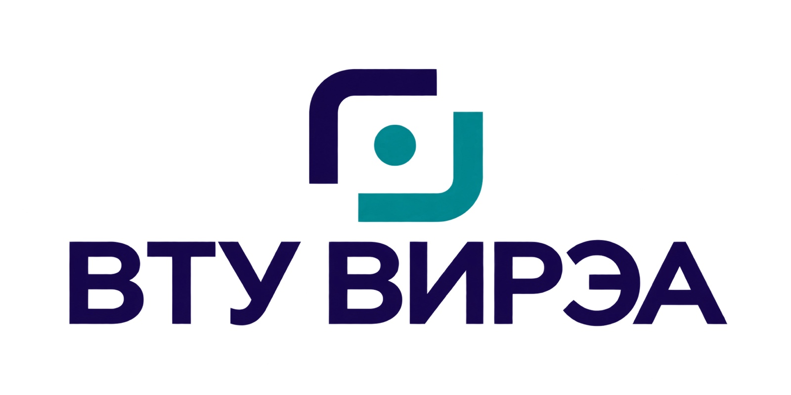

---

## 9. Промпт для Codex: как достать открытое расписание МИРЭА

- **Дата и время:** 2026-11-09 00:03 МСК
- **Инструмент:** Claude Code (Claude Opus 5.5) → задача для Codex (Алёна)
- **Кто ставил задачу:** Алёна
- **Этап плана:** 2a Модель данных и проверки
- **Требования PRD:** R5, NF6

### Задача
> Напиши промт для кодекса, чтобы он выполнил эту задачу - Проверить, как достать открытое расписание МИРЭА

### Что сделал ИИ
- Написал задачу для Codex Алёны в формате `docs/prompts.md`: найти официальные открытые источники расписания, проверить доступ без авторизации и без VPN, разобрать формат и сопоставить поля с карточкой пары (R2), понять чётные недели и переносы (R3), проверить на трёх группах разных институтов.
- Результат задачи: отчёт `docs/research/schedule-source.md` и скрипт-проба `scripts/schedule/probe.mjs` (Node 20 без зависимостей).
- Встроил ограничения из `AGENTS.md`: скрипт сразу заменяет ФИО преподавателей на вымышленные детерминированно, сырые ответы источника не коммитятся, никаких логинов, обхода защиты и массовых запросов.
- Варианты источников помечены как предположения для проверки — не факты. Выбор источника Codex не принимает сам, а выносит вопрос человеку.
- Предупредил Алёну: в `docs/status.md` задача записана на напарника (парсер в его зоне), промпт передаёт её Codex Алёны.

### Что проверил и поправил человек
Алёна передала промпт своему Codex. Результат (PR) ещё не получен.

### Ошибки ИИ
Не было

### Скриншоты
Не нужны: результат — текст задачи.

---

## 10. Сверка с GitHub и ревью логотипов

- **Дата и время:** 2026-11-09 00:04 МСК
- **Инструмент:** Claude Code (Claude Opus 5.5)
- **Кто ставил задачу:** Алёна
- **Этап плана:** 2 Дизайн
- **Требования PRD:** X1

### Задача
> Проверь изменения на гитхабе и обнови локальные файлы в соответствии с ним

### Что сделал ИИ
- Обновил локальную копию до `main`: после PR #1 слит PR #3 Codex Алёны — два логотипа в `docs/brand/`, три записи журнала от ChatGPT, 4 скриншота.
- Посмотрел оба логотипа: надпись везде «ВТУ ВИРЭА», прозрачный фон, реальных людей нет.
- Замечания Алёне:
  - вариант со Змеем Горынычем — переделка герба (орла заменили драконом). Условие допускает перекличку с оригиналом, но не копию; выбор главного варианта — за Алёной, записать в `docs/context.md`;
  - `vtu-virea-gorynych-logo.png` весит 1,5 МБ — для сайта сжать и сделать маленькие версии вместе с каркасом;
  - в `docs/status.md` задача «Логотип ВТУ ВИРЭА и иконки PWA» не отмечена: логотип готов, иконок нет;
  - `LOG.md` не пересобран — это нормально, собираем перед сдачей.

### Что проверил и поправил человек
Выбор главного логотипа ещё не сделан.

### Ошибки ИИ
Не было

### Скриншоты
Логотипы — в записях ChatGPT от 8 ноября (`2026-11-08_10_…`, `2026-11-08_11_…`).

---

## 11. Проверили источник открытого расписания РТУ МИРЭА

- **Дата и время:** 2026-11-09 00:59 МСК
- **Инструмент:** Codex (Алёна)
- **Кто ставил задачу:** Алёна
- **Этап плана:** 2a Модель данных и проверки
- **Требования PRD:** R5, NF6 (сопоставление с R2 и R3)

### Задача

> Это исследование: код приложения не пишем, нужен отчёт и маленький скрипт-проба.

Проверить открытые источники, три группы, чётность недель, поля карточки и признаки переноса. Подменить ФИО преподавателей до вывода.

### Что сделал ИИ

- Описал HTML, публичный JSON-поиск и iCal в [отчёте](../../research/schedule-source.md). Отдельно указал ограничения использования, отсутствие подтверждённой частоты обновления и проверку, которую нужно повторить с российского VPS.
- Написал [скрипт-пробу](../../../scripts/schedule/probe.mjs) без зависимостей. Проверил живой запуск на Node.js 20.19.5 для трёх групп, разворачивание двух недель с исключениями, отказ на неверной дате и отсутствующей группе, а также отсутствие исходных ФИО в JSON.
- Зафиксировал ограничения R2 и R3. Источник показывает дистанционный формат, но не даёт ссылок на онлайн-пары в выборке. В iCal не нашёл истории «было → стало». Выбор источника вынес на согласование.

### Что проверил и поправил человек

Алёна уточнила, что PR должен быть направлен в `main`. Алёна согласовала разовую подготовку демо из iCal после проверки российского VPS без VPN и уточнения условий использования. Ревью отчёта и пробы ещё впереди.

### Ошибки ИИ

Не было.

### Скриншоты

Проверка проводилась запросами и в терминале. В отчёте есть пример очищенного JSON.

---

## 12. Журналы в Claude Docs и в репозитории сведены

- **Дата и время:** 2026-11-09 01:11 МСК
- **Инструмент:** Claude Code (Claude Opus 5.5)
- **Кто ставил задачу:** Алёна
- **Этап плана:** 7 Сдача (подготовка отчёта)
- **Требования PRD:** —

### Задача
> обнови локальные данные в журнале работы с ии данными с гитхаба и из чата

Затем: «добавь» — перенести в репозиторий записи, которых там не было.

### Что сделал ИИ
- В документ «Журнал работы с ИИ» в Claude Docs перенёс записи 12–21 из репозитория и чата: репозиторий, онбординг агентов, проверка Codex, исправления и решение Алёны по «Сегодня», три логотипа ChatGPT, задача про расписание, сверка с GitHub.
- Дополнил таблицы «Ошибки ИИ» (8–13) и «Ручные шаги» (создание репозитория, подключение GitHub и Codex, решение по порядку блоков, выбор логотипов и слияние PR), вставил скриншоты итоговых логотипов.
- В разделе «Как ведём журнал» указал, что основной журнал — в репозитории, документ — сводная копия для чтения.
- Добавил в репозиторий три записи, которых там не было (эта и две предыдущие от 9 ноября), через PR.

### Что проверил и поправил человек
Ожидает ревью Алёной.

### Ошибки ИИ
Не было

### Скриншоты
Не нужны.

---

## 13. Проверка подключения Codex напарника

- **Дата и время:** 2026-11-09 11:33 МСК
- **Инструмент:** Codex (напарник)
- **Кто ставил задачу:** напарник
- **Этап плана:** 2a Модель данных
- **Требования PRD:** —

### Задача

> найди мои задания и начинай их делать

Сверить роль, проверить доступ к репозиторию и найти первую задачу по инструкциям онбординга.

### Что сделал ИИ

- Прочитал [правила проекта](../../../AGENTS.md), [решения](../../context.md), [статус](../../status.md), [PRD](../../PRD.md) и [условие хакатона](../../hackathon-task.md). ВТУ ВИРЭА — вымышленный вуз. Кабинет первым сообщает студенту о переносах и дедлайнах, а для ключевого сценария push и сообщение в мессенджере должны приходить за 60 секунд.
- Выделил пять ограничений: только вымышленные персональные данные, собственная символика и плашка концепта, доступ к данным по серверной сессии с ответом 404 на чужой ID, пароль только в виде хэша argon2id и защищённая cookie, ключи только на сервере. Внешние сервисы требуют проверки из РФ без VPN, изменения в `main` проходят через PR.
- GitHub подтвердил роль `Write` для аккаунта напарника. Открытых Issues нет. Первая задача по [плану](../../plan.md) — [модель данных](../../data-model.md) для каркаса приложения. После `git fetch` подтвердил, что [PR #4 с исследованием расписания](https://github.com/ghsteee/VIREA_Decanat/pull/4) уже влит в `main`. Проверка доступности источника с российского VPS ещё предстоит.
- Нашёл расхождения. В [статусе, строка 11](../../status.md#L11) ещё указано, что у напарника нет доступа. В [PRD, строки 90 и 120](../../PRD.md#L90) сотрудник ограничен своим институтом, а демонстрационный аккаунт обслуживает группы из трёх институтов. Для схемы нужно явно ограничить сотрудника выданными областями доступа. Шкала оценок и источники документов для помощника ещё открыты в [PRD, строки 139–145](../../PRD.md#L139).

### Что проверил и поправил человек

Напарник завершил вход в GitHub в браузере. Проверка модели и ревью этой записи ещё предстоят.

### Ошибки ИИ

Первую попытку скачать приватный репозиторий запустил без интерактивной авторизации. Git остановился на получении учётных данных. После входа через браузер ветка `main` скачалась и стала отслеживать `origin/main`. Для приватного репозитория сначала проверять локальную авторизацию Git.

### Скриншоты

Проверка проходила в терминале и через GitHub. Экранов приложения пока нет.

> Пометка от 11.11: позже канал мессенджера заменён на e-mail — решение Алёны 10.11, [PR #8](https://github.com/ghsteee/VIREA_Decanat/pull/8).

---

## 14. Логическая модель данных деканата

- **Дата и время:** 2026-11-09 11:39 МСК
- **Инструмент:** Codex (напарник)
- **Кто ставил задачу:** напарник
- **Этап плана:** 2a Модель данных
- **Требования PRD:** NF5, R3, N2, A4 и связанные требования

### Задача

> найди мои задания и начинай их делать

Описать сущности, связи, границы доступа и индексы для экрана «Сегодня», чтобы по ним можно было написать схему PostgreSQL и Prisma.

### Что сделал ИИ

- Описал [модель данных](../../data-model.md) для профиля, расписания, заявок, дедлайнов, успеваемости, ленты, фоновой доставки и помощника.
- Сопоставил роли с разрешёнными полями и запросами. В [контексте](../../context.md) зафиксировал явное назначение институтов сотруднику для демо и проверки S9.
- Описал транзакции для изменений пары и заявок, подтверждения почты одноразовым кодом и фоновой отправки. _(Исправлено 11.11 Claude Code по ревью: в первой версии записи здесь была «привязка мессенджера», модель уже описывала почту.)_ Отдельно указал, как различать подтверждение отправки и реальное получение уведомления.
- Сверил модель с S1–S9, NF5 и NF6. Шкала оценок и происхождение документов для помощника оставлены открытыми до решения команды. [PR #7](https://github.com/ghsteee/VIREA_Decanat/pull/7).

### Что проверил и поправил человек

Ревью второго участника ещё предстоит. Миграции, запросы и приложение появятся на этапе каркаса. Сценарии проверки для реализации описаны в модели.

### Ошибки ИИ

Не было.

### Скриншоты

Изменения в документации. Скриншоты интерфейса появятся после реализации.

---

## 15. Проверка доступности ботов MAX и ВКонтакте

- **Дата и время:** 2026-11-09 11:48 МСК
- **Инструмент:** Codex (напарник)
- **Кто ставил задачу:** напарник
- **Этап плана:** 2a Модель данных и проверки
- **Требования PRD:** N2, N3

### Задача

Проверить возможность создать бота MAX с обычным аккаунтом и подготовить проверку резервного канала из плана проекта.

### Что сделал ИИ

- По официальным документам MAX сверил требования к верификации, модерации и серверной отправке.
- В официальной схеме API ВКонтакте проверил наличие ключа сообщества для отправки сообщений и методов для получения входящих событий.
- Подготовил [порядок прогона с российского VPS](../../research/messenger-channel.md) и оставил задачу в работе до фактической отправки и получения сообщения.

### Что проверил и поправил человек

Ревью и проверка с тестовым сообществом и российским VPS ещё предстоят.

### Ошибки ИИ

Не было.

### Скриншоты

После теста нужен скриншот получения сообщения с вымышленным содержимым. Личные данные и идентификаторы в кадр не включать.

---

## 16. Переход на web push и e-mail

- **Дата и время:** 2026-11-09 15:42 МСК
- **Инструмент:** Codex (напарник)
- **Кто ставил задачу:** напарник
- **Этап плана:** 2a Модель данных и проверки
- **Требования PRD:** N2, N3, N5, P3

### Задача

> вк не подходит и макс тоже. мб тогда сделаем уведомления на почту

Заменить канал мессенджера письмами и подготовить проверку доставки.

### Что сделал ИИ

- Обновил [PRD](../../PRD.md) и [журнал решений](../../context.md). Web push остался основным каналом. Для срочных событий добавлена отправка на подтверждённую почту, а дайджест оставлен в Should.
- Описал подтверждение адреса и [прогон с VPS](../../research/email-notifications.md). Зафиксировал отдельно принятие письма SMTP-сервером и получение во входящих.
- Согласовал изменения с [PR модели данных](https://github.com/ghsteee/VIREA_Decanat/pull/7). Обновлённые требования и план теста находятся в [PR #8](https://github.com/ghsteee/VIREA_Decanat/pull/8).

### Что проверил и поправил человек

Напарник исключил MAX и ВКонтакте и предложил почту. Проверка отправки и получения писем предстоит после настройки SMTP и VPS.

### Ошибки ИИ

Не было.

### Скриншоты

После прогона нужен кадр письма и отметка времени получения. Адрес ящика и код подтверждения в кадр не включать.

---

## 17. Ревью PR #6, #7 и #8 напарника по чек-листу AGENTS.md

- **Дата и время:** 2026-11-10 23:45 МСК
- **Инструмент:** Claude Code
- **Кто ставил задачу:** Алёна
- **Этап плана:** 2a Модель данных
- **Требования PRD:** N2, N3, N5, P3, S2, S8, NF5

### Задача
Сделать кросс-ревью трёх PR напарника: проверить, что после отказа от MAX (решение Алёны 10.11) канал убран везде одинаково, а модель данных совпадает с решением про почту и правилом 3. Замечания оставить в PR, ничего не сливать.

> Для #8 проверь, что MAX убран везде одинаково: PRD (S2, S8, N2, N5, P3), план, AGENTS.md (правило 6), .env.example, glossary.md. Для #7 проверь, что модель данных совпадает с решением про почту из #8 и с правилом 3.

### Что сделал ИИ
- Проверил с помощью `git grep` по головам веток и сравнения с `main`. В PR #8 MAX убран во всех перечисленных местах, а также в README, `status.md` и `survey-summary.md`. Остались только исторические упоминания.
- Нашёл, что в `context.md` (#8) решение записано как 09.11 «напарник исключил», хотя решение Алёны принято 10.11. Также из N2 пропало обоснование «корпоративную почту не читают», а для шифрования адреса и HMAC кода в `.env.example` нет ключей.
- В PR #7 нашёл: не описан механизм дайджеста N5, не указаны хранилища лимитов выдачи кодов и AI3, нет явного 404 для сотрудника вне назначенных институтов. Запись журнала говорит о «привязке мессенджера», хотя модель уже про почту. Правило 3 соблюдено.
- По PR #6 предложил пометку, что канал мессенджера позже заменён на почту.
- Через `git merge-tree` проверил, что #7 и #8 сливаются без конфликтов. Рекомендовал порядок: сначала #8, потом #7.
- Оставил ревью-комментарии в PR [#6](https://github.com/ghsteee/VIREA_Decanat/pull/6), [#7](https://github.com/ghsteee/VIREA_Decanat/pull/7), [#8](https://github.com/ghsteee/VIREA_Decanat/pull/8).

### Что проверил и поправил человек
Нужно проверить: Алёна читает замечания и решает, что поправить напарнику и когда сливать.

### Ошибки ИИ
Не было.

### Скриншоты
Скриншот нужен вручную: вкладка ревью одного из PR на GitHub.

---

## 18. Опрос отмечен итоговым, статус защиты main зафиксирован

- **Дата и время:** 2026-11-10 23:50 МСК
- **Инструмент:** Claude Code
- **Кто ставил задачу:** Алёна
- **Этап плана:** 1 Исследование
- **Требования PRD:** —

### Задача
Внести в документы решения Алёны от 10.11: опрос итоговый (20 ответов, пересчёт не нужен), защита `main` недоступна для приватного репозитория на бесплатном тарифе GitHub.

### Что сделал ИИ
- `docs/context.md`: две новые строки в журнале решений (опрос итоговый; защита `main` не включается). Пункт про опрос в «Что уже сделано» обновлён. Строку «MAX → почта» не добавлял: она уже есть в PR #8, в ревью попросил поправить в ней дату и автора решения.
- `docs/status.md`: задача пересчёта опроса закрыта, напарник отмечен в collaborators. Защита `main` помечена как недоступная, раздел «Сейчас» и дата обновлены.
- `docs/research/survey-summary.md`: убраны «промежуточные» и пометка о пересчёте. Строку о каналах не трогал — её меняет PR #8.

### Что проверил и поправил человек
Нужно проверить: Алёна смотрит PR. При слиянии вместе с #7 и #8 возможен конфликт в строке «Обновлено» в `status.md`.

### Ошибки ИИ
Не было.

### Скриншоты
Изменения только в документах, скриншот не нужен.

---

## 19. Слияние PR #6, #8, #7 и обновление PR #9

- **Дата и время:** 2026-11-10 23:58 МСК
- **Инструмент:** Claude Code
- **Кто ставил задачу:** Алёна
- **Этап плана:** 2a Модель данных
- **Требования PRD:** N2, N3, N5, NF5

### Задача
> Слей все что нужно

### Что сделал ИИ
- Слил PR #6 (онбординг Codex напарника). PR #8 был черновиком — по ответу Алёны снял draft и слил. Затем слил #7, в порядке, предложенном на ревью.
- Перебазировал PR #9 на новый `main`, разрешил конфликты в `docs/context.md` и `docs/status.md`. Строку решения о почте исправил: 10.11, решение Алёны по предложению напарника (замечание 1 из ревью #8). Раздел «Сейчас» в `status.md` обновил.
- PR #9 слит без ревью напарника — по решению Алёны как капитана, вопреки правилу кросс-ревью из `AGENTS.md`.

### Что проверил и поправил человек
Алёна решила снять draft с #8 и слить #9 без ревью напарника. Остальные замечания из ревью #7 и #8 (обоснование N2, ключи в `.env.example`, дайджест N5, лимиты, запись журнала #7) остаются за напарником.

### Ошибки ИИ
- Первая попытка слить #8 упала: PR был черновиком. ИИ это не проверил при ревью → заметил по ответу GitHub 405 → спросил Алёну и снял draft с её согласия → перед слиянием проверять статус draft.

### Скриншоты
Скриншот не нужен.

---

## 20. Устранены замечания из ревью PR #7 и #8, закрыты организационные хвосты

- **Дата и время:** 2026-11-11 00:00 МСК
- **Инструмент:** Claude Code
- **Кто ставил задачу:** Алёна
- **Этап плана:** 2a Модель данных
- **Требования PRD:** N2, N5, AI3, NF5

### Задача
> Закрой все хвосты, я подключила джпт к репозиторию, устрани замечания из ревью сам, на все остальное тоже даю разрешение. Необходимые на 2 этапе задачи напарника беру на себя.

### Что сделал ИИ
- `docs/PRD.md`: в N2 вернул обоснование — адрес студент указывает сам, потому что корпоративную почту, по опросу, не читают.
- `.env.example`: добавил пустые `EMAIL_ENCRYPTION_KEY` и `EMAIL_CODE_HMAC_KEY`.
- `docs/data-model.md` (зона напарника, с разрешения Алёны): описал режим доставки `immediate`/`digest` и сущность `EmailDigest` для N5, таблицу лимитов `RateLimitBucket` (вход, выдача кода почты, помощник AI3) и явный 404 для сотрудника вне назначенных институтов. Указал ключи шифрования адреса и HMAC кода.
- Журнал: исправил «привязку мессенджера» в записи о модели данных, добавил пометку о замене канала в запись онбординга Codex напарника.
- `docs/status.md`: отметил подключение Codex напарника и ChatGPT, задачи VPS и проверки почты переназначил на Алёну. В `docs/context.md` добавил строку о передаче задач.

### Что проверил и поправил человек
Нужно проверить: Алёна смотрит PR. Лимиты на выдачу кода (раз в 60 с, 5 в час) — предложение ИИ по умолчанию, можно поменять.

### Ошибки ИИ
Не было.

### Скриншоты
Изменения только в документах, скриншот не нужен.

---

## 21. Дизайн-система v1: палитра, шрифт, компоненты и превью «Сегодня»

- **Дата и время:** 2026-11-11 00:10 МСК
- **Инструмент:** Claude Code (скилл design-system, Artifact для превью, Playwright для скриншотов)
- **Кто ставил задачу:** Алёна
- **Этап плана:** 2 Дизайн
- **Требования PRD:** NF1, NF3, NF8, R3, T1, T2, X1, A4, G3

### Задача
> Начни с дизайна

Заполнить `docs/design-system.md`: цвета светлой и тёмной темы с контрастом AA, шрифт с лицензией OFL, сетка от 360 px, компоненты.

### Что сделал ИИ
- Вывел палитру из логотипа ВТУ ВИРЭА (индиго и бирюза) и посчитал контраст каждой пары по формуле WCAG 2.1 скриптом. Все текстовые пары не ниже 4,5 : 1, граница полей ввода — не ниже 3 : 1.
- Выбрал шрифт Golos Text (ParaType, SIL OFL 1.1), подключение со своего сервера через npm-пакет. Добавил строку в `docs/licenses.md`.
- Описал шкалу шрифтов, сетку для 360 / 768 / 1024 px, радиусы, тени, движение, метки изменений R3 и статусы заявок и допуска (иконка Lucide + слово), карточки пары, дедлайна и заявки, кнопки, нижнее меню, плашку концепта, скелетон, пустые состояния, ошибки, тон текстов и соответствие токенов именам shadcn/ui.
- Предложил, где какой логотип: знак — в шапке и иконке PWA, Горыныч — на входе и в пустых состояниях. Решение за Алёной.
- Сделал превью в Claude Artifact (палитра, метки, кнопки и экран «Сегодня» на 360 px с переключателем темы) и скриншоты через Playwright. Горизонтальной прокрутки нет ни на 1280, ни на 360 px.

### Что проверил и поправил человек
Нужно проверить: Алёна смотрит превью и утверждает палитру, шрифт и логотип.

### Ошибки ИИ
- Скриншот превью сначала вышел без иконок → Playwright показал 0 иконок на странице → CDN unpkg закрыт в песочнице, для скриншота подключил копию lucide из npm → проверять загрузку внешних скриптов до снимка.

### Скриншоты

---

## 22. Подбор шрифтов: Days One для заголовков и Onest для текста

- **Дата и время:** 2026-11-11 00:30 МСК
- **Инструмент:** Claude Code (Artifact для сравнения, fontTools и Playwright для проверки)
- **Кто ставил задачу:** Алёна
- **Этап плана:** 2 Дизайн
- **Требования PRD:** NF1, NF3

### Задача
> Я хочу изменить шрифты — можешь ли ты найти менее избитые бесплатные комбинации в открытом доступе?

Потом: «Есть ещё какие-нибудь интересные типа Tektur?», «для заголовков Days One, подыщи интересные для основного текста», выбор — Onest.

### Что сделал ИИ
- Проверил 70+ шрифтов по npm-пакетам Fontsource: есть ли кириллица и какая лицензия. Отсеял шрифты без кириллицы (Doto, Bungee, Saira, Hanken Grotesk, Mona Sans, Lexend и др.) и Ubuntu Sans из-за лицензии UFL.
- Собрал три страницы сравнения в Claude Artifact: пять пар, 11 характерных заголовочных шрифтов и 12 текстовых в паре с Days One, с мини-расписанием.
- Через fontTools проверил, у каких текстовых шрифтов есть цифры одинаковой ширины (функция tnum) — это важно для колонки времени в расписании.
- Обновил `docs/design-system.md` (версия 1.1): Days One — заголовки, Onest — всё остальное, правило `lang="ru"`. В `docs/licenses.md` Golos Text заменён на Days One и Onest, в `docs/context.md` обновлена строка решения. Превью дизайн-системы переведено на новые шрифты.

### Что проверил и поправил человек
Алёна смотрела сравнения в браузере, заметила, что первая страница показывает везде один шрифт, и выбрала Days One + Onest.

### Ошибки ИИ
- На первой странице сравнения все карточки показывали Golos → заметила Алёна → имена шрифтов в двойных кавычках обрывали атрибут `style="…"`, заменил на одинарные и проверил вычисленный `font-family` в Playwright → при подстановке строк в HTML-атрибуты проверять кавычки и смотреть результат до публикации.
- При исправлении скрипт вставил в код лишние обратные слэши → Playwright не нашёл ни одной карточки → убрал слэши, проверил снова.
- Sofia Sans по умолчанию рисует болгарские формы «т» и «д» → заметил на скриншоте → с `lang="ru"` формы русские; правило `lang="ru"` добавлено в дизайн-систему.

### Скриншоты

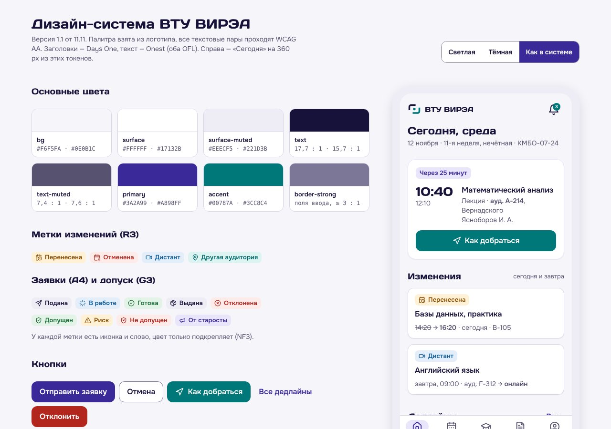
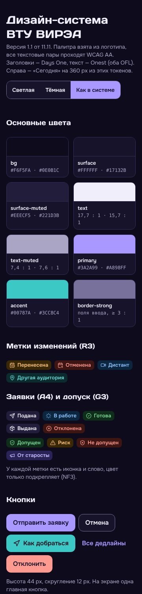

---

## 23. Палитра «Табло» из словаря Санзо Вады: молочная основа и пастельные плашки

- **Дата и время:** 2026-11-11 01:00 МСК
- **Инструмент:** Claude Code (Artifact для сравнения, Python для контраста, Playwright для скриншотов)
- **Кто ставил задачу:** Алёна
- **Этап плана:** 2 Дизайн
- **Требования PRD:** NF3, R3, A4, G3

### Задача
> Попробуй другие цветовые комбинации, менее избитые, например попробуй что-то из книги A Dictionary of Color Combinations

Дальше по шагам: «попробуй более нейтральную основу», «найди ещё сочетания, не такие броские», «хочу поменять оранжевый», «берём пудрово-розовый, нужно добавить ещё цвета для плашек».

### Что сделал ИИ
- Нашёл открытый набор данных по книге (mattdesl/dictionary-of-colour-combinations, MIT): 159 цветов и 348 сочетаний. Скриптом отобрал сочетания, пригодные для интерфейса.
- Сделал пять страниц сравнения в Claude Artifact: шесть ярких палитр; нейтральная основа с семью наборами акцентов; «Табло» было/стало и семь тихих палитр; шесть замен оранжевому; набор плашек. Всего около 20 палитр.
- Для каждой палитры вывел токены светлой и тёмной темы: главный цвет — из книги, при нехватке контраста менялась только светлота. Каждую текстовую пару проверил по WCAG 2.1 — не ниже 4,5 : 1.
- Обновил `docs/design-system.md` до версии 1.2: основа «молочный и графит», кнопки `#064F6E`, плашки (изменение — Hermosa Pink, опасность — Carmine Red, внимание — Naples Yellow, успех — Cobalt Green, в процессе — Pale King's Blue, староста — Grayish Lavender), метки R3 и статусы. Обновил `context.md`, `licenses.md`, `brand/README.md` (цвета для перекраски логотипа), `status.md`, превью дизайн-системы.

### Что проверил и поправил человек
Алёна выбирала на каждом шаге: «Табло» → молочная основа → замена оранжевого на пудрово-розовый → набор плашек.

### Ошибки ИИ
- В первых палитрах кнопка «Как добраться» и метка «Перенесена» были одного цвета → заметил на скриншоте до публикации → развёл действие и предупреждение по разным цветам → в палитре цвет действия и цвет изменений всегда разные.
- Просьбу «как в предыдущей версии, но не такие броские» понял как «на нейтральной основе» → Алёна поправила: фон может быть цветным → переделал блок с окрашенным фоном → уточнять, к какой версии относится «как в предыдущей».
- В превью у плашки «От старосты» пропал фон → по скриншоту → имя токена `--head` совпало с переменной шрифта заголовков, переименовал в `--plate-head` → давать цветовым токенам префикс по роли.

### Скриншоты
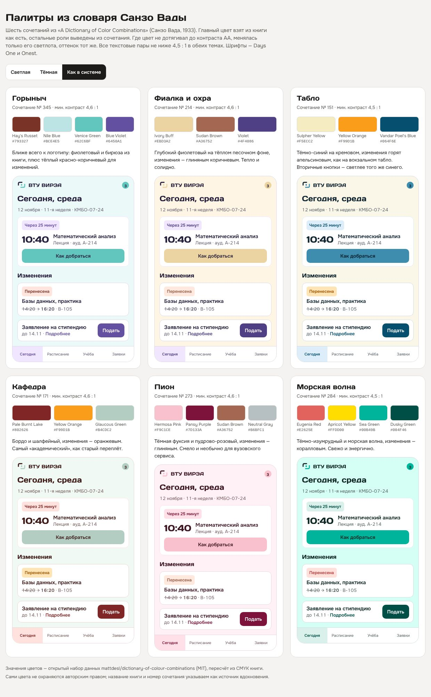
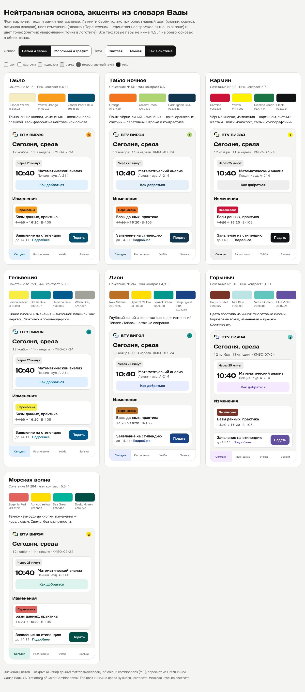

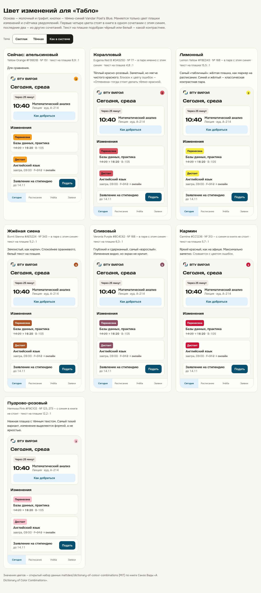

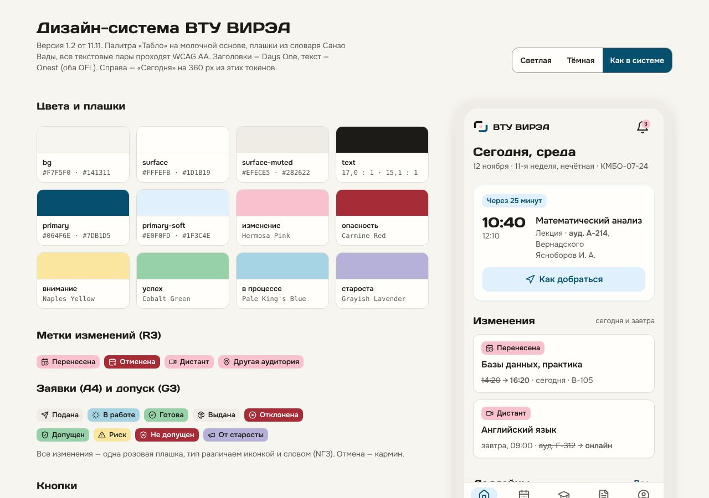

---

## 24. Название «Деканыч» и логотип «Одна пара»: от 40 концепций до файлов

- **Дата и время:** 2026-11-11 01:30 МСК
- **Инструмент:** Claude Code (SVG вручную, fontTools для перевода надписи в кривые, Playwright для проверки и PNG)
- **Кто ставил задачу:** Алёна
- **Этап плана:** 2 Дизайн
- **Требования PRD:** X1

### Задача
> Ты можешь переделать логотип заново?

Потом: «сделай логотип, связанный с Горынычем, заодно придумай название сервиса», «название Деканыч, над логотипом подумай ещё», вариации «Выглядывают», минимализм, надписи, варианты с глазами, «Одна пара» с исправленным контрастом.

### Что сделал ИИ
- Проверил, какие инструменты есть для логотипов: свой SVG, CoDesign (генерация требует входа в IMG.LY), Figma и Canva не подключились, в каталоге — генераторы растровых PNG. Выбрал SVG: вектор, права у проекта.
- Предложил пять названий; Алёна выбрала «Деканыч».
- Нарисовал около 40 вариантов знака в восьми подборках: уголки и сетка расписания, Горыныч (три шеи, профили, буква «Г»), головы, выглядывающие из-за карточки и из-за надписи, минимализм, глаза. Каждый проверял крупно, на 16 и 32 px, в светлой и тёмной теме.
- Для надписей измерил реальные позиции букв Days One в браузере и ставил головы по ним.
- Финал: знак «Одна пара» — драконьи глаза на тёмно-синей табличке. Сделал `dekanych-mark.svg`, `dekanych-logo.svg`, `dekanych-logo-dark.svg` (надпись переведена в кривые через fontTools), maskable-иконку, PNG 32/180/192/512 в `docs/brand/`.
- Обновил `docs/brand/README.md`, `design-system.md` (1.3), `context.md` (название и смена исполнителя логотипа), `PRD.md` (X1), `glossary.md`, `AGENTS.md`, `README.md`, `licenses.md`, `status.md`.

### Что проверил и поправил человек
Алёна выбирала на каждом шаге и заметила, что в тёмной теме глаза на табличке не видно.

### Ошибки ИИ
- Головы с рогами наверху читались как коты и чертята, профили — как лошади → видно на скриншотах → рога перенесены на бока, добавлены гребень, клыки, пасть → драконьи признаки задавать формой морды и гребнем, а не «ушами».
- Глаза с толстым зрачком распадались на два треугольника «◄►» → на скриншоте → глаз шире, зрачок тоньше.
- В тёмной теме глаза почти не видны: 1,5 : 1 → заметила Алёна → табличка тёмно-синяя в обеих темах, 5,8 : 1 → считать контраст знака в обеих темах до показа.
- Лист с надписями отрисовался запасным шрифтом, и головы встали не над теми буквами → проверил `document.fonts.check` → загрузил Days One из файла и измерил позиции букв.
- Две вспомогательные функции с одинаковым именем ломали страницу; плашки шапки вылезали за карточку; на 360 px была прокрутка → поймал проверкой в Playwright до публикации.

### Скриншоты
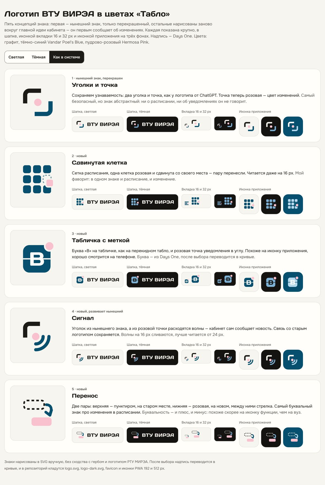

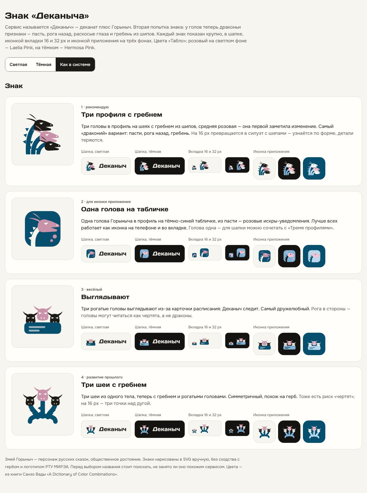
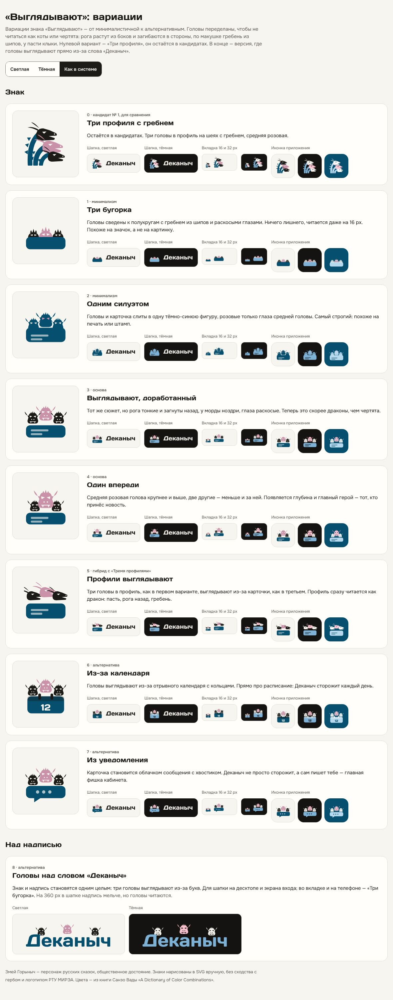
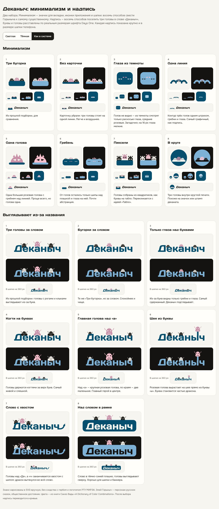
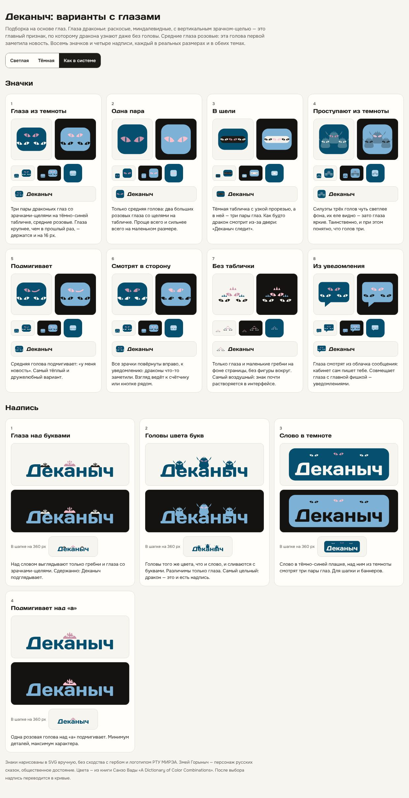
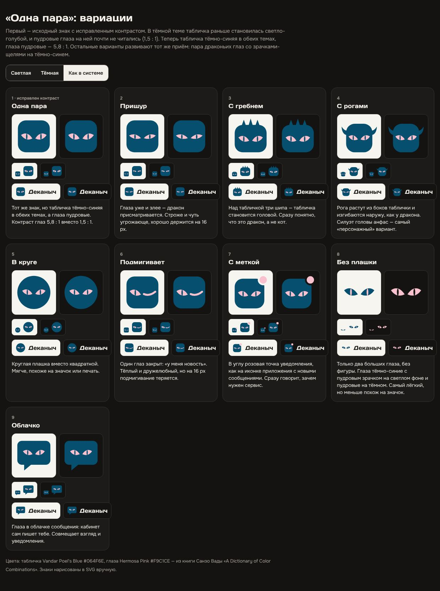

---

## 25. Макеты ключевых экранов «Деканыча» на 360 px и десктопе

- **Дата и время:** 2026-11-11 01:40 МСК
- **Инструмент:** Claude Code (холст Design в Claude Artifact)
- **Кто ставил задачу:** Алёна
- **Этап плана:** 2 Дизайн
- **Требования PRD:** T1, T2, R1–R4, A1, A4, P1–P3, S8, X1, NF1, NF3

### Задача
> макеты экранов

### Что сделал ИИ
- Собрал холст из восьми экранов по дизайн-системе 1.3 (палитра «Табло», плашки, Days One + Onest, логотип «Одна пара») и данным персоны Данилы из PRD:
  - **Вход** — знак, форма логина, плашка концепта (X1).
  - **Сегодня** — блоки строго по T1: ближайшая пара с «Как добраться», изменения (перенос, отмена, дистант), дедлайны с отметкой «сделано», новые оценки, заявки; нижнее меню.
  - **Расписание** — день/неделя, номер учебной недели, дни с точкой изменений, полная карточка пары (R2), «было → стало» с автором изменения (R3), «где аудитория» (R4), отменённая пара, онлайн-пара с кнопкой «Подключиться».
  - **Заявки** — каталог (A1), мои заявки со шкалой статусов и историей (A4), отказ с причиной и «Подать снова».
  - **Профиль** — данные студента (P1), студенческий с QR (P2), push, подтверждённая почта, смена адреса и отключение писем, тема, выход (P3, S8).
  - **Сегодня, тёмная тема** — первый экран.
  - **Сегодня и Расписание на десктопе** — боковое меню вместо нижнего, две колонки и недельная сетка.
- Все тексты на «ты», данные вымышленные, кнопки и строки не меньше 44 px.

### Что проверил и поправил человек
Нужно проверить: Алёна смотрит макеты на холсте и правит прямо в редакторе.

### Ошибки ИИ
Не было замечено. Холст по правилам редактора не проверялся рендером — проверка глазами за Алёной.

### Скриншоты
Скриншот нужен вручную: общий вид холста и экран «Сегодня» на 360 px.

---

## 26. Дизайн-система 2.0: стиль вокзального табло, шрифт заголовков, маршрут заявки

- **Дата и время:** 2026-11-11 02:15 МСК
- **Инструмент:** Claude Code (холст Design в Claude Artifact, WebSearch, Playwright, fontTools)
- **Кто ставил задачу:** Алёна
- **Этап плана:** 2 Дизайн
- **Требования PRD:** T1, R1–R4, A3, A4, P1–P3, NF1, NF3

### Задача
> Попробуй сделать дизайн менее типовым, более уникальным … Найди удачные примеры или воспользуйся рекомендациями из классических книг

Потом: «отрисовалось плохо, проверь и переделай; больше стиля табло; слово „табло“ убери; меньше текста сверху; поищи живые примеры», «переноси, верни этапы заявления как в доставке, подбери шрифт заголовков», «обнови дизайн-систему и запиши в репозиторий».

### Что сделал ИИ
- Предложил стиль «расписание как вокзальное табло» по мотивам швейцарской школы, Тафти, Круга, Нормана и «Refactoring UI»; нашёл живые примеры: страница статуса Crontap, split-flap-компоненты 21st.dev и shadcn.io, демо табло аэропорта.
- Сравнил шесть шрифтов заголовков с кириллицей и OFL (проверил наборы и `tnum` по пакетам Fontsource); выбран Sofia Sans Extra Condensed.
- Нарисовал на холсте 5 экранов на 360 px (Сегодня, Расписание, Заявки, Профиль, вход) и 3 на десктопе (Сегодня, Расписание на неделю, Заявки) и лист сравнения шрифтов. Этапы заявки — маршрут с остановками, студенческий — билет.
- Каждый экран собирал локально и проверял Playwright: выход за край, обрезанные строки, перенос плиток.
- Обновил `docs/design-system.md` до 2.0 (принцип «расписание — это табло», токены доски с контрастом, типографика, строка табло, плитка, маршрут заявки, билет, навигация), `licenses.md`, `context.md`, `status.md`.

### Что проверил и поправил человек
Алёна заметила, что первая версия отрисовалась плохо и наверху много текста; попросила убрать слово «табло» из меню и вернуть этапы заявки.

### Ошибки ИИ
- Первая версия: меню не влезало по высоте, линия на плитках читалась как зачёркивание, колонки на десктопе наезжали → заметила Алёна → проверил локальной сборкой, переделал → проверять каждую раскладку до публикации.
- Время в строках на 360 px переносилось на две строки; проверка «выход за край» этого не ловила → увидел на скриншоте → расширил колонку, добавил в проверку поиск переноса плиток.
- Цифры прошедших пар на плитке — 2,8 : 1, ниже AA → нашёл при расчёте контраста для дизайн-системы → заменил на `#A9C7D7` (4,5–5,6).
- В билете обрезался код группы, три названия в расписании не помещались → по проверке → полная ширина поля, сокращения.

### Скриншоты

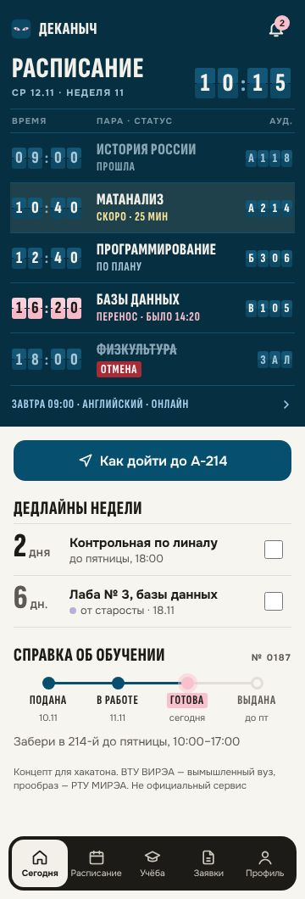
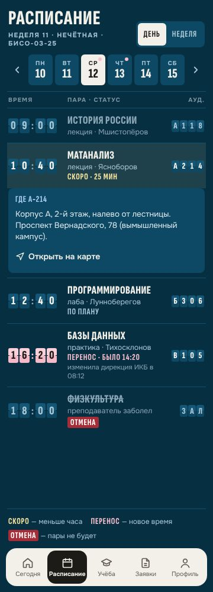
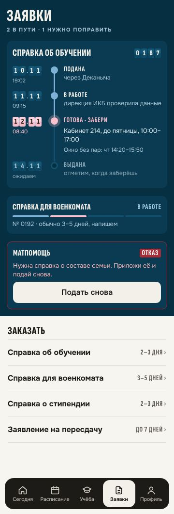
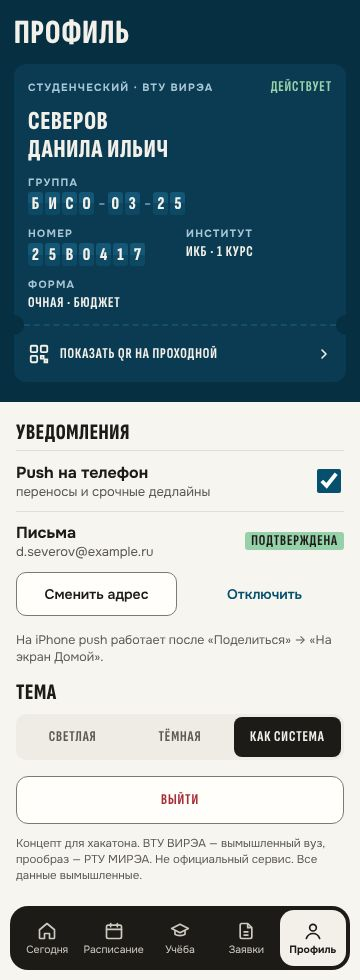
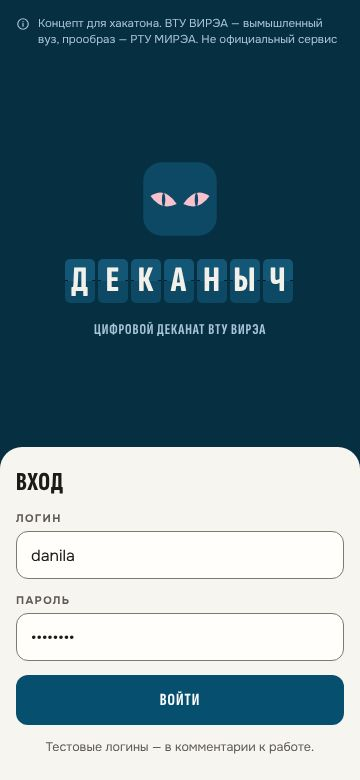

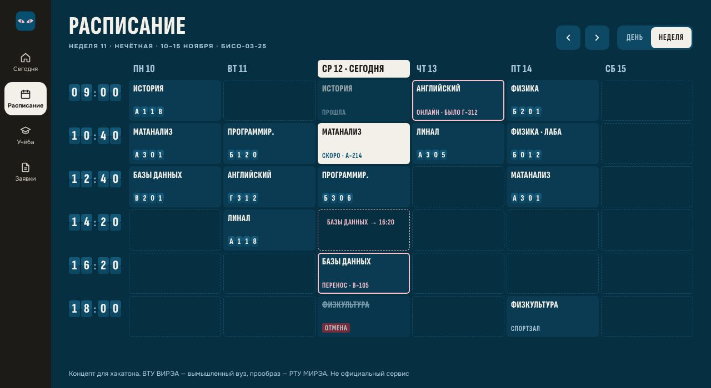

---

## 27. Дорисованы недостающие экраны в стиле табло

- **Дата и время:** 2026-11-11 02:25 МСК
- **Инструмент:** Claude Code
- **Кто ставил задачу:** Алёна
- **Этап плана:** 2 Дизайн
- **Требования PRD:** G1, G2, G3, N1, E1, E2, NF3

### Задача
После перехода на стиль вокзального табло не хватало части экранов.

> дорисовать недостающие экраны

### Что сделал ИИ
- «Учёба» на 360 px: сводка одной фразой (G2), средний балл, долги и допуск на плитках, таблица дисциплин с баллом и словом табло «допущен / риск» (G1), чек-лист допуска раскрыт у дисциплины с риском (G3).
- «Уведомления» на 360 px (N1): фильтры чипами, новые — на табло с плитками времени и розовой точкой непрочитанного, ранние — на молочном фоне; плашки типов по палитре Вады (перенос, заявка, дедлайн старосты, отмена, дистант, объявление); ссылка на настройку каналов.
- Тёмная тема «Сегодня»: табло без изменений, молочная часть — графит #141311, главная кнопка #7DB1D5, светлая капсула навигации.
- Кабинет сотрудника, 1280 px: очередь заявок как табло отправлений — номера на плитках (жёлтые — новые, розовые — срок завтра), мини-маршрут этапов, фильтры; панель заявки со сменой статуса, местом выдачи и историей (E1). Перенос пары: было и станет на плитках, причина, каналы, предпросмотр строки табло и push для студента, «прочитали N из M» по опубликованным изменениям (E2).
- Все экраны проверены локальным рендером: нет выхода за край, обрезанных строк и переносов плиток. Холст обновлён, `docs/status.md` и «Что дальше» в `docs/design-system.md` — тоже.

### Что проверил и поправил человек
Алёна посмотрела на холсте: в «Учёбе» подсветка строки «Базы данных» обрывалась прямыми углами над чек-листом. Строку и чек-лист объединил в один блок со скруглёнными углами; подпись «контрольные сданы» сократил до «всё сдано», чтобы не переносилась.

### Ошибки ИИ
- В «Уведомлениях» навигация уехала за низ экрана → заметил по проверке рендера → увеличил высоту макета → проверять, что капсула навигации видна на каждом скриншоте.
- В кнопке «В работе» текст переносился на две строки → увидел на скриншоте → запретил перенос в кнопках → кнопки статусов делать с `white-space: nowrap`.
- В сноске «Учёбы» было упоминание МИРЭА и PRD — служебный текст в интерфейсе → заметил при просмотре → заменил на пояснение шкалы → в макетах не писать служебные пометки.

- Подсветка строки с риском и чек-лист выглядели как два несвязанных куска → заметила Алёна → объединил в один скруглённый блок → раскрывающиеся детали строки оформлять одним блоком с самой строкой.

### Скриншоты
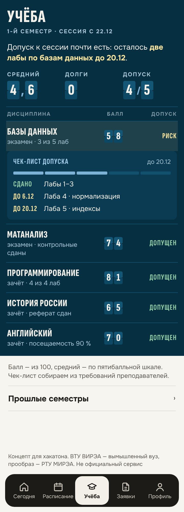

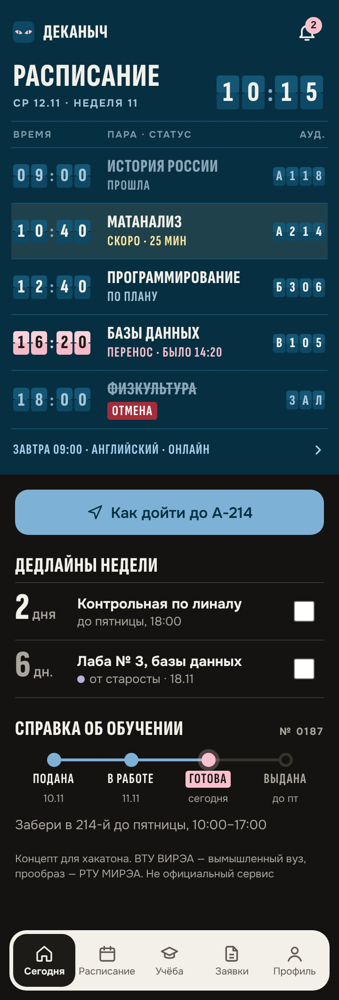
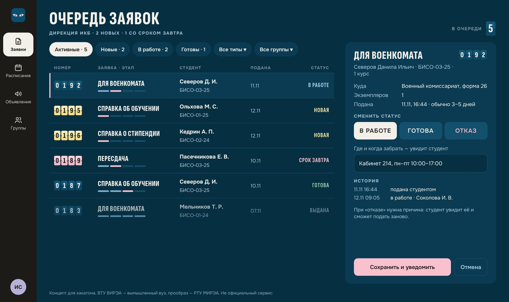

---

## 28. Последние экраны и песочный вариант табло для светлой темы

- **Дата и время:** 2026-11-11 15:20 МСК
- **Инструмент:** Claude Code
- **Кто ставил задачу:** Алёна
- **Этап плана:** 2 Дизайн
- **Требования PRD:** S6, N4, T2, NF1, NF3

### Задача
Дорисовать оставшиеся экраны и примерить другой цвет табло.

> Доделай недостающие экраны, в светлой теме попробуй поменять цвет табло с синего на песочный, как на старых табло

### Что сделал ИИ
- Староста (S6): публикация дедлайна, изменения или новости для своей группы, срок на плитках, список опубликованного со счётчиком «прочитали 21 из 24». Кто именно прочитал — не показываем.
- Настройки уведомлений (N4): таблица «тип × push / почта», утреннее письмо, тихие часы на плитках.
- Пустые состояния: выходной на табло («пар нет», плитки с прочерками), пустые заявки, уведомления, дедлайны и ошибка обновления расписания; места под иллюстрации ChatGPT подписаны.
- Песочное табло: скрипт пересчитал цвета табло во всех 15 экранах (12 прежних и 3 новых). Фон #E8DAB8, карточки #F3EAD3, графитовые плитки со светлыми цифрами, статусы затемнены до контраста от 4,5:1 на песке. Синий вариант и тёмная тема не тронуты, выбор — за Алёной.
- Холст обновлён, `docs/status.md` и «Что дальше» в `docs/design-system.md` — тоже.

### Что проверил и поправил человек
Нужно проверить: выбрать синий или песочный вариант на холсте.

### Ошибки ИИ
- При автозамене цветов в песочный текст на плитках, днях недели, переключателе темы и выбранной паре недели стал тёмным на тёмном → увидел на листе со всеми экранами → добавил исключения в скрипт и перепроверил все экраны → после автоматической перекраски смотреть каждый экран глазами, а не только проверку переполнения.
- Тусклый текст «прошла» на песке сначала был 4,2:1 → посчитал контраст до вёрстки → затемнил до #625842 → считать контраст для каждой пары «текст — фон» новой палитры.
- В прошлой задаче строка о макетах учёбы и сотрудника не добавилась в `docs/status.md`: замена не нашла текст и молча ничего не сделала → заметил сейчас → добавил строку → в скриптах правки документов проверять, что замена сработала.

### Скриншоты
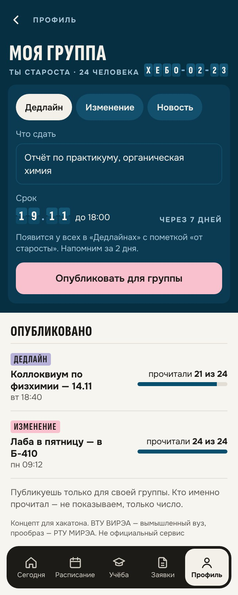
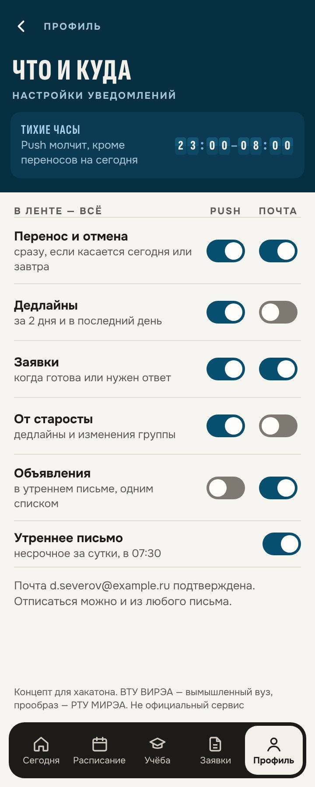
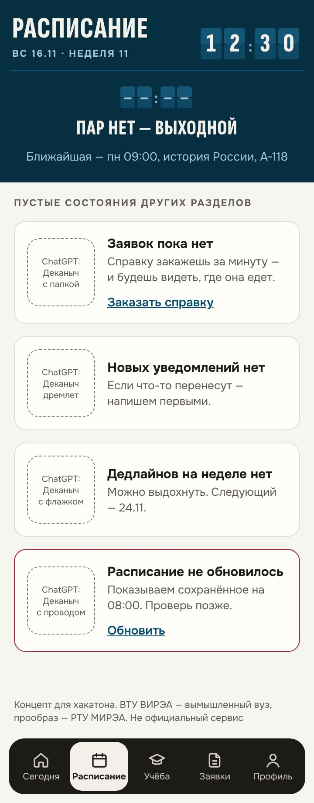
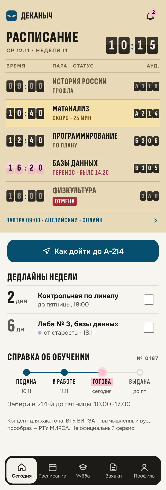
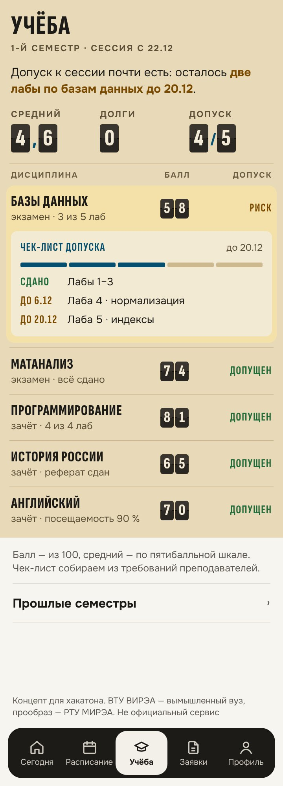

---

## 29. Песочное табло принято, главные кнопки в светлой теме — розовые

- **Дата и время:** 2026-11-11 17:36 МСК
- **Инструмент:** Claude Code
- **Кто ставил задачу:** Алёна
- **Этап плана:** 2 Дизайн
- **Требования PRD:** NF1, NF3

### Задача
Алёна выбрала песочное табло и попросила поменять цвет кнопок.

> Мне все нравится, песочный для табло отлично, цвет кнопок в светлой теме можно поменять на розовый

### Что сделал ИИ
- В песочных макетах главные кнопки стали розовыми `#F9C1CE` с тёмным текстом (11,1:1): «Как дойти до А‑214», «Войти», «Подать снова», «+ Новая заявка». Чипы фильтров и переключатели остались графитовыми — это выбор, а не действие.
- `docs/design-system.md`: таблица «Табло» теперь в двух колонках — песок для светлой темы, синее для тёмной, с контрастом каждой пары; добавлены токены `--action` / `--on-action`, правило, как не спутать розовую кнопку с розовым «переносом»; исправлены задвоенные заголовки «Метка» и «Кнопки».
- `docs/context.md` — строка с решением, `docs/status.md` — задача выбора цвета закрыта.
- Холст обновлён.

### Что проверил и поправил человек
Алёна выбрала песочный вариант на холсте и предложила розовые кнопки. Розовые кнопки на макетах — нужно посмотреть.

### Ошибки ИИ
- В `design-system.md` при правке скриптом в текст попали буквальные `\n` вместо переноса строки → заметил, когда проверял раздел → исправил → после правок скриптом просматривать изменённый раздел.

### Скриншоты

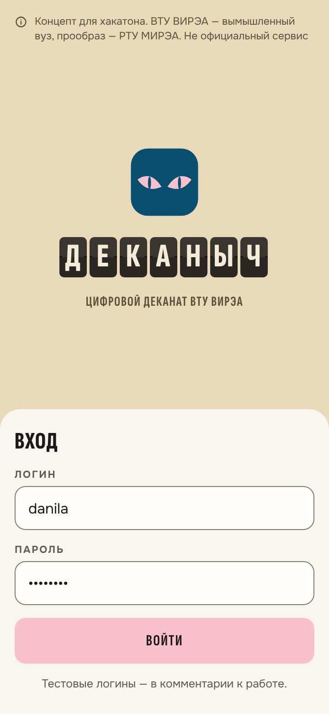

---

## 30. Розовый вариант логотипа для светлой темы

- **Дата и время:** 2026-11-11 17:38 МСК
- **Инструмент:** Claude Code
- **Кто ставил задачу:** Алёна
- **Этап плана:** 2 Дизайн
- **Требования PRD:** X1

### Задача
> сделай вариант логотипа для светлой темы с розовым фоном и синими глазами

### Что сделал ИИ
- Знак и логотип с надписью с инвертированными цветами: розовая табличка `#F9C1CE`, синие глаза `#064F6E`, розовые зрачки. Контраст глаз и таблички 5,8:1. Файлы: `docs/brand/dekanych-mark-pink.svg`, `docs/brand/dekanych-logo-pink.svg`; строка в `docs/brand/README.md`.
- Лист сравнения на холсте: нынешний и розовый знак на молочном и на песочном фоне в размерах 64/40/24/16 px, шапка «Сегодня» на песке, логотип с надписью.
- Нынешний логотип не заменён: розовый — вариант, пока Алёна не решит.

### Что проверил и поправил человек
Нужно посмотреть лист сравнения на холсте и выбрать.

### Ошибки ИИ
Не было.

### Скриншоты

---

## 31. Розовый знак для светлой темы: рамка, иконки, шапки

- **Дата и время:** 2026-11-11 17:42 МСК
- **Инструмент:** Claude Code
- **Кто ставил задачу:** Алёна
- **Этап плана:** 2 Дизайн
- **Требования PRD:** X1

### Задача
> берем розовый, перерисуй иконки и шапки. сделай тонкую рамку более темного оттенка розового

### Что сделал ИИ
- Знак светлой темы: розовая табличка `#F9C1CE` с рамкой `#C06A85` (2 из 64 единиц), синие глаза `#064F6E`. Рамку подобрал по контрасту с фоном: на песке 2,7:1, на молочном 3,4:1 — у самой таблички было 1,1 и 1,4.
- `docs/brand/`: `dekanych-mark.svg` и `dekanych-logo.svg` теперь розовые; синий знак сохранён как `dekanych-mark-dark.svg` для тёмной темы, `dekanych-logo-dark.svg` не менялся. Временные `*-pink.svg` удалены — их заменили основные файлы.
- Иконки приложения перерисованы: `icon-192.png`, `icon-512.png`, `apple-touch-icon.png` — розовый квадрат без рамки (maskable, рамку обрезало бы), `favicon-32.png` — знак с рамкой; `dekanych-icon-full.svg` — исходник.
- Макеты светлой темы: розовый знак в шапке «Сегодня», на входе, в навигации десктопа, в предпросмотре push у сотрудника. Лист сравнения на холсте обновлён.
- Обновлены `docs/brand/README.md`, раздел «Логотип в интерфейсе» в `docs/design-system.md`, строка решения в `docs/context.md`. README репозитория показывает `dekanych-logo.svg` — там теперь розовый знак.

### Что проверил и поправил человек
Алёна выбрала розовый вариант и попросила рамку. Нужно посмотреть на холсте и на иконках.

### Ошибки ИИ
Не было.

### Скриншоты
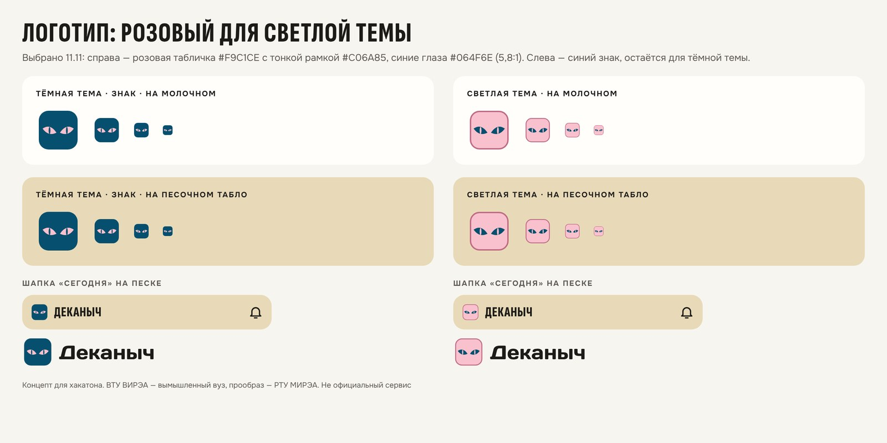

---

## 32. Сравнение GigaChat и YandexGPT по лимитам и цене, предложение по документам помощника

- **Дата и время:** 2026-11-11 17:47 МСК
- **Инструмент:** Claude Code
- **Кто ставил задачу:** Алёна
- **Этап плана:** 1 Исследование
- **Требования PRD:** AI1, AI3, G1

### Задача
После дизайна Алёна написала «дальше». Взял следующие задачи этапа 2a из `docs/status.md`, закреплённые за Claude Code: сравнение ИИ-провайдеров и открытые вопросы PRD.

### Что сделал ИИ
- Прочитал официальные тарифы GigaChat (Freemium 365 млн токенов на 12 месяцев, один поток, только некоммерческое использование) и условия стартового гранта Yandex Cloud (от 4 000 ₽, нужна карта).
- Написал [`docs/research/ai-provider.md`](../../research/ai-provider.md): таблица сравнения, рекомендация GigaChat с YandexGPT как запасным, 5 вопросов для проверки, когда будут ключи.
- Предложил вместо реальных правил МИРЭА написать демо-положение ВТУ ВИРЭА для шкалы оценок и для базы помощника.
- В PRD отметил решённым вопрос о названии и логотипе, к остальным открытым вопросам добавил ссылки и статус. Обновил `docs/status.md`.
- Для чтения первоисточников создал среду проекта `VIREA_Decanat` с доступом к www.mirea.ru, developers.sber.ru, yandex.cloud и aistudio.yandex.ru (с подтверждения Алёны в окне запроса).

### Что проверил и поправил человек
Нужно решить: GigaChat или YandexGPT, демо-положение или реальные правила; выдать ключи для проверки на 5 вопросах.

### Ошибки ИИ
- Сначала искал через поиск и получил противоречивые цифры из сторонних обзоров (1 млн токенов против 365 млн) → проверил по changelog и странице тарифов Сбера → в документ взял только цифры первоисточника, сторонние пометил → цены и лимиты брать только с официальных страниц.
- Не смог прочитать mirea.ru (DDoS-Guard блокирует зарубежные адреса) и цены AI Studio (капча) → записал это в документ, цифры не додумывал.

### Скриншоты
Не нужны — текстовое исследование.

---

## 33. Демо-положение ВТУ ВИРЭА и решения по ИИ-провайдеру

- **Дата и время:** 2026-11-11 20:04 МСК
- **Инструмент:** Claude Code
- **Кто ставил задачу:** Алёна
- **Этап плана:** 2 Дизайн (2a: открытые вопросы PRD)
- **Требования PRD:** AI1, G1, G2, G3, A1, D2

### Задача
Алёна приняла решения по открытым вопросам:

> 1. гигачат
> 2. демо-положение

### Что сделал ИИ
- Написал [`docs/knowledge/polozhenie-demo.md`](../../knowledge/polozhenie-demo.md) — «Положение об учёбе и услугах дирекции ВТУ ВИРЭА (демо)», 9 разделов с номерами пунктов для ссылок помощника: баллы за семестр (0–100), допуск (от 50 баллов и все обязательные работы), автомат (зачёт от 60, «отлично» от 85), пересдача и болезнь в сессию, справки и сроки, матпомощь, стипендия, изменения расписания и напоминания. Летней практики в положении нет — по ней помощник должен честно ответить «не знаю» (5-й проверочный вопрос).
- Сверил положение с макетами: сроки справок, пересдачи, матпомощи и статус «риск» у баз данных совпадают.
- Записал решения в `docs/context.md`, закрыл открытые вопросы в PRD и задачи в `docs/status.md`, добавил задачу «проверить ответы GigaChat на 5 вопросах».

### Что проверил и поправил человек
Нужно прочитать положение: цифры (пороги, сроки) придуманы для демо и могут быть изменены.

### Ошибки ИИ
- В макетах старосты и настроек уведомлений было «напомним за 2 дня», а в PRD (D2) — за 3 дня и за 1 день → заметил при сверке с положением → исправил макеты на холсте → тексты в макетах сверять с требованиями PRD.
- В первой версии положения статус «риск» включался только за 14 дней до сессии — тогда «Базы данных» на макете «Учёба» (12.11, сессия с 22.12) не были бы в риске → поправил правило: «риск», пока сессия не началась и условие не выполнено.

### Скриншоты
Не нужны — текст.

---

## 34. Подключение GigaChat: ключ сохранён, проверка из облака упёрлась в сертификат

- **Дата и время:** 2026-11-11 20:13 МСК
- **Инструмент:** Claude Code
- **Кто ставил задачу:** Алёна
- **Этап плана:** 2 Дизайн (2a: проверки)
- **Требования PRD:** AI1, AI3

### Задача
> открой форму

Получить ключ GigaChat API, не показывая его в чате и репозитории, и проверить ответы на 5 вопросах по демо-положению.

### Что сделал ИИ
- Прочитал документацию Сбера по авторизации: ключ (Client ID и Client Secret) → токен на 30 минут на `ngw.devices.sberbank.ru:9443` → запросы на `api.giga.chat`.
- Открыл защищённую форму секрета среды; Алёна ввела Client ID и Client Secret. Значение в чат, журнал и репозиторий не попало.
- Попробовал получить токен: `ngw.devices.sberbank.ru` обрывает соединение, `api.giga.chat` — ошибка проверки сертификата. Причина — сертификат НУЦ Минцифры, которому не доверяет сетевой прокси облака. Ключ тут ни при чём.
- Записал порядок подключения в [`docs/research/ai-provider.md`](../../research/ai-provider.md#как-подключать-gigachat), добавил в `.env.example` переменные `GIGACHAT_SCOPE`, `GIGACHAT_MODEL`, `GIGACHAT_CA_BUNDLE`. Проверку на 5 вопросах перенёс на VPS после деплоя каркаса.

### Что проверил и поправил человек
Алёна ввела ключ в форму. Нужно: при деплое положить ключ в `.env` на VPS и установить сертификат Минцифры.

### Ошибки ИИ
- Не проверил заранее, что Сбер работает на сертификате Минцифры, и открыл форму до проверки сети → узнал по ошибке TLS → записал требование в исследование → перед запросом ключа проверять, что хост вообще доступен из этой среды.

### Скриншоты
Не нужны.

---

## 35. Промпты ChatGPT для иллюстраций пустых состояний

- **Дата и время:** 2026-11-11 20:16 МСК
- **Инструмент:** Claude Code
- **Кто ставил задачу:** Алёна
- **Этап плана:** 2 Дизайн
- **Требования PRD:** T2

### Задача
> напиши промт для gpt для генерации картинок пустых состояний

### Что сделал ИИ
- [`docs/brand/empty-states-prompts.md`](../../brand/empty-states-prompts.md): общий стиль (персонаж Деканыч — розовая табличка-дракончик с глазами из логотипа, плоский вектор, палитра из дизайн-системы, PNG 1024×1024 с прозрачным фоном, без текста и символики МИРЭА) и 5 сцен: выходной, нет заявок, нет уведомлений, нет дедлайнов, ошибка обновления расписания. Подсказки, что делать, если персонаж получился не тем.
- Таблица «Что ещё нужно» в `docs/brand/README.md` расширена до 5 файлов, в `docs/status.md` — ссылка на промпты.

### Что проверил и поправил человек
Нужно: прогнать промпты в ChatGPT, выбрать варианты.

### Ошибки ИИ
Не было.

### Скриншоты
Не нужны.

---

## 36. Промпты пустых состояний: светлая и тёмная версии

- **Дата и время:** 2026-11-11 20:46 МСК
- **Инструмент:** Claude Code
- **Кто ставил задачу:** Алёна
- **Этап плана:** 2 Дизайн
- **Требования PRD:** T2, NF3

### Задача
> переделай основную инструкцию - мне нужно результат в двух вариантах - для светлой и для темной темы - розовый и синий соответственно

### Что сделал ИИ
- Переписал общий стиль в [`docs/brand/empty-states-prompts.md`](../../brand/empty-states-prompts.md): одна композиция, две раскраски. Светлая — розовый Деканыч (как знак светлой темы), графитовые линии. Тёмная — синий Деканыч с розовыми глазами (как знак тёмной темы), светлые контуры и тёмно-синие плитки, чтобы читалось на #141311 и #062F42.
- Порядок: 3 варианта светлой версии → выбор → «сделай тёмную версию варианта N». Имена файлов `<имя>-light.png` и `<имя>-dark.png`, таблица в `docs/brand/README.md` обновлена.
- В сцене «уведомлений нет» убрал жёсткий цвет закрытых глаз — в тёмной версии глаза розовые.

### Что проверил и поправил человек
Нужно: прогнать в ChatGPT.

### Ошибки ИИ
- В первой версии промптов не учёл тёмную тему — заметила Алёна → добавил вторую раскраску → иллюстрации и иконки сразу описывать для обеих тем.

### Скриншоты
Не нужны.

---

## 37. Разбивка этапов 3 и 4 на задачи, промпт для аватаров

- **Дата и время:** 2026-11-11 21:41 МСК
- **Инструмент:** Claude Code
- **Кто ставил задачу:** Алёна
- **Этап плана:** 3 Каркас (подготовка)
- **Требования PRD:** все Must, T2

### Задача
> дальше

Дизайн и решения этапа 2 закрыты; следующий шаг по `docs/status.md` — разбить этап 3 на задачи.

### Что сделал ИИ
- В `docs/status.md` вместо «разбиваем после этапа 2» — таблицы: этап 3 (9 задач каркаса с зависимостями и исполнителями по зонам из `AGENTS.md`) и этап 4 (13 задач Must с требованиями и сценариями S1–S9). Исполнители — черновик, подтверждают сами.
- В `docs/brand/empty-states-prompts.md` — промпт для 4 аватаров-заглушек (табличка цвета плашки и предмет роли, без людей), таблица в `docs/brand/README.md` обновлена.

### Что проверил и поправил человек
Нужно: Алёне и напарнику подтвердить исполнителей и порядок.

### Ошибки ИИ
Не было.

### Скриншоты
Не нужны.

---

## 38. Каркас приложения на Next.js (задача 3.1)

- **Дата и время:** 2026-11-11 21:54 МСК
- **Инструмент:** Claude Code
- **Кто ставил задачу:** Алёна
- **Этап плана:** 3 Каркас
- **Требования PRD:** NF1, NF7, X1

### Задача
> начни делать задачи напарника

### Что сделал ИИ
- Создал проект Next.js 15.5 (App Router, TypeScript, Tailwind CSS 4, ESLint) через `create-next-app`, добавил Prettier, Lucide, помощник `cn` и `components.json` для shadcn/ui.
- Шрифты Onest и Sofia Sans Extra Condensed подключены пакетами `@fontsource` — файлы раздаёт наш сервер, Google Fonts не используется (правило 6 `AGENTS.md`).
- `lang="ru"`, заголовок и описание с пометкой концепта, иконки из `docs/brand/` в `public/brand/`, цвет панели браузера для обеих тем, `output: "standalone"` для Docker.
- Временная страница с плашкой концепта (X1). Токены дизайн-системы — отдельная задача 3.6.
- Структура `src/app`, `src/components/ui`, `src/lib`, `src/server`; раздел «Запуск» в README.
- Проверки: `npm run lint`, `npm run typecheck`, `npm run build` проходят; страница на 360 px без горизонтальной прокрутки.

### Что проверил и поправил человек
Нужно: ревью PR (по возможности — напарник).

### Ошибки ИИ
Не было. Замечание: `npm audit` показывает уязвимость во встроенном в Next.js 15 PostCSS (влияет на сборку, не на работу сайта); исправление есть только в Next.js 16 — оставили 15.5, вернёмся при обновлении.

### Скриншоты

---

## 39. Схема БД в Prisma и первая миграция (задача 3.3)

- **Дата и время:** 2026-11-11 21:57 МСК
- **Инструмент:** Claude Code
- **Кто ставил задачу:** Алёна
- **Этап плана:** 3 Каркас
- **Требования PRD:** все (NF5, NF6)

### Задача
> начни делать задачи напарника

Задача 3.3 — Prisma-схема и миграция по `docs/data-model.md`.

### Что сделал ИИ
- `prisma/schema.prisma`: 42 модели по `docs/data-model.md` — вход и профиль, расписание с историей изменений, оценки и допуск, дедлайны, объявления, заявки со статусами и слотами, лента, доставки push и e-mail, дайджест, напоминания, подписки, лимиты, документы помощника. UUID, `timestamptz`, индексы из раздела «Запросы и индексы».
- В SQL миграции — то, что Prisma не описывает: частичный уникальный индекс подписки на почту, проверки времени, обязательная причина отказа, один источник у уведомления, соответствие канала и подписки.
- Миграция применена на локальном PostgreSQL 16 в контейнере. `src/server/db.ts` — клиент Prisma только для сервера (`server-only`).
- Дополнения к логической схеме описаны в разделе «Реализация в Prisma» `docs/data-model.md`; устаревшая фраза про открытые вопросы заменена ссылкой на демо-положение.

### Что проверил и поправил человек
Нужно: ревью схемы (по возможности — напарник, владелец модели данных).

### Ошибки ИИ
Не было.

### Скриншоты
Не нужны.

---

## 40. Вход по логину и паролю, сессии и роли (задача 3.4)

- **Дата и время:** 2026-11-11 22:02 МСК
- **Инструмент:** Claude Code
- **Кто ставил задачу:** Алёна
- **Этап плана:** 3 Каркас
- **Требования PRD:** NF5, X1, S9

### Задача
> начни делать задачи напарника

Задача 3.4 — вход, argon2id, сессия в cookie, роли, лимит попыток.

### Что сделал ИИ
- Пароли — argon2id (`@node-rs/argon2`, параметры OWASP). Если логина нет, сервер всё равно проверяет пароль по пустому хэшу — по времени ответа нельзя узнать, есть ли логин.
- Сессия: случайный токен 32 байта в cookie `dk_session` (HttpOnly, Secure, SameSite=Lax, 14 дней), в БД — только HMAC токена с `SESSION_SECRET`. Выход отзывает сессию.
- `getCurrentUser()` — единственный источник `userId`, роли и группы; староста — по `GroupHead`. `requireUser()` ведёт на вход, `requireStaff()` студенту отвечает 404.
- Лимит попыток до проверки пароля: 5 на логин и 30 с адреса за 15 минут, атомарный счётчик в `RateLimitBucket`.
- Страницы: вход (розовая кнопка, плашка концепта), временная оболочка кабинета с выходом, заглушки «Сегодня» и «Кабинет сотрудника».
- Проверил в браузере на временных пользователях локальной БД: неверный пароль → понятная ошибка; вход студента → «Сегодня»; cookie HttpOnly/Secure/Lax; студент на `/staff` → 404; выход → на вход; сотрудник → `/staff`; шестая попытка → «Слишком много попыток».

### Что проверил и поправил человек
Нужно: ревью PR.

### Ошибки ИИ
- Первый прогон теста упал: сервер из прошлой проверки не остановился и занимал порт, а селектор `[role=alert]` находил служебный элемент Next.js → остановил процесс по порту, уточнил селектор → в тестах искать сообщения по своему элементу, а не по роли.

### Скриншоты

---

## 41. Демо-данные: 4 тестовых аккаунта, расписание, изменения, оценки, заявки (задача 3.5)

- **Дата и время:** 2026-11-11 22:07 МСК
- **Инструмент:** Claude Code
- **Кто ставил задачу:** Алёна
- **Этап плана:** 3 Каркас
- **Требования PRD:** NF6, G1, AI1, S1–S6

### Задача
> начни делать задачи напарника

Задача 3.5 — сиды по данным макетов.

### Что сделал ИИ
- `prisma/seed.ts` (`npm run db:seed`) полностью пересоздаёт демо: 3 института, 3 группы по 27 человек, 4 корпуса с вымышленными адресами, 9 вымышленных преподавателей, расписание всего семестра (521 занятие) по шаблонам групп.
- «Сегодня» и «завтра» у БИСО-03-25 — ровно как в макетах и строятся от текущей даты по Москве: перенос баз данных 14:20 → 16:20, отмена физкультуры, английский завтра онлайн. Изменения опубликованы от дирекции с историей и уведомлениями группе.
- Оценки и допуск: у Данилы базы данных 58 баллов и «риск» (3 из 5 лаб), у Ксении — риск по базам данных и прошлая сессия со средним 4,6. Дедлайны (в том числе «от старосты»), объявление, заявки №0187 (готова), №0192 (в работе), отказ по матпомощи с причиной, очередь дирекции.
- Марат — староста своей группы, его публикация «прочитали 21 из 26». Ирина — сотрудник с тремя институтами.
- Демо-положение разобрано на 39 пунктов в `HelpDocumentSection`.
- Пароль тестовых аккаунтов — из `SEED_PASSWORD` или генерируется и печатается в консоль; в репозиторий не попадает.
- Повторный запуск проверен: база пересоздаётся без ошибок; `lint` и `typecheck` проходят.

### Что проверил и поправил человек
Нужно: ревью PR.

### Ошибки ИИ
- Первый запуск упал: ключи корпусов в коде были латиницей, а в кодах аудиторий — кириллица → добавил явное соответствие букв и понятную ошибку → коды из интерфейса не смешивать с ключами в коде.
- Заметил, что в макете «Расписание» адрес корпуса — реальный адрес РТУ МИРЭА → в сидах адреса вымышленные; макет нужно поправить.

### Скриншоты
Не нужны — данные проверены SQL-запросами.

---

## 42. Docker, Compose и Caddy для деплоя (задача 3.2, без VPS)

- **Дата и время:** 2026-11-11 22:18 МСК
- **Инструмент:** Claude Code
- **Кто ставил задачу:** Алёна
- **Этап плана:** 3 Каркас
- **Требования PRD:** NF5, NF7

### Задача
> начни делать задачи напарника

Задача 3.2 — Docker Compose и Caddy на российском VPS. VPS ещё не выбран, поэтому подготовлены файлы и инструкция.

### Что сделал ИИ
- `Dockerfile`: многоэтапная сборка на Debian (glibc для argon2 и Prisma), итоговый образ — standalone-сервер Next.js от непривилегированного пользователя.
- `docker-compose.yml`: PostgreSQL 16 с томом и проверкой готовности, приложение, разовые команды `tools` (миграции, сид), Caddy с HTTPS; `restart: unless-stopped`; порт базы наружу не открыт; сертификат Минцифры для GigaChat монтируется из `deploy/certs/` (в репозиторий не коммитится).
- `deploy/Caddyfile`: HTTPS, сжатие, заголовки безопасности, проксирование с честным `X-Forwarded-For` для лимита входа.
- [`docs/setup/deploy.md`](../../setup/deploy.md): первый запуск, обновление, утренний сброс демо по cron, проверка доступа к Docker Hub из РФ.
- Проверил standalone-сборку локально: сервер стартует, вход сотрудника по сидам работает.

### Что проверил и поправил человек
Нужно: выбрать VPS и домен, затем первый деплой по инструкции.

### Ошибки ИИ
- Сборку образа в облачной среде проверить не удалось: `apt` и `npm ci` внутри Docker не достают до сети песочницы → проверил standalone-сборку без Docker, в инструкции записал, что образ проверяем на VPS → не считать Docker-образ проверенным до первого запуска на сервере.

### Скриншоты
Не нужны.

---

## 43. Скрипт первой настройки VPS

- **Дата и время:** 2026-11-11 22:53 МСК
- **Инструмент:** Claude Code
- **Кто ставил задачу:** Алёна
- **Этап плана:** 3 Каркас
- **Требования PRD:** NF5, NF7

### Задача
> я все купила что делать

Алёна купила VPS на REG.RU и домен. Нужен простой путь к первому деплою.

### Что сделал ИИ
- Подсказал выбор: VPS у российского хостинга (REG.RU, Yandex Cloud), диск 26 ГБ хватает, для домена `.ru` нужны паспортные данные и подтверждение личности.
- [`deploy/setup-server.sh`](../../../deploy/setup-server.sh): Docker из репозитория Ubuntu (доступен из России), файрвол, подкачка, проверка Docker Hub, ключ развёртывания для приватного репозитория, клонирование, `.env` со случайными секретами (права 600), сборка, миграции, демо. Повторный запуск пропускает сделанное.
- Ссылка на скрипт — в [`docs/setup/deploy.md`](../../setup/deploy.md).

### Что проверил и поправил человек
Нужно: запустить на сервере.

### Ошибки ИИ
Не было. Скрипт проверен только на синтаксис (`bash -n`): на этой машине нет systemd и файрвола — проверка на реальном сервере.

### Скриншоты
Не нужны.

---

## 44. Первый деплой на Yandex Cloud

- **Дата и время:** 2026-11-12 00:33 МСК
- **Инструмент:** Claude Code
- **Кто ставил задачу:** Алёна
- **Этап плана:** 3 Каркас
- **Требования PRD:** NF7

### Задача
Развернуть сайт на российском VPS: выбрать сервер, купить домен, запустить скрипт настройки.

### Что сделал ИИ
- Объяснил, почему обычный хостинг не подходит (нужны постоянный Node.js-сервер, PostgreSQL, фоновые задачи, Docker), и предложил Yandex Cloud со стартовым грантом вместо Рег.облака от 5 000 ₽.
- Провёл Алёну по созданию ВМ (2 vCPU, 4 ГБ, HDD 20 ГБ из-за квоты SSD 10 ГБ), SSH-ключу, группе безопасности, A-записям, запуску `deploy/setup-server.sh` и ключу развёртывания GitHub.
- Диагностировал по скриншотам: `Permission denied` — не указан логин; `syntax error` — набраны угловые скобки; `NXDOMAIN` — у домена DNS-серверы хостинга REG.RU (`ns*.hosting.reg.ru`), а A-записи — в обычной зоне REG.RU.
- Записал результат и грабли в [`docs/setup/deploy.md`](../../setup/deploy.md) и `docs/status.md`.

### Что проверил и поправил человек
Алёна создала ВМ и домен, запустила скрипт. Проверено на сервере: контейнеры `app`, `db`, `caddy` работают, `/login` отвечает 200, HTTP переадресуется на HTTPS. Осталось переключить DNS-серверы домена и проверить сайт с телефона.

### Ошибки ИИ
- В инструкциях писал `<домен>` и `<IP-адрес>` без пояснения, что скобки набирать не нужно → Алёна получила `syntax error` → объяснил; в документацию добавил предупреждение → в командах для человека давать готовые примеры без угловых скобок.
- Не предупредил заранее, что при покупке домена вместе с хостингом REG.RU ставит DNS-серверы хостинга → нашли по WHOIS → описал в «Граблях» → при настройке домена сразу проверять `nserver` в WHOIS.

### Скриншоты
Скриншот нужен вручную: открытая страница `https://dekanych.ru/login` на телефоне, когда заработает DNS.

---

## 45. Сертификат Минцифры — только для клиента GigaChat

- **Дата и время:** 2026-11-12 00:36 МСК
- **Инструмент:** Claude Code
- **Кто ставил задачу:** Алёна
- **Этап плана:** 3 Каркас
- **Требования PRD:** AI1, NF5

### Задача
> давай разберемся с сертификатом минцифры

### Что сделал ИИ
- По [документации GigaChat](https://developers.sber.ru/docs/ru/gigachat/certificates) нужны корневой и выпускающий сертификаты НУЦ Минцифры; источник — портал Госуслуг.
- Убрал `NODE_EXTRA_CA_CERTS` из `docker-compose.yml`: раньше сертификат подключался ко всему приложению, и оно доверяло этому центру во всех соединениях. Теперь путь передаётся только клиенту GigaChat через `GIGACHAT_CA_BUNDLE` (файл `russian_trusted_ca.pem`). Заодно пропадёт предупреждение в логах.
- [`deploy/certs/README.md`](../../../deploy/certs/README.md) — как скачать, проверить владельца и соединение с GigaChat на сервере. Обновлены `.env.example`, `deploy/setup-server.sh`, `docs/setup/deploy.md`, `docs/research/ai-provider.md`.
- Ответил Алёне, что сертификат сейчас не обязателен: он нужен только ИИ-помощнику (этап 5).

### Что проверил и поправил человек
Алёна решила отложить установку сертификата до подключения помощника.

### Ошибки ИИ
- В первой версии деплоя подключил сертификат ко всему приложению → заметил при разборе → ограничил клиентом GigaChat → доверие к дополнительным центрам сертификации давать только тому коду, которому оно нужно.

### Скриншоты
Не нужны.

---

## 46. Токены, компоненты табло, навигация; экраны «Сегодня» и «Расписание»

- **Дата и время:** 2026-11-12 00:45 МСК
- **Инструмент:** Claude Code
- **Кто ставил задачу:** Алёна
- **Этап плана:** 4 Must
- **Требования PRD:** T1, T2, R1, R2, R3, R4, D1, D3, A4, NF1, NF3, X1; сценарий S1

### Задача
> начинай делать этап 4

### Что сделал ИИ
- Задачи 3.6–3.8 (зона Алёны, по её просьбе): токены светлой (песочное табло, розовые кнопки) и тёмной (синее табло) темы в CSS-переменных и Tailwind; тема из настроек пользователя через `data-theme`; компоненты — плитки, слова-статусы, плашки, компактный маршрут заявки, строка табло, плашка концепта; капсула навигации на телефоне и панель слева на десктопе для студента и сотрудника.
- «Сегодня» (4.2): часы на плитках, пары дня с состояниями «прошла / идёт / скоро · N мин / по плану / перенос · было / дистант / отмена», завтрашняя первая пара, кнопка «Как дойти до …», дедлайны недели с отметкой «сделано» (D3, проверка, что дедлайн своей группы), самая важная заявка с маршрутом, счётчик непрочитанного.
- «Расписание» (4.3): день и неделя, вкладки дней с розовой точкой изменений, листание недель, «Где аудитория» с корпусом и этажом, «Подключиться» для онлайн-пар, причина изменения, легенда.
- Группа и студент берутся только из сессии. Временные страницы для остальных разделов, «Выйти» — в профиле.
- Проверено в браузере на 360 px в светлой и тёмной теме: без горизонтальной прокрутки; студент на `/staff` → 404; `lint`, `typecheck`, `build` проходят.

### Что проверил и поправил человек
Нужно: посмотреть на телефоне, когда заработает домен.

### Ошибки ИИ
- Плитки времени получились шире колонки и наезжали на название → увидел на скриншоте → уменьшил плитку до 0,85 em × 1,25 em, как в макете → сверять размеры компонентов с макетом в пикселях.
- В тёмной теме текст кнопки «Как дойти» был невидим: базовое правило `a { color }` вне слоя перебивало классы Tailwind → увидел на скриншоте → перенёс базовые стили в `@layer base` → базовые стили в Tailwind 4 всегда класть в слой.

### Скриншоты
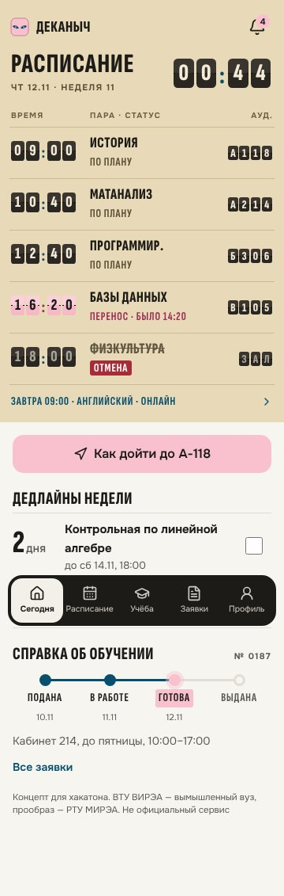
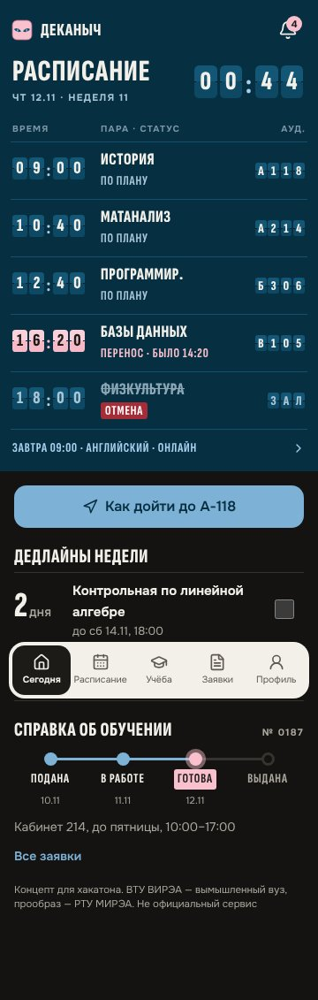

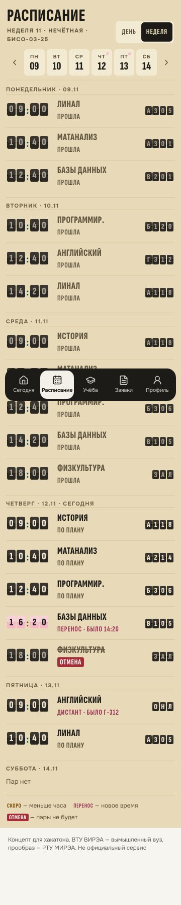

---

## 47. Перенос пары сотрудником, дедлайны и объявления, лента уведомлений (S2, S3)

- **Дата и время:** 2026-11-12 00:52 МСК
- **Инструмент:** Claude Code
- **Кто ставил задачу:** Алёна
- **Этап плана:** 4 Must
- **Требования PRD:** E2, E3, N1, D1; сценарии S2, S3

### Задача
> да

Продолжить этап 4: задачи 4.4 (кабинет сотрудника — перенос и публикации) и 4.5 (лента).

### Что сделал ИИ
- Сотрудник видит только группы назначенных институтов; чужая группа или пара → 404 (`src/server/staff.ts`).
- Перенос, отмена, смена аудитории или формата: форма с датой, парой, форматом, аудиторией или ссылкой и обязательной причиной. В одной транзакции — обновление пары с проверкой версии, запись истории «было → стало» и уведомление всей группе (срочное, если касается сегодня или завтра). Повторная отправка устаревшей формы получает «Пару уже изменили».
- Дедлайны и объявления для выбранных групп; дедлайн сразу планирует напоминания за 3 дня и за 1 день. Блок «Уже опубликовано · прочитали N из M» без имён.
- Лента: фильтры, новые на табло с временем на плитках, раньше — на молочном фоне, плашки типов, переход к расписанию или заявкам; показанные новые отмечаются прочитанными.
- Проверено в браузере: сотрудник переносит программирование 12:40 → 18:00, у студента на «Сегодня» «перенос · было 12:40» и новое уведомление в ленте; конфликт версий; студент на странице изменения пары и сотрудник на несуществующей паре → 404; публикация дедлайна. `lint`, `typecheck`, `build` проходят.

### Что проверил и поправил человек
Нужно: проверить с телефона после обновления сервера.

### Ошибки ИИ
- Файл форм сотрудника не записался — папку создавал той же командой после записи → заметил по ошибке проверки типов → создал заново → сначала создавать папки, потом писать файлы.
- Ограничение Prisma на тип смещения напоминания (`"d3"` как строка) → поймала проверка типов → `as const` → для перечислений Prisma использовать литеральные типы.

### Скриншоты
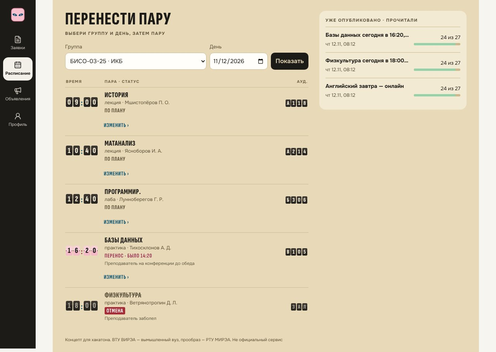
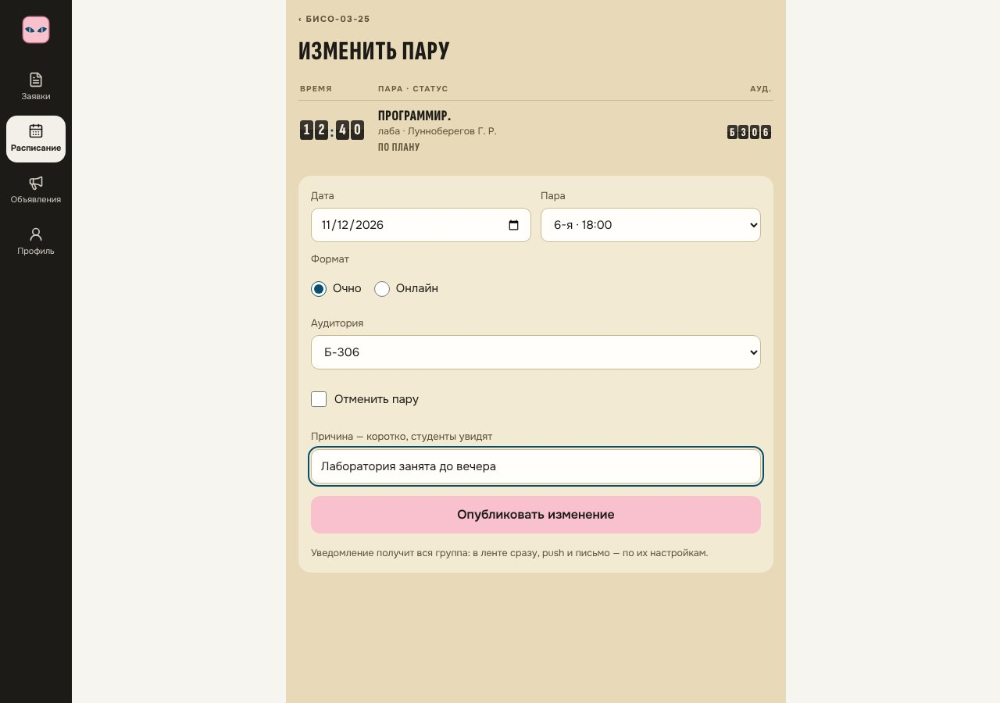

---

## 48. Заявки студента и очередь дирекции (S4, S9)

- **Дата и время:** 2026-11-12 00:56 МСК
- **Инструмент:** Claude Code
- **Кто ставил задачу:** Алёна
- **Этап плана:** 4 Must
- **Требования PRD:** A1, A2, A4, E1, NF5; сценарии S4, S9

### Задача
Продолжить этап 4: задачи 4.10 (заявки студента) и 4.11 (очередь дирекции).

### Что сделал ИИ
- Студент: «Заявки» на табло — главная заявка с полным маршрутом «Подана → В работе → Готова · забери → Выдана» (даты на плитках), остальные — с полоской этапов, отказ с причиной и «Подать снова»; каталог со сроками. Форма строится из полей типа заявки, данные профиля подставляет сервер (A2), повторная подача — только своей отклонённой заявки и только один раз.
- Карточка заявки `/requests/[id]` — только своя, чужая → 404 (S9).
- Дирекция: очередь как табло с фильтрами по статусу и типу, счётчики; карточка заявки — только из назначенных институтов, иначе 404. Смена статуса по разрешённым переходам с проверкой версии, история, уведомление студенту; отказ — только с причиной, «готова» — с местом выдачи.
- Проверено в браузере: Данила заказывает справку о стипендии → дирекция видит её в «Новых», отказ без причины не проходит, «в работе» → «готова» → у Данилы «Готова · забери» с местом выдачи; повторная подача отклонённой матпомощи; Ксения на заявке Данилы и на странице дирекции → 404. `lint`, `typecheck`, `build` проходят.

### Что проверил и поправил человек
Нужно: проверить на телефоне после обновления сервера.

### Ошибки ИИ
Не было.

### Скриншоты

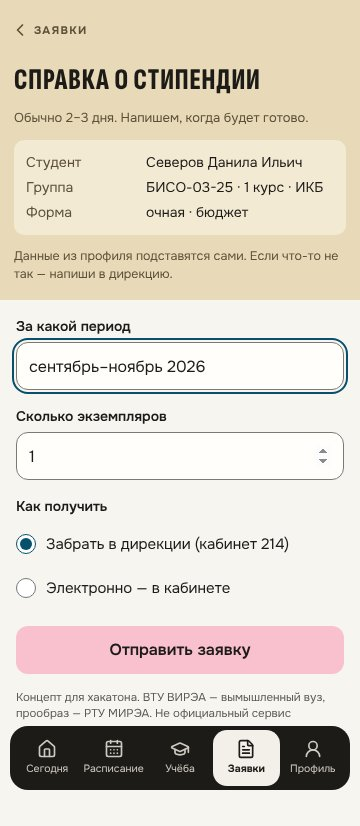

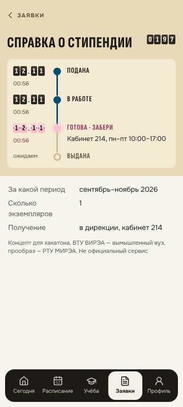

---

## 49. «Учёба» по демо-положению и профиль с темой (S5)

- **Дата и время:** 2026-11-12 01:02 МСК
- **Инструмент:** Claude Code
- **Кто ставил задачу:** Алёна
- **Этап плана:** 4 Must
- **Требования PRD:** G1, G2, G3, P1, P3, NF3; сценарий S5

### Задача
> давай

Задачи 4.9 («Учёба») и 4.12 (профиль).

### Что сделал ИИ
- «Учёба» считает всё по [демо-положению](../../knowledge/polozhenie-demo.md): рейтинг 0–100 как сумма баллов за работы, допуск — от 50 баллов и все обязательные работы, «риск» до начала сессии, «не допущен» после; средний — по экзаменам прошлых сессий.
- Сводка одной фразой (G2): «Допуск к сессии почти есть: осталось 2 лабы по дисциплине «Базы данных» до 20.12». Плитки «средний / долги / допуск», таблица дисциплин; у дисциплины с риском раскрыт чек-лист допуска со сроками (G3); прошлые семестры с оценками (G1).
- Профиль: студенческий билет (ФИО, группа и номер на плитках, институт, курс, форма), переключатель темы «светлая / тёмная / как система» в настройках пользователя, выход. Push и почта — вместе с задачами 4.6 и 4.7.
- Проверено в браузере на 360 px: у Данилы и Ксении сводка и чек-лист верные, тёмная тема включается из профиля. `lint`, `typecheck`, `build` проходят.

### Что проверил и поправил человек
Нужно: посмотреть на телефоне.

### Ошибки ИИ
- В демо-данных лабы были записаны группами («Лабы 4–5», «Лабы 1–4») → на экране «осталось 1 лаба» и «1 из 1 лаб», а в S5 должно быть «3 из 5» → увидел на скриншоте → разбил на отдельные лабы → в сидах каждую работу заводить отдельно, раз экран их считает.

### Скриншоты

---

## 50. Web push: подписка, доставка с повторами, установка на экран «Домой» (N3)

- **Дата и время:** 2026-11-12 01:15 МСК
- **Инструмент:** Claude Code
- **Кто ставил задачу:** Алёна
- **Этап плана:** 4 Must
- **Требования PRD:** N3, P3, NF5; сценарии S2, S8

### Задача
> да, бери push

### Что сделал ИИ
- PWA-манифест (установка на экран «Домой» — на iPhone push работает только так) и сервис-воркер: показывает уведомление и по нажатию открывает расписание, заявки или ленту.
- В профиле — переключатель push: разрешение браузера → подписка → сохранение за пользователем из сессии. Подсказки для iPhone без установки, для запрета в браузере и для неподдерживаемых браузеров. Отключение отзывает только свою подписку.
- Доставка: после публикации переноса, дедлайна, объявления или смены статуса заявки создаются задания на каждую подписку получателей (уникальный ключ — без дублей) и сразу отправляются через `web-push` с ключами VAPID из `.env`. Фоновый обработчик (`src/instrumentation.ts`) раз в 15 секунд повторяет временные сбои с нарастающей паузой, до 5 попыток; ответ 404/410 отзывает подписку.
- `deploy/gen-vapid.sh` генерирует ключи VAPID через `openssl`, `setup-server.sh` вызывает его на новом сервере; инструкция для уже настроенного — в `docs/setup/deploy.md`.
- Проверено: перенос пары сотрудником → на поддельный HTTPS push-сервис пришли два зашифрованных (`aes128gcm`) запроса с подписью VAPID; доставка на `/ok` — `accepted`, на `/gone` (410) — подписка отозвана. Манифест и сервис-воркер отдаются. `lint`, `typecheck`, `build` проходят.

### Что проверил и поправил человек
Нужно вручную на телефоне: включить push в профиле (на iPhone — после «На экран «Домой»»), сотрудником перенести пару и проверить, что уведомление пришло за 60 секунд.

### Ошибки ИИ
- Импортировал `web-push` как модуль по умолчанию → сборка предупредила, отправка бы упала → `import * as webpush` → проверять формат экспорта CommonJS-пакетов в ESM.
- Первый тест слал push на HTTP-адрес, а `web-push` всегда ходит по HTTPS → поднял поддельный сервис на HTTPS с самоподписанным сертификатом, доверие — только тестовому процессу.
- Включение push в браузере автоматически проверить не удалось: безголовый Chromium запрещает уведомления → оставил ручную проверку на телефоне.

### Скриншоты

---

## 51. Сайт открылся на https://dekanych.ru

- **Дата и время:** 2026-11-12 01:22 МСК
- **Инструмент:** Claude Code
- **Кто ставил задачу:** Алёна
- **Этап плана:** 3 Каркас
- **Требования PRD:** NF7

### Задача
Довести домен до рабочего HTTPS после первого деплоя.

### Что сделал ИИ
- По выводу `nslookup` увидел лишние записи заглушки REG.RU (A `37.140.192.242`, AAAA `2a00:f940:…`) и объяснил, какие удалить и какие оставить (NS, SOA, MX и записи почты хостинга).
- Объяснил таймаут Google DNS с ВМ Yandex Cloud и проверку через `77.88.8.8`.
- После чистки зоны и перезапуска Caddy сертификат Let's Encrypt получен. Записал результат и грабли в `docs/setup/deploy.md` и `docs/status.md`.

### Что проверил и поправил человек
Алёна удалила лишние записи, перезапустила Caddy, в логе — `certificate obtained successfully` для `dekanych.ru`.

### Ошибки ИИ
- Раньше советовал переключить DNS-серверы на `ns1.reg.ru`, хотя A-записи можно было править в зоне хостинга, которая и отвечала → Алёна правила зону хостинга, и это сработало → сначала смотреть, какие DNS-серверы реально назначены, и править их зону.

### Скриншоты
Скриншот нужен вручную: https://dekanych.ru/login на телефоне.

---

## 52. Сайт на телефоне; исправлен вход в тёмной теме

- **Дата и время:** 2026-11-12 01:28 МСК
- **Инструмент:** Claude Code
- **Кто ставил задачу:** Алёна
- **Этап плана:** 4 Must
- **Требования PRD:** NF3, NF7, X1

### Задача
Алёна прислала скриншот https://dekanych.ru/login с телефона (тёмная тема iOS).

### Что сделал ИИ
- Подтвердил, что сайт открывается с телефона без VPN.
- Нашёл по скриншоту: поля ввода и подложка формы входа с зашитыми светлыми цветами — в тёмной теме белые; знак розовый, хотя в тёмной теме он синий.
- Перевёл форму входа на токены темы; добавил компонент `BrandMark` — знак в цвете темы (розовый в светлой, синий в тёмной) — для входа, «Сегодня» и панели навигации.

### Что проверил и поправил человек
Алёна открыла сайт на телефоне.

### Ошибки ИИ
- Страница входа делалась до токенов (задача 3.4) с цветами напрямую, и при переходе на токены я её не пересмотрел → заметили на телефоне → перевёл на токены → после ввода токенов искать по коду оставшиеся `#…` цвета.

### Скриншоты
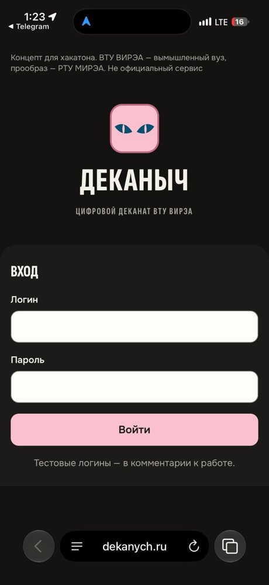

---

## 53. Напоминания о дедлайнах за 3 дня и за 1 день (D2)

- **Дата и время:** 2026-11-12 01:34 МСК
- **Инструмент:** Claude Code
- **Кто ставил задачу:** Алёна
- **Этап плана:** 4 Must
- **Требования PRD:** D2, D3; сценарий S3

### Задача
Задача 4.8: напоминания о дедлайнах во все каналы.

### Что сделал ИИ
- `src/server/reminders.ts`: фоновый обработчик раз в 15 секунд атомарно забирает созревшие задания `DeadlineReminder`; проверяет версию срока (перенесённый дедлайн не напоминает по старому сроку) и не шлёт устаревшие (старше 6 часов — после простоя сервера).
- Получатели — студенты групп дедлайна, кроме отметивших «сделано» (D3). Уведомление «Завтра: …» / «Через 3 дня: …» — в ленту и push; письма добавятся с задачей 4.7.
- Проверено на локальной базе: созревшее напоминание ушло 26 из 27 студентов (один отметил «сделано»), устаревшее отменено. `lint`, `typecheck`, `build` проходят.

### Что проверил и поправил человек
Нужно: на сервере дождаться напоминания по демо-дедлайну «Контрольная по линейной алгебре» (за 1 день).

### Ошибки ИИ
Не было.

### Скриншоты
Не нужны — проверено по базе.

---

## 54. Кнопки входа для жюри без пароля

- **Дата и время:** 2026-11-12 01:36 МСК
- **Инструмент:** Claude Code
- **Кто ставил задачу:** Алёна
- **Этап плана:** 4 Must
- **Требования PRD:** X1, NF5; сдача

### Задача
> Добавь кнопки для жюри - вход в тестовые аккаунты без логина и пароля

Плюс разбор «Application error: a client-side exception» на сайте после обновления.

### Что сделал ИИ
- Проверил все страницы студента и сотрудника в обеих темах — ошибок в консоли нет; ошибка на сайте, вероятнее всего, из-за страницы, открытой до обновления сервера (старые файлы сборки) — лечится перезагрузкой.
- На странице входа — блок «Для жюри — вход без пароля»: Данила, Ксения, Марат, Ирина с коротким описанием, что смотреть. Серверное действие пускает только в эти 4 логина, лимит 60 входов с адреса за 15 минут, сессия — как при обычном входе.
- Блок включается только `DEMO_LOGIN=on` в `.env` на сервере (`setup-server.sh` включает на новом сервере; команда для текущего — в `docs/setup/deploy.md`). Решение — в `docs/context.md`; логины и пароли по условию всё равно идут в комментарий к работе.
- Проверено в браузере: все четыре кнопки входят и ведут на свой раздел, ошибок нет.

### Что проверил и поправил человек
Нужно: включить `DEMO_LOGIN=on` на сервере и проверить с телефона.

### Ошибки ИИ
- Положил константу и обычную функцию в файл с `"use server"` — сборка упала («Server Actions must be async functions») → перенёс в `src/server/demo.ts` → в файлах серверных действий экспортировать только асинхронные функции.

### Скриншоты
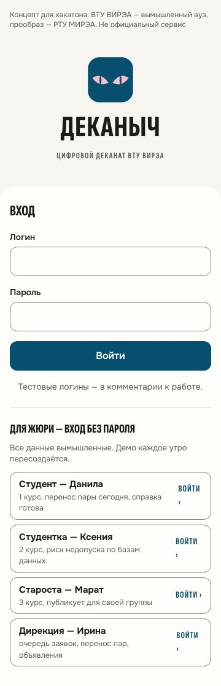

---

## 55. Цвета знака и кнопок поменяли местами: светлая — синие, тёмная — розовые

- **Дата и время:** 2026-11-12 01:40 МСК
- **Инструмент:** Claude Code
- **Кто ставил задачу:** Алёна
- **Этап плана:** 4 Must
- **Требования PRD:** NF3, X1

### Задача
Посмотрев на сайт в тёмной теме телефона (розовый знак на тёмном фоне), Алёна решила:

> нет, так хорошо, поменяй цвета местами - для темной розовый, для светлой - синий (включая кнопки)

### Что сделал ИИ
- Токены главной кнопки: светлая тема — `#064F6E` с белым текстом (8,9:1), тёмная — `#F9C1CE` с тёмным текстом (11,1:1).
- Файлы знака и логотипа поменяны: `dekanych-mark.svg` и `dekanych-logo.svg` (светлая тема) — синяя табличка, `*-dark.svg` — розовая с рамкой. Иконка приложения и favicon остались розовыми.
- Обновлены `docs/design-system.md` (токены, кнопки, логотип), `docs/brand/README.md`, `docs/context.md` (решение 12.11).
- Проверено в браузере на 360 px: вход и «Сегодня» в обеих темах.

### Что проверил и поправил человек
Алёна приняла решение по виду живого сайта на телефоне.

### Ошибки ИИ
Не было. Перед этим я «исправил» розовый знак в тёмной теме на синий по решению 11.11, а Алёна предпочла розовый — решения о цвете лучше сверять с живым видом на телефоне.

### Скриншоты
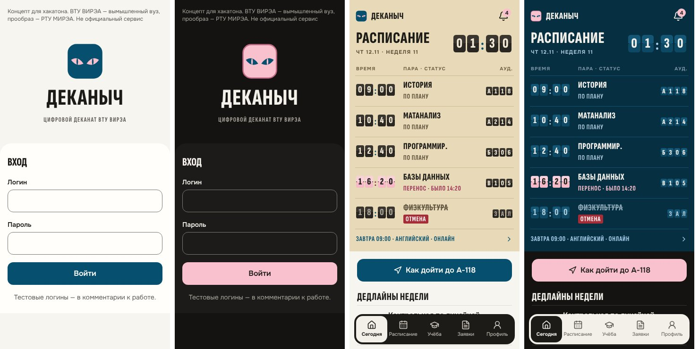

---

## 56. Подтверждение почты и отправка срочных писем

- **Дата и время:** 2026-11-14 17:41 МСК
- **Инструмент:** Codex (напарник)
- **Кто ставил задачу:** напарник
- **Этап плана:** 4 Must
- **Требования PRD:** N2, D2, P3, NF5

### Задача

> посмотри мои задачи, наработки алены и начинай делать мою часть

Сверить свежий `main` с планом и реализовать почтовые уведомления по задаче 4.7.

### Что сделал ИИ

- Добавил подтверждение почты в профиле, лимиты выдачи и ввода кода, шифрование адреса и отзыв подписки. В публичном демо доступна отправка на тестовые адреса команды.
- Подключил письма к очереди уведомлений для срочных изменений и напоминаний. Запись заданий происходит внутри транзакции публикации. Временные ошибки SMTP повторяются, а отозванные назначения отменяются.
- Сборка Next.js, TypeScript и ESLint по изменённым файлам прошли. В браузере на 360 px с локальным TLS SMTP и тестовой БД проверил подтверждение адреса, неверный код, срочный и несрочный дедлайн, разделение групп, повтор SMTP и отмену задания после отключения. [План проверки с VPS](../../research/email-notifications.md).

### Что проверил и поправил человек

Ревью Алёны и измерение доставки с VPS на реальном тестовом ящике впереди.

### Ошибки ИИ

- Первый локальный тест блокировал цикл событий синхронным запуском сида. Перевёл запуск в асинхронный режим и повторил проверку.

### Скриншоты

---

## 57. Проверки сценариев жюри и исправления демо

- **Дата и время:** 2026-11-14 23:23 МСК
- **Инструмент:** Codex (напарник)
- **Кто ставил задачу:** напарник
- **Этап плана:** 4 Must и 6 Проверка
- **Требования PRD:** T1, X1, NF1, NF5, AI1

### Задача

> доделай и задачи алены тоже. просмотри весь проект и мб что-то еще улучшить

Проверить актуальный проект и закрыть пробелы в сценариях жюри.

### Что сделал ИИ

- Вынес ближайшую пару наверх на «Сегодня», добавил изменения на сегодня и завтра и три последние оценки за неделю. В расписании отмечаются обе даты переноса.
- Добавил плашку концепта на страницы редактирования пары и заявки сотрудника и на страницу 404 в кабинете. Подправил расположение фильтров расписания дирекции на узких экранах.
- Исправил чтение демо-положения с окончаниями строк CRLF. Сид загрузил 39 пунктов. При пустом документе он останавливается до очистки базы.
- Добавил четыре теста Playwright и workflow на PR для S1–S4 и S9. Локально прошли все четыре теста на ширине 360 px, включая 404 на чужую заявку и кабинет сотрудника. Публичная страница входа вернула HTTP 200.

### Что проверил и поправил человек

Ревью Алёны и проверка доставки уведомлений на VPS впереди.

### Ошибки ИИ

- Первый прогон использовал режим разработки и столкнулся с упаковкой `web-push`. Переключил тесты на собранное приложение и уточнил селекторы формы и активного шага заявки.

### Скриншоты

Скриншот нужен вручную: «Сегодня» с ближайшей парой, изменениями и новыми оценками на 360 px.

---

## 58. Иллюстрация для дня без занятий

- **Дата и время:** 2026-11-14 23:28 МСК
- **Инструмент:** ChatGPT (ImageGen через Codex)
- **Кто ставил задачу:** напарник
- **Этап плана:** 2 Дизайн
- **Требования PRD:** T2

### Задача

> доделай и задачи алены тоже

Подготовить иллюстрацию для сценария «Сегодня пар нет» по [промптам проекта](../../brand/empty-states-prompts.md).

### Что сделал ИИ

- Промпт для светлой темы: маленький вымышленный дракон в форме синей перекидной таблички с розовыми глазами отдыхает на подушке рядом с табло с прочерками и чашкой. Чистые формы, прозрачный фон, без букв, реальных людей и символики вуза.
- Промпт для тёмной темы: сохранить позу и предметы исходной композиции, сделать дракона розовым с синими глазами и осветлить контуры.
- Сохранил оригинальные [светлый](../../brand/empty-today-light.png) и [тёмный](../../brand/empty-today-dark.png) PNG. Версии WebP 320 px используются на странице «Сегодня».

### Что проверил и поправил человек

Ревью иллюстрации Алёной впереди.

### Ошибки ИИ

Не было.

### Скриншоты

Скриншот нужен вручную: день без занятий на 360 px, обе темы.

---

## 59. Черновик отчёта о создании «Деканыча»

- **Дата и время:** 2026-11-14 23:34 МСК
- **Инструмент:** Codex (напарник)
- **Кто ставил задачу:** напарник
- **Этап плана:** 7 Сдача
- **Требования PRD:** —

### Задача

Подготовить материал к черновой сдаче по структуре `docs/submission.md`.

### Что сделал ИИ

- Собрал четырёхстраничный PDF для ревью. Включил итоги опроса, развитие макетов, примеры промптов, работу команды, защиту данных и результаты проверок. Все страницы отрисованы и просмотрены.
- Пересобрал `docs/ai-log/LOG.md` скриптом из записей репозитория.

### Что проверил и поправил человек

Чтение отчёта капитаном и финальная сдача впереди.

### Ошибки ИИ

- Сборка журнала записывала Markdown, но завершалась с ошибкой вывода стрелки в консоли Windows. Заменил стрелку в сообщении и повторил сборку.

### Скриншоты

В черновике использованы готовые снимки макета, «Сегодня» и ленты уведомлений из журнала.

---

## 60. Ревью и слияние почты и проверок для жюри

- **Дата и время:** 2026-11-19 16:49 МСК
- **Инструмент:** Codex (Алёна)
- **Кто ставил задачу:** Алёна
- **Этап плана:** 6 Проверка
- **Требования PRD:** N2, P3, T1, NF1, NF5, X1

### Задача

> «Сделай 1 пункт и напиши что я должна проверить и как поподробнее».

Проверить и последовательно влить PR с почтой и тестами, повторить CI на основной ветке и подготовить сценарий ручной проверки.

### Что сделал ИИ

- Проверил серверную логику подтверждения почты и доставки, изменения экранов, состав e2e и историю веток. После слияния [PR #47](https://github.com/ghsteee/VIREA_Decanat/pull/47) сверил состав [PR #48](https://github.com/ghsteee/VIREA_Decanat/pull/48) и подтвердил, что GitHub собрал результат слияния с теми же файлами, на которых прошёл CI.
- Влил оба PR в `main`, итоговый коммит `8ee7b7a`. [Повторный CI на main](https://github.com/ghsteee/VIREA_Decanat/actions/runs/44536691807) прошёл линтер, проверку типов, сборку и Playwright.
- Подготовил ручной прогон для Алёны. Доставка push и писем с VPS отдельно от CI. Исправления из [PR #51](https://github.com/ghsteee/VIREA_Decanat/pull/51) остаются отдельной задачей.

### Что проверил и поправил человек

Алёна поручила интеграцию. Ручная проверка на телефоне и подтверждение доставки остаются до финального показа.

### Ошибки ИИ

Не было.

### Скриншоты

Скриншоты нужны при ручной проверке профиля, переноса и заявки на телефоне.

---

## 61. Защита отправки push и отображение переноса

- **Дата и время:** 2026-11-20 01:33 МСК
- **Инструмент:** Codex (Алёна)
- **Кто ставил задачу:** Алёна
- **Этап плана:** 6 Проверка
- **Требования PRD:** R3, N2, N3, NF5

### Задача

> «Сделай все задания, которые можешь сделать сам».

Устранить риски из обзора перед финалом и подготовить проверяемый релиз.

### Что сделал ИИ

- Проверил адреса и ключи push при сохранении подписки и перед отправкой. Запрос к поставщику имеет жёсткий предел времени.
- Воркер забирает следующий пакет заданий сразу, с ограничением параллелизма и числа пакетов.
- На исходном дне переноса отображается ссылка на актуальную дату. Карточка пары хранит старую и новую дату рядом с текущим статусом.
- Добавил проверку формата подписки и сценарий переноса на другой день с тем же временем.
- Источники по адресам поставщиков: [Chromium и Firefox](https://web.dev/articles/push-notifications-server-codelab), [Apple](https://developer.apple.com/documentation/usernotifications/sending-web-push-notifications-in-web-apps-and-browsers), [Microsoft](https://learn.microsoft.com/en-us/windows/apps/windows-app-sdk/migrate-to-windows-app-sdk/guides/notifications).

### Что проверил и поправил человек

Ручная проверка на реальном телефоне и замер push и письма во входящих с VPS ещё предстоят.

### Ошибки ИИ

Не было.

### Скриншоты

При ручном прогоне снять исходную и новую даты на ширине 360 px.

---

## 62. Четыре иллюстрации пустых состояний подключены к кабинету

- **Дата и время:** 2026-11-20 01:38 МСК
- **Инструмент:** ChatGPT (иллюстрации), Codex (Алёна, подключение)
- **Кто ставил задачу:** Алёна
- **Этап плана:** 6 Проверка
- **Требования PRD:** T2

### Задача

> «Сохраняй эти и предыдущие для экрана уведомлений».

Подключить утверждённые светлые и тёмные рисунки для дня без пар, заявок, уведомлений и дедлайнов.

### Что сделал ИИ

- Сохранил прозрачные PNG 1024 × 1024 в [исходниках бренда](../../brand/README.md). Для сайта экспортировал облегчённые WebP.
- Пара для заявок повторяет геометрию выбранного второго рисунка: папка по центру, четыре точки внизу. Светлый файл восстановлен из утверждённого тёмного перекрашиванием в исходную светлую палитру.
- Разместил картинки в пустых состояниях «Сегодня», «Заявок» и ленты. В фильтре дедлайнов иллюстрация относится к отсутствию новых уведомлений, а в «Сегодня» — к отсутствию дедлайнов недели.

### Что проверил и поправил человек

Алёна выбрала варианты, попросила смягчить глаза и убрать хвост у спящего Деканыча. Она подтвердила обе пары для экрана уведомлений.

### Ошибки ИИ

- ИИ один раз выбрал не тот вариант заявки. Алёна уточнила номер из финальной тройки. В репозиторий вошла пара с маршрутом под папкой.

### Скриншоты

После выкладки снять пустые состояния с телефона в обеих темах.

---

## 63. Подготовка сдачи и безопасного обновления стенда

- **Дата и время:** 2026-11-20 01:38 МСК
- **Инструмент:** Codex (Алёна)
- **Кто ставил задачу:** Алёна
- **Этап плана:** 7 Сдача
- **Требования PRD:** NF7, N2, N3

### Задача

> «Ты можешь сделать деплой сам… Сделай все задания, которые можешь сделать сам».

Подготовить проверенный релиз и собрать материалы сдачи.

### Что сделал ИИ

- Сверил и влил [PR #49](https://github.com/ghsteee/VIREA_Decanat/pull/49), [#50](https://github.com/ghsteee/VIREA_Decanat/pull/50), [#52](https://github.com/ghsteee/VIREA_Decanat/pull/52), [#53](https://github.com/ghsteee/VIREA_Decanat/pull/53) и [#54](https://github.com/ghsteee/VIREA_Decanat/pull/54). У #53 и #54 прошёл CI на 360 px.
- Обновил [статус](../../status.md), собрал журнал и [PDF для финальной сдачи](../../dekanych-hackathon-submission.pdf). Проверил визуально четыре страницы.
- Добавил [обновление без миграций](../../setup/deploy.md#обновление-уже-работающего-демо-без-миграций). Скрипт принимает проверенный SHA, сначала собирает образ, затем обновляет контейнер. На имитации проверены успех, остановка при изменении схемы, ошибка сборки и возврат приложения после ошибки запуска.

### Что проверил и поправил человек

Алёна определила приоритеты и раньше утвердила дизайн. После реального обновления ещё нужен ручной прогон с телефона.

- Управление Terminal недоступно. Отдельный SSH-сеанс не прошёл проверку учётной записи. Серверные файлы и контейнеры не изменены. Публичная страница входа ответила HTTP 200, версии приложения и доставку этим не подтверждаем.

### Ошибки ИИ

Не было.

### Скриншоты

В PDF использованы скриншоты макетов и ранее проверенных экранов. Скриншоты обновлённого VPS нужны после выкладки.

---

## 64. Кабинет старосты для своей группы

- **Дата и время:** 2026-11-20 01:42 МСК
- **Инструмент:** Codex (Алёна)
- **Кто ставил задачу:** Алёна
- **Этап плана:** 5 Should
- **Требования PRD:** H1, S6, NF5

### Задача

После обязательных правок подготовить сценарий старосты из PRD: изменение пары, объявление или дедлайн для своей группы и счётчик «прочитали N из M».

### Что сделал ИИ

- Добавил вход в кабинет старосты из профиля. Группа и право публикации определяются на сервере из профиля и назначения.
- Переиспользовал формы и очередь уведомлений. В ленте и блоке изменений видно автора по роли. Староста получает только сводные числа по своим публикациям.
- Добавил тест Playwright на ширине 360 px для публикации в свою группу, метки, роста счётчика после чтения и ответа 404 за пределами роли или группы. Локально проверил линтер и типы.

### Что проверил и поправил человек

На VPS пока не проверял. Для ручной проверки открыть «Кабинет старосты» как Марат и опубликовать тестовую запись.

### Ошибки ИИ

- Тест пытался нажать скрытый radio input. GitHub Actions выявил, что видимая подпись перехватывала клик. Тест нажимает подпись, затем проверяет выбор по доступной роли.

### Скриншоты

Нужен мобильный скриншот кабинета старосты после обновления сайта.

---

## 65. Предметные аватары для четырёх демо-аккаунтов

- **Дата и время:** 2026-11-20 01:43 МСК
- **Инструмент:** Codex (Алёна)
- **Кто ставил задачу:** Алёна
- **Этап плана:** 6 Проверка
- **Требования PRD:** T2, X1

### Задача

По [заданию на аватары](../../brand/empty-states-prompts.md#аватары-заглушки-4-тестовых-аккаунта) отличить роли на входе для жюри предметными символами без портретов.

### Что сделал ИИ

Нарисовал книгу, карандаш с галочкой, флажок и папку с печатью. Исходники 512 × 512 в [каталоге бренда](../../brand/README.md), версии WebP для кнопок входа. Проверены вид при 40 px и TypeScript.

### Что проверил и поправил человек

Проверка на развёрнутом сайте остаётся после обновления.

### Ошибки ИИ

Не было.

### Скриншоты

После выкладки снять кнопки входа на телефоне.

---

## 66. Ближайший срок и условия допуска в разделе «Учёба»

- **Дата и время:** 2026-11-20 01:45 МСК
- **Инструмент:** Codex (Алёна)
- **Кто ставил задачу:** Алёна
- **Этап плана:** 5 Should
- **Требования PRD:** G2, G3, S5

### Задача

Проверить существующий сценарий допуска. У студента должны быть видны рейтинг, незакрытые работы, прогресс и сроки.

### Что сделал ИИ

Ближайший срок стоит в сводке, недостающие баллы и работы показаны вместе. Выполненный чек-лист можно раскрыть. Рейтинг учитывает только балльные результаты, а требования берутся из демо-положения и записей чек-листа. Добавлен мобильный тест сценария Ксении.

### Что проверил и поправил человек

Ручной прогон после обновления: «Учёба» → «Базы данных» у Ксении.

### Ошибки ИИ

- Предыдущая сводка выбирала самый дальний срок. Сверили список с демо-данными, поменяли сортировку и добавили проверку ближайшей даты.

### Скриншоты

Мобильный скриншот нужен после выкладки.

---

## 67. Мгновенное напоминание для демонстрации дедлайна

- **Дата и время:** 2026-11-20 01:50 МСК
- **Инструмент:** Codex (Алёна)
- **Кто ставил задачу:** Алёна
- **Этап плана:** 5 Should
- **Требования PRD:** E4, D2, N2, N3

### Задача

Показать уведомление дедлайна без ожидания трёх дней или дня. Доступно сотруднику в демо-режиме для своего дедлайна.

### Что сделал ИИ

Добавил кнопку, отдельное идемпотентное событие и повторную проверку права и актуальности перед доставкой. Плановые напоминания не расходуются. Добавлен сценарий Playwright для публикации, появления записи в ленте и сохранения двух плановых напоминаний. Линтер и проверка типов прошли.

### Что проверил и поправил человек

Фактическую доставку на телефон и в почту предстоит проверить после обновления VPS.

### Ошибки ИИ

Не было.

### Скриншоты

После выкладки снять кнопку и уведомление у студента.

---

## 68. Свободное время выдачи справки без пересечения с парами

- **Дата и время:** 2026-11-20 01:54 МСК
- **Инструмент:** Codex (Алёна)
- **Кто ставил задачу:** Алёна
- **Этап плана:** 5 Should
- **Требования PRD:** A3, S4, NF5

### Задача

Добавить выбор времени выдачи справки для своего института в окнах без занятий.

### Что сделал ИИ

Показал свободные интервалы и повторно проверяю их при подаче. Бронь сохраняется вместе с заявкой и освобождается при отказе. Выбранное время видно студенту и сотруднику. В демо-сиде появляются будние окна для всех трёх институтов. Добавлен тест 360 px, который показывает отбор окна и сохранение брони. Линтер и проверка типов прошли.

### Что проверил и поправил человек

Ручная проверка на VPS остаётся после обновления и штатного сброса демонстрационных данных.

### Ошибки ИИ

Не было.

### Скриншоты

После выкладки снять выбор окна и карточку заявки.

---

## 69. Обновлены отчёт и порядок финальной проверки

- **Дата и время:** 2026-11-20 02:02 МСК
- **Инструмент:** Codex (Алёна)
- **Кто ставил задачу:** Алёна
- **Этап плана:** 7 Сдача
- **Требования PRD:** R3, R5, NF1, NF5, N2, N3, H1, G3, E4, A3

### Задача

После доработок подготовить проверяемую версию для выпуска и материалы для жюри.

### Что сделал ИИ

- Обновил статусы функций и инструкции ручной проверки на телефоне. В отчёт добавил проверенные сценарии, старый эскиз и три примера исправлений после ревью или теста.
- Пересобрал журнал из записей основной ветки. Для помощника есть отдельная запись в черновике PR.
- Запустил общую проверку GitHub Actions. Публичный вход открылся, новый аватар вернул 404. Программный вход на VPS по ключу отклонён, а управление уже открытым Terminal недоступно. Работающий сайт не обновлялся.

### Что проверил и поправил человек

Предстоит пройти вход и проверить получение уведомлений на телефоне после обновления VPS. Отчёт и исходники передаёт жюри Алёна.

### Ошибки ИИ

Не было.

### Скриншоты

В [отчёте для сдачи](../../dekanych-hackathon-submission.pdf) есть ранние и принятые варианты дизайна и мобильные сценарии.

---

## 70. Записано мобильное демо для сдачи

- **Дата и время:** 2026-11-20 02:10 МСК
- **Инструмент:** Codex (Алёна)
- **Кто ставил задачу:** Алёна
- **Этап плана:** 7 Сдача
- **Требования PRD:** NF1, T1, R3, G3, A1, E4

### Задача

Подготовить дополнительное видео о работе кабинета с телефона.

### Что сделал ИИ

- Поднял локальную сборку с отдельной базой вымышленных данных. Записал экран шириной 390 px, где видны день в расписании, чек-лист допуска и подача справки, изменение её статуса, перенос и напоминание о дедлайне.
- На время записи подтвердил действия обеих ролей проверками Playwright. Добавил подписи и сохранил вертикальное видео MP4 в локальную папку `output/video/`.
- Видео фиксирует работу локальной сборки. Доставка push и писем с VPS проверяется отдельным сценарием.

### Что проверил и поправил человек

Публикация ссылки для жюри остаётся у капитана. На момент записи видео не загружалось на видеохостинг.

### Ошибки ИИ

- В поле «Срок» браузер показал американский порядок даты. Повтор с русской локалью видео не изменил это поле. Заголовки приложения и даты расписания показываются по-русски.

### Скриншоты

---

## 71. Подготовлено скачивание пары в календарь

- **Дата и время:** 2026-11-20 02:16 МСК
- **Инструмент:** Codex (Алёна)
- **Кто ставил задачу:** Алёна
- **Этап плана:** 5 Should
- **Требования PRD:** дополнение к R2 и R3, NF5

### Задача

Подготовить небольшую дополнительную функцию после доработки основной версии.

### Что сделал ИИ

- Добавил «В календарь» к парам на вкладке «День». Файл содержит актуальные время, дисциплину, тип и место пары. Для перенесённой пары берём новую дату. Формат описан в [RFC 5545](https://www.rfc-editor.org/rfc/rfc5545.html).
- Сервер проверяет сессию и группу. Отменённые и прошедшие пары недоступны для экспорта. Онлайн-ссылка и ФИО в файл не включаются.
- Добавил модульные проверки формата и проверку скачивания и границ доступа в мобильный сценарий переноса. Скачал файл из Chromium и WebKit на 360 px. Прочитал независимой библиотекой iCalendar, сверил московское время начала и окончания, место пары и номер правки. Экспорт сохранил корректную структуру таблицы после добавления свайпа.

### Что проверил и поправил человек

Codex проверил скачивание в двух браузерных движках, линтер, типы, модульные проверки и сценарии кабинета. Импорт во встроенный календарь на физическом телефоне пока не проверялся.

### Ошибки ИИ

Не было.

### Скриншоты

---

## 72. Проверен мобильный кабинет и добавлен свайп в расписании

- **Дата и время:** 2026-11-20 02:29 МСК
- **Инструмент:** Codex (Алёна)
- **Кто ставил задачу:** Алёна
- **Этап плана:** 6 Проверка
- **Требования PRD:** R1, NF1

### Задача

Пройти основные экраны от 360 px и исправить обнаруженные проблемы.

### Что сделал ИИ

- Проверил 14 комбинаций страниц и ролей в светлой и тёмной теме в Chromium и WebKit с мобильным экраном 360×640. Во всех 56 проверках ширина страницы совпала с шириной экрана.
- Добавил переход между днями свайпом в обе стороны. Добавил воскресенье и ссылку «Сегодня». Проверил переключение с субботы на воскресенье и понедельник, а также размеры всех семи кнопок даты.
- Исправил структуру табло расписания студента и сотрудника, таблицы допуска и видимость ссылки на профиль в ленте. Повторный прогон axe по выбранным правилам WCAG 2.1 A/AA не обнаружил нарушений. Полная ручная проверка скринридером остаётся отдельным шагом.
- Локально прошли девять сценариев Playwright, проверка типов и линтер.

### Что проверил и поправил человек

Codex просмотрел снимок расписания после правки. Жест на физическом телефоне ещё предстоит проверить.

### Ошибки ИИ

- Первая правка заменила видимый текст кнопок дат описанием для скринридера, что выявил повторный прогон axe. Вернул видимую подпись в доступное имя и добавил полную дату скрытым текстом.

### Скриншоты

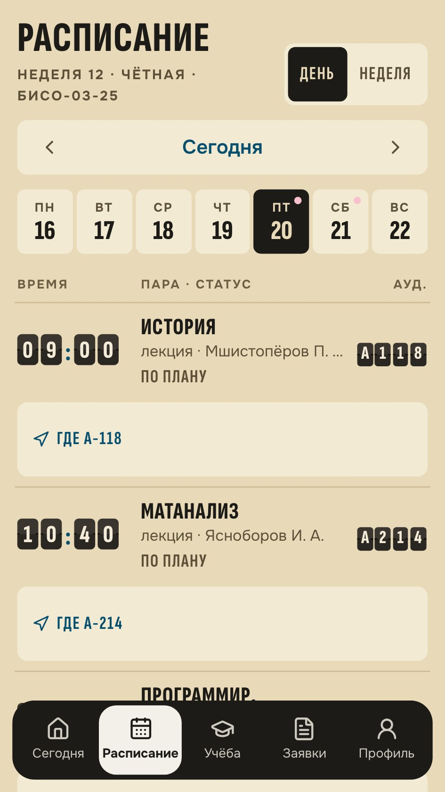

---

## 73. Проверена локальная почта и доработан переход из push

- **Дата и время:** 2026-11-20 02:34 МСК
- **Инструмент:** Codex (Алёна)
- **Кто ставил задачу:** Алёна
- **Этап плана:** 6 Проверка
- **Требования PRD:** N2, N3, P3

### Задача

Пройти независимо от VPS доступные части сценариев почты и push.

### Что сделал ИИ

- Через локальный SMTP с STARTTLS подтвердил два вымышленных адреса. Проверил отказ для адреса вне списка демо и неверного кода, отправку только нужной группе и отсутствие новых заданий после отключения писем.
- Принятие письма локальным SMTP после публикации переноса заняло 241 мс. Результат относится только к локальному стенду.
- Сервис-воркер дожидается перехода и активирует вкладку. Если эта вкладка закрылась, открывает новую. Ссылка остаётся в пределах сайта, запасным разделом служит лента.
- Проверил обработку push в Chromium через [инструменты разработчика](https://developer.chrome.com/docs/devtools/javascript/background-services) и добавил отдельные тесты перехода по уведомлению.

### Что проверил и поправил человек

Получение настоящего push на телефоне и письма в реальном тестовом ящике проверяется после обновления VPS.

### Ошибки ИИ

- Локальный SMTP через имя localhost не ответил в срок. Повторил на IPv4 loopback с отключённым обратным DNS на тестовом приёмнике. Проверка доверия к TLS-сертификату прошла.
- Полный Chromium локально показал тестовый push, но повтор CI не увидел его через getNotifications. Автоматический браузерный тест теперь проверяет активацию воркера, а модульные проверки покрывают показ уведомления и переход. Доставку до устройства отдельно проверяем на VPS.

- Первый прогон CI на этой ветке прошёл push, но на Ubuntu не сработал сразу эмулированный тап после серии свайпов. Разделил касания и обычную проверку кнопок перезагрузкой страницы. Временные значения тестового запуска теперь маскируются в журнале CI.

### Скриншоты

Для журнала нужен снимок уведомления после проверки на телефоне. Коды и адреса в журнал не включены.

---

## 74. Уточнена подробная карточка пары на телефоне

- **Дата и время:** 2026-11-20 02:40 МСК
- **Инструмент:** Codex (Алёна)
- **Кто ставил задачу:** Алёна
- **Этап плана:** 6 Проверка
- **Требования PRD:** R2, NF1

### Задача

Исправить места, где сокращённое название и обрезанная строка скрывали сведения в карточке пары на 360 px.

### Что сделал ИИ

В подробной карточке показал название дисциплины целиком, время окончания и всех преподавателей. Онлайн-занятие и неуказанная аудитория получают разные подписи для скринридера. Для обзора недели оставил компактный вид.

### Что проверил и поправил человек

Codex посмотрел снимок на 360 px, прогнал десять сценариев Playwright и повторно проверил основные страницы в обеих темах в Chromium и WebKit.

### Ошибки ИИ

- После первой правки один инициал отрывался от остального имени. Добавил неразрывные пробелы перед инициалами и повторно проверил карточку.

### Скриншоты

---

## 75. Проверены предупреждения зависимостей сборки

- **Дата и время:** 2026-11-20 02:45 МСК
- **Инструмент:** Codex (Алёна)
- **Кто ставил задачу:** Алёна
- **Этап плана:** 6 Проверка
- **Требования PRD:** NF5

### Задача

Разобрать предупреждения npm audit, появившиеся в локальной сборке Docker.

### Что сделал ИИ

- Проверил образ запуска. PostCSS 8.4.31 оказался вложенной зависимостью Next.js в рабочем образе. Prisma CLI и его конфигурационные пакеты Effect и DeepmergeTS в образе запуска отсутствовали.
- В отдельной ветке обновил PostCSS под Next.js до 8.5.33 и Effect под конфигурацией Prisma до 3.22.1. Схема базы и версии Next.js и Prisma те же. Повторный npm audit показал три предупреждения вместо шести. Оставшиеся связаны с DeepmergeTS в Prisma CLI.
- Чистая установка, миграция временной базы, загрузка вымышленных данных, сборка и девять мобильных сценариев прошли локально до объединения ветки с текущим main.

### Что проверил и поправил человек

Codex проверил дерево зависимостей в Docker. Серверный релиз и состояние базы на VPS требуют отдельной проверки.

### Ошибки ИИ

Не было.

### Скриншоты

Изменение касается зависимостей сборки, скриншоты не нужны.

---

## 76. Проверена остановка пробы при изменении календаря

- **Дата и время:** 2026-11-20 02:46 МСК
- **Инструмент:** Codex (Алёна)
- **Кто ставил задачу:** Алёна
- **Этап плана:** 6 Проверка
- **Требования PRD:** R5, R3, NF6

### Задача

Проверить исследовательскую пробу iCal на сбоях формата, доступных для воспроизведения локально.

### Что сделал ИИ

- Добавил остановку при отмене отдельной пары повторяющейся серии и при недопустимой дате. До этого отмена могла быть пропущена, а невозможный день превращался в дату следующего месяца.
- На Node.js 20 проверил вымышленную группу и календарь через подстановку ответов fetch. Проверены интервал через неделю, EXDATE, московское время и стабильный псевдоним.
- Зафиксировал поведение в [исследовании источника](../../research/schedule-source.md). Проверку на российском VPS и условия использования ещё предстоит уточнить.

### Что проверил и поправил человек

Локальные сценарии выполнил Codex. Реальные календари на этом этапе не скачивались.

### Ошибки ИИ

- Предыдущий разбор пропускал исключение с RECURRENCE-ID в отменённом событии. Добавил проверку до ветки, которая пропускает отменённые и служебные события.

### Скриншоты

Задача касается консольной пробы. Графического результата нет.

---

## 77. Выполнена локальная репетиция деплоя и возврата версии

- **Дата и время:** 2026-11-20 02:47 МСК
- **Инструмент:** Codex (Алёна)
- **Кто ставил задачу:** Алёна
- **Этап плана:** 7 Сдача
- **Требования PRD:** NF5, NF7

### Задача

На изолированном стенде проверить развёртывание и возврат последней рабочей версии, пока недоступен вход на VPS.

### Что сделал ИИ

- Собрал исходные образы Compose на Linux ARM64, применил миграцию к отдельной базе с вымышленными данными. В контейнере приложение работает с UID 1001. Вход и новый аватар с контейнера вернули HTTP 200.
- Проверил вход четырёх ролей и подал тестовую заявку. Настоящий скрипт обновления поднял новый образ, во время первой попытки локальная проверка намеренно вернула 503. Скрипт вернул прежний образ. Затем обновление прошло с ответом 200. Тестовая заявка сохранилась при обоих переключениях.
- Уточнил порядок проверки в [инструкции деплоя](../../setup/deploy.md) и обновил PDF с результатами мобильной проверки и локальной репетиции.

### Что проверил и поправил человек

Работа шла на отдельной виртуальной машине и тестовой базе. Ручная проверка публичного HTTPS, устройства и почтовых ящиков на VPS остаётся открытой.

### Ошибки ИИ

- Тест кабинета сотрудника искал короткое название пункта меню. В заголовке страницы используется «Очередь заявок», на него и перевёл проверку.

### Скриншоты

Снимок карточки на 360 px включён в [отчёт для сдачи](../../dekanych-hackathon-submission.pdf).

---

## 78. Кабинет адаптирован для телефона, планшета и ноутбука

- **Дата и время:** 2026-11-20 22:35 МСК
- **Инструмент:** Codex (Алёна)
- **Кто ставил задачу:** Алёна
- **Этап плана:** 6 Проверка
- **Требования PRD:** NF1

### Задача

Исправить отображение узкой мобильной раскладки на ноутбуке.

### Что сделал ИИ

- Расширил страницы кабинета начиная с планшета. На ноутбуке «Сегодня» показывает расписание и изменения слева, дедлайны и заявки рядом. Вход, профиль, заявки и другие экраны используют доступную ширину.
- Недельное расписание на широком экране размещает дни в две колонки. На телефоне действия и список пар остаются в одной колонке с нижней навигацией.
- Проверил шесть размеров от 360 до 1920 px. Прошли 16 сценариев Playwright и 10 модульных тестов. Дополнительно прошли 42 проверки ширины в WebKit в светлой и тёмной теме.

### Что проверил и поправил человек

Алёна заметила мобильную раскладку на ноутбуке. Codex проверил исправление локально. Проверка на её ноутбуке предстоит после обновления публичного сервера.

### Ошибки ИИ

- Новый тест находил одновременно заголовок «Сегодня» и заголовок про изменения. Уточнил поиск до полного текста заголовка и повторил весь прогон.

### Скриншоты

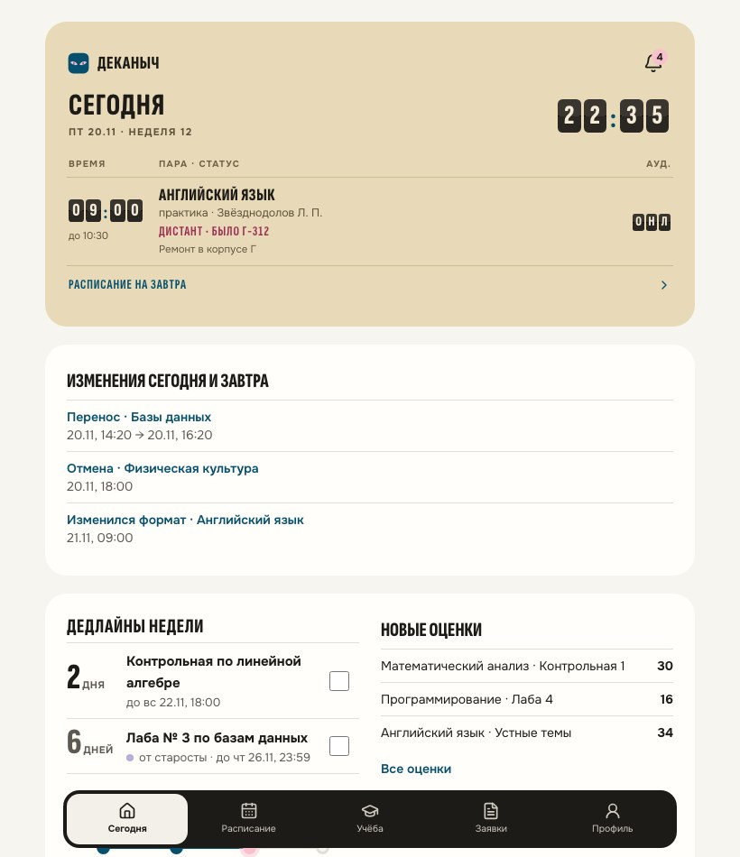
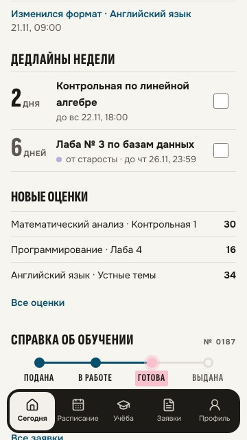

---

## 79. Расписание и кабинет после повторного аудита интерфейса

- **Дата и время:** 2026-11-20 23:35 МСК
- **Инструмент:** Codex (Алёна)
- **Кто ставил задачу:** Алёна
- **Этап плана:** 6 Проверка
- **Требования PRD:** NF1, X1, R2

### Задача

Алёна показала дневное расписание КМБО-07-24 на ноутбуке и попросила повторно пройти по всему сайту с рекомендациями по UI/UX.

### Что сделал ИИ

- На ноутбуке дневной календарь и список занятий занимают отдельные панели. У списка есть заголовок с выбранной датой. В недельном режиме дни стоят рядом при достаточной ширине. На узком экране аудитория помещается под временем. Для выбора компоновки использован подход с учётом ширины содержимого. [web.dev, Macro layouts](https://web.dev/learn/design/macro-layouts)
- Проверены вход, «Сегодня», расписание, оценки, лента, заявки, детали, формы, профиль, кабинеты старосты и дирекции. В кабинете появился общий подвал, клавиатурный переход к содержанию и прямая ссылка на уведомления в боковом меню. Фильтры дирекции и ленты переносятся, длинные названия работ, пар и объявлений читаются целиком. [W3C, Reflow](https://www.w3.org/WAI/WCAG22/Understanding/reflow.html)
- Увеличены области выбора фильтров и темы. В тестах закреплены размеры семи кнопок календаря, расположение панелей в дневном режиме и двух первых дней в недельном. [W3C, Target Size](https://www.w3.org/WAI/WCAG22/Understanding/target-size-minimum)
- Для названия прошедшей пары и заголовков колонок в тёмной теме контраст на фоне доски составляет 7,66:1. Порядок перехода по разделам начинается с клавиатурной ссылки «К содержанию». [W3C, Contrast Minimum](https://www.w3.org/WAI/WCAG22/Understanding/contrast-minimum.html) · [W3C, Focus Visible](https://www.w3.org/WAI/WCAG22/Understanding/focus-visible.html)
- На локальном стенде прошли сборка, статические проверки, 10 модульных тестов и 17 браузерных сценариев. В Chromium и WebKit проверены 228 сочетаний экрана, размера, темы и демо-аккаунта на ширинах 320–1920 px. Горизонтального переполнения страницы не обнаружено. Отдельный прогон axe-core 4.14 на 15 основных экранах и состояниях при 320 и 1366 px в двух темах не зарегистрировал нарушений по выбранным правилам WCAG A/AA. Физические устройства и работа с экранным диктором отдельно не проверялись.

### Что проверил и поправил человек

Алёна указала на неудачную композицию в предыдущей версии. Проверка нового результата на её ноутбуке предстоит.

### Ошибки ИИ

- Предыдущий тест проверял ширину страницы, но пропускал неудачное расположение календаря относительно пар. Добавлены проверки геометрии двух режимов и снимки той же группы.
- Серия повторных входов демо-аккаунтов остановила первый локальный обход. Для повторных просмотров тест переиспользовал свои сеансы и завершил все проверки.

### Скриншоты

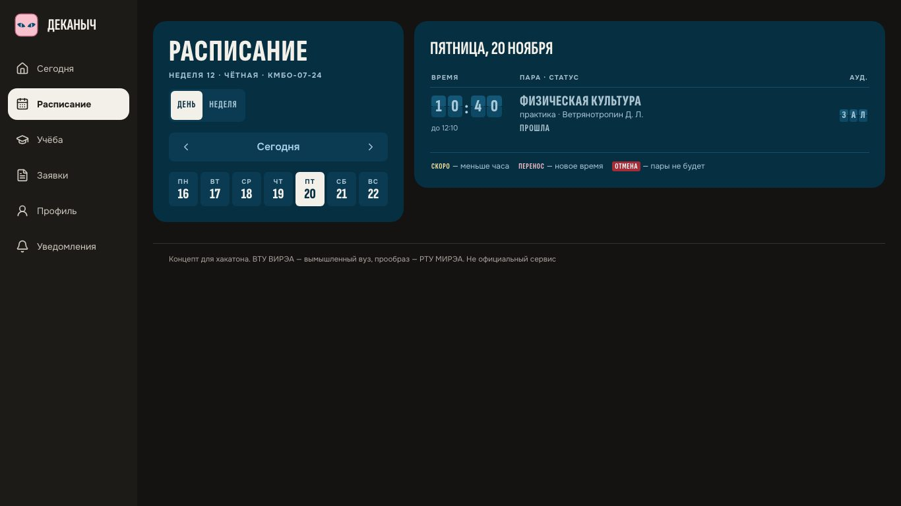

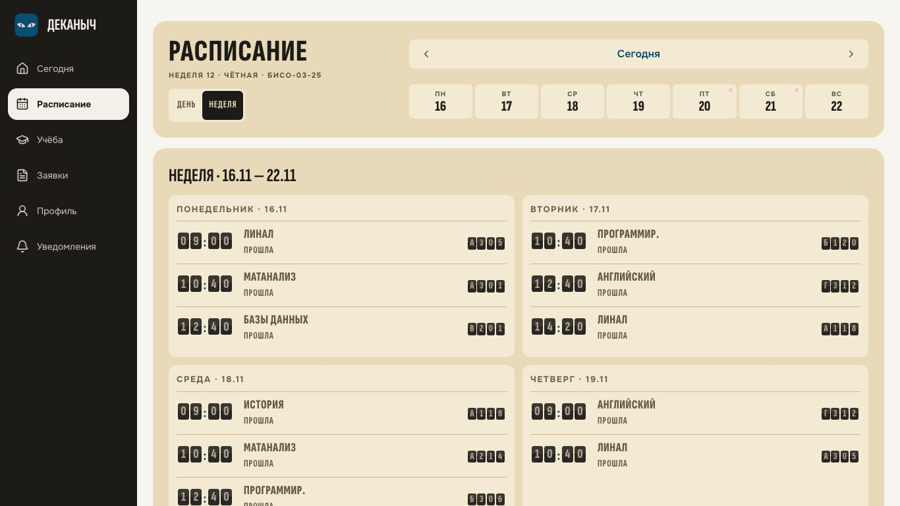

---

## 80. Панели входа выровнены по высоте

- **Дата и время:** 2026-11-20 23:50 МСК
- **Инструмент:** Codex (Алёна)
- **Кто ставил задачу:** Алёна
- **Этап плана:** 6 Проверка
- **Требования PRD:** NF1, X1

### Задача

Вынести пояснение о вымышленном вузе за рамку и растянуть синюю панель до нижнего края формы входа.

### Что сделал ИИ

Перенёс пояснение в подвал под обеими панелями. В двухколоночной раскладке панели занимают одну строку сетки, её высоту определяет содержимое. Логотип и название центрированы. В браузерный тест добавлена проверка обеих границ, порядка блоков на телефоне и положения пояснения при семи ширинах от 320 до 1920 px.

### Что проверил и поправил человек

Алёна показала исходный экран и указала нужное положение пояснения и нижней границы панели.

### Ошибки ИИ

В предыдущей версии левая панель заканчивалась выше формы. Теперь тест сравнивает высоту и верхние координаты двух панелей.

### Скриншоты

---

## 81. Выбор дня расположен над расписанием

- **Дата и время:** 2026-11-20 23:51 МСК
- **Инструмент:** Codex (Алёна)
- **Кто ставил задачу:** Алёна
- **Этап плана:** 6 Проверка
- **Требования PRD:** NF1, R2

### Задача

«Панель выбора дня должна быть над выбранным днем».

### Что сделал ИИ

Календарь занимает верхнюю строку сетки во всех режимах. Под ним идет панель занятий той же ширины. На ноутбуке все семь дней располагаются непосредственно над выбранной датой. Браузерный тест проверяет порядок панелей, их ширину и левую границу на семи размерах от 320 до 1920 px. Обновлено описание сетки в дизайн-системе.

### Что проверил и поправил человек

Алёна указала на неправильное положение календаря в дневном режиме на ноутбуке.

### Ошибки ИИ

Разместил выбор дня сбоку и закрепил это в тесте. Исправил вёрстку и проверку по замечанию Алёны.

### Скриншоты

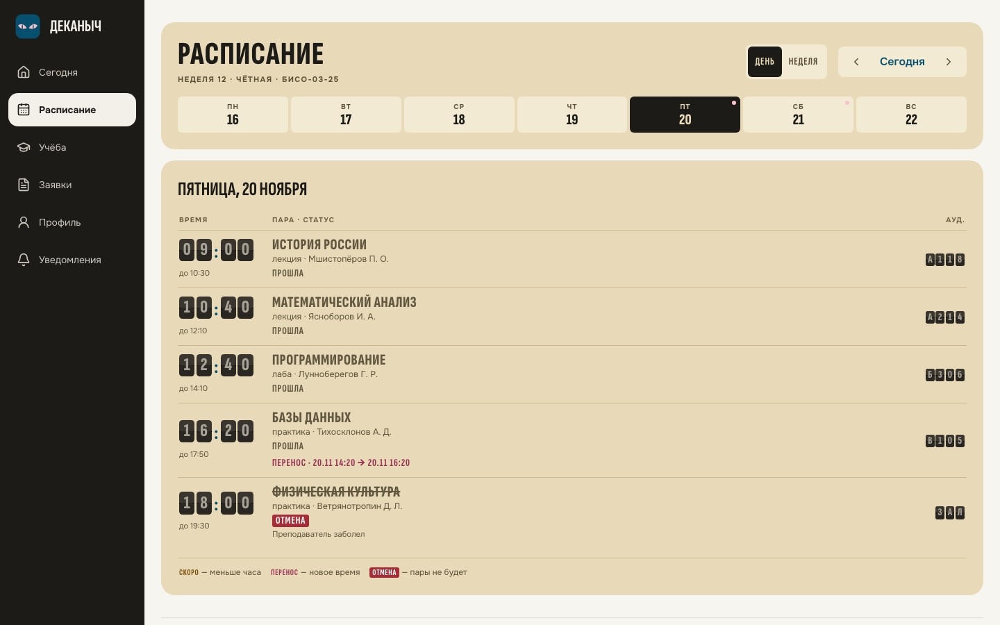
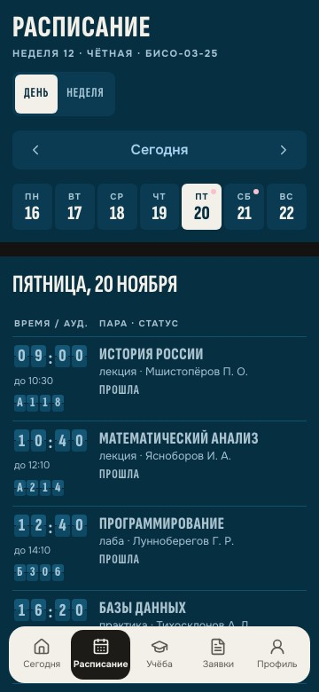

---

## 82. Пиксельные глаза Деканыча на фоне входа

- **Дата и время:** 2026-11-21 00:06 МСК
- **Инструмент:** Codex (Алёна)
- **Кто ставил задачу:** Алёна
- **Этап плана:** 2 Дизайн, 6 Проверка
- **Требования PRD:** NF1

### Задача

При наведении курсора подсветить моргающие глаза Деканыча в стиле пиксельной матрицы.

### Что сделал ИИ

На странице входа курсор проявляет участок неподвижного пиксельного узора. Две группы глаз моргают с разными периодами. Светлая тема использует синий цвет, тёмная — розовый. При уменьшенном движении глаза остаются открытыми. Клавиатурный ввод скрывает подсветку. Касание не запускает эффект.

Сравнил кадры с открытыми и прикрытыми глазами в Chromium и WebKit в обеих темах. Пройдены сборка, линтер, проверка типов и 18 браузерных сценариев. Новый тест проверяет реакцию на курсор, уменьшенное движение, отключение с клавиатуры и доступность поля логина.

### Что проверил и поправил человек

Алёна задала стиль и взаимодействие. Визуальная проверка результата Алёной предстоит.

### Ошибки ИИ

На GitHub тест единожды передвинул мышь при загрузке страницы и не увидел подсветку. Тест теперь воспроизводит движение курсора до появления подсветки и по-прежнему проверяет остальные состояния.

### Скриншоты

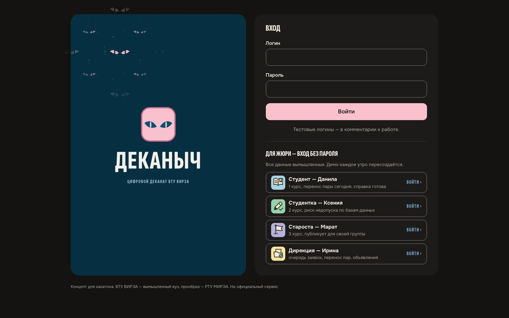

---

## 83. Возврат статичного фона входа

- **Дата и время:** 2026-11-21 00:28 МСК
- **Инструмент:** Codex (Алёна)
- **Кто ставил задачу:** Алёна
- **Этап плана:** 6 Проверка
- **Требования PRD:** NF1

### Задача

По просьбе Алёны откатить анимацию глаз на экране входа.

### Что сделал ИИ

Вернул страницу входа к версии 435bef9, убрал компонент анимации, его стили и тест наведения. Сравнение каталогов приложения и тестов с версией до анимации прошло без различий.

### Что проверил и поправил человек

Алёна посмотрела эффект и выбрала статичный фон.

### Ошибки ИИ

Не было.

### Скриншоты

[Экран входа в восстановленной версии](screenshots/2026-11-20_11_login-panels.jpg)
