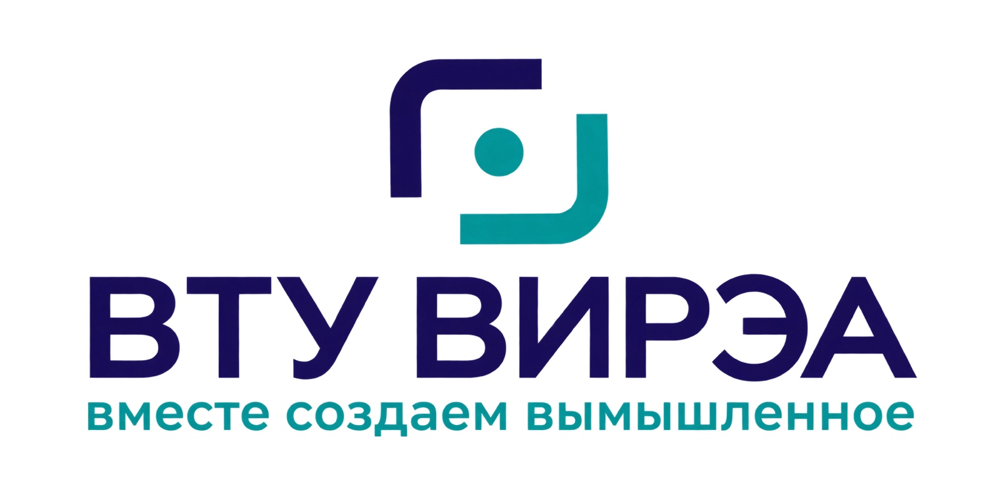

# Обновили логотип ВТУ ВИРЭА

- **Дата и время:** 2026-11-08 23:16 МСК
- **Инструмент:** ChatGPT (генерация изображения в Codex), Codex (Алёна) для добавления файлов в GitHub
- **Кто ставил задачу:** Алёна
- **Этап плана:** 2 Дизайн
- **Требования PRD:** X1

## Задача

Обновить название и подпись на логотипе. Добавить результат и запись с изображением в отдельную ветку.

> переделай логотип - исправь буквы на ВТУ ВИРЭА, а текст на "вместе создаем вымышленное"

## Что сделал ИИ

- Перерисовал знак из двух углов и точки и поставил надписи «ВТУ ВИРЭА» и «вместе создаем вымышленное».
- Сохранил [логотип с прозрачным фоном](../../brand/vtu-virea-logo.png) в PNG (1774 × 887). Для журнала подготовил JPEG шириной 1600 px и проверил обе надписи по изображению.
- Добавил промпт и описание варианта в [документацию бренда](../../brand/README.md).

## Что проверил и поправил человек

Алёна попросила добавить в репозиторий вариант из чата. Ревью файлов ещё впереди.

## Ошибки ИИ

Не было.

## Скриншоты

