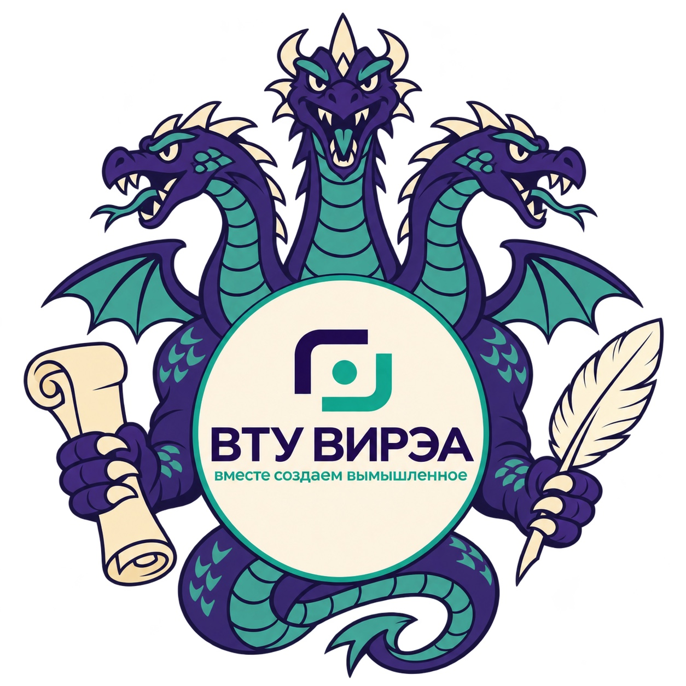

# Нарисовали вариант логотипа ВТУ ВИРЭА со Змеем Горынычем

- **Дата и время:** 2026-11-08 23:24 МСК
- **Инструмент:** ChatGPT (генерация изображения в Codex), Codex (Алёна) для добавления файлов в GitHub
- **Кто ставил задачу:** Алёна
- **Этап плана:** 2 Дизайн
- **Требования PRD:** X1

## Задача

Сделать вариант логотипа с персонажем из фольклора и добавить его в ветку с предыдущим логотипом.

> вместо двуглавого орла отрисуй трехглавого змея-горыныча, по центру вместо овала круг и в нем новый логотип ВТУ ВИРЭА, в лапах остается свиток и перо

## Что сделал ИИ

- Нарисовал трёхглавого Змея Горыныча со свитком и пером. В круг на груди поместил знак ВТУ ВИРЭА с подписью «вместе создаем вымышленное».
- Сохранил [новый вариант](../../brand/vtu-virea-gorynych-logo.png) как PNG с прозрачным фоном, 1254 × 1254 px. Для журнала подготовил JPEG шириной 1254 px.
- Записал промпт и описание варианта в [документацию бренда](../../brand/README.md).

## Что проверил и поправил человек

Алёна попросила добавить показанный в чате вариант в ту же ветку. Ревью коммита ещё впереди.

## Ошибки ИИ

Не было.

## Скриншоты

