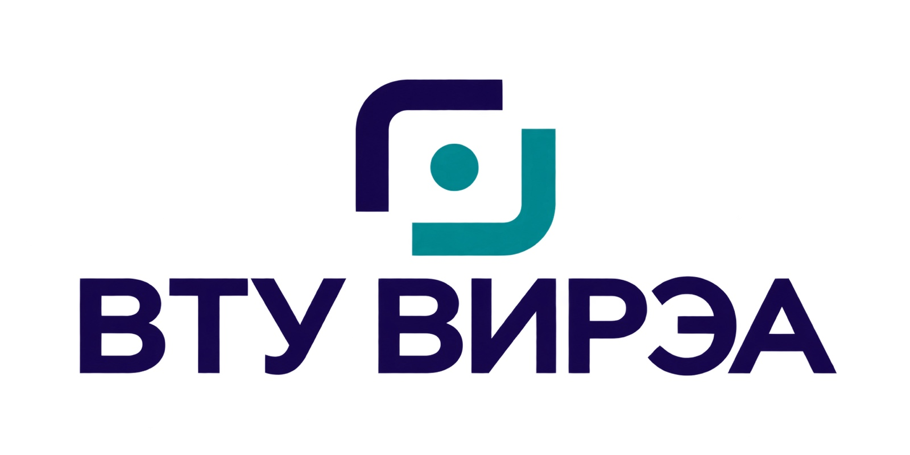
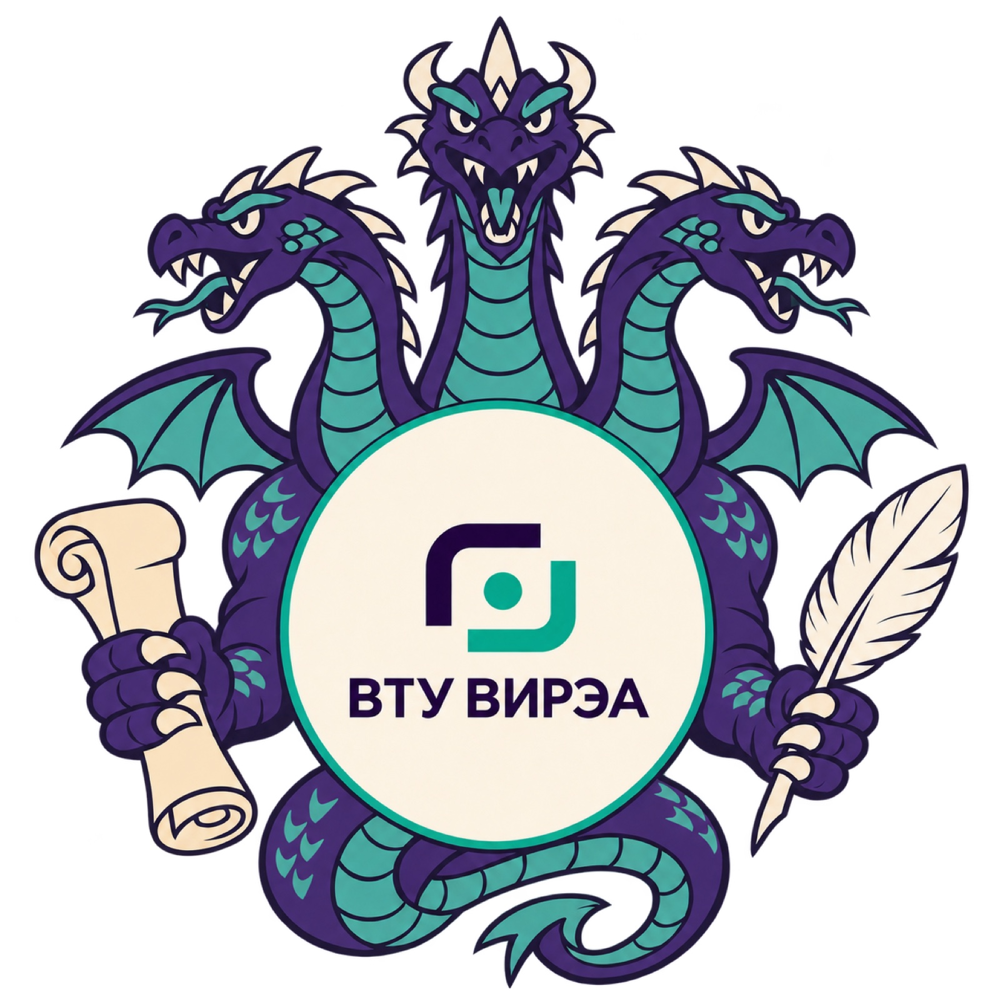

# Убрали слоган и выровняли оба логотипа ВТУ ВИРЭА

- **Дата и время:** 2026-11-08 23:45 МСК
- **Инструмент:** ChatGPT (генерация изображения в Codex), Codex (Алёна) для добавления файлов в GitHub
- **Кто ставил задачу:** Алёна
- **Этап плана:** 2 Дизайн
- **Требования PRD:** X1

## Задача

> переделай оба логотипа - убери слоган, выровняй логотип

## Что сделал ИИ

- Убрал слоган из обоих вариантов. В [основном логотипе](../../brand/vtu-virea-logo.png) выровнял знак и название «ВТУ ВИРЭА» по общей вертикальной оси.
- В [варианте со Змеем Горынычем](../../brand/vtu-virea-gorynych-logo.png) отцентрировал композицию в круге и уменьшил надпись, чтобы она не касалась ободка. В лапах остались свиток и перо.
- Проверил надписи и прозрачный фон обоих PNG. Добавил JPEG-превью шириной 1600 и 1254 px и обновил [описание вариантов](../../brand/README.md).

## Что проверил и поправил человек

Алёна задала правки к двум предыдущим версиям. Новые версии ожидают ревью.

## Ошибки ИИ

- После первого прохода центр композиции с Горынычем был выше центра круга. При выравнивании надпись приблизилась к ободку. На финальном проходе уменьшил надпись и проверил поля по бокам.

## Скриншоты

