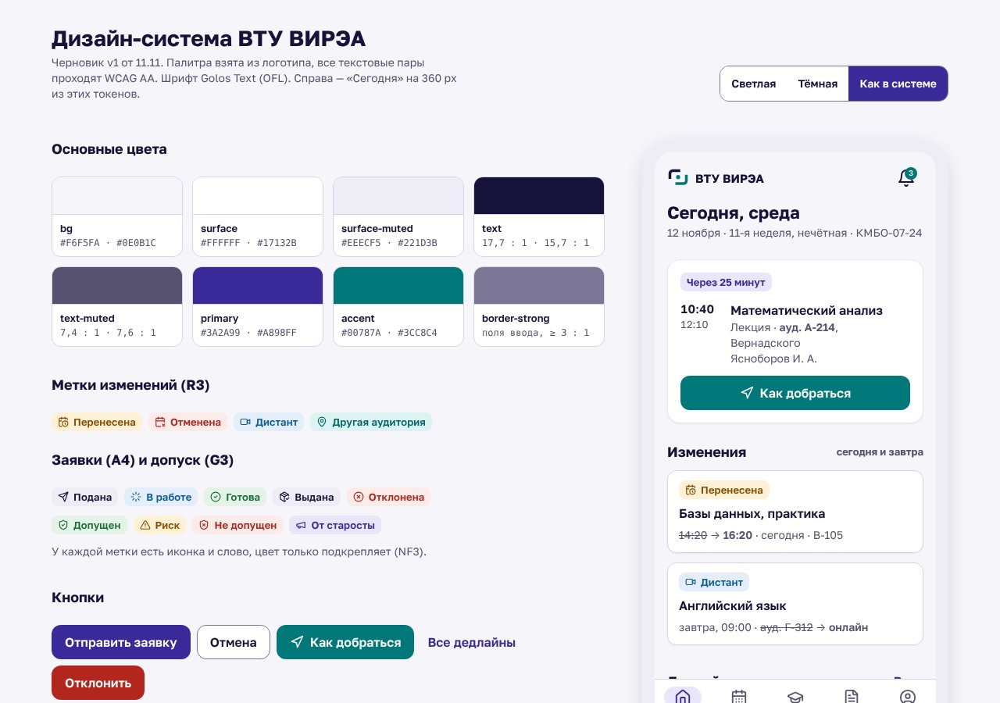
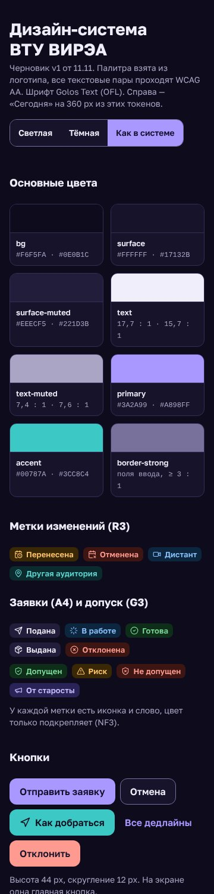

# Дизайн-система v1: палитра, шрифт, компоненты и превью «Сегодня»

- **Дата и время:** 2026-11-11 00:10 МСК
- **Инструмент:** Claude Code (скилл design-system, Artifact для превью, Playwright для скриншотов)
- **Кто ставил задачу:** Алёна
- **Этап плана:** 2 Дизайн
- **Требования PRD:** NF1, NF3, NF8, R3, T1, T2, X1, A4, G3

## Задача
> Начни с дизайна

Заполнить `docs/design-system.md`: цвета светлой и тёмной темы с контрастом AA, шрифт с лицензией OFL, сетка от 360 px, компоненты.

## Что сделал ИИ
- Вывел палитру из логотипа ВТУ ВИРЭА (индиго и бирюза) и посчитал контраст каждой пары по формуле WCAG 2.1 скриптом. Все текстовые пары не ниже 4,5 : 1, граница полей ввода — не ниже 3 : 1.
- Выбрал шрифт Golos Text (ParaType, SIL OFL 1.1), подключение со своего сервера через npm-пакет. Добавил строку в `docs/licenses.md`.
- Описал шкалу шрифтов, сетку для 360 / 768 / 1024 px, радиусы, тени, движение, метки изменений R3 и статусы заявок и допуска (иконка Lucide + слово), карточки пары, дедлайна и заявки, кнопки, нижнее меню, плашку концепта, скелетон, пустые состояния, ошибки, тон текстов и соответствие токенов именам shadcn/ui.
- Предложил, где какой логотип: знак — в шапке и иконке PWA, Горыныч — на входе и в пустых состояниях. Решение за Алёной.
- Сделал превью в Claude Artifact (палитра, метки, кнопки и экран «Сегодня» на 360 px с переключателем темы) и скриншоты через Playwright. Горизонтальной прокрутки нет ни на 1280, ни на 360 px.

## Что проверил и поправил человек
Нужно проверить: Алёна смотрит превью и утверждает палитру, шрифт и логотип.

## Ошибки ИИ
- Скриншот превью сначала вышел без иконок → Playwright показал 0 иконок на странице → CDN unpkg закрыт в песочнице, для скриншота подключил копию lucide из npm → проверять загрузку внешних скриптов до снимка.

## Скриншоты

