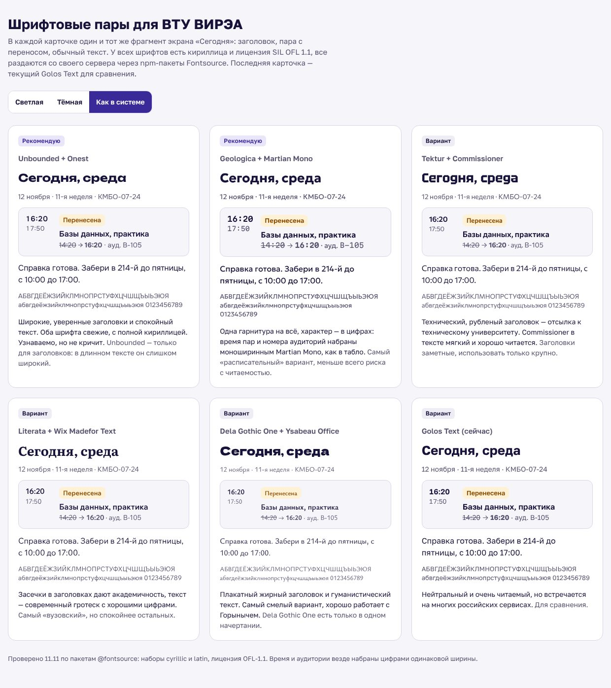
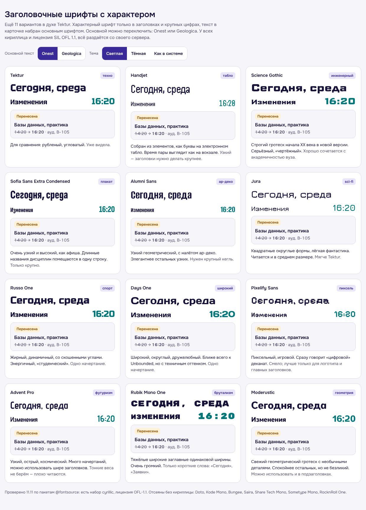
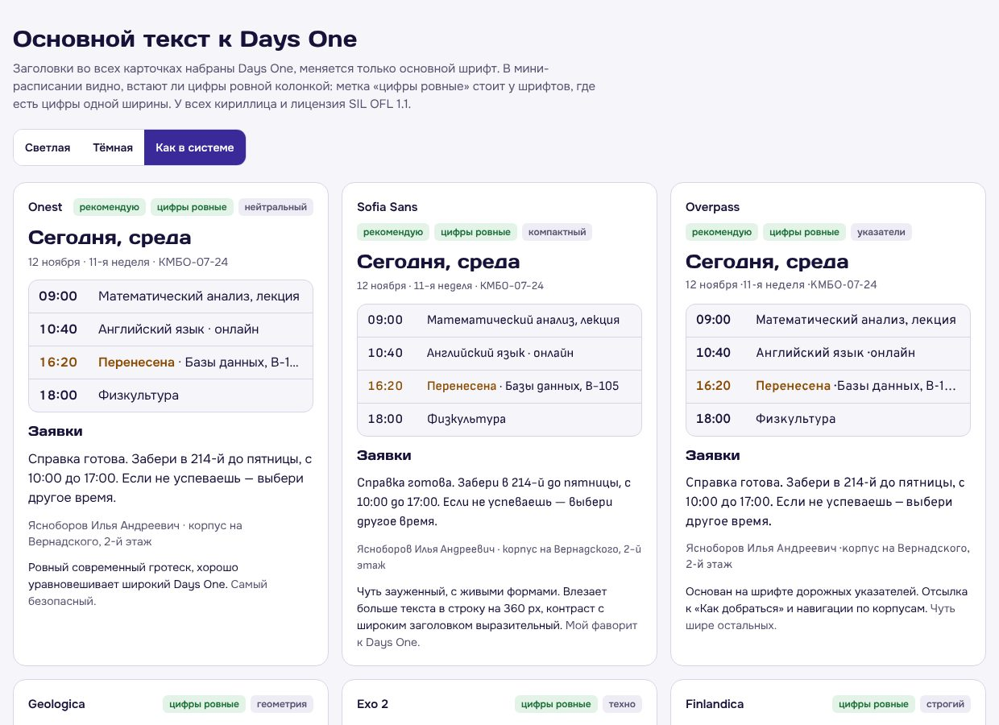
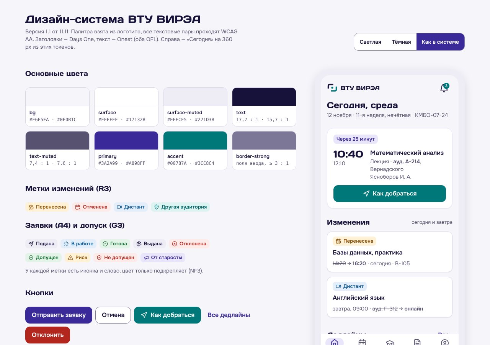
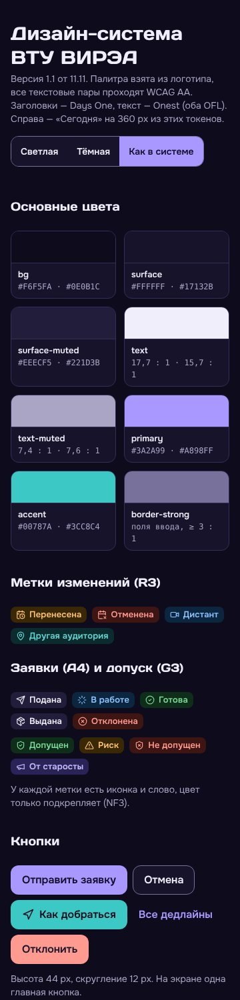

# Подбор шрифтов: Days One для заголовков и Onest для текста

- **Дата и время:** 2026-11-11 00:30 МСК
- **Инструмент:** Claude Code (Artifact для сравнения, fontTools и Playwright для проверки)
- **Кто ставил задачу:** Алёна
- **Этап плана:** 2 Дизайн
- **Требования PRD:** NF1, NF3

## Задача
> Я хочу изменить шрифты — можешь ли ты найти менее избитые бесплатные комбинации в открытом доступе?

Потом: «Есть ещё какие-нибудь интересные типа Tektur?», «для заголовков Days One, подыщи интересные для основного текста», выбор — Onest.

## Что сделал ИИ
- Проверил 70+ шрифтов по npm-пакетам Fontsource: есть ли кириллица и какая лицензия. Отсеял шрифты без кириллицы (Doto, Bungee, Saira, Hanken Grotesk, Mona Sans, Lexend и др.) и Ubuntu Sans из-за лицензии UFL.
- Собрал три страницы сравнения в Claude Artifact: пять пар, 11 характерных заголовочных шрифтов и 12 текстовых в паре с Days One, с мини-расписанием.
- Через fontTools проверил, у каких текстовых шрифтов есть цифры одинаковой ширины (функция tnum) — это важно для колонки времени в расписании.
- Обновил `docs/design-system.md` (версия 1.1): Days One — заголовки, Onest — всё остальное, правило `lang="ru"`. В `docs/licenses.md` Golos Text заменён на Days One и Onest, в `docs/context.md` обновлена строка решения. Превью дизайн-системы переведено на новые шрифты.

## Что проверил и поправил человек
Алёна смотрела сравнения в браузере, заметила, что первая страница показывает везде один шрифт, и выбрала Days One + Onest.

## Ошибки ИИ
- На первой странице сравнения все карточки показывали Golos → заметила Алёна → имена шрифтов в двойных кавычках обрывали атрибут `style="…"`, заменил на одинарные и проверил вычисленный `font-family` в Playwright → при подстановке строк в HTML-атрибуты проверять кавычки и смотреть результат до публикации.
- При исправлении скрипт вставил в код лишние обратные слэши → Playwright не нашёл ни одной карточки → убрал слэши, проверил снова.
- Sofia Sans по умолчанию рисует болгарские формы «т» и «д» → заметил на скриншоте → с `lang="ru"` формы русские; правило `lang="ru"` добавлено в дизайн-систему.

## Скриншоты

