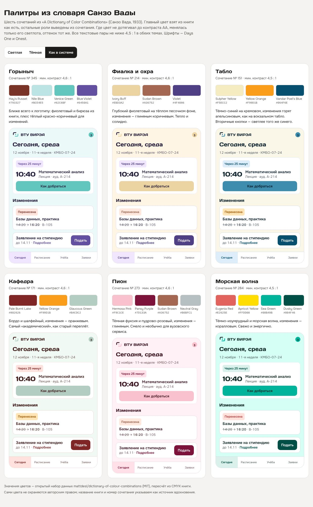
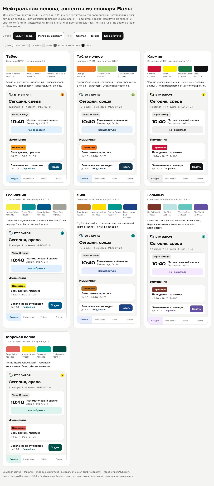
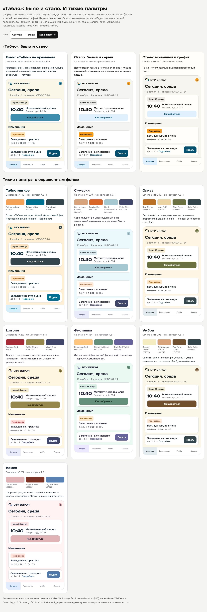
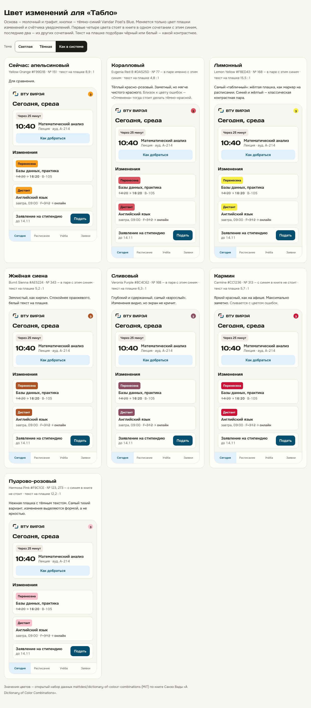
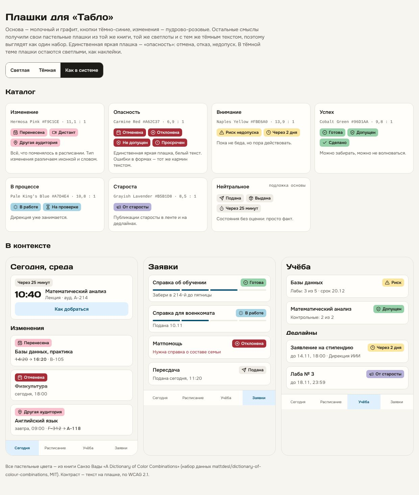
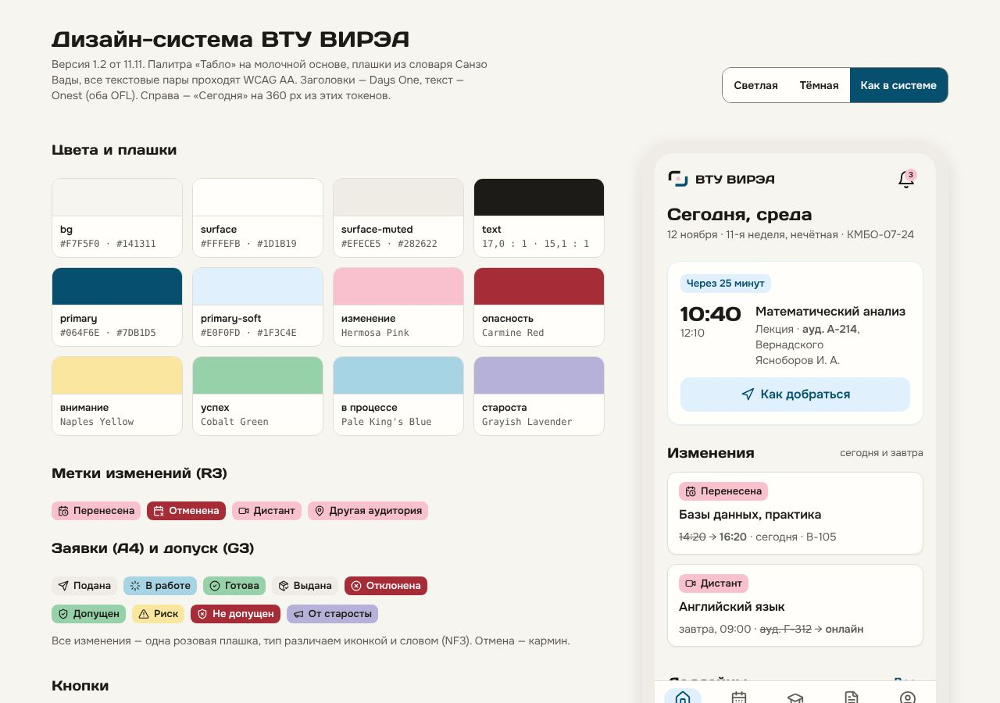
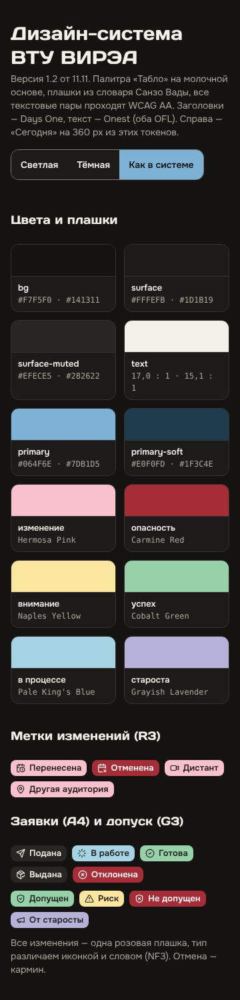

# Палитра «Табло» из словаря Санзо Вады: молочная основа и пастельные плашки

- **Дата и время:** 2026-11-11 01:00 МСК
- **Инструмент:** Claude Code (Artifact для сравнения, Python для контраста, Playwright для скриншотов)
- **Кто ставил задачу:** Алёна
- **Этап плана:** 2 Дизайн
- **Требования PRD:** NF3, R3, A4, G3

## Задача
> Попробуй другие цветовые комбинации, менее избитые, например попробуй что-то из книги A Dictionary of Color Combinations

Дальше по шагам: «попробуй более нейтральную основу», «найди ещё сочетания, не такие броские», «хочу поменять оранжевый», «берём пудрово-розовый, нужно добавить ещё цвета для плашек».

## Что сделал ИИ
- Нашёл открытый набор данных по книге (mattdesl/dictionary-of-colour-combinations, MIT): 159 цветов и 348 сочетаний. Скриптом отобрал сочетания, пригодные для интерфейса.
- Сделал пять страниц сравнения в Claude Artifact: шесть ярких палитр; нейтральная основа с семью наборами акцентов; «Табло» было/стало и семь тихих палитр; шесть замен оранжевому; набор плашек. Всего около 20 палитр.
- Для каждой палитры вывел токены светлой и тёмной темы: главный цвет — из книги, при нехватке контраста менялась только светлота. Каждую текстовую пару проверил по WCAG 2.1 — не ниже 4,5 : 1.
- Обновил `docs/design-system.md` до версии 1.2: основа «молочный и графит», кнопки `#064F6E`, плашки (изменение — Hermosa Pink, опасность — Carmine Red, внимание — Naples Yellow, успех — Cobalt Green, в процессе — Pale King's Blue, староста — Grayish Lavender), метки R3 и статусы. Обновил `context.md`, `licenses.md`, `brand/README.md` (цвета для перекраски логотипа), `status.md`, превью дизайн-системы.

## Что проверил и поправил человек
Алёна выбирала на каждом шаге: «Табло» → молочная основа → замена оранжевого на пудрово-розовый → набор плашек.

## Ошибки ИИ
- В первых палитрах кнопка «Как добраться» и метка «Перенесена» были одного цвета → заметил на скриншоте до публикации → развёл действие и предупреждение по разным цветам → в палитре цвет действия и цвет изменений всегда разные.
- Просьбу «как в предыдущей версии, но не такие броские» понял как «на нейтральной основе» → Алёна поправила: фон может быть цветным → переделал блок с окрашенным фоном → уточнять, к какой версии относится «как в предыдущей».
- В превью у плашки «От старосты» пропал фон → по скриншоту → имя токена `--head` совпало с переменной шрифта заголовков, переименовал в `--plate-head` → давать цветовым токенам префикс по роли.

## Скриншоты

