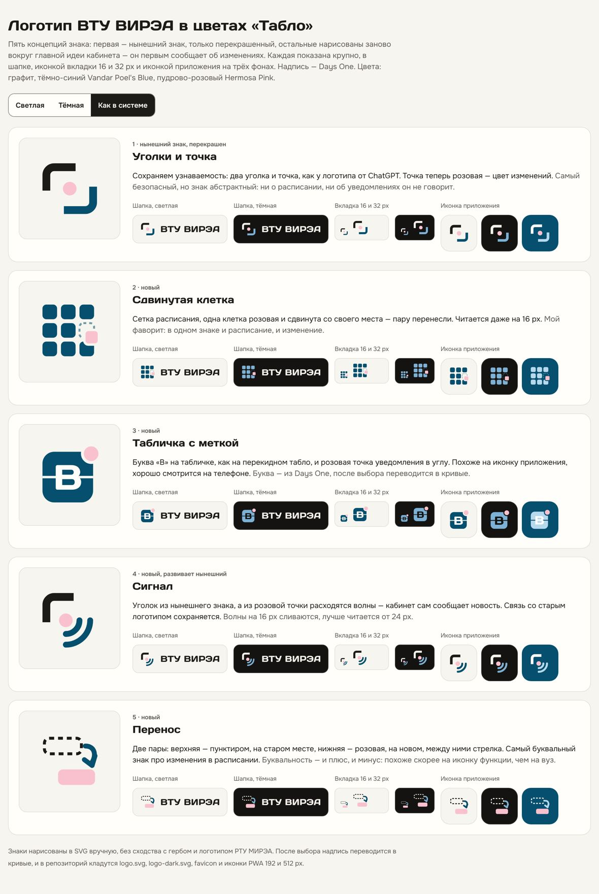
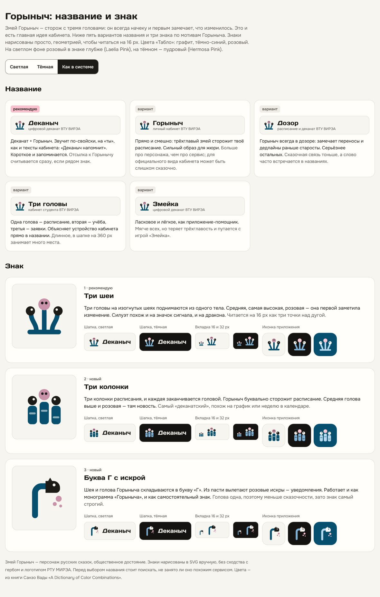
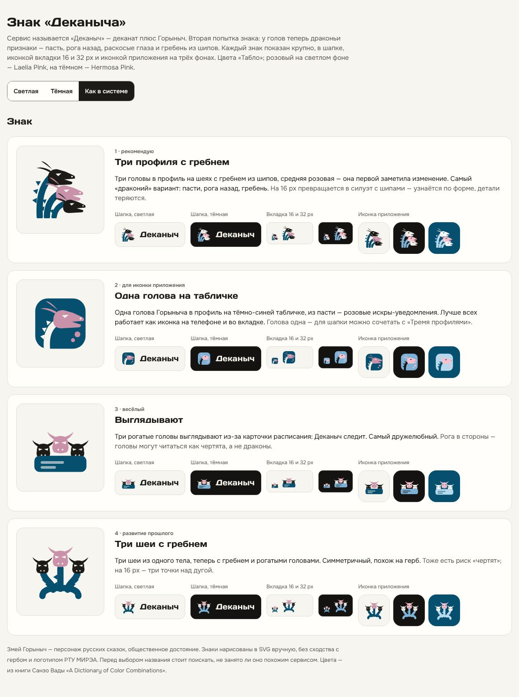
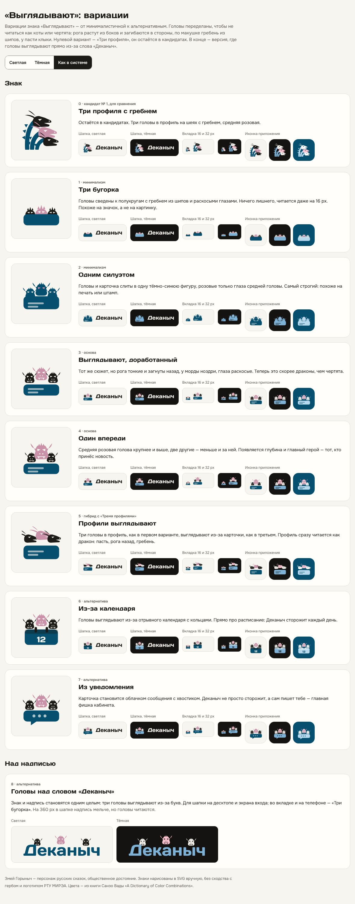
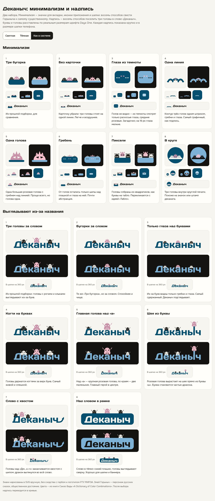
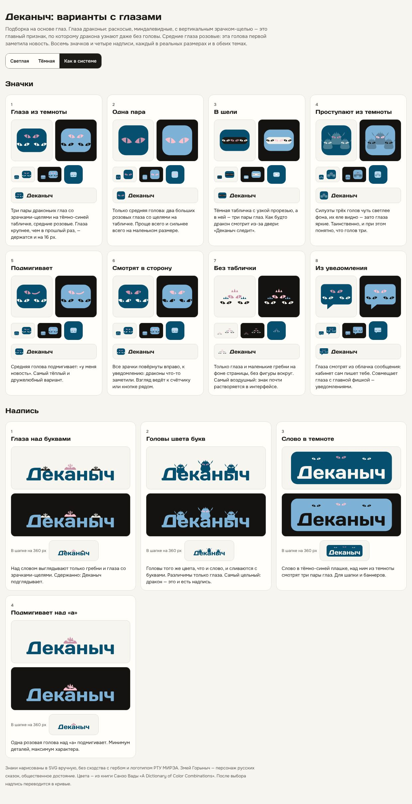
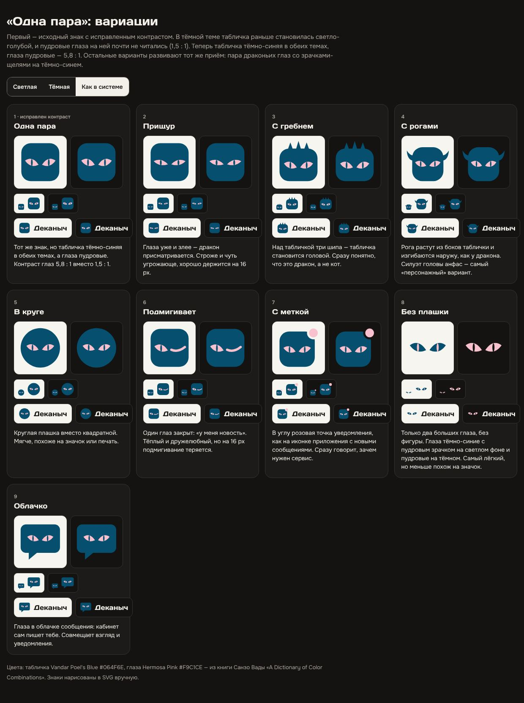
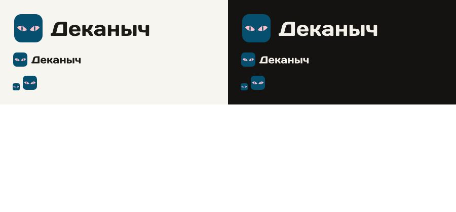

# Название «Деканыч» и логотип «Одна пара»: от 40 концепций до файлов

- **Дата и время:** 2026-11-11 01:30 МСК
- **Инструмент:** Claude Code (SVG вручную, fontTools для перевода надписи в кривые, Playwright для проверки и PNG)
- **Кто ставил задачу:** Алёна
- **Этап плана:** 2 Дизайн
- **Требования PRD:** X1

## Задача
> Ты можешь переделать логотип заново?

Потом: «сделай логотип, связанный с Горынычем, заодно придумай название сервиса», «название Деканыч, над логотипом подумай ещё», вариации «Выглядывают», минимализм, надписи, варианты с глазами, «Одна пара» с исправленным контрастом.

## Что сделал ИИ
- Проверил, какие инструменты есть для логотипов: свой SVG, CoDesign (генерация требует входа в IMG.LY), Figma и Canva не подключились, в каталоге — генераторы растровых PNG. Выбрал SVG: вектор, права у проекта.
- Предложил пять названий; Алёна выбрала «Деканыч».
- Нарисовал около 40 вариантов знака в восьми подборках: уголки и сетка расписания, Горыныч (три шеи, профили, буква «Г»), головы, выглядывающие из-за карточки и из-за надписи, минимализм, глаза. Каждый проверял крупно, на 16 и 32 px, в светлой и тёмной теме.
- Для надписей измерил реальные позиции букв Days One в браузере и ставил головы по ним.
- Финал: знак «Одна пара» — драконьи глаза на тёмно-синей табличке. Сделал `dekanych-mark.svg`, `dekanych-logo.svg`, `dekanych-logo-dark.svg` (надпись переведена в кривые через fontTools), maskable-иконку, PNG 32/180/192/512 в `docs/brand/`.
- Обновил `docs/brand/README.md`, `design-system.md` (1.3), `context.md` (название и смена исполнителя логотипа), `PRD.md` (X1), `glossary.md`, `AGENTS.md`, `README.md`, `licenses.md`, `status.md`.

## Что проверил и поправил человек
Алёна выбирала на каждом шаге и заметила, что в тёмной теме глаза на табличке не видно.

## Ошибки ИИ
- Головы с рогами наверху читались как коты и чертята, профили — как лошади → видно на скриншотах → рога перенесены на бока, добавлены гребень, клыки, пасть → драконьи признаки задавать формой морды и гребнем, а не «ушами».
- Глаза с толстым зрачком распадались на два треугольника «◄►» → на скриншоте → глаз шире, зрачок тоньше.
- В тёмной теме глаза почти не видны: 1,5 : 1 → заметила Алёна → табличка тёмно-синяя в обеих темах, 5,8 : 1 → считать контраст знака в обеих темах до показа.
- Лист с надписями отрисовался запасным шрифтом, и головы встали не над теми буквами → проверил `document.fonts.check` → загрузил Days One из файла и измерил позиции букв.
- Две вспомогательные функции с одинаковым именем ломали страницу; плашки шапки вылезали за карточку; на 360 px была прокрутка → поймал проверкой в Playwright до публикации.

## Скриншоты

