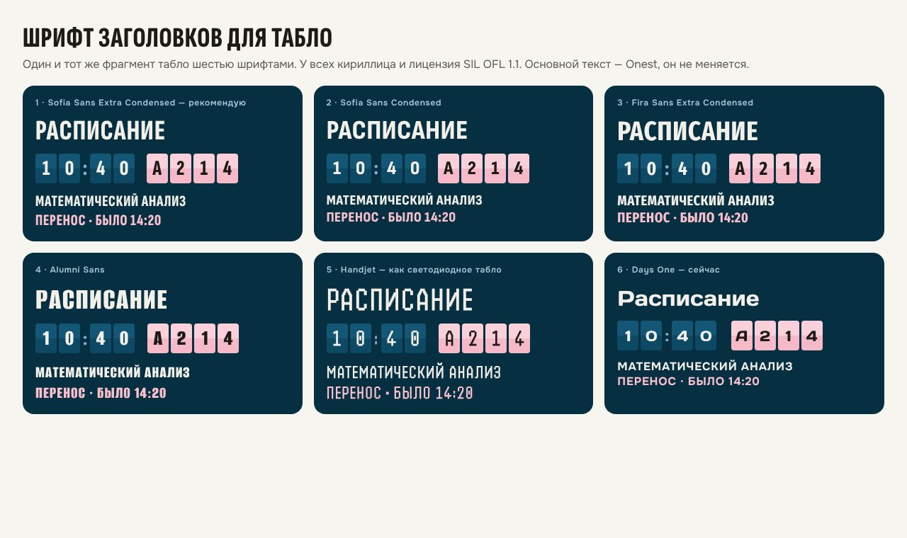
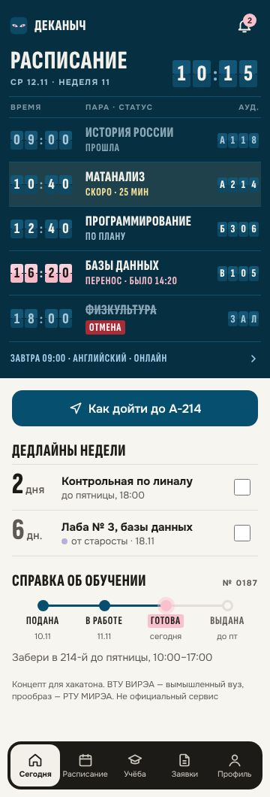
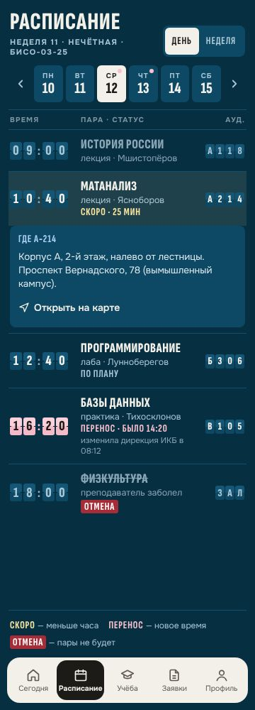
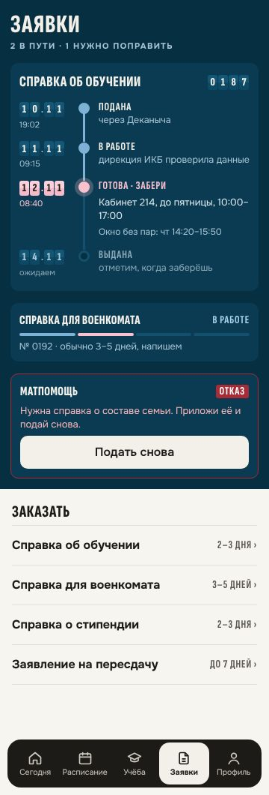
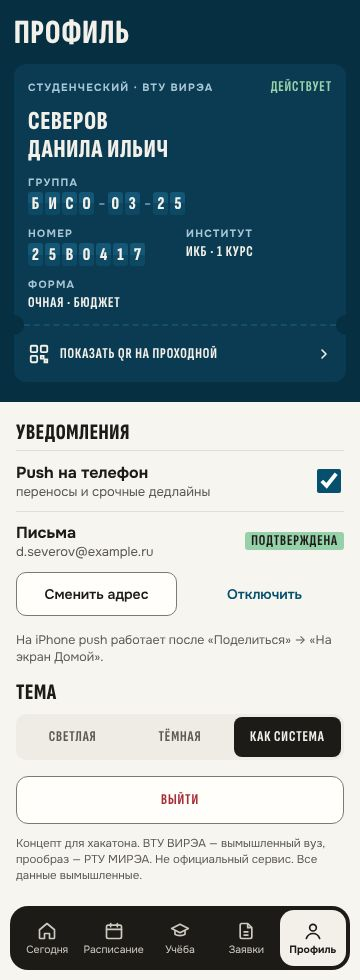
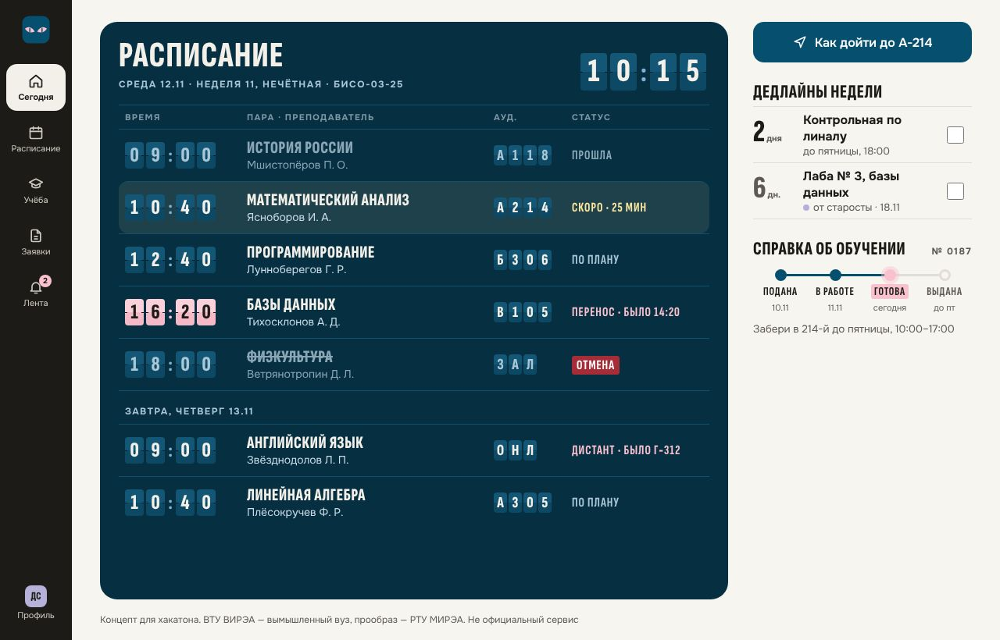
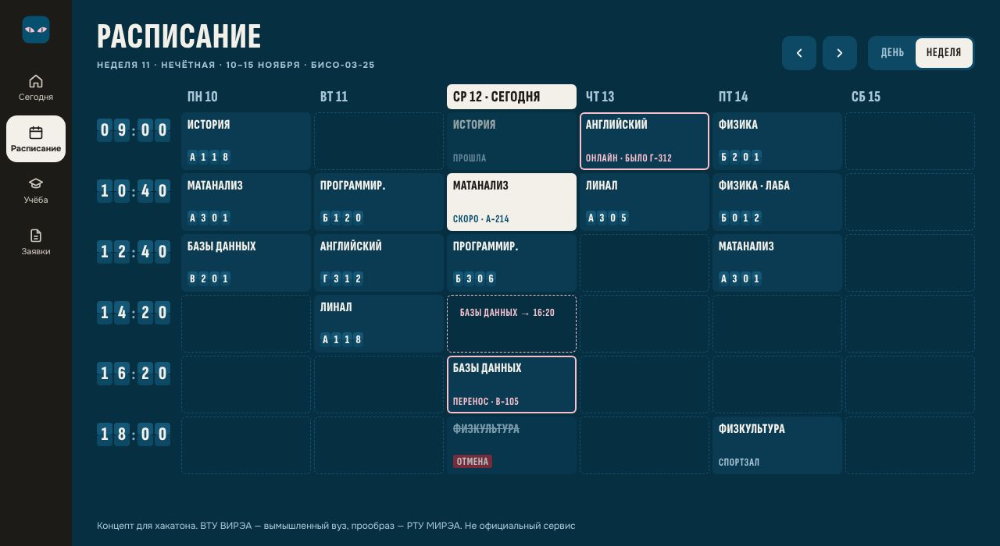
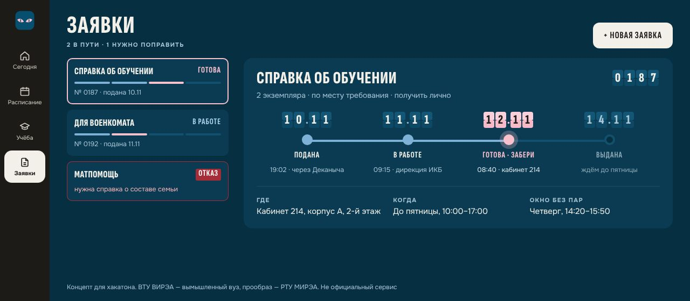

# Дизайн-система 2.0: стиль вокзального табло, шрифт заголовков, маршрут заявки

- **Дата и время:** 2026-11-11 02:15 МСК
- **Инструмент:** Claude Code (холст Design в Claude Artifact, WebSearch, Playwright, fontTools)
- **Кто ставил задачу:** Алёна
- **Этап плана:** 2 Дизайн
- **Требования PRD:** T1, R1–R4, A3, A4, P1–P3, NF1, NF3

## Задача
> Попробуй сделать дизайн менее типовым, более уникальным … Найди удачные примеры или воспользуйся рекомендациями из классических книг

Потом: «отрисовалось плохо, проверь и переделай; больше стиля табло; слово „табло“ убери; меньше текста сверху; поищи живые примеры», «переноси, верни этапы заявления как в доставке, подбери шрифт заголовков», «обнови дизайн-систему и запиши в репозиторий».

## Что сделал ИИ
- Предложил стиль «расписание как вокзальное табло» по мотивам швейцарской школы, Тафти, Круга, Нормана и «Refactoring UI»; нашёл живые примеры: страница статуса Crontap, split-flap-компоненты 21st.dev и shadcn.io, демо табло аэропорта.
- Сравнил шесть шрифтов заголовков с кириллицей и OFL (проверил наборы и `tnum` по пакетам Fontsource); выбран Sofia Sans Extra Condensed.
- Нарисовал на холсте 5 экранов на 360 px (Сегодня, Расписание, Заявки, Профиль, вход) и 3 на десктопе (Сегодня, Расписание на неделю, Заявки) и лист сравнения шрифтов. Этапы заявки — маршрут с остановками, студенческий — билет.
- Каждый экран собирал локально и проверял Playwright: выход за край, обрезанные строки, перенос плиток.
- Обновил `docs/design-system.md` до 2.0 (принцип «расписание — это табло», токены доски с контрастом, типографика, строка табло, плитка, маршрут заявки, билет, навигация), `licenses.md`, `context.md`, `status.md`.

## Что проверил и поправил человек
Алёна заметила, что первая версия отрисовалась плохо и наверху много текста; попросила убрать слово «табло» из меню и вернуть этапы заявки.

## Ошибки ИИ
- Первая версия: меню не влезало по высоте, линия на плитках читалась как зачёркивание, колонки на десктопе наезжали → заметила Алёна → проверил локальной сборкой, переделал → проверять каждую раскладку до публикации.
- Время в строках на 360 px переносилось на две строки; проверка «выход за край» этого не ловила → увидел на скриншоте → расширил колонку, добавил в проверку поиск переноса плиток.
- Цифры прошедших пар на плитке — 2,8 : 1, ниже AA → нашёл при расчёте контраста для дизайн-системы → заменил на `#A9C7D7` (4,5–5,6).
- В билете обрезался код группы, три названия в расписании не помещались → по проверке → полная ширина поля, сокращения.

## Скриншоты

