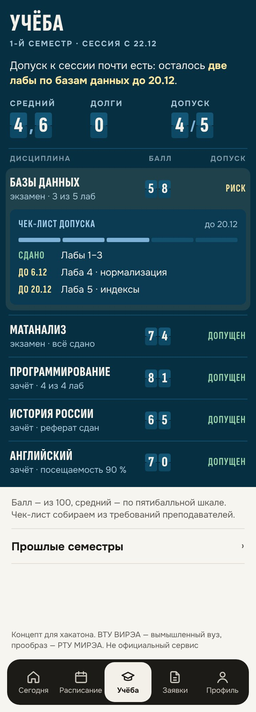
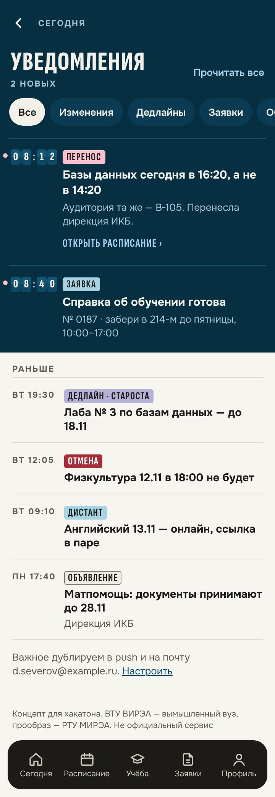
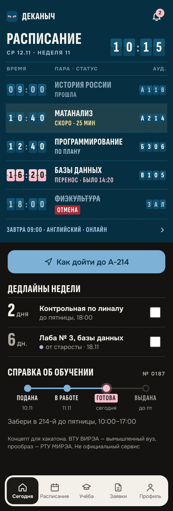
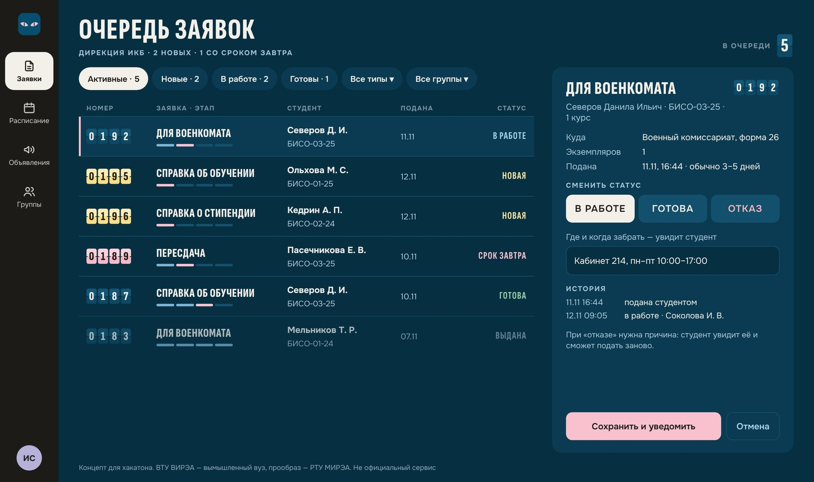
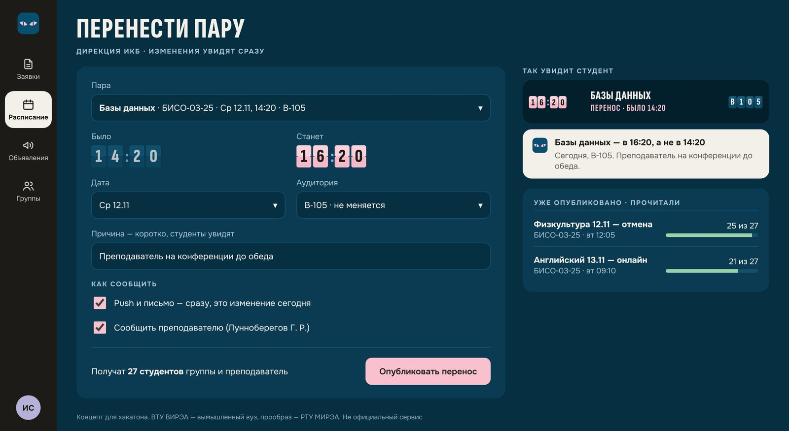

# Дорисованы недостающие экраны в стиле табло

- **Дата и время:** 2026-11-11 02:25 МСК
- **Инструмент:** Claude Code
- **Кто ставил задачу:** Алёна
- **Этап плана:** 2 Дизайн
- **Требования PRD:** G1, G2, G3, N1, E1, E2, NF3

## Задача
После перехода на стиль вокзального табло не хватало части экранов.

> дорисовать недостающие экраны

## Что сделал ИИ
- «Учёба» на 360 px: сводка одной фразой (G2), средний балл, долги и допуск на плитках, таблица дисциплин с баллом и словом табло «допущен / риск» (G1), чек-лист допуска раскрыт у дисциплины с риском (G3).
- «Уведомления» на 360 px (N1): фильтры чипами, новые — на табло с плитками времени и розовой точкой непрочитанного, ранние — на молочном фоне; плашки типов по палитре Вады (перенос, заявка, дедлайн старосты, отмена, дистант, объявление); ссылка на настройку каналов.
- Тёмная тема «Сегодня»: табло без изменений, молочная часть — графит #141311, главная кнопка #7DB1D5, светлая капсула навигации.
- Кабинет сотрудника, 1280 px: очередь заявок как табло отправлений — номера на плитках (жёлтые — новые, розовые — срок завтра), мини-маршрут этапов, фильтры; панель заявки со сменой статуса, местом выдачи и историей (E1). Перенос пары: было и станет на плитках, причина, каналы, предпросмотр строки табло и push для студента, «прочитали N из M» по опубликованным изменениям (E2).
- Все экраны проверены локальным рендером: нет выхода за край, обрезанных строк и переносов плиток. Холст обновлён, `docs/status.md` и «Что дальше» в `docs/design-system.md` — тоже.

## Что проверил и поправил человек
Алёна посмотрела на холсте: в «Учёбе» подсветка строки «Базы данных» обрывалась прямыми углами над чек-листом. Строку и чек-лист объединил в один блок со скруглёнными углами; подпись «контрольные сданы» сократил до «всё сдано», чтобы не переносилась.

## Ошибки ИИ
- В «Уведомлениях» навигация уехала за низ экрана → заметил по проверке рендера → увеличил высоту макета → проверять, что капсула навигации видна на каждом скриншоте.
- В кнопке «В работе» текст переносился на две строки → увидел на скриншоте → запретил перенос в кнопках → кнопки статусов делать с `white-space: nowrap`.
- В сноске «Учёбы» было упоминание МИРЭА и PRD — служебный текст в интерфейсе → заметил при просмотре → заменил на пояснение шкалы → в макетах не писать служебные пометки.

- Подсветка строки с риском и чек-лист выглядели как два несвязанных куска → заметила Алёна → объединил в один скруглённый блок → раскрывающиеся детали строки оформлять одним блоком с самой строкой.

## Скриншоты

