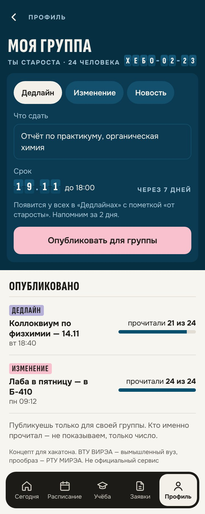
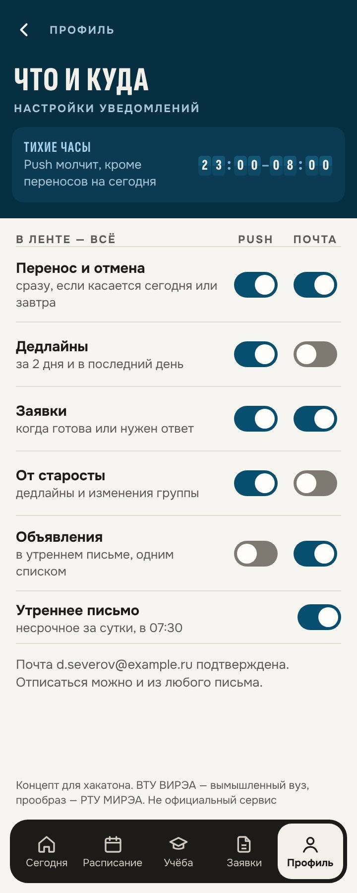
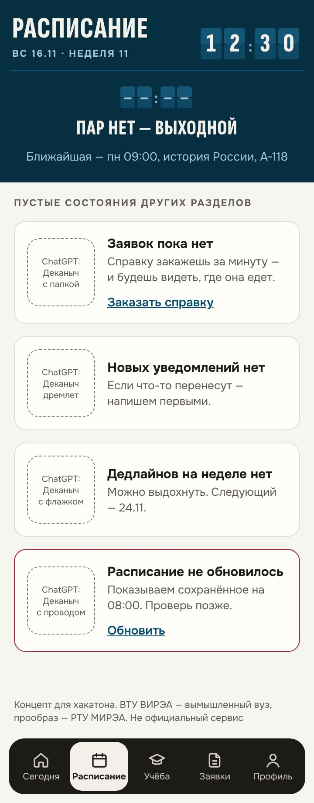
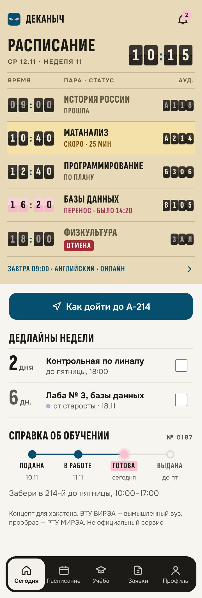
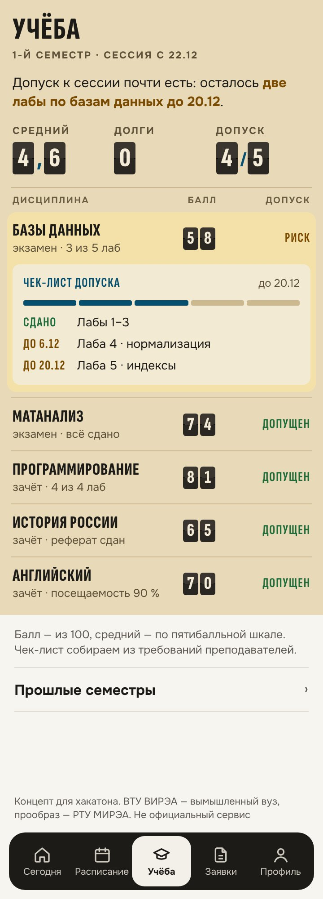
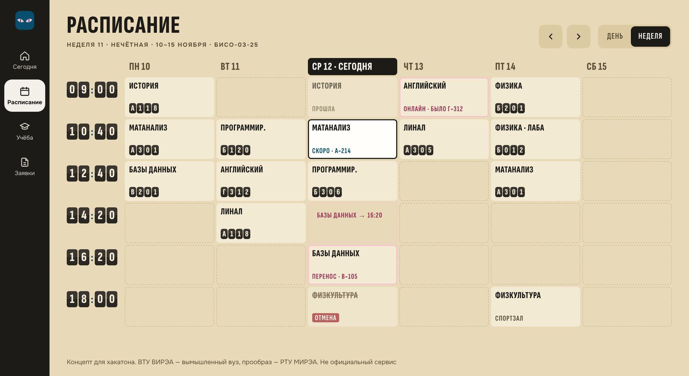

# Последние экраны и песочный вариант табло для светлой темы

- **Дата и время:** 2026-11-11 15:20 МСК
- **Инструмент:** Claude Code
- **Кто ставил задачу:** Алёна
- **Этап плана:** 2 Дизайн
- **Требования PRD:** S6, N4, T2, NF1, NF3

## Задача
Дорисовать оставшиеся экраны и примерить другой цвет табло.

> Доделай недостающие экраны, в светлой теме попробуй поменять цвет табло с синего на песочный, как на старых табло

## Что сделал ИИ
- Староста (S6): публикация дедлайна, изменения или новости для своей группы, срок на плитках, список опубликованного со счётчиком «прочитали 21 из 24». Кто именно прочитал — не показываем.
- Настройки уведомлений (N4): таблица «тип × push / почта», утреннее письмо, тихие часы на плитках.
- Пустые состояния: выходной на табло («пар нет», плитки с прочерками), пустые заявки, уведомления, дедлайны и ошибка обновления расписания; места под иллюстрации ChatGPT подписаны.
- Песочное табло: скрипт пересчитал цвета табло во всех 15 экранах (12 прежних и 3 новых). Фон #E8DAB8, карточки #F3EAD3, графитовые плитки со светлыми цифрами, статусы затемнены до контраста от 4,5:1 на песке. Синий вариант и тёмная тема не тронуты, выбор — за Алёной.
- Холст обновлён, `docs/status.md` и «Что дальше» в `docs/design-system.md` — тоже.

## Что проверил и поправил человек
Нужно проверить: выбрать синий или песочный вариант на холсте.

## Ошибки ИИ
- При автозамене цветов в песочный текст на плитках, днях недели, переключателе темы и выбранной паре недели стал тёмным на тёмном → увидел на листе со всеми экранами → добавил исключения в скрипт и перепроверил все экраны → после автоматической перекраски смотреть каждый экран глазами, а не только проверку переполнения.
- Тусклый текст «прошла» на песке сначала был 4,2:1 → посчитал контраст до вёрстки → затемнил до #625842 → считать контраст для каждой пары «текст — фон» новой палитры.
- В прошлой задаче строка о макетах учёбы и сотрудника не добавилась в `docs/status.md`: замена не нашла текст и молча ничего не сделала → заметил сейчас → добавил строку → в скриптах правки документов проверять, что замена сработала.

## Скриншоты

