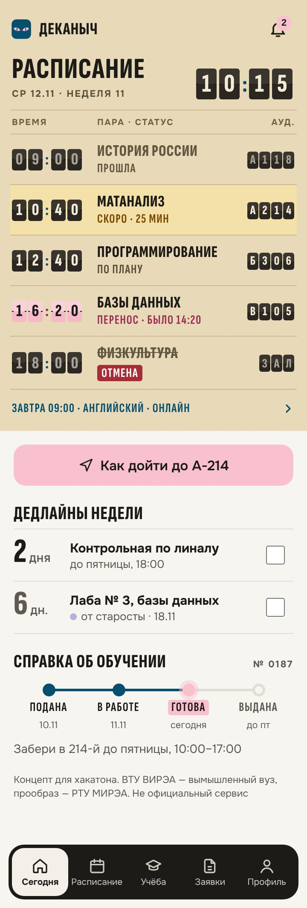
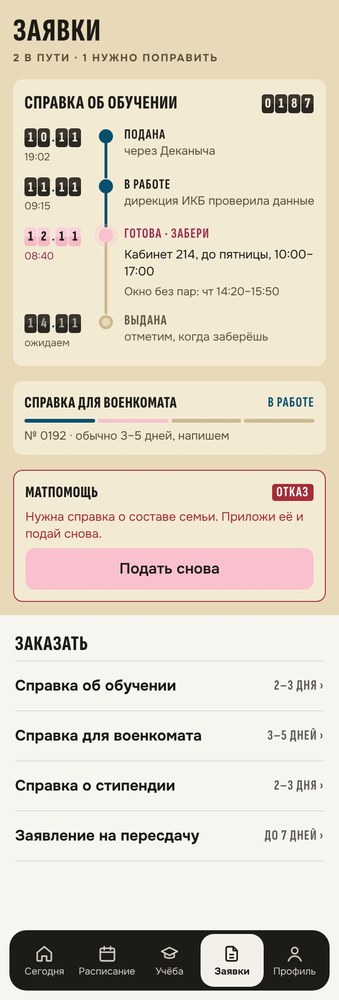
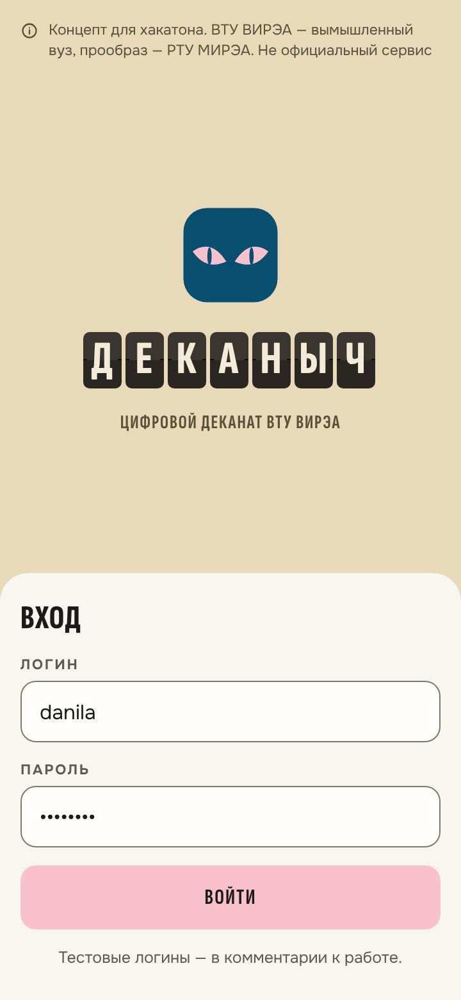

# Песочное табло принято, главные кнопки в светлой теме — розовые

- **Дата и время:** 2026-11-11 17:36 МСК
- **Инструмент:** Claude Code
- **Кто ставил задачу:** Алёна
- **Этап плана:** 2 Дизайн
- **Требования PRD:** NF1, NF3

## Задача
Алёна выбрала песочное табло и попросила поменять цвет кнопок.

> Мне все нравится, песочный для табло отлично, цвет кнопок в светлой теме можно поменять на розовый

## Что сделал ИИ
- В песочных макетах главные кнопки стали розовыми `#F9C1CE` с тёмным текстом (11,1:1): «Как дойти до А‑214», «Войти», «Подать снова», «+ Новая заявка». Чипы фильтров и переключатели остались графитовыми — это выбор, а не действие.
- `docs/design-system.md`: таблица «Табло» теперь в двух колонках — песок для светлой темы, синее для тёмной, с контрастом каждой пары; добавлены токены `--action` / `--on-action`, правило, как не спутать розовую кнопку с розовым «переносом»; исправлены задвоенные заголовки «Метка» и «Кнопки».
- `docs/context.md` — строка с решением, `docs/status.md` — задача выбора цвета закрыта.
- Холст обновлён.

## Что проверил и поправил человек
Алёна выбрала песочный вариант на холсте и предложила розовые кнопки. Розовые кнопки на макетах — нужно посмотреть.

## Ошибки ИИ
- В `design-system.md` при правке скриптом в текст попали буквальные `\n` вместо переноса строки → заметил, когда проверял раздел → исправил → после правок скриптом просматривать изменённый раздел.

## Скриншоты

