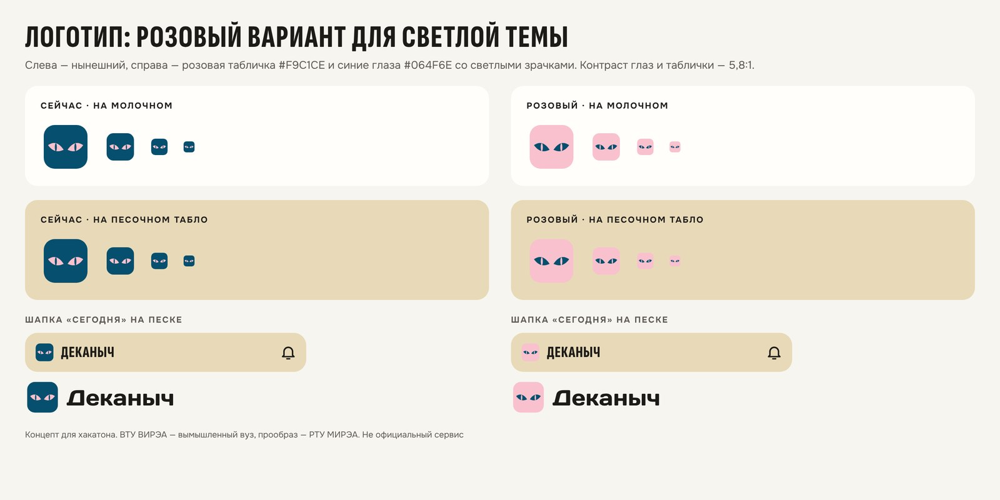

# Розовый вариант логотипа для светлой темы

- **Дата и время:** 2026-11-11 17:38 МСК
- **Инструмент:** Claude Code
- **Кто ставил задачу:** Алёна
- **Этап плана:** 2 Дизайн
- **Требования PRD:** X1

## Задача
> сделай вариант логотипа для светлой темы с розовым фоном и синими глазами

## Что сделал ИИ
- Знак и логотип с надписью с инвертированными цветами: розовая табличка `#F9C1CE`, синие глаза `#064F6E`, розовые зрачки. Контраст глаз и таблички 5,8:1. Файлы: `docs/brand/dekanych-mark-pink.svg`, `docs/brand/dekanych-logo-pink.svg`; строка в `docs/brand/README.md`.
- Лист сравнения на холсте: нынешний и розовый знак на молочном и на песочном фоне в размерах 64/40/24/16 px, шапка «Сегодня» на песке, логотип с надписью.
- Нынешний логотип не заменён: розовый — вариант, пока Алёна не решит.

## Что проверил и поправил человек
Нужно посмотреть лист сравнения на холсте и выбрать.

## Ошибки ИИ
Не было.

## Скриншоты

