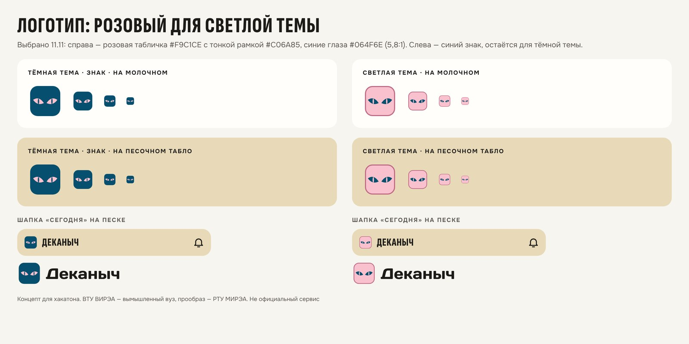
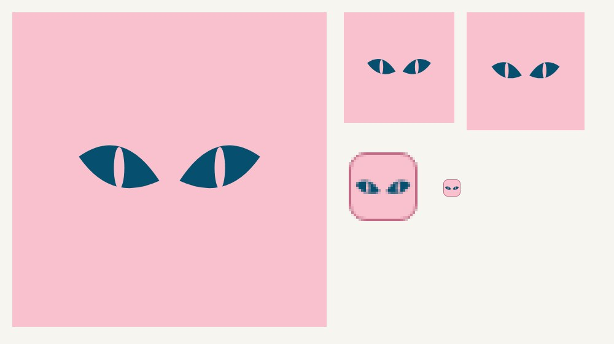

# Розовый знак для светлой темы: рамка, иконки, шапки

- **Дата и время:** 2026-11-11 17:42 МСК
- **Инструмент:** Claude Code
- **Кто ставил задачу:** Алёна
- **Этап плана:** 2 Дизайн
- **Требования PRD:** X1

## Задача
> берем розовый, перерисуй иконки и шапки. сделай тонкую рамку более темного оттенка розового

## Что сделал ИИ
- Знак светлой темы: розовая табличка `#F9C1CE` с рамкой `#C06A85` (2 из 64 единиц), синие глаза `#064F6E`. Рамку подобрал по контрасту с фоном: на песке 2,7:1, на молочном 3,4:1 — у самой таблички было 1,1 и 1,4.
- `docs/brand/`: `dekanych-mark.svg` и `dekanych-logo.svg` теперь розовые; синий знак сохранён как `dekanych-mark-dark.svg` для тёмной темы, `dekanych-logo-dark.svg` не менялся. Временные `*-pink.svg` удалены — их заменили основные файлы.
- Иконки приложения перерисованы: `icon-192.png`, `icon-512.png`, `apple-touch-icon.png` — розовый квадрат без рамки (maskable, рамку обрезало бы), `favicon-32.png` — знак с рамкой; `dekanych-icon-full.svg` — исходник.
- Макеты светлой темы: розовый знак в шапке «Сегодня», на входе, в навигации десктопа, в предпросмотре push у сотрудника. Лист сравнения на холсте обновлён.
- Обновлены `docs/brand/README.md`, раздел «Логотип в интерфейсе» в `docs/design-system.md`, строка решения в `docs/context.md`. README репозитория показывает `dekanych-logo.svg` — там теперь розовый знак.

## Что проверил и поправил человек
Алёна выбрала розовый вариант и попросила рамку. Нужно посмотреть на холсте и на иконках.

## Ошибки ИИ
Не было.

## Скриншоты

