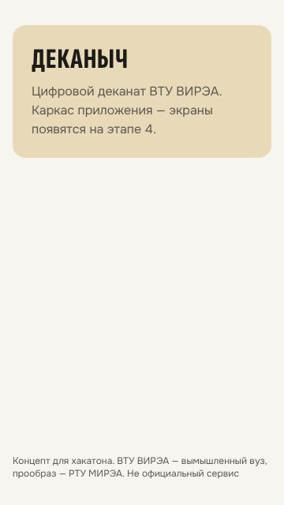

# Каркас приложения на Next.js (задача 3.1)

- **Дата и время:** 2026-11-11 21:54 МСК
- **Инструмент:** Claude Code
- **Кто ставил задачу:** Алёна
- **Этап плана:** 3 Каркас
- **Требования PRD:** NF1, NF7, X1

## Задача
> начни делать задачи напарника

## Что сделал ИИ
- Создал проект Next.js 15.5 (App Router, TypeScript, Tailwind CSS 4, ESLint) через `create-next-app`, добавил Prettier, Lucide, помощник `cn` и `components.json` для shadcn/ui.
- Шрифты Onest и Sofia Sans Extra Condensed подключены пакетами `@fontsource` — файлы раздаёт наш сервер, Google Fonts не используется (правило 6 `AGENTS.md`).
- `lang="ru"`, заголовок и описание с пометкой концепта, иконки из `docs/brand/` в `public/brand/`, цвет панели браузера для обеих тем, `output: "standalone"` для Docker.
- Временная страница с плашкой концепта (X1). Токены дизайн-системы — отдельная задача 3.6.
- Структура `src/app`, `src/components/ui`, `src/lib`, `src/server`; раздел «Запуск» в README.
- Проверки: `npm run lint`, `npm run typecheck`, `npm run build` проходят; страница на 360 px без горизонтальной прокрутки.

## Что проверил и поправил человек
Нужно: ревью PR (по возможности — напарник).

## Ошибки ИИ
Не было. Замечание: `npm audit` показывает уязвимость во встроенном в Next.js 15 PostCSS (влияет на сборку, не на работу сайта); исправление есть только в Next.js 16 — оставили 15.5, вернёмся при обновлении.

## Скриншоты

