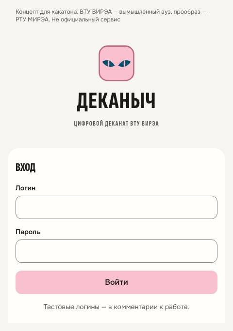

# Вход по логину и паролю, сессии и роли (задача 3.4)

- **Дата и время:** 2026-11-11 22:02 МСК
- **Инструмент:** Claude Code
- **Кто ставил задачу:** Алёна
- **Этап плана:** 3 Каркас
- **Требования PRD:** NF5, X1, S9

## Задача
> начни делать задачи напарника

Задача 3.4 — вход, argon2id, сессия в cookie, роли, лимит попыток.

## Что сделал ИИ
- Пароли — argon2id (`@node-rs/argon2`, параметры OWASP). Если логина нет, сервер всё равно проверяет пароль по пустому хэшу — по времени ответа нельзя узнать, есть ли логин.
- Сессия: случайный токен 32 байта в cookie `dk_session` (HttpOnly, Secure, SameSite=Lax, 14 дней), в БД — только HMAC токена с `SESSION_SECRET`. Выход отзывает сессию.
- `getCurrentUser()` — единственный источник `userId`, роли и группы; староста — по `GroupHead`. `requireUser()` ведёт на вход, `requireStaff()` студенту отвечает 404.
- Лимит попыток до проверки пароля: 5 на логин и 30 с адреса за 15 минут, атомарный счётчик в `RateLimitBucket`.
- Страницы: вход (розовая кнопка, плашка концепта), временная оболочка кабинета с выходом, заглушки «Сегодня» и «Кабинет сотрудника».
- Проверил в браузере на временных пользователях локальной БД: неверный пароль → понятная ошибка; вход студента → «Сегодня»; cookie HttpOnly/Secure/Lax; студент на `/staff` → 404; выход → на вход; сотрудник → `/staff`; шестая попытка → «Слишком много попыток».

## Что проверил и поправил человек
Нужно: ревью PR.

## Ошибки ИИ
- Первый прогон теста упал: сервер из прошлой проверки не остановился и занимал порт, а селектор `[role=alert]` находил служебный элемент Next.js → остановил процесс по порту, уточнил селектор → в тестах искать сообщения по своему элементу, а не по роли.

## Скриншоты

