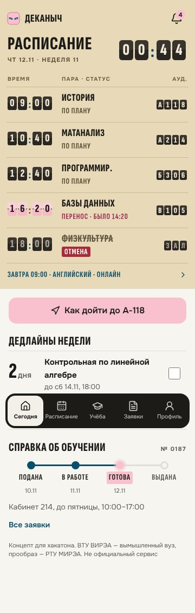
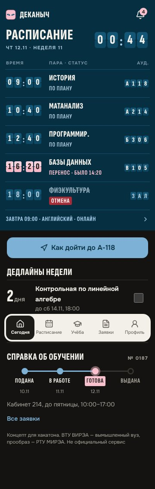
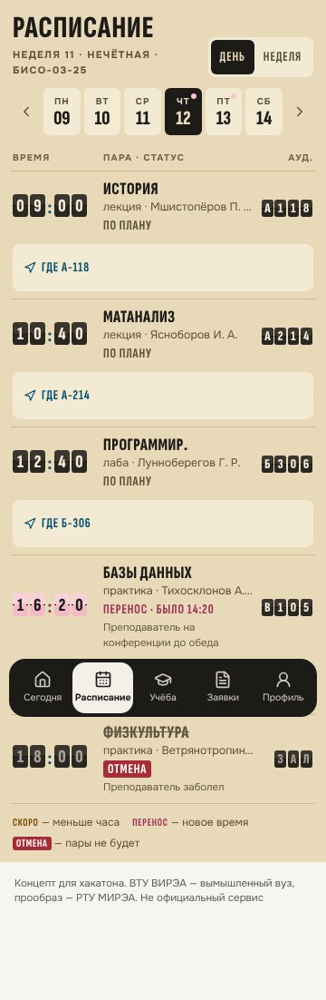
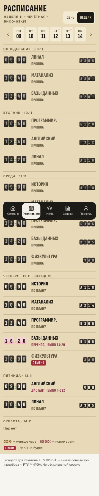

# Токены, компоненты табло, навигация; экраны «Сегодня» и «Расписание»

- **Дата и время:** 2026-11-12 00:45 МСК
- **Инструмент:** Claude Code
- **Кто ставил задачу:** Алёна
- **Этап плана:** 4 Must
- **Требования PRD:** T1, T2, R1, R2, R3, R4, D1, D3, A4, NF1, NF3, X1; сценарий S1

## Задача
> начинай делать этап 4

## Что сделал ИИ
- Задачи 3.6–3.8 (зона Алёны, по её просьбе): токены светлой (песочное табло, розовые кнопки) и тёмной (синее табло) темы в CSS-переменных и Tailwind; тема из настроек пользователя через `data-theme`; компоненты — плитки, слова-статусы, плашки, компактный маршрут заявки, строка табло, плашка концепта; капсула навигации на телефоне и панель слева на десктопе для студента и сотрудника.
- «Сегодня» (4.2): часы на плитках, пары дня с состояниями «прошла / идёт / скоро · N мин / по плану / перенос · было / дистант / отмена», завтрашняя первая пара, кнопка «Как дойти до …», дедлайны недели с отметкой «сделано» (D3, проверка, что дедлайн своей группы), самая важная заявка с маршрутом, счётчик непрочитанного.
- «Расписание» (4.3): день и неделя, вкладки дней с розовой точкой изменений, листание недель, «Где аудитория» с корпусом и этажом, «Подключиться» для онлайн-пар, причина изменения, легенда.
- Группа и студент берутся только из сессии. Временные страницы для остальных разделов, «Выйти» — в профиле.
- Проверено в браузере на 360 px в светлой и тёмной теме: без горизонтальной прокрутки; студент на `/staff` → 404; `lint`, `typecheck`, `build` проходят.

## Что проверил и поправил человек
Нужно: посмотреть на телефоне, когда заработает домен.

## Ошибки ИИ
- Плитки времени получились шире колонки и наезжали на название → увидел на скриншоте → уменьшил плитку до 0,85 em × 1,25 em, как в макете → сверять размеры компонентов с макетом в пикселях.
- В тёмной теме текст кнопки «Как дойти» был невидим: базовое правило `a { color }` вне слоя перебивало классы Tailwind → увидел на скриншоте → перенёс базовые стили в `@layer base` → базовые стили в Tailwind 4 всегда класть в слой.

## Скриншоты

