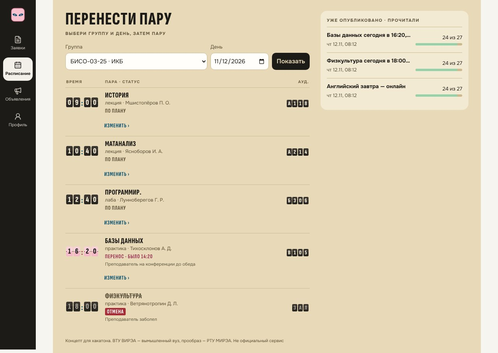
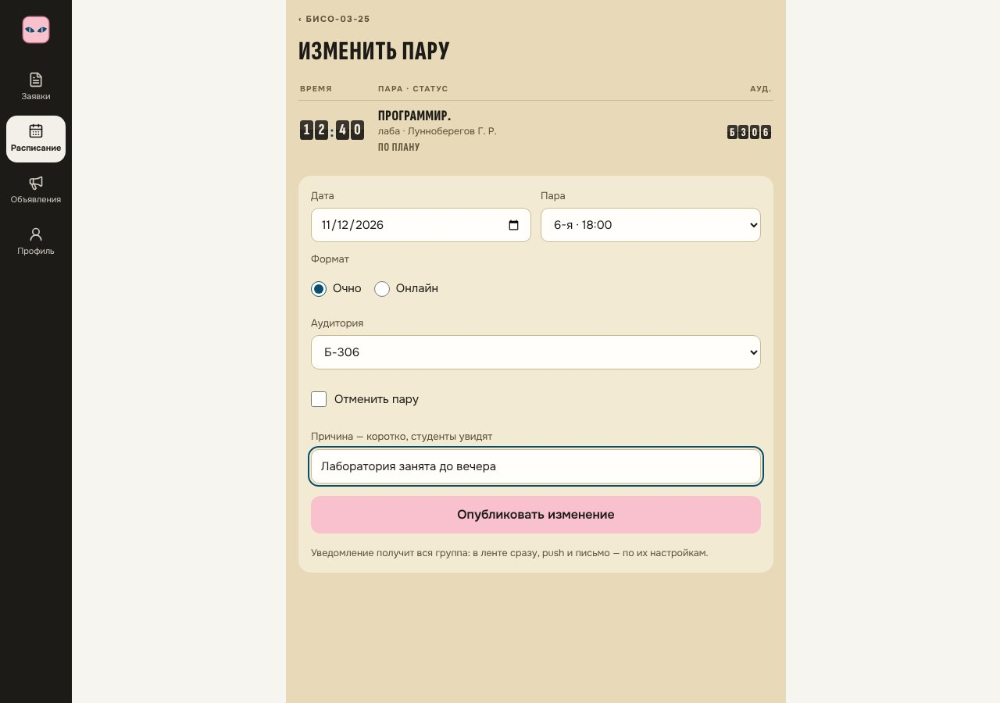
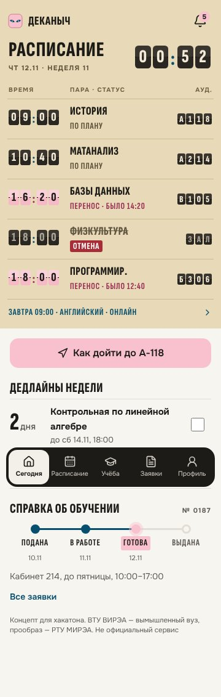
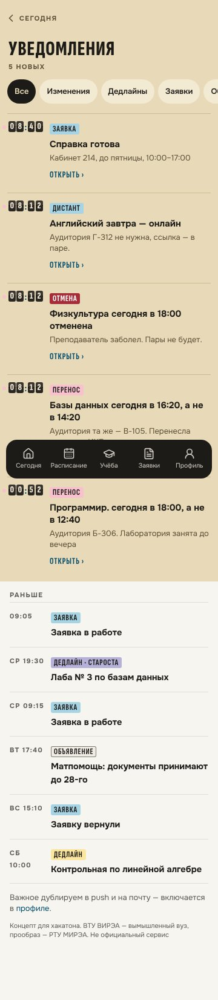
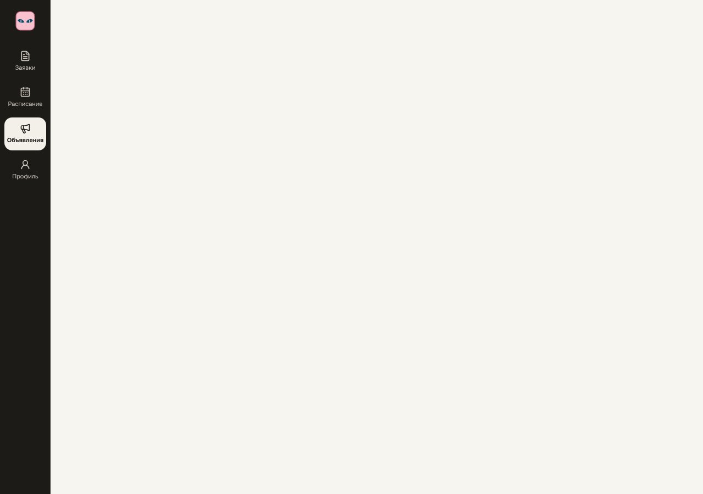

# Перенос пары сотрудником, дедлайны и объявления, лента уведомлений (S2, S3)

- **Дата и время:** 2026-11-12 00:52 МСК
- **Инструмент:** Claude Code
- **Кто ставил задачу:** Алёна
- **Этап плана:** 4 Must
- **Требования PRD:** E2, E3, N1, D1; сценарии S2, S3

## Задача
> да

Продолжить этап 4: задачи 4.4 (кабинет сотрудника — перенос и публикации) и 4.5 (лента).

## Что сделал ИИ
- Сотрудник видит только группы назначенных институтов; чужая группа или пара → 404 (`src/server/staff.ts`).
- Перенос, отмена, смена аудитории или формата: форма с датой, парой, форматом, аудиторией или ссылкой и обязательной причиной. В одной транзакции — обновление пары с проверкой версии, запись истории «было → стало» и уведомление всей группе (срочное, если касается сегодня или завтра). Повторная отправка устаревшей формы получает «Пару уже изменили».
- Дедлайны и объявления для выбранных групп; дедлайн сразу планирует напоминания за 3 дня и за 1 день. Блок «Уже опубликовано · прочитали N из M» без имён.
- Лента: фильтры, новые на табло с временем на плитках, раньше — на молочном фоне, плашки типов, переход к расписанию или заявкам; показанные новые отмечаются прочитанными.
- Проверено в браузере: сотрудник переносит программирование 12:40 → 18:00, у студента на «Сегодня» «перенос · было 12:40» и новое уведомление в ленте; конфликт версий; студент на странице изменения пары и сотрудник на несуществующей паре → 404; публикация дедлайна. `lint`, `typecheck`, `build` проходят.

## Что проверил и поправил человек
Нужно: проверить с телефона после обновления сервера.

## Ошибки ИИ
- Файл форм сотрудника не записался — папку создавал той же командой после записи → заметил по ошибке проверки типов → создал заново → сначала создавать папки, потом писать файлы.
- Ограничение Prisma на тип смещения напоминания (`"d3"` как строка) → поймала проверка типов → `as const` → для перечислений Prisma использовать литеральные типы.

## Скриншоты

