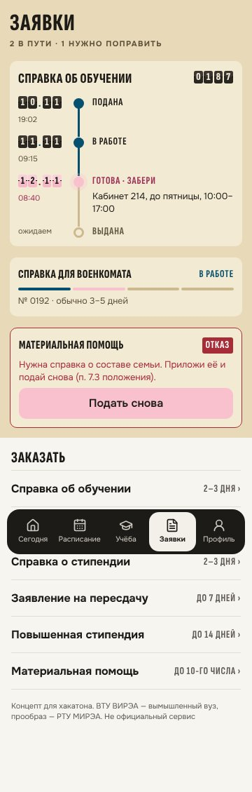
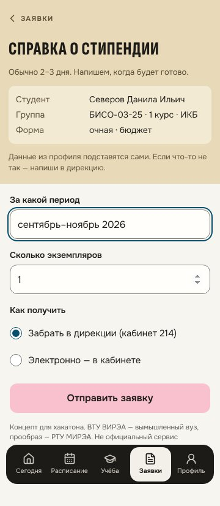
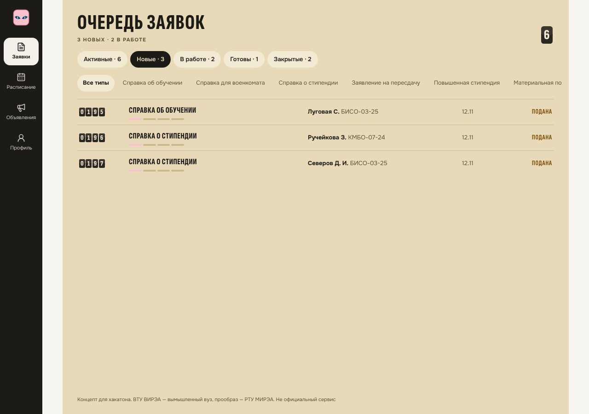
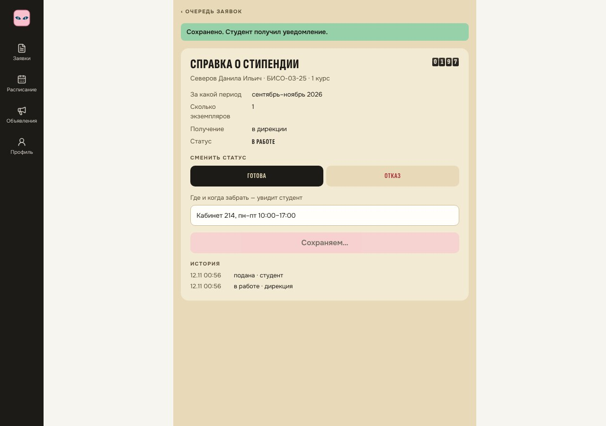
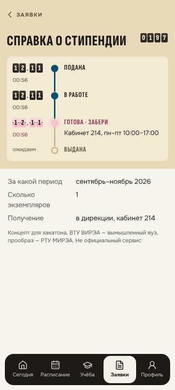

# Заявки студента и очередь дирекции (S4, S9)

- **Дата и время:** 2026-11-12 00:56 МСК
- **Инструмент:** Claude Code
- **Кто ставил задачу:** Алёна
- **Этап плана:** 4 Must
- **Требования PRD:** A1, A2, A4, E1, NF5; сценарии S4, S9

## Задача
Продолжить этап 4: задачи 4.10 (заявки студента) и 4.11 (очередь дирекции).

## Что сделал ИИ
- Студент: «Заявки» на табло — главная заявка с полным маршрутом «Подана → В работе → Готова · забери → Выдана» (даты на плитках), остальные — с полоской этапов, отказ с причиной и «Подать снова»; каталог со сроками. Форма строится из полей типа заявки, данные профиля подставляет сервер (A2), повторная подача — только своей отклонённой заявки и только один раз.
- Карточка заявки `/requests/[id]` — только своя, чужая → 404 (S9).
- Дирекция: очередь как табло с фильтрами по статусу и типу, счётчики; карточка заявки — только из назначенных институтов, иначе 404. Смена статуса по разрешённым переходам с проверкой версии, история, уведомление студенту; отказ — только с причиной, «готова» — с местом выдачи.
- Проверено в браузере: Данила заказывает справку о стипендии → дирекция видит её в «Новых», отказ без причины не проходит, «в работе» → «готова» → у Данилы «Готова · забери» с местом выдачи; повторная подача отклонённой матпомощи; Ксения на заявке Данилы и на странице дирекции → 404. `lint`, `typecheck`, `build` проходят.

## Что проверил и поправил человек
Нужно: проверить на телефоне после обновления сервера.

## Ошибки ИИ
Не было.

## Скриншоты

