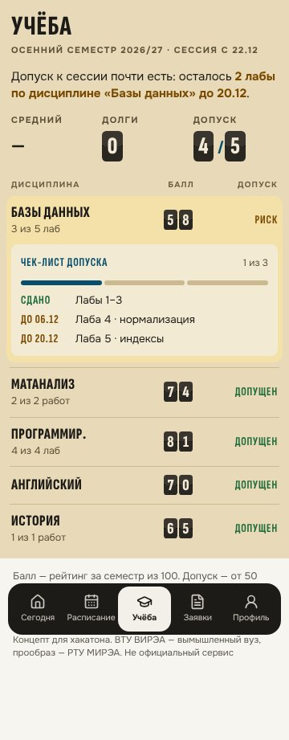
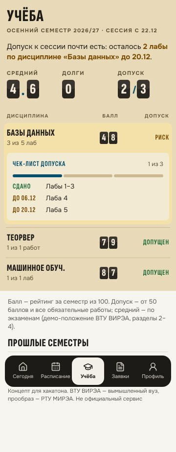
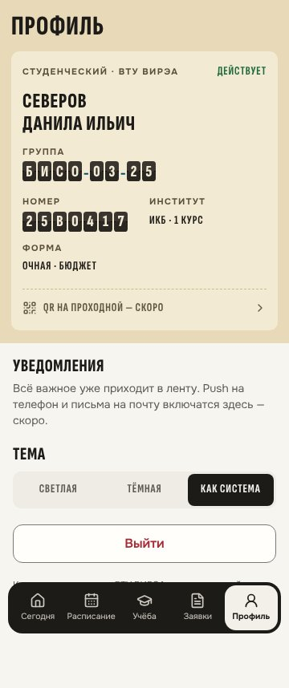
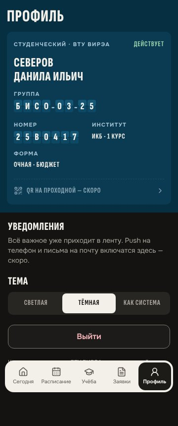

# «Учёба» по демо-положению и профиль с темой (S5)

- **Дата и время:** 2026-11-12 01:02 МСК
- **Инструмент:** Claude Code
- **Кто ставил задачу:** Алёна
- **Этап плана:** 4 Must
- **Требования PRD:** G1, G2, G3, P1, P3, NF3; сценарий S5

## Задача
> давай

Задачи 4.9 («Учёба») и 4.12 (профиль).

## Что сделал ИИ
- «Учёба» считает всё по [демо-положению](../../knowledge/polozhenie-demo.md): рейтинг 0–100 как сумма баллов за работы, допуск — от 50 баллов и все обязательные работы, «риск» до начала сессии, «не допущен» после; средний — по экзаменам прошлых сессий.
- Сводка одной фразой (G2): «Допуск к сессии почти есть: осталось 2 лабы по дисциплине «Базы данных» до 20.12». Плитки «средний / долги / допуск», таблица дисциплин; у дисциплины с риском раскрыт чек-лист допуска со сроками (G3); прошлые семестры с оценками (G1).
- Профиль: студенческий билет (ФИО, группа и номер на плитках, институт, курс, форма), переключатель темы «светлая / тёмная / как система» в настройках пользователя, выход. Push и почта — вместе с задачами 4.6 и 4.7.
- Проверено в браузере на 360 px: у Данилы и Ксении сводка и чек-лист верные, тёмная тема включается из профиля. `lint`, `typecheck`, `build` проходят.

## Что проверил и поправил человек
Нужно: посмотреть на телефоне.

## Ошибки ИИ
- В демо-данных лабы были записаны группами («Лабы 4–5», «Лабы 1–4») → на экране «осталось 1 лаба» и «1 из 1 лаб», а в S5 должно быть «3 из 5» → увидел на скриншоте → разбил на отдельные лабы → в сидах каждую работу заводить отдельно, раз экран их считает.

## Скриншоты

