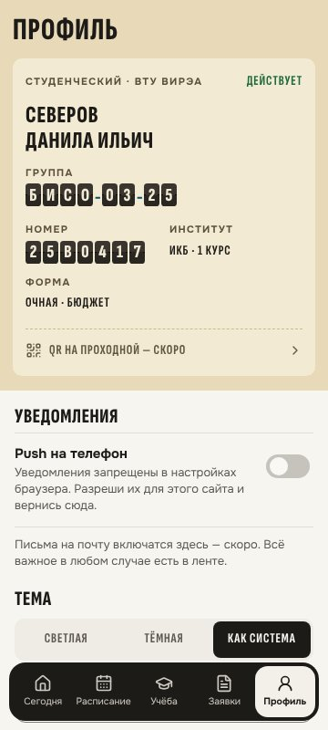

# Web push: подписка, доставка с повторами, установка на экран «Домой» (N3)

- **Дата и время:** 2026-11-12 01:15 МСК
- **Инструмент:** Claude Code
- **Кто ставил задачу:** Алёна
- **Этап плана:** 4 Must
- **Требования PRD:** N3, P3, NF5; сценарии S2, S8

## Задача
> да, бери push

## Что сделал ИИ
- PWA-манифест (установка на экран «Домой» — на iPhone push работает только так) и сервис-воркер: показывает уведомление и по нажатию открывает расписание, заявки или ленту.
- В профиле — переключатель push: разрешение браузера → подписка → сохранение за пользователем из сессии. Подсказки для iPhone без установки, для запрета в браузере и для неподдерживаемых браузеров. Отключение отзывает только свою подписку.
- Доставка: после публикации переноса, дедлайна, объявления или смены статуса заявки создаются задания на каждую подписку получателей (уникальный ключ — без дублей) и сразу отправляются через `web-push` с ключами VAPID из `.env`. Фоновый обработчик (`src/instrumentation.ts`) раз в 15 секунд повторяет временные сбои с нарастающей паузой, до 5 попыток; ответ 404/410 отзывает подписку.
- `deploy/gen-vapid.sh` генерирует ключи VAPID через `openssl`, `setup-server.sh` вызывает его на новом сервере; инструкция для уже настроенного — в `docs/setup/deploy.md`.
- Проверено: перенос пары сотрудником → на поддельный HTTPS push-сервис пришли два зашифрованных (`aes128gcm`) запроса с подписью VAPID; доставка на `/ok` — `accepted`, на `/gone` (410) — подписка отозвана. Манифест и сервис-воркер отдаются. `lint`, `typecheck`, `build` проходят.

## Что проверил и поправил человек
Нужно вручную на телефоне: включить push в профиле (на iPhone — после «На экран «Домой»»), сотрудником перенести пару и проверить, что уведомление пришло за 60 секунд.

## Ошибки ИИ
- Импортировал `web-push` как модуль по умолчанию → сборка предупредила, отправка бы упала → `import * as webpush` → проверять формат экспорта CommonJS-пакетов в ESM.
- Первый тест слал push на HTTP-адрес, а `web-push` всегда ходит по HTTPS → поднял поддельный сервис на HTTPS с самоподписанным сертификатом, доверие — только тестовому процессу.
- Включение push в браузере автоматически проверить не удалось: безголовый Chromium запрещает уведомления → оставил ручную проверку на телефоне.

## Скриншоты

