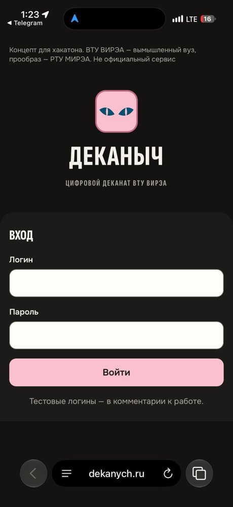
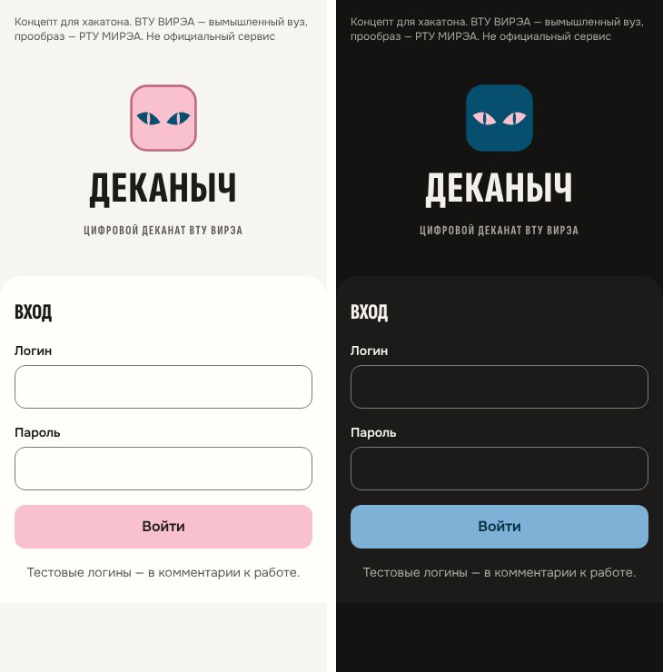

# Сайт на телефоне; исправлен вход в тёмной теме

- **Дата и время:** 2026-11-12 01:28 МСК
- **Инструмент:** Claude Code
- **Кто ставил задачу:** Алёна
- **Этап плана:** 4 Must
- **Требования PRD:** NF3, NF7, X1

## Задача
Алёна прислала скриншот https://dekanych.ru/login с телефона (тёмная тема iOS).

## Что сделал ИИ
- Подтвердил, что сайт открывается с телефона без VPN.
- Нашёл по скриншоту: поля ввода и подложка формы входа с зашитыми светлыми цветами — в тёмной теме белые; знак розовый, хотя в тёмной теме он синий.
- Перевёл форму входа на токены темы; добавил компонент `BrandMark` — знак в цвете темы (розовый в светлой, синий в тёмной) — для входа, «Сегодня» и панели навигации.

## Что проверил и поправил человек
Алёна открыла сайт на телефоне.

## Ошибки ИИ
- Страница входа делалась до токенов (задача 3.4) с цветами напрямую, и при переходе на токены я её не пересмотрел → заметили на телефоне → перевёл на токены → после ввода токенов искать по коду оставшиеся `#…` цвета.

## Скриншоты

