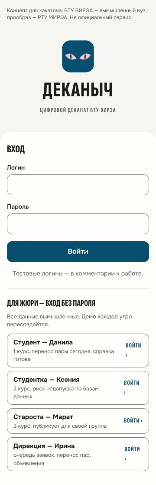

# Кнопки входа для жюри без пароля

- **Дата и время:** 2026-11-12 01:36 МСК
- **Инструмент:** Claude Code
- **Кто ставил задачу:** Алёна
- **Этап плана:** 4 Must
- **Требования PRD:** X1, NF5; сдача

## Задача
> Добавь кнопки для жюри - вход в тестовые аккаунты без логина и пароля

Плюс разбор «Application error: a client-side exception» на сайте после обновления.

## Что сделал ИИ
- Проверил все страницы студента и сотрудника в обеих темах — ошибок в консоли нет; ошибка на сайте, вероятнее всего, из-за страницы, открытой до обновления сервера (старые файлы сборки) — лечится перезагрузкой.
- На странице входа — блок «Для жюри — вход без пароля»: Данила, Ксения, Марат, Ирина с коротким описанием, что смотреть. Серверное действие пускает только в эти 4 логина, лимит 60 входов с адреса за 15 минут, сессия — как при обычном входе.
- Блок включается только `DEMO_LOGIN=on` в `.env` на сервере (`setup-server.sh` включает на новом сервере; команда для текущего — в `docs/setup/deploy.md`). Решение — в `docs/context.md`; логины и пароли по условию всё равно идут в комментарий к работе.
- Проверено в браузере: все четыре кнопки входят и ведут на свой раздел, ошибок нет.

## Что проверил и поправил человек
Нужно: включить `DEMO_LOGIN=on` на сервере и проверить с телефона.

## Ошибки ИИ
- Положил константу и обычную функцию в файл с `"use server"` — сборка упала («Server Actions must be async functions») → перенёс в `src/server/demo.ts` → в файлах серверных действий экспортировать только асинхронные функции.

## Скриншоты

