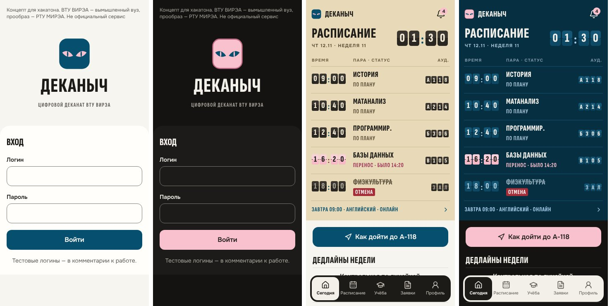

# Цвета знака и кнопок поменяли местами: светлая — синие, тёмная — розовые

- **Дата и время:** 2026-11-12 01:40 МСК
- **Инструмент:** Claude Code
- **Кто ставил задачу:** Алёна
- **Этап плана:** 4 Must
- **Требования PRD:** NF3, X1

## Задача
Посмотрев на сайт в тёмной теме телефона (розовый знак на тёмном фоне), Алёна решила:

> нет, так хорошо, поменяй цвета местами - для темной розовый, для светлой - синий (включая кнопки)

## Что сделал ИИ
- Токены главной кнопки: светлая тема — `#064F6E` с белым текстом (8,9:1), тёмная — `#F9C1CE` с тёмным текстом (11,1:1).
- Файлы знака и логотипа поменяны: `dekanych-mark.svg` и `dekanych-logo.svg` (светлая тема) — синяя табличка, `*-dark.svg` — розовая с рамкой. Иконка приложения и favicon остались розовыми.
- Обновлены `docs/design-system.md` (токены, кнопки, логотип), `docs/brand/README.md`, `docs/context.md` (решение 12.11).
- Проверено в браузере на 360 px: вход и «Сегодня» в обеих темах.

## Что проверил и поправил человек
Алёна приняла решение по виду живого сайта на телефоне.

## Ошибки ИИ
Не было. Перед этим я «исправил» розовый знак в тёмной теме на синий по решению 11.11, а Алёна предпочла розовый — решения о цвете лучше сверять с живым видом на телефоне.

## Скриншоты

