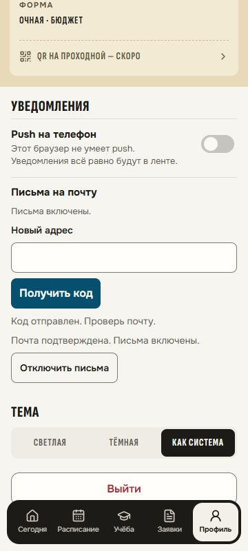

# Подтверждение почты и отправка срочных писем

- **Дата и время:** 2026-11-14 17:41 МСК
- **Инструмент:** Codex (напарник)
- **Кто ставил задачу:** напарник
- **Этап плана:** 4 Must
- **Требования PRD:** N2, D2, P3, NF5

## Задача

> посмотри мои задачи, наработки алены и начинай делать мою часть

Сверить свежий `main` с планом и реализовать почтовые уведомления по задаче 4.7.

## Что сделал ИИ

- Добавил подтверждение почты в профиле, лимиты выдачи и ввода кода, шифрование адреса и отзыв подписки. В публичном демо доступна отправка на тестовые адреса команды.
- Подключил письма к очереди уведомлений для срочных изменений и напоминаний. Запись заданий происходит внутри транзакции публикации. Временные ошибки SMTP повторяются, а отозванные назначения отменяются.
- Сборка Next.js, TypeScript и ESLint по изменённым файлам прошли. В браузере на 360 px с локальным TLS SMTP и тестовой БД проверил подтверждение адреса, неверный код, срочный и несрочный дедлайн, разделение групп, повтор SMTP и отмену задания после отключения. [План проверки с VPS](../../research/email-notifications.md).

## Что проверил и поправил человек

Ревью Алёны и измерение доставки с VPS на реальном тестовом ящике впереди.

## Ошибки ИИ

- Первый локальный тест блокировал цикл событий синхронным запуском сида. Перевёл запуск в асинхронный режим и повторил проверку.

## Скриншоты

