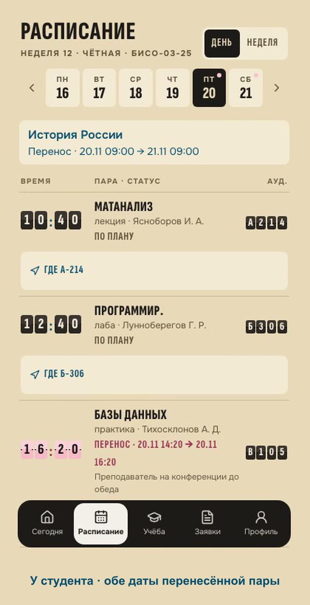

# Записано мобильное демо для сдачи

- **Дата и время:** 2026-11-20 02:10 МСК
- **Инструмент:** Codex (Алёна)
- **Кто ставил задачу:** Алёна
- **Этап плана:** 7 Сдача
- **Требования PRD:** NF1, T1, R3, G3, A1, E4

## Задача

Подготовить дополнительное видео о работе кабинета с телефона.

## Что сделал ИИ

- Поднял локальную сборку с отдельной базой вымышленных данных. Записал экран шириной 390 px, где видны день в расписании, чек-лист допуска и подача справки, изменение её статуса, перенос и напоминание о дедлайне.
- На время записи подтвердил действия обеих ролей проверками Playwright. Добавил подписи и сохранил вертикальное видео MP4 в локальную папку `output/video/`.
- Видео фиксирует работу локальной сборки. Доставка push и писем с VPS проверяется отдельным сценарием.

## Что проверил и поправил человек

Публикация ссылки для жюри остаётся у капитана. На момент записи видео не загружалось на видеохостинг.

## Ошибки ИИ

Проверка первой записи показала, что дата в поле браузера была в американском формате. Перезаписал с русской локалью.

## Скриншоты

