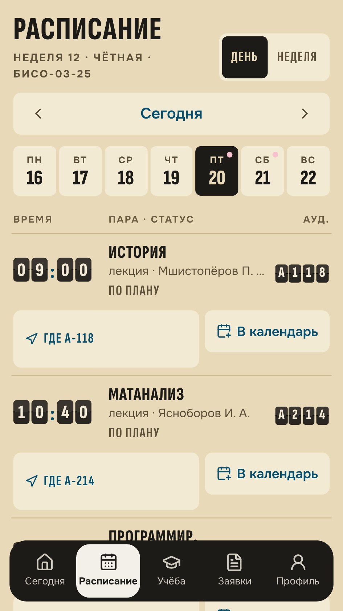

# Подготовлено скачивание пары в календарь

- **Дата и время:** 2026-11-20 02:16 МСК
- **Инструмент:** Codex (Алёна)
- **Кто ставил задачу:** Алёна
- **Этап плана:** 5 Should
- **Требования PRD:** дополнение к R2 и R3, NF5

## Задача

Подготовить небольшую дополнительную функцию после доработки основной версии.

## Что сделал ИИ

- Добавил «В календарь» к парам на вкладке «День». Файл содержит актуальные время, дисциплину, тип и место пары. Для перенесённой пары берём новую дату. Формат описан в [RFC 5545](https://www.rfc-editor.org/rfc/rfc5545.html).
- Сервер проверяет сессию и группу. Отменённые и прошедшие пары недоступны для экспорта. Онлайн-ссылка и ФИО в файл не включаются.
- Добавил модульные проверки формата и проверку скачивания и границ доступа в мобильный сценарий переноса. Скачал файл из Chromium и WebKit на 360 px. Прочитал независимой библиотекой iCalendar, сверил московское время начала и окончания, место пары и номер правки. Экспорт сохранил корректную структуру таблицы после добавления свайпа.

## Что проверил и поправил человек

Codex проверил скачивание в двух браузерных движках, линтер, типы, модульные проверки и сценарии кабинета. Импорт во встроенный календарь на физическом телефоне пока не проверялся.

## Ошибки ИИ

Не было.

## Скриншоты

