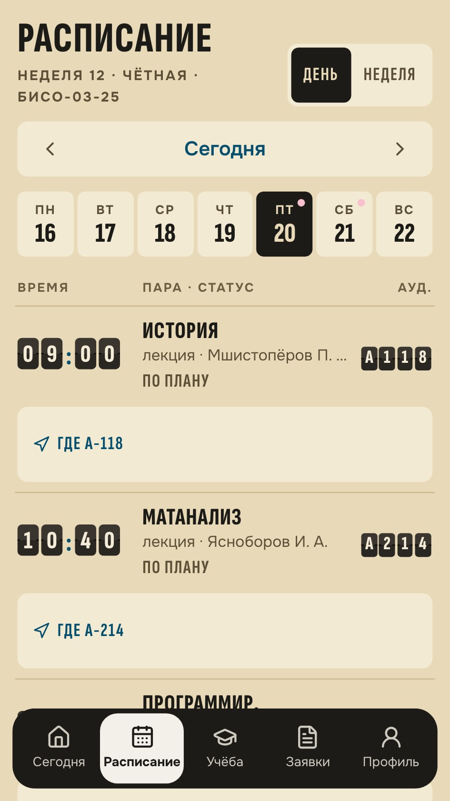

# Проверен мобильный кабинет и добавлен свайп в расписании

- **Дата и время:** 2026-11-20 02:29 МСК
- **Инструмент:** Codex (Алёна)
- **Кто ставил задачу:** Алёна
- **Этап плана:** 6 Проверка
- **Требования PRD:** R1, NF1

## Задача

Пройти основные экраны от 360 px и исправить обнаруженные проблемы.

## Что сделал ИИ

- Проверил 14 комбинаций страниц и ролей в светлой и тёмной теме в Chromium и WebKit с мобильным экраном 360×640. Во всех 56 проверках ширина страницы совпала с шириной экрана.
- Добавил переход между днями свайпом в обе стороны. Добавил воскресенье и ссылку «Сегодня». Проверил переключение с субботы на воскресенье и понедельник, а также размеры всех семи кнопок даты.
- Исправил структуру табло расписания студента и сотрудника, таблицы допуска и видимость ссылки на профиль в ленте. Повторный прогон axe по выбранным правилам WCAG 2.1 A/AA не обнаружил нарушений. Полная ручная проверка скринридером остаётся отдельным шагом.
- Локально прошли девять сценариев Playwright, проверка типов и линтер.

## Что проверил и поправил человек

Codex просмотрел снимок расписания после правки. Жест на физическом телефоне ещё предстоит проверить.

## Ошибки ИИ

- Первая правка заменила видимый текст кнопок дат описанием для скринридера, что выявил повторный прогон axe. Вернул видимую подпись в доступное имя и добавил полную дату скрытым текстом.

## Скриншоты

