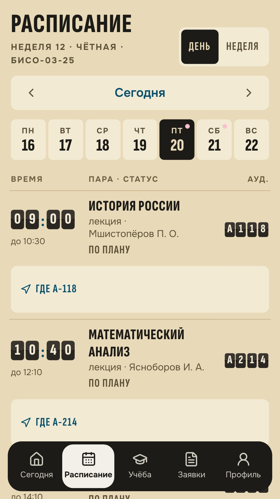

# Уточнена подробная карточка пары на телефоне

- **Дата и время:** 2026-11-20 02:40 МСК
- **Инструмент:** Codex (Алёна)
- **Кто ставил задачу:** Алёна
- **Этап плана:** 6 Проверка
- **Требования PRD:** R2, NF1

## Задача

Исправить места, где сокращённое название и обрезанная строка скрывали сведения в карточке пары на 360 px.

## Что сделал ИИ

В подробной карточке показал название дисциплины целиком, время окончания и всех преподавателей. Онлайн-занятие и неуказанная аудитория получают разные подписи для скринридера. Для обзора недели оставил компактный вид.

## Что проверил и поправил человек

Codex посмотрел снимок на 360 px, прогнал десять сценариев Playwright и повторно проверил основные страницы в обеих темах в Chromium и WebKit.

## Ошибки ИИ

- После первой правки один инициал отрывался от остального имени. Добавил неразрывные пробелы перед инициалами и повторно проверил карточку.

## Скриншоты

