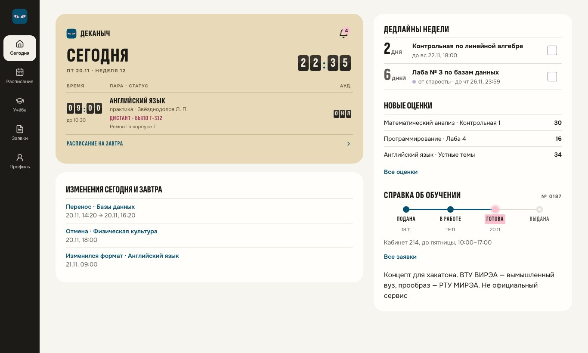
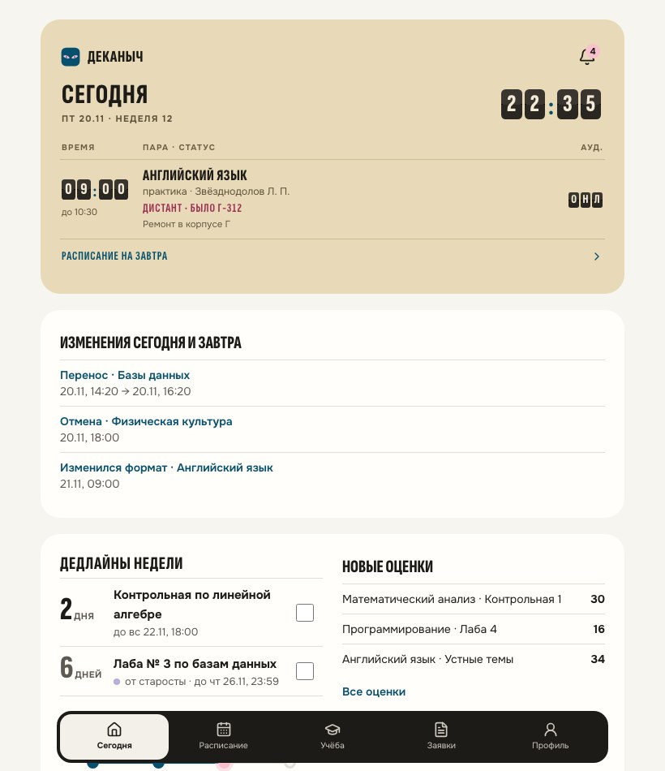
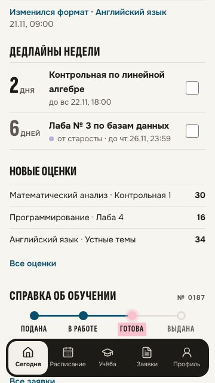

# Кабинет адаптирован для телефона, планшета и ноутбука

- **Дата и время:** 2026-11-20 22:35 МСК
- **Инструмент:** Codex (Алёна)
- **Кто ставил задачу:** Алёна
- **Этап плана:** 6 Проверка
- **Требования PRD:** NF1

## Задача

Исправить отображение узкой мобильной раскладки на ноутбуке.

## Что сделал ИИ

- Расширил страницы кабинета начиная с планшета. На ноутбуке «Сегодня» показывает расписание и изменения слева, дедлайны и заявки рядом. Вход, профиль, заявки и другие экраны используют доступную ширину.
- Недельное расписание на широком экране размещает дни в две колонки. На телефоне действия и список пар остаются в одной колонке с нижней навигацией.
- Проверил шесть размеров от 360 до 1920 px. Прошли 16 сценариев Playwright и 10 модульных тестов. Дополнительно прошли 42 проверки ширины в WebKit в светлой и тёмной теме.

## Что проверил и поправил человек

Алёна заметила мобильную раскладку на ноутбуке. Codex проверил исправление локально. Проверка на её ноутбуке предстоит после обновления публичного сервера.

## Ошибки ИИ

- Новый тест находил одновременно заголовок «Сегодня» и заголовок про изменения. Уточнил поиск до полного текста заголовка и повторил весь прогон.

## Скриншоты

