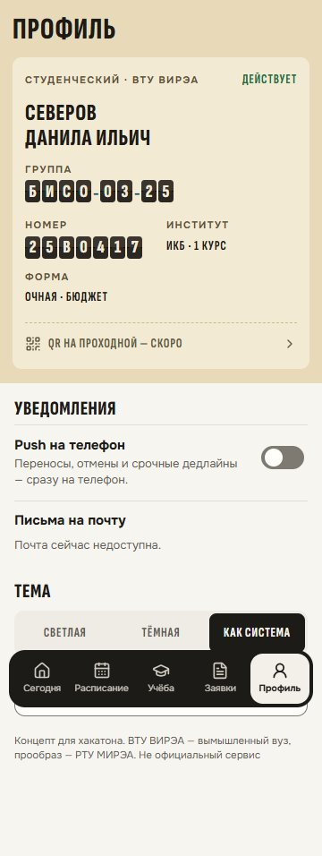
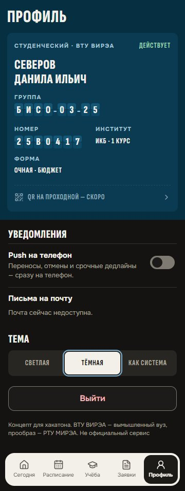

# Дополнительная защита уведомлений и проверка релиза

- **Дата и время:** 2026-11-20 22:35 МСК
- **Инструмент:** Codex (напарник)
- **Кто ставил задачу:** напарник
- **Этап плана:** 6 Проверка
- **Требования PRD:** N2, N3, D2, NF1, NF3, NF5, NF7

## Задача

> «Поправь и улучшь это всё» — замечания повторного обзора репозитория.

## Что сделал ИИ

- Обновил базовую ветку до `7b84c88`. Учитывал уже внесённые Алёной исправления адресов push, тайм-аутов, очереди и переносов, а также готовые новые разделы.
- В `src/server/delivery.ts` распространил проверку действующего дедлайна, его версии, выполнения и группы на push. Добавил перепривязку существующей браузерной подписки сразу после входа в кабинет, до открытия профиля, и повторную проверку без расходования лимита. Сценарий с двумя аккаунтами проверяет владельца подписки ещё на главном экране.
- Ограничил полную SMTP-попытку 20 секундами с закрытием транспорта. Чистый генератор ключа демо-события выделен в `src/lib/notification-keys.ts`, чтобы воркер не зависел от навигации Next.js.
- Добавил маршрут `/api/health` с запросом к БД, Docker healthcheck и проверку нового контейнера при обновлении. Подготовил `deploy/backup-db.sh` и `deploy/check-backup.sh`; реальное восстановление на VPS не выполнял.
- Добавил `compose.local.yml`, `scripts/setup-local.mjs`, инструкции запуска и сохранения данных. В отдельной временной папке проверил генерацию настроек и сохранение существующего `.env`; значения не выводились.
- Увеличил кнопки темы и фильтры ленты/очереди до 44 px. Владелец экранов — Алёна, требуется её кросс-ревью.
- Сборка, TypeScript, ESLint и 10 модульных тестов прошли. На изолированном PGlite-стенде прошли 3 серверных проверки и 14 сценариев Edge/Chromium на 360 px. Серверные проверки включают отмену доставок и несколько пакетов; SMTP-проверка использует подставной зависший транспорт и виртуальные часы.
- Публичные `/login` и аватар вернули 200, новый health-маршрут — 404. Код этого PR ещё не развёрнут на VPS. Доставка во входящие и на телефон, полный Lighthouse и импорт расписания остаются отдельными проверками.

## Что проверил и поправил человек

Ревью человеком пока не проводилось. Пароли, ключи и реальные персональные данные не добавлялись. Схема БД не менялась.

## Ошибки ИИ

- Первый серверный тест через `react-server` подтянул `next/navigation` через общий генератор ключа → запуск упал на `React.createContext` → генератор вынесен в чистый модуль → фоновый воркер не должен импортировать навигацию через вспомогательные функции.
- В тестовых данных пропущены обязательное время выполнения и источник уведомления → TypeScript и ограничение БД остановили проверку → фикстуры дополнены → тестовые данные должны соответствовать ограничениям настоящей схемы.
- В первом браузерном тесте выбран общий `role=alert`, не учтены очистка пароля после отправки формы и ожидание перехода после входа → сценарии падали → селекторы и ожидания уточнены, пароль заполняется в каждой попытке → проверять завершение конкретного действия.
- Первый скриншот профиля сделан до завершения перехода и показывал вход → замечено при визуальной проверке → добавлено ожидание заголовка профиля, скриншот переснят → проверять содержимое изображения перед сохранением результата.

## Скриншоты

