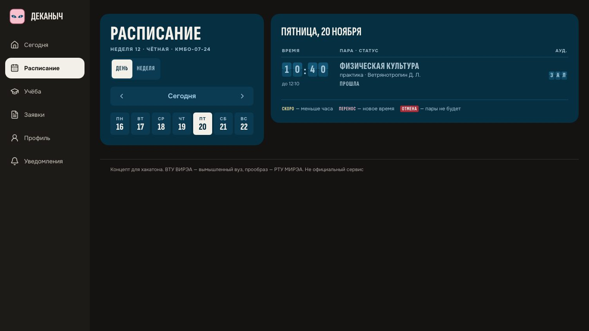
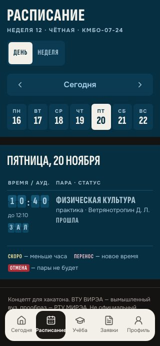
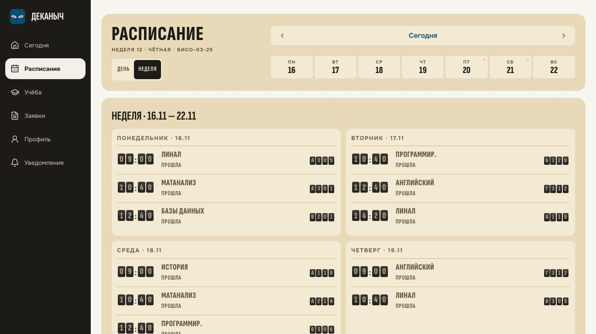

# Расписание и кабинет после повторного аудита интерфейса

- **Дата и время:** 2026-11-20 23:35 МСК
- **Инструмент:** Codex (Алёна)
- **Кто ставил задачу:** Алёна
- **Этап плана:** 6 Проверка
- **Требования PRD:** NF1, X1, R2

## Задача

Алёна показала дневное расписание КМБО-07-24 на ноутбуке и попросила повторно пройти по всему сайту с рекомендациями по UI/UX.

## Что сделал ИИ

- На ноутбуке дневной календарь и список занятий занимают отдельные панели. У списка есть заголовок с выбранной датой. В недельном режиме дни стоят рядом при достаточной ширине. На узком экране аудитория помещается под временем. Для выбора компоновки использован подход с учётом ширины содержимого. [web.dev, Macro layouts](https://web.dev/learn/design/macro-layouts)
- Проверены вход, «Сегодня», расписание, оценки, лента, заявки, детали, формы, профиль, кабинеты старосты и дирекции. В кабинете появился общий подвал, клавиатурный переход к содержанию и прямая ссылка на уведомления в боковом меню. Фильтры дирекции и ленты переносятся, длинные названия работ, пар и объявлений читаются целиком. [W3C, Reflow](https://www.w3.org/WAI/WCAG22/Understanding/reflow.html)
- Увеличены области выбора фильтров и темы. В тестах закреплены размеры семи кнопок календаря, расположение панелей в дневном режиме и двух первых дней в недельном. [W3C, Target Size](https://www.w3.org/WAI/WCAG22/Understanding/target-size-minimum)
- Для названия прошедшей пары и заголовков колонок в тёмной теме контраст на фоне доски составляет 7,66:1. Порядок перехода по разделам начинается с клавиатурной ссылки «К содержанию». [W3C, Contrast Minimum](https://www.w3.org/WAI/WCAG22/Understanding/contrast-minimum.html) · [W3C, Focus Visible](https://www.w3.org/WAI/WCAG22/Understanding/focus-visible.html)
- На локальном стенде прошли сборка, статические проверки, 10 модульных тестов и 17 браузерных сценариев. В Chromium и WebKit проверены 228 сочетаний экрана, размера, темы и демо-аккаунта на ширинах 320–1920 px. Горизонтального переполнения страницы не обнаружено. Отдельный прогон axe-core 4.14 на 15 основных экранах и состояниях при 320 и 1366 px в двух темах не зарегистрировал нарушений по выбранным правилам WCAG A/AA. Физические устройства и работа с экранным диктором отдельно не проверялись.

## Что проверил и поправил человек

Алёна указала на неудачную композицию в предыдущей версии. Проверка нового результата на её ноутбуке предстоит.

## Ошибки ИИ

- Предыдущий тест проверял ширину страницы, но пропускал неудачное расположение календаря относительно пар. Добавлены проверки геометрии двух режимов и снимки той же группы.
- Серия повторных входов демо-аккаунтов остановила первый локальный обход. Для повторных просмотров тест переиспользовал свои сеансы и завершил все проверки.

## Скриншоты

