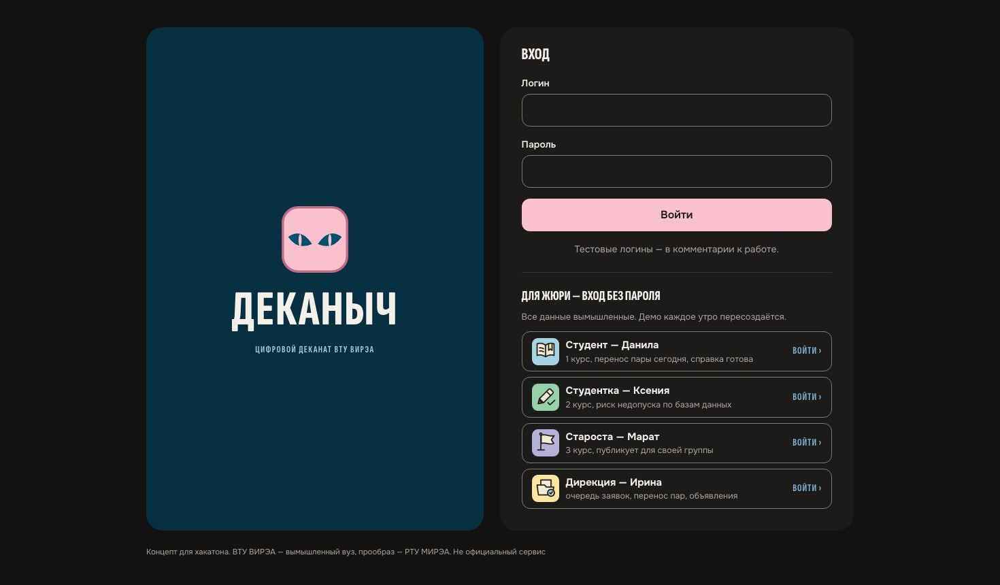
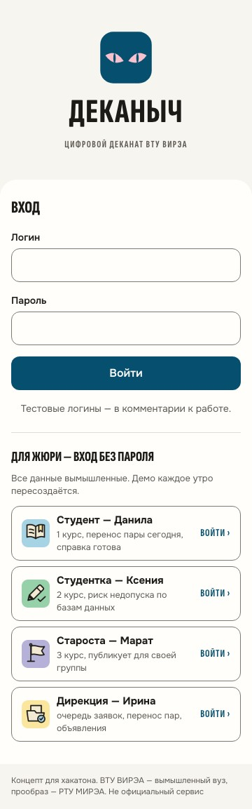

# Панели входа выровнены по высоте

- **Дата и время:** 2026-11-20 23:50 МСК
- **Инструмент:** Codex (Алёна)
- **Кто ставил задачу:** Алёна
- **Этап плана:** 6 Проверка
- **Требования PRD:** NF1, X1

## Задача

Вынести пояснение о вымышленном вузе за рамку и растянуть синюю панель до нижнего края формы входа.

## Что сделал ИИ

Перенёс пояснение в подвал под обеими панелями. В двухколоночной раскладке панели занимают одну строку сетки, её высоту определяет содержимое. Логотип и название центрированы. В браузерный тест добавлена проверка обеих границ, порядка блоков на телефоне и положения пояснения при семи ширинах от 320 до 1920 px.

## Что проверил и поправил человек

Алёна показала исходный экран и указала нужное положение пояснения и нижней границы панели.

## Ошибки ИИ

В предыдущей версии левая панель заканчивалась выше формы. Теперь тест сравнивает высоту и верхние координаты двух панелей.

## Скриншоты

