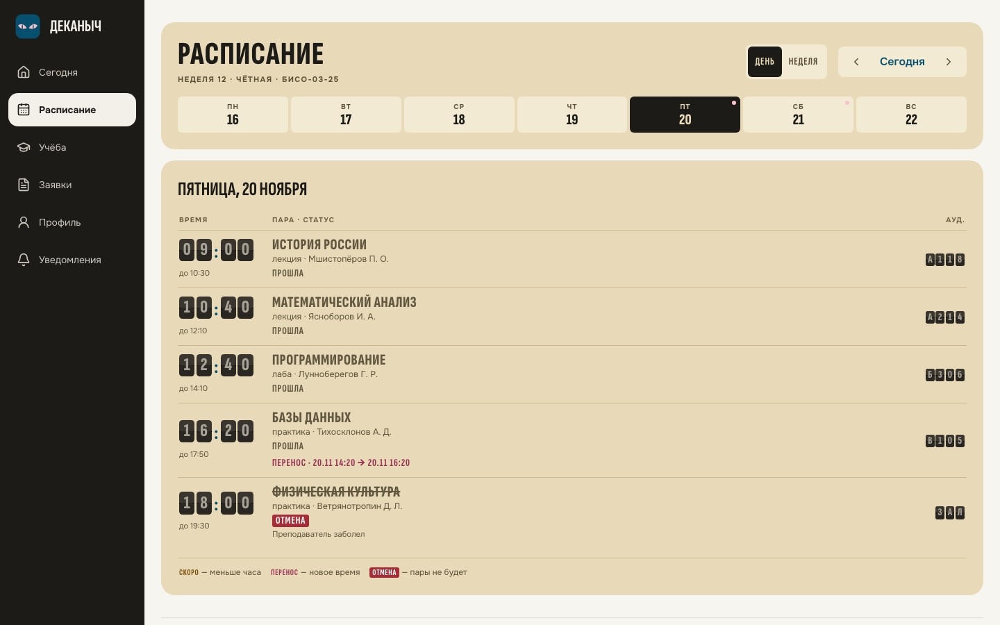
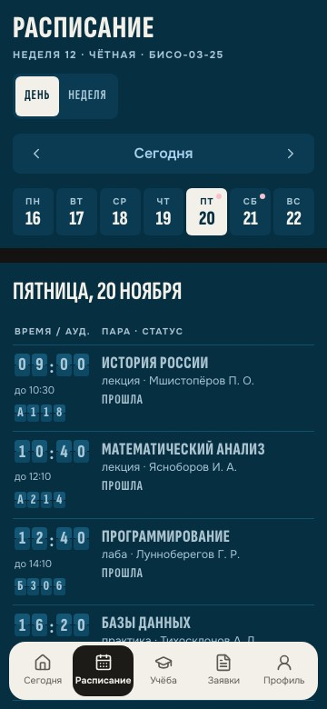

# Выбор дня расположен над расписанием

- **Дата и время:** 2026-11-20 23:51 МСК
- **Инструмент:** Codex (Алёна)
- **Кто ставил задачу:** Алёна
- **Этап плана:** 6 Проверка
- **Требования PRD:** NF1, R2

## Задача

«Панель выбора дня должна быть над выбранным днем».

## Что сделал ИИ

Календарь занимает верхнюю строку сетки во всех режимах. Под ним идет панель занятий той же ширины. На ноутбуке все семь дней располагаются непосредственно над выбранной датой. Браузерный тест проверяет порядок панелей, их ширину и левую границу на семи размерах от 320 до 1920 px. Обновлено описание сетки в дизайн-системе.

## Что проверил и поправил человек

Алёна указала на неправильное положение календаря в дневном режиме на ноутбуке.

## Ошибки ИИ

Разместил выбор дня сбоку и закрепил это в тесте. Исправил вёрстку и проверку по замечанию Алёны.

## Скриншоты

