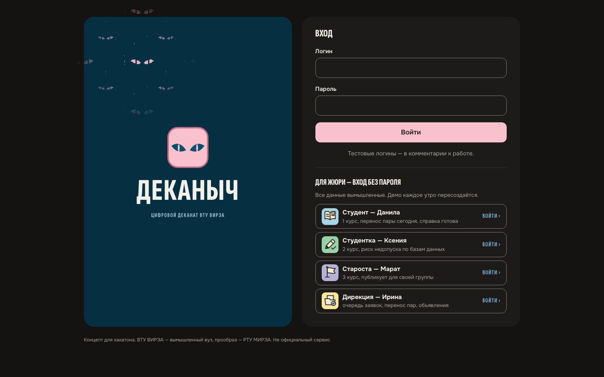
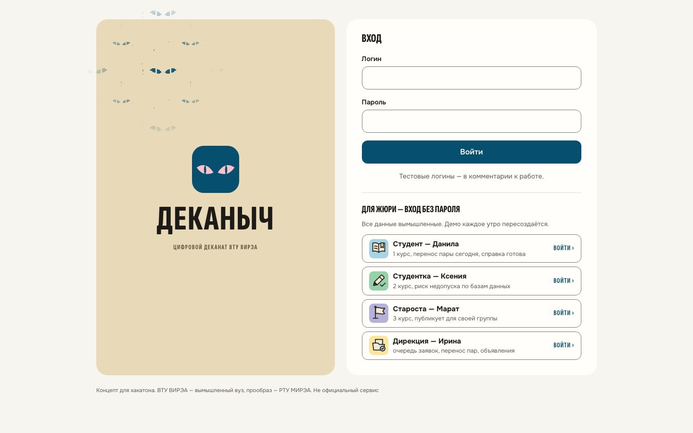

# Пиксельные глаза Деканыча на фоне входа

- **Дата и время:** 2026-11-21 00:06 МСК
- **Инструмент:** Codex (Алёна)
- **Кто ставил задачу:** Алёна
- **Этап плана:** 2 Дизайн, 6 Проверка
- **Требования PRD:** NF1

## Задача

При наведении курсора подсветить моргающие глаза Деканыча в стиле пиксельной матрицы.

## Что сделал ИИ

На странице входа курсор проявляет участок неподвижного пиксельного узора. Две группы глаз моргают с разными периодами. Светлая тема использует синий цвет, тёмная — розовый. При уменьшенном движении глаза остаются открытыми. Клавиатурный ввод скрывает подсветку. Касание не запускает эффект.

Сравнил кадры с открытыми и прикрытыми глазами в Chromium и WebKit в обеих темах. Пройдены сборка, линтер, проверка типов и 18 браузерных сценариев. Новый тест проверяет реакцию на курсор, уменьшенное движение, отключение с клавиатуры и доступность поля логина.

## Что проверил и поправил человек

Алёна задала стиль и взаимодействие. Визуальная проверка результата Алёной предстоит.

## Ошибки ИИ

На GitHub тест единожды передвинул мышь при загрузке страницы и не увидел подсветку. Тест теперь воспроизводит движение курсора до появления подсветки и по-прежнему проверяет остальные состояния.

## Скриншоты

