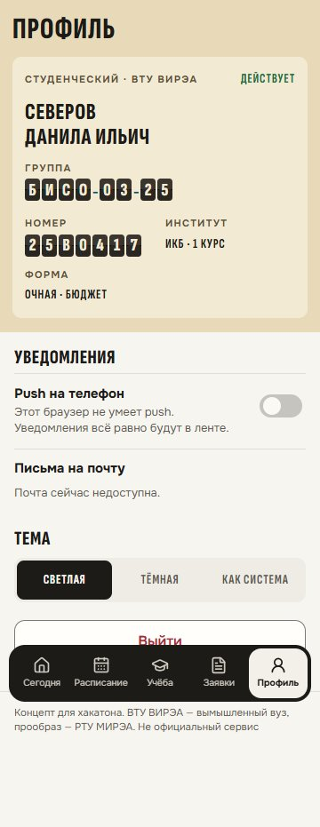

# Удалена заглушка QR из профиля

- **Дата и время:** 2026-11-21 00:16 МСК
- **Инструмент:** Codex (напарник)
- **Кто ставил задачу:** напарник
- **Этап плана:** 6 Проверка
- **Требования PRD:** P1

## Задача

> «Надо убрать куаркод в профиле».

## Что сделал ИИ

- Удалил строку «QR на проходной — скоро», её иконку и разделитель из `src/app/(cabinet)/profile/page.tsx`.
- Выровнял нижний отступ карточки студенческого после удаления строки.
- Использовал актуальный `main` (`435bef9`), сохранив новые адаптивные панели. Экран принадлежит Алёне, требуется кросс-ревью.
- ESLint страницы и сборка с проверкой типов прошли. На локальном сервере проверил в Edge на 360 px отсутствие строки QR, наличие студенческого и отсутствие горизонтальной прокрутки. Локальная версия обновлена.

## Что проверил и поправил человек

Изменение попросил напарник; проверка результата человеком пока не проводилась.

## Ошибки ИИ

Не было.

## Скриншоты

