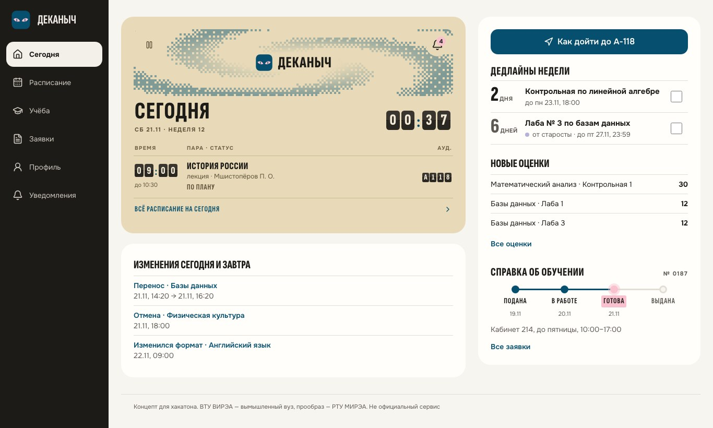
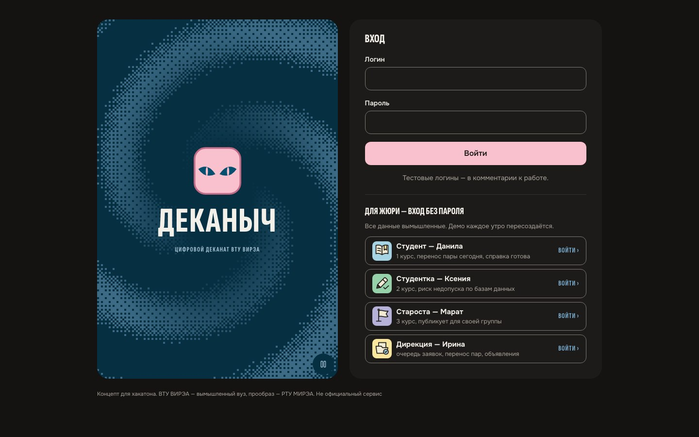
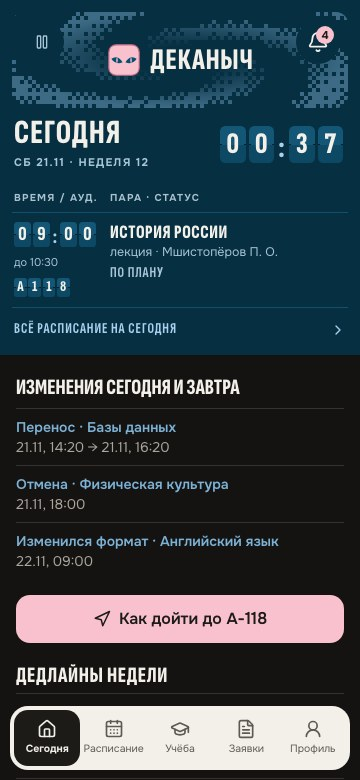

# Пиксельная спираль с логотипом Деканыча

- **Дата и время:** 2026-11-21 00:37 МСК
- **Инструмент:** Codex (Алёна)
- **Кто ставил задачу:** Алёна
- **Этап плана:** 2 Дизайн, 6 Проверка
- **Требования PRD:** NF1

## Задача

Разместить логотип и название в центре анимированной спирали на главном экране и подобрать цвета для двух тем.

## Что сделал ИИ

В шапке «Сегодня» появился компактный узор, на входе — крупная версия того же компонента. Пиксели размером 4 CSS px образуют три рукава спирали. Яркость переводится в плотность точек с помощью матрицы Байера 4×4. Центр приглушён для чтения названия. Цвета берутся из токенов темы. Для работы используются встроенный Canvas 2D и существующие компоненты проекта.

Пример использует импорт DitheringShader без реализации. Реализация размещена в src/components/ui/dithering-shader.tsx. В src/components/ui/swirl.tsx находятся присланный пример счётчика и компонент брендированной анимации. Общие стили проекта заданы в src/app/globals.css.

Кнопка ставит узор на паузу и продолжает движение с того же места. При настройке уменьшенного движения узор статичен. Покадровая отрисовка приостанавливается вне экрана и в скрытой вкладке.

## Что проверил и поправил человек

Алёна выбрала тип узора и расположение логотипа. Оценка готовой композиции Алёной предстоит.

## Ошибки ИИ

При первой проверке после демо-входа на узком экране шапка оказалась вне области просмотра, где отрисовка приостанавливается. Для проверки движения прокрутил шапку в область просмотра.

## Скриншоты

