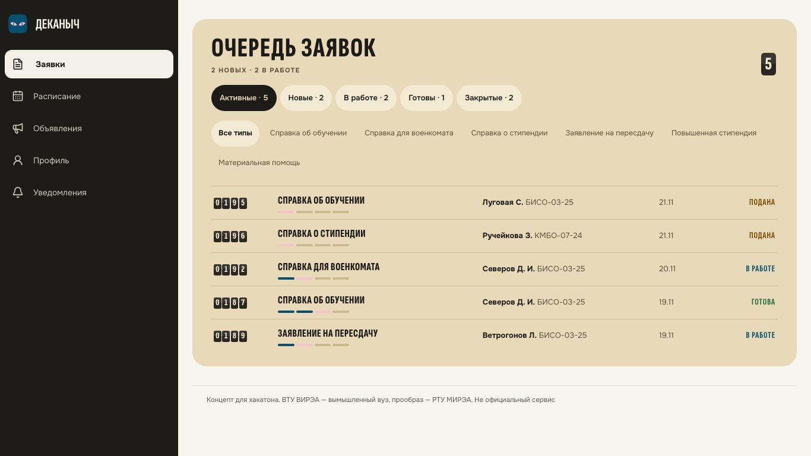
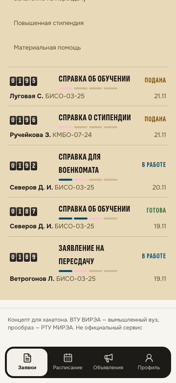

# Боковое меню раскрывается при наведении на десктопе

- **Дата и время:** 2026-11-21 01:05 МСК
- **Инструмент:** Codex (Алёна)
- **Кто ставил задачу:** Алёна
- **Этап плана:** 2 Дизайн, 6 Проверка
- **Требования PRD:** NF1

## Задача

Применить к боковой навигации кабинета анимацию раскрытия из присланного примера.

## Что сделал ИИ

При ширине окна от 1024 px панель с иконками раскрывается с 60 до 300 px. Появляются подписи, а основная область синхронно уступает меню место. При уменьшенном движении переключение происходит сразу. Клавиатурный фокус открывает меню, Escape закрывает. Для сенсорного экрана с настольной раскладкой предусмотрена кнопка с логотипом. Использованы CSS-переходы и настоящие маршруты студента и дирекции.

## Что проверил и поправил человек

Алёна прислала образец взаимодействия и ограничила изменение десктопной версией. Просмотр результата Алёной предстоит.

## Ошибки ИИ

При первой визуальной проверке открытая панель перекрыла заголовок очереди заявок. Согласовал ширину панели и отступ страницы, добавил проверку положения заголовка.

## Скриншоты

