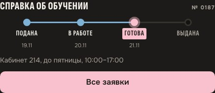
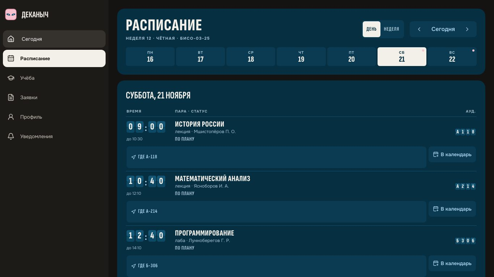

# Ширина панелей, иллюстрации и действия в кабинете

- **Дата и время:** 2026-11-21 01:11 МСК
- **Инструмент:** Codex (Алёна)
- **Кто ставил задачу:** Алёна
- **Этап плана:** 2 Дизайн, 6 Проверка
- **Требования PRD:** NF1, R1

## Задача

«Сделай картинки пустых состояний больше». Проверить, как панели используют доступное место на всех экранах, оформить «Все заявки» кнопкой и убрать три пояснения под расписанием.

## Что сделал ИИ

- Убрал ограничения ширины основных панелей входа и кабинета. На десктопе раскладка учитывает ширину открытого меню. Дни недельного расписания заполняют свободное место в своей строке.
- У восьми изображений для двух тем обрезал прозрачные поля по общей для каждой пары рамке. Проверил все четыре сцены на тестовых данных. На экране 360 px иллюстрация «Сегодня пар нет» отображается в размере 194 × 119 px, на экране 1440 px — 320 × 196 px.
- Оформил переход «Все заявки» как кнопку во всю ширину карточки высотой 44 px. Убрал строку «Скоро / Перенос / Отмена» в обоих видах расписания. Метки отдельных занятий сохранены.
- Проверил 372 сочетания разделов, размеров окна, тем и состояний меню в Chromium и WebKit, ширина окна от 320 до 2560 px. Все 19 сквозных тестов прошли, включая переход по кнопке клавишей Enter.

## Что проверил и поправил человек

Алёна отметила на снимках слишком маленькую сцену выходного дня, слабое оформление перехода к заявкам и лишние подписи в расписании. Просмотр новой версии Алёной предстоит.

## Ошибки ИИ

Прозрачные поля исходных иллюстраций занимали значительную часть места в карточке. Для проверки измерили область самого рисунка и обрезали поля в версиях для сайта.

## Скриншоты

