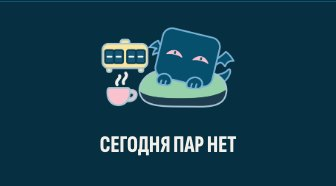
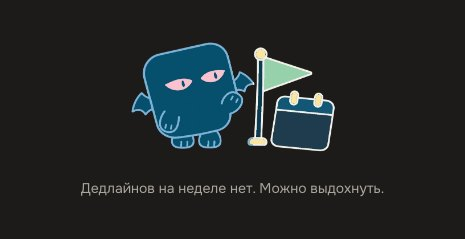

# Уменьшены иллюстрации и увеличены отступы в пустых состояниях

- **Дата и время:** 2026-11-21 01:26 МСК
- **Инструмент:** Codex (Алёна)
- **Кто ставил задачу:** Алёна
- **Этап плана:** 2 Дизайн, 6 Проверка
- **Требования PRD:** NF1

## Задача

«Сделай картинки чуть меньше, что-то среднее между этим вариантом и предыдущим, а отступы больше».

## Что сделал ИИ

Изменил общий стиль четырёх пустых состояний. Ширина сцен выходного дня и дедлайнов на телефоне 360 px уменьшилась со 194 до 137 px, на десктопе 1440 px — с 320 до 208 px. Расстояние от рисунка до подписи составляет 20–24 px, верхнее и нижнее поля — 24–40 px. В браузере проверены четыре сцены на двух размерах экрана в обеих темах.

## Что проверил и поправил человек

Алёна сравнила две предыдущие версии и прислала снимки главной страницы и дедлайнов. Новую версию предстоит посмотреть.

## Ошибки ИИ

После предыдущего увеличения иллюстрации доминировали над содержимым карточки. Подобран промежуточный масштаб и увеличено пространство вокруг сцены.

## Скриншоты

