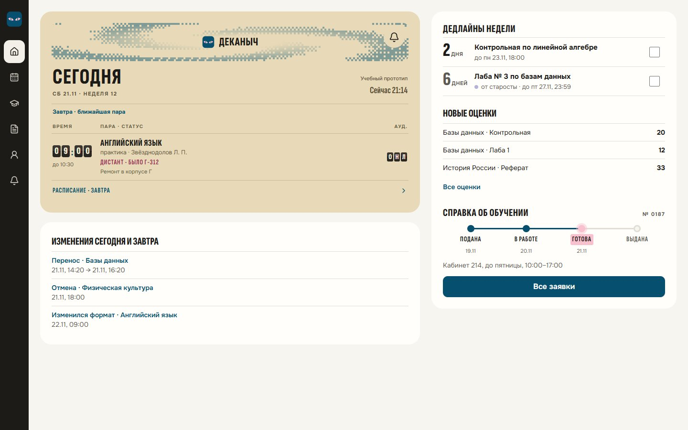
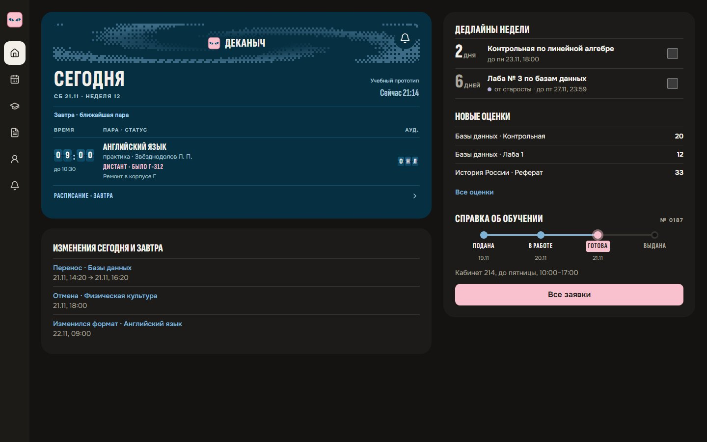
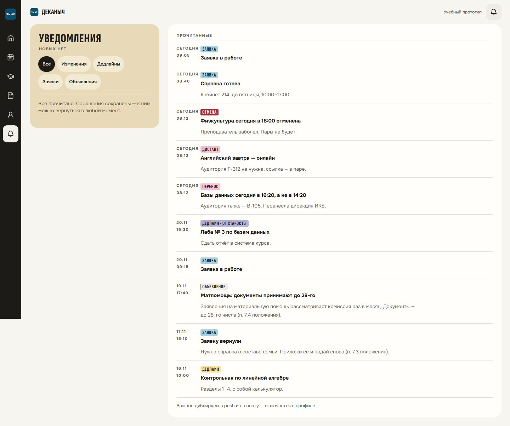
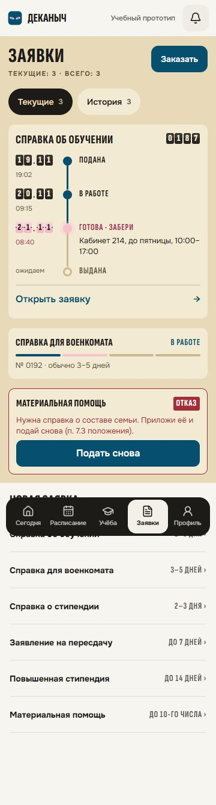
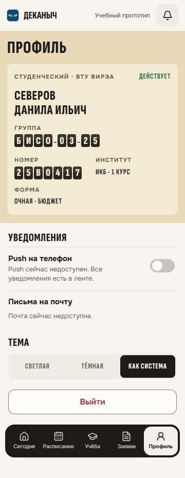

# Доработка кабинета на телефоне и десктопе

- **Дата и время:** 2026-11-21 21:12 МСК
- **Инструмент:** Codex (напарник)
- **Кто ставил задачу:** напарник
- **Этап плана:** 6 Проверка
- **Требования PRD:** T1, N1, A4, P1, NF1, NF2, NF4, NF5, X1

## Задача

> «Посмотри, убери лишнее и добавь нужное… можно посмотреть всё и улучшить настолько, насколько это возможно».
> Дополнение: «Нужно убрать надпись концепт для хакатона и далее».

## Что сделал ИИ

- Взял актуальную адаптацию `main` (`e9b910a`), прочитал решения об анимациях и сохранил спираль, цвета и раскрытие бокового меню.
- Сократил шапку «Сегодня», сделал текущее время второстепенным. День ближайшей пары показан явно; поиск охватывает восемь дней, включая текущий. Когда заявок нет, появился переход к заказу справки.
- В заявках добавил переключение текущих и полной истории, счётчики, быстрый переход к каталогу и открытие карточки. Выданные и повторно поданные заявки доступны в истории; повторно поданную заявку можно открыть вместо создания дубля.
- Сохранил полный текст прочитанных уведомлений, сделал ссылки на конкретную пару или заявку и поправил метки восстановления и возвращения очного формата. Убрал большое пустое состояние, если прочитанные сообщения уже есть.
- Отметка о чтении перенесена из серверного рендера в действие после открытия страницы. Предзагрузка ссылки не читает сообщения. Получатели проверяются по серверной сессии, чужие ID не принимаются.
- Добавил компактную шапку с переходом к уведомлениям из каждого раздела, увеличил нижний отступ под мобильное меню, убрал принудительное растягивание панелей в высоту. Подпись на анимированном фоне отделена от рисунка для читаемости.
- По прямому указанию пользователя удалил длинное пояснение и подвал, оставил короткую метку «Учебный прототип». Обновил X1, правило 2 AGENTS.md и дизайн-систему. Это согласованное пользователем изменение прежнего требования о точном тексте плашки.
- Сохранил удаление QR-заглушки из предыдущего PR, добавил ошибку раздела с кнопкой повтора и скелетоны только для ленты и учёбы. Сообщение о недоступном push больше не обвиняет браузер, когда канал не настроен.
- Исправил подключение Node.js-воркера в `src/instrumentation.ts`: зависимости push загружаются в явной ветке Node.js. Удалил неиспользуемый демонстрационный счётчик из компонента спирали.
- Сборка с проверкой типов, ESLint и 10 модульных тестов прошли. Пройдено 23 сквозных теста, включая новые сценарии истории заявок, повторного чтения, отсутствия чтения при GET и следующей пары после свободных дней. Адаптивные тесты покрывают 320, 360, 820, 1024, 1366, 1440 и 1920 px, студента и сотрудника.
- Итоговые экраны проверены в Edge/Chromium на отдельной базе PGlite, светлая и тёмная темы сняты в JPEG. База локального приложения пользователя при проверках не сбрасывалась. Схема БД не менялась.

## Что проверил и поправил человек

Пользователь попросил убрать длинное пояснение и продолжить общую доработку. Визуальное ревью окончательного результата человеком предстоит. Владелец экранов и дизайн-системы — Алёна.

## Ошибки ИИ

- Общий `loading.tsx` включил потоковый ответ до проверки чужого объекта → тесты получили HTTP 200 вместо 404 и сбои переходов → загрузка оставлена только в ленте и учёбе, все проверки доступа и действий повторены → не добавлять общую потоковую границу перед проверкой владельца.
- Первое широкое текстовое изменение поставило пустую карточку заявок рядом с кнопкой маршрута → замечено при просмотре diff → ветка перенесена к правильному условию наличия заявки → использовать достаточный контекст в патчах.
- Дополнительное место выдачи продублировало текст уже существующего маршрута → замечено на мобильном снимке → повтор удалён → проверять состав вложенного компонента до добавления подписи.
- Во время разработки обнаружена ошибка сборки Edge-инструментации с Node-зависимостью `crypto` → импорт перенесён внутрь явного условия Node.js → серверные зависимости должны отсеиваться при сборке других сред.

## Скриншоты

