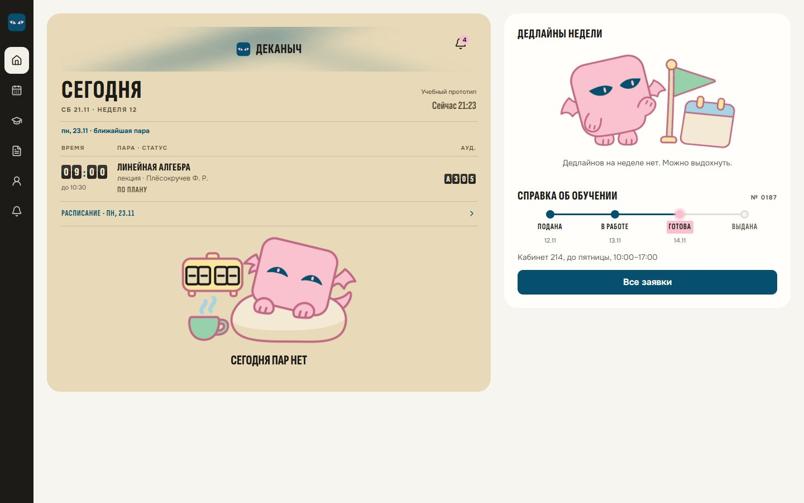
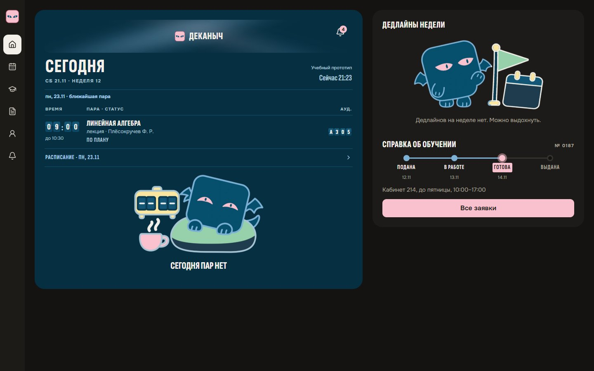
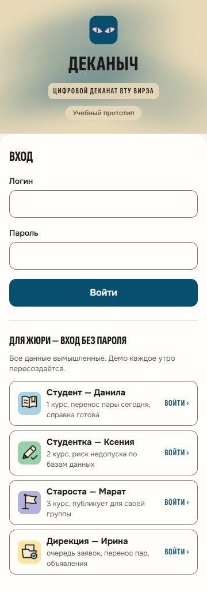
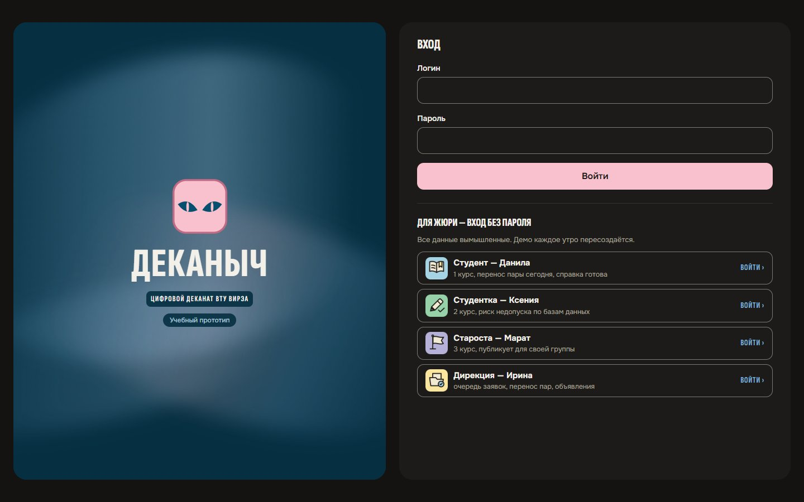

# Мягкое сияние вместо пиксельной спирали

- **Дата и время:** 2026-11-21 21:24 МСК
- **Инструмент:** Codex (напарник)
- **Кто ставил задачу:** напарник
- **Этап плана:** 6 Проверка
- **Требования PRD:** NF1, NF5, X1

## Задача

> «Давай изменим дизайн фона, оставим цвет и логотип».
> «Пиксельную форму убрать, но оставить что-то типа северного сияния».

## Что сделал ИИ

- На входе и над главной заменил пиксельный canvas мягкими размытыми лентами CSS. Используются существующие цветовые токены; логотип и основной цвет табло сохранены.
- Ленты движутся медленно, за 22–32 секунды. Кнопка паузы доступна с клавиатуры, при уменьшении движения фон статичен и кнопка скрыта.
- Удалил неиспользуемые компоненты спирали и шейдера, адаптировал существующий тест паузы и уменьшения движения к новому фону.
- Сборка с TypeScript и ESLint прошли. Повторно прошли 8 браузерных тестов: анимация и адаптация студента/сотрудника на 320, 360, 820, 1024, 1366, 1440 и 1920 px.
- Проверил и снял новый фон в светлой и тёмной темах. Локальное приложение обновлено; база пользователя сохранена. Изменение добавлено в PR #81, документация решений и дизайн-система обновлены.
- Предыдущая версия PR #81 до изменения фона прошла полный GitHub Actions: сборка, линтер, типы, модульные и браузерные тесты. Проверки нового коммита запускаются после публикации.

## Что проверил и поправил человек

Пользователь выбрал направление «северное сияние» и попросил убрать пиксели. Визуальное ревью реализации предстоит; владелец дизайна — Алёна.

## Ошибки ИИ

Не было. Для снимков тёмной главной тема переключена только в DOM браузера: сохранённые настройки пользователя в базе не менялись.

## Скриншоты

