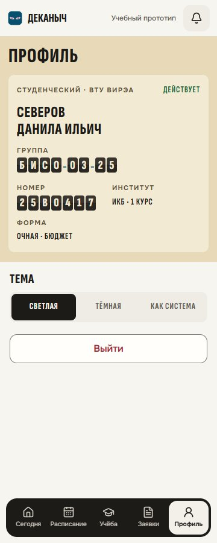
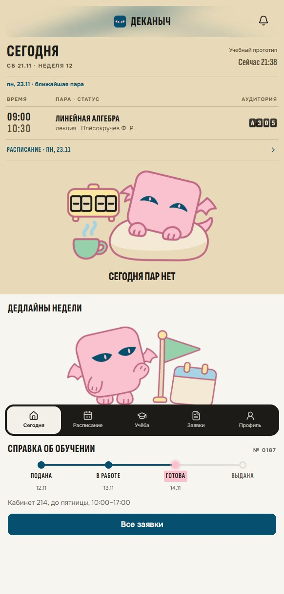
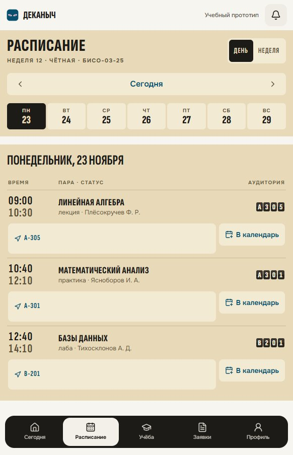
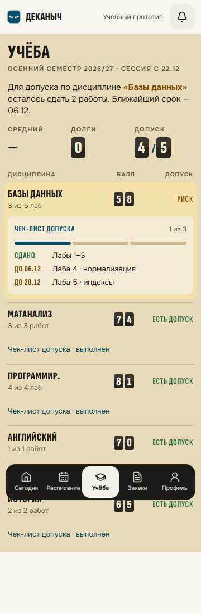
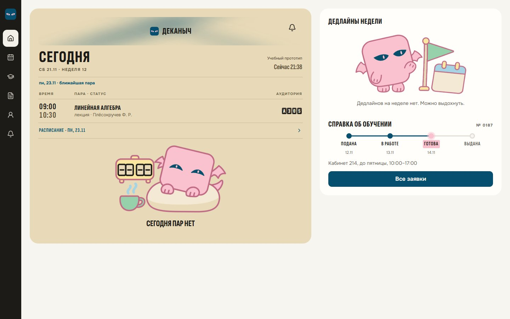

# Удаление недоступных элементов и девять исправлений интерфейса

- **Дата и время:** 2026-11-21 21:38 МСК
- **Инструмент:** Codex (напарник)
- **Кто ставил задачу:** напарник
- **Этап плана:** 6 Проверка
- **Требования PRD:** P3, N1, N3, R4, G2, NF1, NF4, NF5, NF8

## Задача

> «Все функции, которые сейчас недоступны, удали».
> Убрать кнопку запуска фона; исправить девять комментариев в браузере: время, статусы, подписи и интерактивный дизайн.

## Что сделал ИИ

- Настройки почты отсутствуют без серверной конфигурации; push не показывается без ключей, поддержки или разрешения браузера. Удалены заглушки «недоступно», пустой общий заголовок и обещание дублировать ленту в отключённые каналы. Настроенные рабочие каналы сохранены.
- Удалены демонстрационная ссылка встречи из сидов и неиспользуемый компонент ComingSoon. Старые демонстрационные URL из существующей базы также не становятся кнопками; обычная HTTPS-ссылка сохраняется. База пользователя не очищалась.
- Удалены кнопки запуска/паузы и автоматическое движение фона. По следующему уточнению пользователя сияние мягко реагирует на курсор и касание. При уменьшении движения смещения отключены. Логотип и палитра сохранены.
- Время начала и окончания пары отрисовано одинаковым шрифтом и размером без плиток и мелкой подписи. Нормальный статус «По плану» не показывается, важные изменения сохранены. «Аудитория» написана полностью, слово «Где» у кода аудитории удалено.
- В учёбе статусы — «Есть допуск» и «Нет допуска». Пояснение о баллах и подпись под календарём удалены, рабочий экспорт пары сохранён. После удаления пояснения не остаётся пустой панели истории.
- Уточнены PRD, дизайн-система и журнал решений. Изменения подготовлены для PR #81, владелец дизайна — Алёна.
- Прошли сборка с проверкой типов, ESLint, 12 модульных и 25 браузерных тестов. Проверены заявки, 404 для чужого пользователя, доступная лента без внешних каналов, удаление старой демо-ссылки, экспорт календаря, реакция фона и уменьшение движения. Адаптация — 320–1920 px; дополнительно снят вид на 582 px по комментариям пользователя.
- Отдельный стенд со случайными тестовыми ключами подтвердил: настроенная почта и поддерживаемый push доступны, запрещённый push скрыт. Реальные письма и push не отправлялись.

## Что проверил и поправил человек

Пользователь отметил девять элементов в браузере и выбрал реакцию фона на взаимодействие. Окончательное визуальное ревью предстоит.

## Ошибки ИИ

- Вспомогательный проверочный скрипт импортировал web-push как default → Node.js остановил скрипт до запуска стенда → заменён на namespace-импорт, проверка прошла → учитывать фактические экспорты установленного пакета.
- Снимок учёбы был сделан до завершения потоковой загрузки и показывал скелетон → замечено при просмотре JPEG → добавлено ожидание заголовка страницы, снимок переснят → снимки делаем после появления содержимого, а не только HTTP 200.

## Скриншоты

