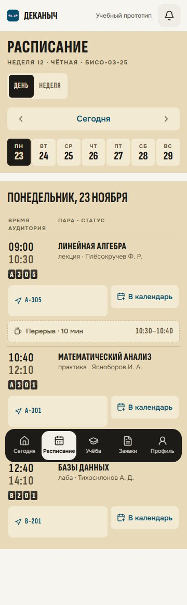
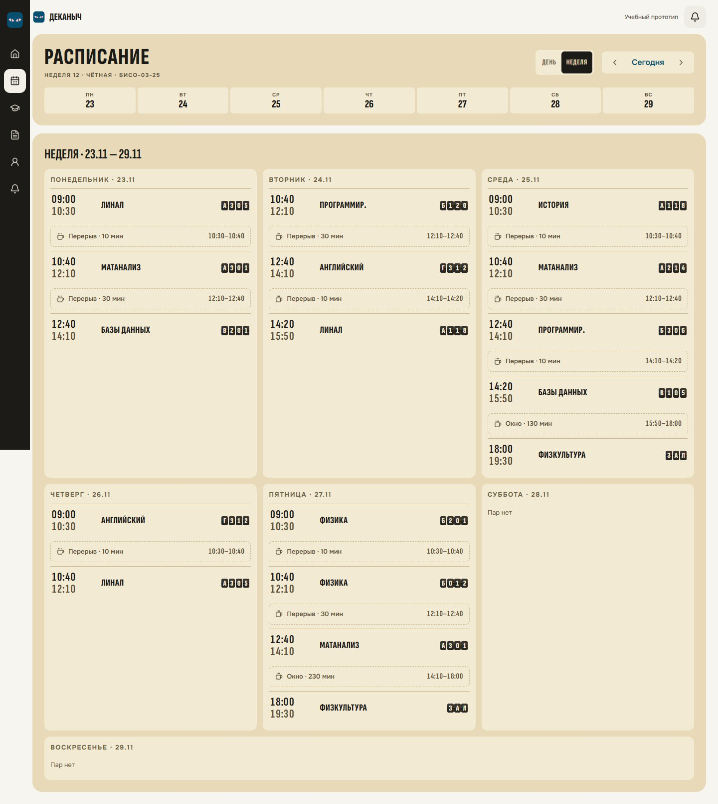
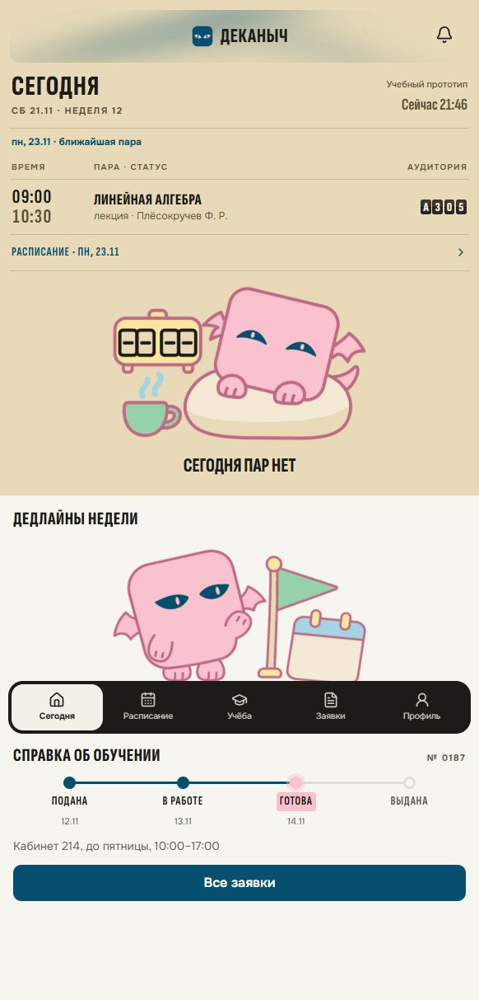

# Движение сияния и перерывы между парами

- **Дата и время:** 2026-11-21 21:46 МСК
- **Инструмент:** Codex (напарник)
- **Кто ставил задачу:** напарник
- **Этап плана:** 6 Проверка
- **Требования PRD:** R1, R2, NF1, NF3

## Задача

> «Хочу, чтобы северное сияние двигалось».
> «Сделать вставки между парами с перерывами, чередуя перерыв в 10 и 30 минут».

## Что сделал ИИ

- Добавил плавное постоянное CSS-движение лент с разными циклами 12/16/20 секунд на главной и входе. Сохранены палитра, логотип и реакция на курсор/касание. Кнопка запуска не возвращена; при уменьшении движения фон статичен.
- В дневной и недельный виды добавил компактные вставки «Перерыв · 10 мин» и «Перерыв · 30 мин» с интервалами времени, без интерактивных элементов.
- Вставки вычисляются по действительным датам пар, а не по индексу строки. Отменённые пары пропускаются, перекрывающиеся интервалы не создают ложный перерыв; от часа свободного времени подпись «Окно». Перед первой и после последней пары вставок нет. Чередование 10/30 соответствует уже существующим демо-звонкам.
- Обновил R2, дизайн-систему, решения и статус. Изменения в PR #81; владелец дизайна — Алёна.
- Сборка с TypeScript и ESLint прошли. Все 15 модульных тестов прошли, в том числе отмены, переносы, пересечения и последовательность 10/30/10/30/10.
- После изменения прошли 10 браузерных тестов: автоматическое движение и реакция фона, уменьшение движения, перерывы дня/недели, свайпы и адаптация на 320–1920 px.
- Итоговые вставки проверены глазами на телефоне и в недельном виде. Локальное приложение обновлено без сброса базы пользователя.

## Что проверил и поправил человек

Пользователь уточнил, что движение должно быть автоматическим, и попросил вставки перерывов. Визуальное ревью результата предстоит.

## Ошибки ИИ

Не было.

## Скриншоты

