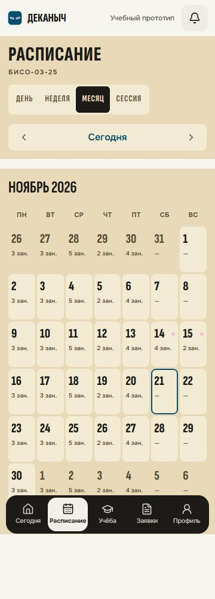
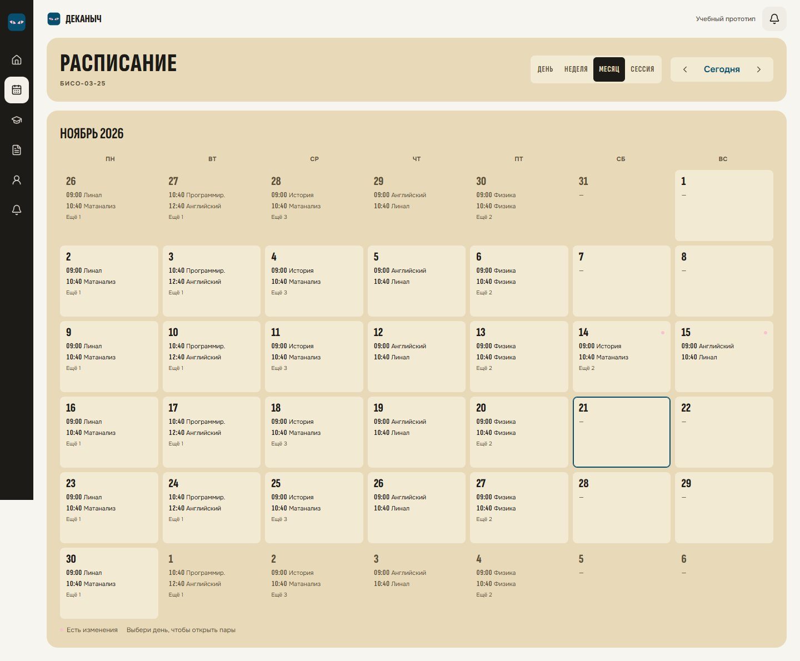
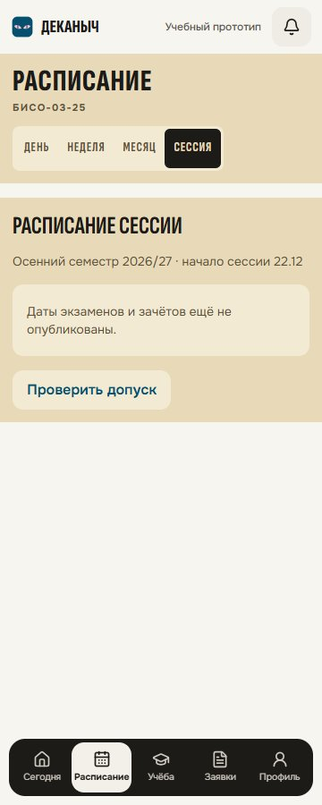
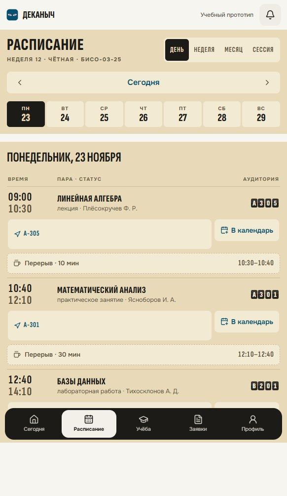

# Месячный календарь, расписание сессии и полные названия занятий

- **Дата и время:** 2026-11-21 22:00 МСК
- **Инструмент:** Codex (напарник)
- **Кто ставил задачу:** напарник
- **Этап плана:** 6 Проверка
- **Требования PRD:** R1, R2, NF1, NF3, NF5, NF8

## Задача

> «Практическое занятие», «лабораторная работа» вместо сокращений.
> «Добавить интерактивный календарь с расписанием на месяц».
> «И добавь раздел с расписанием сессии».

## Что сделал ИИ

- Типы занятий в полной карточке и экспорте расписания — «лекция», «практическое занятие», «лабораторная работа».
- Добавил четыре вида: день, неделя, месяц, сессия. Месяц начинается с понедельника и охватывает крайние недели целиком; дни соседнего месяца приглушены. Сегодня выделено, изменения помечены точкой и доступной подписью.
- На телефоне показаны числа занятий, на компьютере — первые две пары со временем. Можно листать месяцы, вернуться к текущему и открыть день нажатием или Enter. Данные относятся только к группе из серверной сессии.
- «Сессия» читает экзамены и зачёты текущего семестра из существующей Assessment, даты — из heldOn. Известное начало сессии берётся из AcademicTerm; есть переход к допуску. Схема и миграции не менялись.
- Даты будущих экзаменов в текущих данных отсутствуют. Показано честное пустое состояние; даты, время и аудитории не выдумывались. Нужно уточнить у команды даты экзаменов и зачётов для наполнения.
- Обновил PRD, дизайн-систему, решения и статус. Изменения подготовлены в PR #81, владелец дизайна — Алёна.
- Прошли production-сборка с TypeScript, ESLint, 18 модульных и все 29 браузерных тестов. Проверены високосный февраль, переход года, месячная навигация, вход в день с клавиатуры, полные названия, изоляция сессии между группами, заявки и ответы 404.
- Адаптивные тесты теперь открывают месяц и сессию на 320–1920 px. Сняты и просмотрены итоговые JPEG на 360, 582 и 1440 px; горизонтальной прокрутки нет.
- Локальное приложение обновлено. База пользователя сохранена; записи экзаменов создавались и удалялись только внутри отдельного тестового стенда.

## Что проверил и поправил человек

Пользователь указал два текста в браузере и попросил месячный календарь и сессию. Окончательное визуальное ревью предстоит. Даты будущих экзаменов нужно предоставить отдельно.

## Ошибки ИИ

- Локальный сервер был запущен до окончания финальной трассировки сборки → standalone-файл ещё отсутствовал, запуск завершился ошибкой → дождался завершения build с кодом 0 и повторил запуск, страницы проверены в браузере → запускать standalone только после полного завершения сборки.

## Скриншоты

