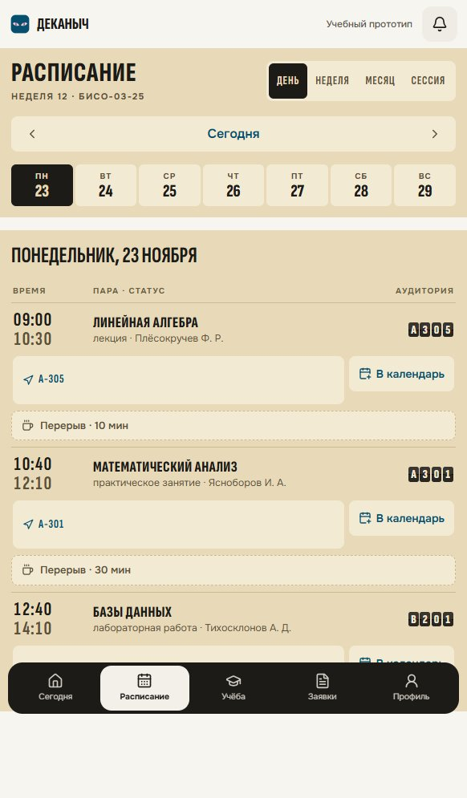
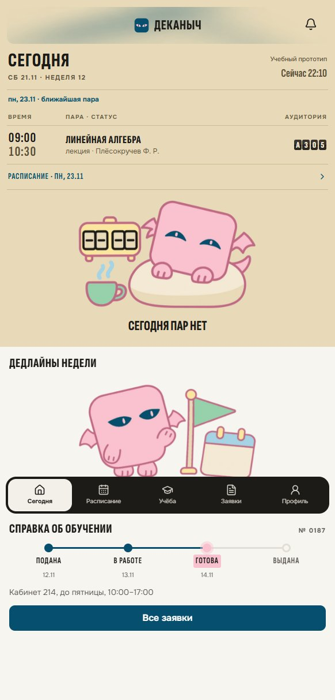

# Упрощённые подписи расписания и живые микроанимации

- **Дата и время:** 2026-11-21 22:11 МСК
- **Инструмент:** Codex (напарник)
- **Кто ставил задачу:** напарник
- **Этап плана:** 6 Проверка
- **Требования PRD:** R1, R2, NF1, NF3, NF8

## Задача

> Убрать время начала и конца перерыва, чётность и нечётность недели.
> «Хочу ещё какие-нибудь живые анимации».

## Что сделал ИИ

- В дне и неделе оставил у перерывов только длительность, удалил границы времени и неиспользуемый импорт. В шапке — номер недели и группа, без чётности.
- Добавил появление основных карточек за 320 мс, лёгкое покачивание иллюстраций пустых состояний с циклом 7 секунд и паузой при наведении. Иконки кнопок и ссылок откликаются на наведение, при нажатии меняется оттенок.
- Области нажатия не уменьшаются; все новые эффекты включаются только при обычной настройке движения и выключаются при prefers-reduced-motion: reduce. Постоянное сияние сохранено.
- Сборка с TypeScript и ESLint прошли. После изменения прошли 14 браузерных тестов: адаптация на 320–1920 px, день/неделя, месяц, сессия своей группы, свайпы, боковое меню и клавиатура, сияние и уменьшение движения.
- Отдельно проверил в браузере реальное изменение положения иллюстрации, паузу на наведении и отключение движения в системном режиме reduce. Проверил чистые подписи на локальном приложении, снял JPEG.
- Обновил дизайн-систему, журнал решений и статус; изменения включены в PR #81. Локальная база пользователя сохранена, визуальное ревью — Алёна.

## Что проверил и поправил человек

Пользователь отметил две подписи в браузере и попросил дополнительные анимации. Окончательное визуальное ревью предстоит.

## Ошибки ИИ

- Проверочный скрипт пытался навести курсор на постоянно движущуюся иллюстрацию, а Playwright ждал неподвижности → тайм-аут автоматического наведения → наведение направлено на её неподвижный контейнер, проверка прошла → декоративную анимацию проверять через неподвижную область взаимодействия.

## Скриншоты

