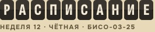
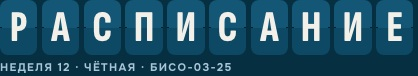

# Заголовок расписания на перекидных карточках

- **Дата и время:** 2026-11-21 22:14 МСК
- **Инструмент:** Codex (Алёна)
- **Кто ставил задачу:** Алёна
- **Этап плана:** 2 Дизайн, 6 Проверка
- **Требования PRD:** R1, NF1

## Задача

Оформить слово «Расписание» на показанном экране теми же перекидными карточками, что время и аудитории.

## Что сделал ИИ

Использовал общий компонент табло. Десять букв раскрываются последовательно один раз при появлении заголовка; при настройке уменьшенного движения слово сразу целиком видно. Заголовок имеет одно доступное имя «Расписание». Сборка прошла. В Chromium и WebKit проверены 20 сочетаний ширины окна, темы и режима просмотра, включая 320 px и уменьшенное движение.

## Что проверил и поправил человек

Алёна указала заголовок на снимке. Просмотр новой версии предстоит.

## Ошибки ИИ

Не было.

## Скриншоты

