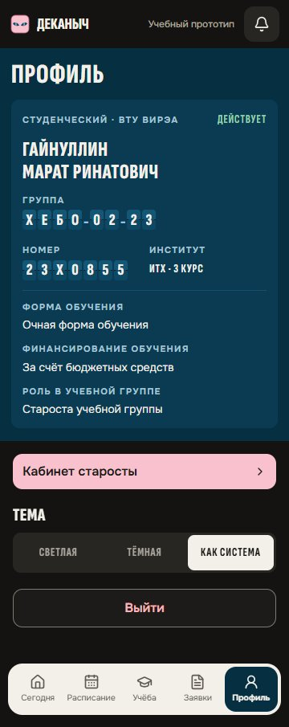
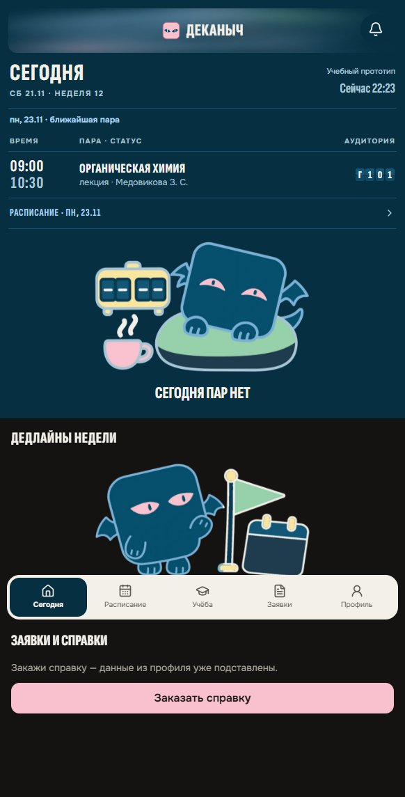
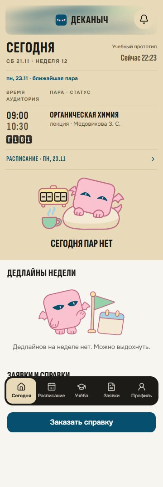

# Официальные поля профиля, цвет навигации и живые волны в шапке

- **Дата и время:** 2026-11-21 22:24 МСК
- **Инструмент:** Codex (напарник)
- **Кто ставил задачу:** напарник
- **Этап плана:** 6 Проверка
- **Требования PRD:** P1, NF1, NF3, NF8

## Задача

> Разделить строку «очная · бюджет · староста» и написать официальнее.
> Изменить цвет активного пункта «Сегодня», чтобы вписывался в интерфейс.
> Добавить живую анимацию в шапке с логотипом.

## Что сделал ИИ

- В студенческом билете отдельные поля списка описаний: «Форма обучения», «Финансирование обучения», для старосты — «Роль в учебной группе». Значения написаны полностью и переносятся по словам.
- Формы сопоставлены со всеми значениями enum: очная, очно-заочная, заочная. Ранее очно-заочная форма ошибочно отображалась как заочная; сопоставление исправлено.
- Активный пункт нижнего меню использует board/board-text: песочный в светлой теме, синий в тёмной. Размеры области нажатия сохранены. Контраст текста по фактическим цветам браузера — 12,40:1 и 12,37:1 соответственно.
- В шапке главной и на входе добавлены более заметные световые волны с циклами 6 и 8 секунд. Палитра и логотип сохранены, в центре свечение ослаблено для читаемости. Сохраняются автоматическое движение, реакция на курсор и касание, отключение движения по системной настройке.
- Сборка с TypeScript и ESLint прошли. После изменений прошли 9 браузерных тестов: движение новых волн, уменьшение движения, клавиатура и навигация, адаптация студента и сотрудника на 320–1920 px.
- Отдельно проверены поля профиля старосты, цвета активного пункта и движение волн на главной в обеих темах. Сняты и просмотрены JPEG на 360 и 582 px, горизонтальной прокрутки нет.
- Обновлены дизайн-система, решения и статус. Локальное приложение обновлено, база пользователя сохранена. Изменения в PR #81; владелец визуального ревью — Алёна.

## Что проверил и поправил человек

Пользователь отметил три элемента в браузере. Окончательное визуальное ревью реализации предстоит.

## Ошибки ИИ

- Первый патч дважды объявлял изменение globals.css → инструмент отклонил патч целиком → все изменения этого файла объединены в одну операцию → использовать один заголовок Update File на файл в патче.
- Проверка контраста считала промежуточные цвета во время перехода темы → временное значение оказалось ниже порога → добавлено ожидание окончательных цветов, итоговый контраст выше 12:1 → сравнивать утверждённые цвета после завершения перехода.

## Скриншоты

